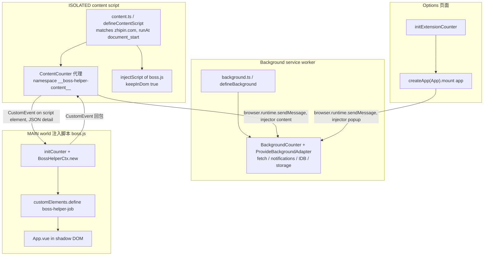
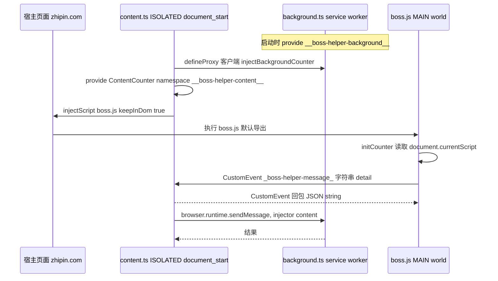

# 扩展运行时与构建目标

BossHelper 是一个 WXT 单扩展项目，但同一个"页面"在不同 JavaScript 世界里被拆成四段互不共享内存的执行环境。理解这四个世界各自**能访问什么、不能访问什么**，是修改任意入口文件之前的前提。本页描述 WXT 的入口装配、四个运行时世界的职责边界与握手顺序，以及 `wxt.config.ts` 如何为 chrome / edge / firefox 生成不同的 MV3 产物。

## 四个运行时世界

| 世界 | 入口文件 | 声明方式 | 能访问的 API |
| --- | --- | --- | --- |
| Background service worker | `src/entrypoints/background.ts` | `defineBackground` | 全部 `browser.*` 扩展 API、跨域 `fetch`、`notifications`、`storage`、IDB |
| 页面内 ISOLATED content script | `src/entrypoints/content.ts` | `defineContentScript({ world: 'ISOLATED', runAt: 'document_start' })` | 扩展 API（`browser.runtime.sendMessage`、`storage`）；共享 DOM，但与页面脚本隔离的 JS 堆 |
| MAIN world 注入脚本（页面脚本） | `src/entrypoints/boss/index.ts` | `defineUnlistedScript` | 页面 `window`（`_PAGE`、`Cookie`、宿主 Vue 根实例）；**没有**任何 `browser.*` |
| Options 页面 | `src/entrypoints/options/main.ts` + `index.html` | HTML entrypoint（`index.html` + `<script type="module" src="./main.ts">`） | 扩展页面上下文中的全部 `browser.*`，以及完整 Vue UI（无 shadow DOM） |

四个入口都通过 `#imports`（WXT 生成的虚拟模块）取得各自的世界级 API，例如 `defineBackground`/`defineContentScript`/`defineUnlistedScript`/`injectScript`，`background.ts` 与 `message/background.ts` 还从同一模块取 `browser`。因此入口文件不应绕开 WXT 抽象直接依赖某一浏览器的全局；`browser.*` 的调用都收敛在 `src/message/` 的适配器类里（`InjectBackgroundAdapter` 明确用 `browser.runtime.sendMessage` / `browser.runtime.onMessage`）。注意 `wxt.config.ts` 里 `// imports: false` 是被注释掉的——WXT 自动导入保持开启，`#imports` 不可省。

图中的每个 subgraph 是一个独立的 JavaScript 世界；跨越 subgraph 的箭头都是跨世界通信，且都必须经过序列化。

## 加载顺序：content script 搭桥，再注入 MAIN world 脚本

`content.ts` 在 `document_start` 就启动（早于页面自身脚本执行），并按固定顺序装配：

1. 先 `import './boss/inject.css'`——content script 的 CSS 由 WXT 注入宿主文档，与下面的 JS 装配无关。
2. 用 `defineProxy(() => ({}) as BackgroundCounter, { namespace: '__boss-helper-background__' })` 得到指向 background 的 RPC 客户端 `injectBackgroundCounter`。
3. 用 `defineProxy(() => new ContentCounter(injectBackgroundCounter(new InjectBackgroundAdapter())), { namespace: '__boss-helper-content__', heartbeatTimeout: 3000 })` 构造并 **provide** 出 `ContentCounter`，得到 `provideContentCounter`。
4. `await injectScript('/boss.js', { keepInDom: true, modifyScript })`：WXT 把 `boss.js` 作为 `<script>` 插入文档，`modifyScript` 回调里拿到的正是那个 `<script>` 元素，于是 `provideContentCounter(new ProvideContentScriptAdapter(script))` 把服务端绑定到该元素上。

也就是说 `boss.js` **在被插入 DOM 的那一刻**才获得一个可通信的 peer。页面脚本侧调用 `initCounter()`，用 `document.currentScript`（默认参数）作为传输载体注入 `__boss-helper-content__` 代理；此后业务代码里所有 `counter.*` 调用（配置、账号、模型、日志、图片）都是"MAIN world → ISOLATED → background"的两跳代理。

这套结构决定了页面脚本**不能**直接调用 `browser.*`：

- MAIN world 的脚本运行在页面自己的 JS 堆里，Manifest V3 下扩展 API 只暴露给扩展上下文，这个堆里根本不存在。
- ISOLATED 与 MAIN 只共享 DOM，不共享 JS 对象，所以消息必须走 DOM 事件：`ProvideContentScriptAdapter.sendMessage` 用 `script.dispatchEvent(new CustomEvent('_boss-helper-message_', { detail: JSON.stringify(message) }))` 发送，`onMessage` 端再 `JSON.parse` 回来。序列化不是可选项，而是唯一可用的传输形式——**任何跨世界消息字段都必须可 JSON 序列化**。
- `contentScriptShare.ts` 里还留着一个**已导出但无调用点**的 `ProvideContentAdapter`（挂在 `document` 上、HTML5 之前用 `cloneInto(message, document.defaultView)` 做 Firefox 兼容的路径），以及一整段被注释掉的旧版 `ProvideContentScriptAdapter`。实际生效的只有 script 元素 + JSON 字符串这一条路径。改动时不要误以为旧路径仍在生效。

由此产生的运维约束：一旦 `keepInDom` 被关掉、或 `<script>` 从 DOM 移除，页面脚本的 `counter` 整体失联，而 `counter` 的 Proxy 在未初始化时会直接抛 `Counter has not been initialized...`（`src/message/index.ts`）。

## 页面脚本：hook 宿主应用并挂载自身

`boss/index.ts` 的默认导出是 `defineUnlistedScript(async () => { ... })`——一个 **unlisted script**：不出现在扩展 UI 上，只登记在 `wxt.config.ts` 的 `web_accessible_resources` 中作为 `boss.js`，`matches` 与 content script 共用 zhipin 域名，因此可以被 `injectScript` 通过 `runtime.getURL` 注入页面。启动流程：

1. `initCounter()` 建立与 ISOLATED 世界的连接。
2. `await BossHelperCtx.new()`：`new` 内部 `ctx.rootVue = await getRootVue()`（`useVue.ts` 轮询 `#wrap.__vue__`，间隔 300ms，最多 20 秒，超时抛"未找到vue根组件"），再 `ctx.workflow = await bossWorkflow(ctx)`。
3. 往宿主 `rootVue.$router.afterHooks` 推一个回调——每次路由切换都 `void bossHelpCtx.onMount(to.path)`，因此面板是**随路由重建**的。
4. `await run(bossHelpCtx)` 注册 web component 并执行首轮挂载。

`onMount(path?)` 的幂等/重建逻辑值得注意：缺省 `path` 时取 `rootVue.$route.path`；先用 `elmGetter.get('boss-helper-job', 3000)` 探测面板是否已存在（探测抛错被吞掉），存在就直接返回；否则若 `BossHelperCtx.instance` 存在先 `remove()` 并置空，用 `elmGetter.get('.job-search-wrapper,.job-recommend-main,.page-jobs .page-jobs-main')` 找到挂载点，`insertBefore` 插入新的 `<boss-helper-job>`，再依次 `_initPage` → `_initPageChange` → `_initJobDetail` → `_initClickJobCardAction` → `_initJobList`，最后 `initNetConf()`、按 `appearanceConf` 监听调整 `.recommend-result-inner` 的左右边距、构造 `GeekChatClientManager` 并 `await this.geek.connect()`。因为面板寄居在宿主页面 DOM 中，`onMount` 还顺手 `removeAd()` 清掉广告位与侧栏。

宿主数据是通过 `useHookVueData` / `useHookVueFn` 打补丁读取的：抓取初值（`pageVo`、`hasMore`、`jobDetail`、`jobList`），并在宿主组件的 `pageChangeAction` / `searchJobAction` / `onSearch` / `clickJobCardAction` 上挂钩子，从而在宿主翻页/搜索/点击卡片时同步刷新本地 ref。这条路径依赖 `window._PAGE` 等页面全局（类型见 `src/env.d.ts` 的 `Window` 扩展，同文件还声明了 `__APP_VERSION__` 常量），也是页面脚本必须运行在 MAIN world 的**唯一原因**：只有那里才能看到宿主 Vue 实例与 `_PAGE`。

## 共享挂载点：run() 与 shadow DOM

`src/index.ts` 导出唯一的 UI 引导函数 `run(ctx)`，被 `boss/index.ts` 以 `await run(bossHelpCtx)` 调用：

- `customElements.define('boss-helper-job', ...)` 注册自定义元素；`connectedCallback` 里 `attachShadow({ mode: 'open' })`，调用 `ctx.setShadowRoot(shadow)` 让 `HelperContext` 持有影子根，再把 `@/assets/main.css?inline` 作为 `<style>` 塞入 shadow、创建 `#app-root` 容器，用 `createApp(App)` + `app.use(ui)` + `app.provide(HelperKey, ctx)` 挂载，实例存回 `root._vueApp`。
- `disconnectedCallback` 会 `app.unmount()` 并清空 `_vueApp`，这是"完美卸载的关键"，避免路由切换后残留 Vue 实例。
- 注册完成后执行 `await ctx.onMount()`。

shadow DOM 是宿主样式与插件样式互不污染的边界；代价是 **Tailwind 必须能进 shadow**，这正是 `wxt.config.ts` 里 `tailwindShadowDOM()` 插件存在的原因。同时，需要改动宿主页面样式的部分只能走另一条路：`src/entrypoints/boss/inject.css` 被 `content.ts` 以普通 `import './boss/inject.css'` 引入，作为 content-script CSS 注入宿主文档（例如 `#boss-helper-external-wrapper` 内的筛选器配色、暗色模式下 `#header.header-v2` 的背景）。而 `src/components/Tabs/ConfigItem/Appearance.vue` 则通过 `document.querySelector('boss-helper-job')?.shadowRoot` 与 `ctx.shadowRoot` 反向定位 shadow 内部节点（`div.boss-chat-box`、`#app-root`）。改动 shadow 内部结构时，这些 `querySelector` 是隐藏的耦合点。

## Options 页面：同一套组合式函数，不同的引导

`options/main.ts` 是一个不经过 `run()` 的独立 Vite 页面入口：

1. `matchMedia('(prefers-color-scheme: dark)')` 设定 `<html>` 的 `dark`/`light` 类与 `colorScheme`，并监听系统主题变化（options 页不走 shadow DOM，所以主题直接落在 `document.documentElement`）。
2. `initExtensionCounter()`——注意这里不是 `initCounter()`：options 页没有 ISOLATED 中间人，直接用 `new InjectBackgroundAdapter('popup')` 把 `BackgroundCounter` 代理成 `ContentCounter` 实例，`meta.injector` 因此为 `popup`（content 侧默认为 `content`，background 的 `ProvideBackgroundAdapter` 按该字段决定用 `tabs.sendMessage` 还是 `runtime.sendMessage` 回包）。
3. 动态 `import('./App.vue')` 后 `createApp(App).use(ui).mount('#app')`；失败时把错误文本写进 `#app`（"设置页面启动失败：..."），避免白屏无提示。

`App.vue` 在 options 世界构造一个**替身** `HelperContext` 并 `provide(HelperKey, context)`，因为配置组件都通过 `useHelper()` 注入上下文，但 options 里既没有网站会话也没有岗位数据。`index.html` 用 `<meta name="manifest.open_in_tab" content="true">`（以及 `manifest.browser_style=false`）让设置页在标签页里打开，并直接 `<link rel="stylesheet" href="@/assets/main.css">`（无 shadow DOM，无需 inline 化）。页面内部的组件结构见 [Options 页面与内嵌面板](../operations/options-page.md)。

## 构建目标与 manifest

`wxt.config.ts` 的职责可归为四块：

- **目录与产物**：`srcDir: 'src'`、`outDirTemplate: '{{browser}}-mv{{manifestVersion}}'`，所以每个浏览器各自产出到 `.output/<browser>-mv3`；`modules: ['@wxt-dev/module-vue']` 提供 Vue 支持。`tsconfig.json` 继承 `./.wxt/tsconfig.json`（WXT 生成）并补上 `@`/`~` 到 `./src`、`@@`/`~~` 到仓库根、`#build/ui` 到 `node_modules/.nuxt-ui/ui`、`devlog-ui` 到 `./packages/devlog-ui/src` 的路径映射。
- **每浏览器的扩展身份**：`extKey(browser)` 决定 manifest 差异。`keys` 表里 `chrome` 是公钥 base64、`firefox` 是 UUID 形式的 `{1b66669d-...}`、`edge` 被显式设为 `undefined`（其原本的 key 以注释形式保留）。规则是：`browser` 不在 `keys` 中或值为空 → 返回 `{}`；`firefox` → 返回 `browser_specific_settings.gecko`（`id` 取该 UUID，`strict_min_version: '109.0'`）；其余 → 返回 `{ key }` 平铺进 manifest。**结果是 chrome 与 edge 的 manifest 形状不同**：edge 没有 `key`，其扩展 ID 由商店/打包决定；chrome 带固定 `key`，扩展 ID 稳定。**更换 key 会改变扩展 ID**，进而影响已安装用户的升级路径，这是该文件里最需要谨慎的一块。
- **manifest 内容**（`manifest: ({ browser }) => ({...})`）：平铺 `extKey(browser)` 的结果、`default_locale: 'zh_CN'`、`name`/`description` 引用 `__MSG_extName__`/`__MSG_extDescription__`、权限仅为 `storage` 与 `notifications`、`host_permissions` 为 `http://*/*` 与 `https://*/*`，并把 `boss.js` 登记到 `web_accessible_resources`（`matches` 与 content script 的 `matches` 共用文件顶部的同一个 `matches` 常量：`*://zhipin.com/*`、`*://*.zhipin.com/*`）。actions/options_ui 等其它键全部由 WXT 从 `src/entrypoints/` 的目录结构推导。
- **Vite/插件层**：`resolve.alias` 把 `devlog-ui` 指向 workspace 子模块 `packages/devlog-ui/src`；`define.__APP_VERSION__` 注入 `package.json` 的 `version`（由 `src/composables/useHelper/index.ts` 的 `VITE_VERSION` 消费）；`ssr.noExternal` 列出必须被预打包的 webext/nuxt 依赖；插件为 `vueJsx()`、`@nuxt/ui` 的 vite 插件（`colorMode`/`router`/`prose` 关闭，主色 teal）与 `tailwindShadowDOM()`。

`dev: {}` 为空、`webExt.disabled: true` 关闭 WXT 的自动浏览器启动，因此开发是 `wxt`（或 `wxt -b firefox --mv3`）+ 手动加载 `.output/<browser>-mv3`。`npm run build` 用 `run-p` 并行跑 `build:chrome`/`build:firefox`/`build:edge`，其中 **firefox 的 build/dev/zip 脚本一律追加 `--mv3`**——这是与 chrome/edge 脚本唯一的命令行差异，因为 `key`/`browser_specific_settings` 这套 MV3 形态才是发布目标，Firefox 目标必须显式选择 MV3；`zip:*` 脚本与 `build:*` 一一对应，CI（`.github/workflows/main.yml`）在 tag 上跑 `bun run zip` 并剔除 `*sources.zip`。完整的脚本矩阵、CI 打包与发布流程见 [构建、质量门禁与发布](../operations/build-and-release.md)。

## 新增一个页面注入脚本或自定义元素要改哪些文件

以"新增另一段需要运行在 MAIN world 的脚本"为例，最小改动路径是：

1. 在 `src/entrypoints/` 下新建入口文件（如 `src/entrypoints/xxx.ts` 或 `src/entrypoints/xxx/index.ts`），用 `defineUnlistedScript` 作为默认导出；WXT 按约定从该目录推导入口，构建产物名由文件名决定（当前 `boss/` 产出 `boss.js`）。**不需要**在 `wxt.config.ts` 里登记 entrypoint，只需要登记可访问资源（下一步）。
2. 在 `wxt.config.ts` 的 `manifest.web_accessible_resources[].resources` 里加上该产物名——否则 `injectScript` 拿到的 URL 在页面里不可加载（注入 404）。若新脚本面向的是别的站点，`matches` 数组也要扩充，但它是 content script 与 `web_accessible_resources` 共用的常量，改一处会同时放大两边的注入面。
3. 在 `src/entrypoints/content.ts` 里再次 `await injectScript('/xxx.js', { keepInDom: true, modifyScript })`；若新脚本也要走 counter，需在 `modifyScript` 里 provide 一个对应的 `defineProxy` 服务端并让它用该 `<script>` 元素作为传输载体（同一 namespace 同时被两个客户端占用会冲突，需新开 namespace 或在页面侧区分）。页面脚本侧要用 `initCounter(script)` 传入 `document.currentScript`——`src/message/index.ts` 的 `initCounter` 是模块级单例（`_counter`），一个世界只能初始化一次。
4. 若新脚本只为某个页面/路径注入，别在 `matches` 上放宽 content script，而是在页面脚本里自己判断 `location`。
5. 需要页面全局类型时在 `src/env.d.ts` 的 `Window` 接口里补声明。

要**新增一个自定义元素**（而不是新增世界）时，落点是 `src/index.ts` 的 `run()`：`customElements.define('<tag>', class extends HTMLElement { ... })`，在 `connectedCallback` 里 `attachShadow` + `setShadowRoot` + 注入 inline 样式 + `createApp(...).provide(HelperKey, ctx)`，并在 `disconnectedCallback` 里 `app.unmount()`。自定义元素必须由 MAIN world 注册（`document` 属于页面），所以注册代码不能放到 content script 里；同时 `tag` 名一旦确定，`onMount` 的存在性探测（`elmGetter.get('boss-helper-job', 3000)`）、`BossHelperCtx.instance` 的创建与移除、以及 `Appearance.vue` 里的 shadow 查询都要同步。只改 UI 而不新增世界时不需要动 `wxt.config.ts`。

## 修改入口时的检查清单

- 新增需要扩展 API 的行为 → 加在 `BackgroundCounter`（`src/message/background.ts`）并在 `ContentCounter` 上转发；不要在 `boss/` 目录里直接 `fetch` 扩展接口或用 `browser`。
- 新增跨世界消息字段 → 必须可 JSON 序列化（`ProvideContentScriptAdapter` 用 `JSON.stringify`）。
- 缩短或移除 `keepInDom` → 会切断 MAIN 与 ISOLATED 的通道。
- 改变 `boss-helper-job` 标签名或 `#app-root` id → 同时要改 `onMount` 的存在性探测、`Appearance.vue` 的 shadow 查询与 `src/index.ts` 的 `customElements.define`。
- 改 `web_accessible_resources` 的 `resources` → 必须与 `injectScript('/boss.js')` 的路径一致，否则注入 404。
- 改 `extKey` → 视为破坏性变更（chrome 的扩展 ID 变化；给 edge 加回 key 也会改变其 ID）；同时确认 firefox 的 `gecko.id` 与 `strict_min_version` 仍是预期值。
- 新增 `src/entrypoints/` 下的 HTML 页面 → 它是一个新的运行时世界（有自己的 `browser.*` 上下文），要像 options 页那样自己调用 `initExtensionCounter()` 或 `initCounter()`，否则 `counter.*` 会抛未初始化错误。

相关页面：[HelperContext 与 Boss 适配器](helper-context.md)、[消息与存储桥（counter）](messaging-and-storage-bridge.md)、[Options 页面与内嵌面板](../operations/options-page.md)、[构建、质量门禁与发布](../operations/build-and-release.md)。
