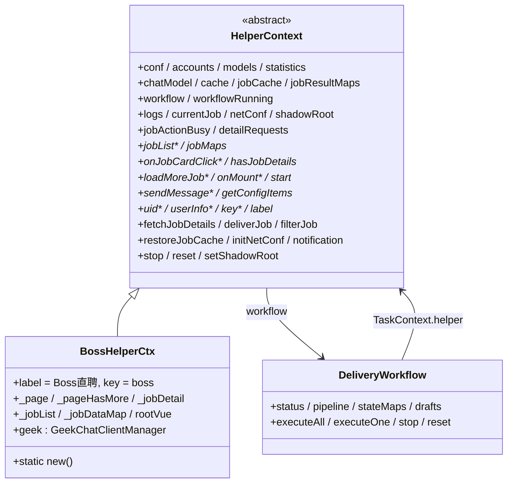
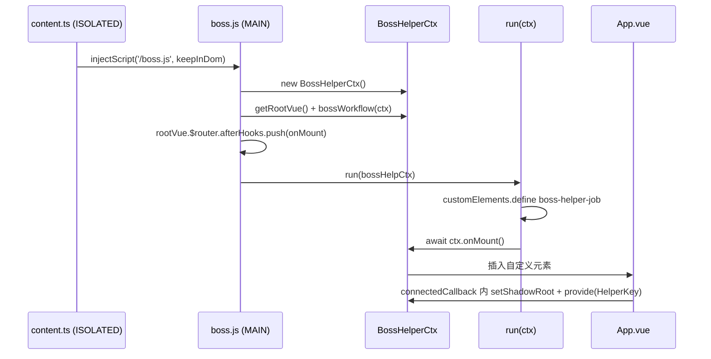
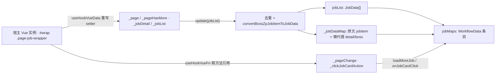

# HelperContext 与 Boss 适配器

`HelperContext` 是插件运行时唯一的"领域上下文"对象：它由 MAIN world 注入脚本实例化一次，经 Vue `provide` 注入整棵 UI 树，并作为第一个参数传给所有任务处理器（`TaskContext.helper`）。它把两类关注点绑在一起——**跨站点无关的公共能力**（配置、账号、模型、统计、缓存、日志、AI 对话、工作流、通知、远端公告）由抽象基类提供，**站点特有的能力**（岗位列表、翻页、岗位详情、消息发送、启动执行、站点身份）由子类实现。仓库里目前只有一个具体子类 `BossHelperCtx`，本页以它为例说明这套契约与实现边界。

*图：基类提供共享状态与私有工具方法（标记带星号的是子类必须实现的抽象成员），`BossHelperCtx` 用宿主页面数据填充抽象层，工作流反向持有同一个实例的泛型类型 `C`。*

## 生命周期与装配

整个上下文只在脚本启动时构建一次，之后靠"重新挂载 DOM 组件"而不是"重建上下文"来响应站内路由切换：

1. 内容脚本 `content.ts` 通过 `injectScript('/boss.js', { keepInDom: true })` 把主脚本注入页面主世界。
2. `entrypoints/boss/index.ts` 的默认导出 `initCounter()` 后调用 `BossHelperCtx.new()`：先 `new BossHelperCtx()`（触发基类构造器），再 `getRootVue()` 等宿主 Vue 根实例出现，最后 `ctx.workflow = await bossWorkflow(ctx)`。
3. 把 `onMount(to.path)` 挂到宿主 `rootVue.$router.afterHooks`，所以每次站内路由跳转都会重新尝试挂载自定义元素。
4. `run(ctx)` 定义 `boss-helper-job` 自定义元素，在 `connectedCallback` 里创建 shadow root、调用 `ctx.setShadowRoot(shadow)`、`app.provide(HelperKey, ctx)` 并挂载 `App.vue`；最后 `await ctx.onMount()` 完成首次注入。

`HelperKey`（`useHelper()` 的注入键）在整个页面生命周期里始终指向同一个 `HelperContext` 实例：账号切换、配置修改都表现为该实例上响应式状态的变化，而不是重新实例化。`useHelper()` 在未提供上下文时直接抛 `useHelper must be used within a HelperProvider`，这也是 options 设置页必须自建 stub context 的原因（见 [Options 页面](../operations/options-page.md)）。

## 基类持有的共享状态

构造器里一次性建立所有跨站点协作对象，且它们都以 `this` 或 `this.accounts.activeAccount` 为"回引"，避免各处重复读取全局状态：

| 成员 | 作用 |
| --- | --- |
| `conf`（`useConf()`） | 表单配置：`formData.useCache`、`formData.notification`、`formData.delayDelivery*`、`deliveryLimit`、`bossGoldMedalHr` 等 |
| `accounts`（`useAccounts()`） | 多账号槽位，`activeAccount` 决定缓存分区与去重分区 |
| `models`（`useModel()`） | AI 模型配置列表，`ChatModel.createAgent` 从中取数据构造 agent |
| `statistics` | 当日统计（`todayData.total / success / tasks`），工作流投递上限与任务计数都写它 |
| `chatModel` | `new ChatModel(this)`，按 role 维护 `agents`、`states`、`jobs` |
| `cache` / `jobCache` | 两个缓存器都以 `() => this.accounts.activeAccount.value` 作为分区槽位函数 |
| `jobResultMaps` | `reactive(new Map())`：`job.key → TaskResult`（状态 + 消息 + 是否来自缓存），UI 筛选与统计的唯一来源 |
| `workflow` | 初始为 `null`，由子类（`new()` 或 `start` 的兜底逻辑）赋值 |
| `currentJob` / `logs` | UI 展示用的当前岗位与日志队列；`logs` 是 `extendRef` 扩展出 `add/info/clear` 的 ref |
| `netConf` / `netConfTimer` | 远端公告配置，`initNetConf()` 拉取一次并每 5 分钟轮询 |
| `shadowRoot` | 由 `run()` 注入，供界面（如 `Appearance.vue` 调聊天框宽度）定位自身宿主节点 |

`workflowRunning` 是派生 computed（`this.workflow?.status.value === 'running'`）：工作流尚未创建时它为 `false`，所以 UI 在初始化早期不会误判为忙碌。

基类还提供了三个与站点无关的副作用工具，子类直接复用而不是自己实现：

- `notification(msg, opt)`：当 `formData.notification` 开启且 `document.visibilityState !== 'visible'` 时发系统通知，同时总是 `useToast().add(...)`。
- `initNetConf()`：首次立即拉取，之后用 `netConfTimer` 每 5 分钟刷新；`netConf` 的 `notification` 里 `alert` 项由 `App.vue` 渲染成顶部告警，`notification` 项由 `netConf.ts` 派发 toast 并按 `local:netConf-<key>` 记录免打扰时间。
- `stop()` / `reset()`：转发到 `workflow?.stop()` / `workflow?.reset()`，工作流未创建时静默无操作。

## 账号切换的失效与恢复

`activeAccount` 的 `watch` 使用 `{ flush: 'sync' }`，确保切换账号的瞬时不留任何跨账号脏数据。回调按固定顺序做四件事：

1. `jobResultMaps.clear()` —— 清空岗位结果，避免上一个账号的"已投递/已过滤"影响新账号。
2. `workflow?.stateMaps.value.clear()`、`workflow?.drafts.clear()`、`workflow?.manuallyFiltered.clear()` —— 清空每个岗位的中间态、AI 招呼语草稿与手动过滤集合。
3. `this.jobMaps` 中每条数据的 `data.state = {}` —— 重置岗位级工作流状态。
4. 对 `jobList` 里的每个岗位 `restoreJobCache(job.key)` —— 从新账号的 `JobResultCache` 分区里把命中且未过期的结果回填到 `jobResultMaps`。

`restoreJobCache` 自身还有三道防线：`useCache` 未开启时直接返回；`jobResultMaps` 已有该 key 时不覆盖；异步返回后重新校验「账号未变、`useCache` 仍开启、结果仍未存在」，满足则 `logger.info('从缓存恢复岗位结果')`，失败只 `logger.error('恢复岗位缓存失败')` 而不抛出。

缓存分区是**每次调用时解析**的：`JobResultCache.store()` 在 `get(key)` / `set(key)` 内部才读取 `getAccount()` 拼出 `local:job-result-cache:<account>`，`HelperCache.slotKey()` 同理拼 `<key>:<account>`。所以同一个缓存实例会自动落到新账号的存储槽位，无需重建缓存对象——这也是为什么上面那条 watch 只需清内存、不必重建缓存。细节见 [持久化与缓存](../concepts/persistence-and-caching.md)。

## 串行化守卫：jobActionBusy 与 workflowRunning

手动操作与工作流共享同一个站内页面资源（滚动、点击卡片、发消息），因此基类用两个信号把二者串行化：`jobActionBusy`（任何"单岗位手动操作"进行中的标志）与 `workflowRunning`（工作流状态的派生值）。

`fetchJobDetails(key)` 的行为是这一设计最典型的地方：

- 同一 key 的并发请求被 `detailRequests: Map<string, Promise<void>>` 合并，第二次调用直接复用尚未完成的 Promise，不会重复点击卡片。
- 若 `workflowRunning` 或 `jobActionBusy` 为真，直接抛出 `工作流或岗位操作正在运行，请稍后再试`。
- 否则置 `jobActionBusy = true`，调用抽象方法 `onJobCardClick(key)`，并在 `finally` 中删除 `detailRequests` 条目、复位 `jobActionBusy`。

`deliverJob(key)` 用同一对信号保护手动投递：工作流缺失或在运行、或 `jobActionBusy` 为真时抛 `工作流不可用或正在运行，请稍后再试`；随后从 `jobMaps` 取数据（缺失时报 `未找到岗位数据，请刷新页面`），先 `manuallyFiltered.delete(key)` 解除手动过滤，再 `workflow.executeOne(data, 'delivery')`；如果返回未被接受或岗位结果为 `error`，则以 `result.reason`、`workflow.errorMessage` 或兜底文案 `投递未执行` 抛出，让上层 toast 展示真实原因。`filterJob(key)` 则要求 `workflow` 存在（否则抛 `工作流尚未初始化`），仅调用 `workflow.markFiltered(key)`。

UI 侧 `useJobActions` 有自己的 `busy` ref 与 `blocked = busy || helper.workflow?.status.value === 'running'`：`fetchDetails` 先 `hasJobDetails(key)` 短路、再因 `blocked` 给出"请先暂停工作流或等待当前操作完成"的警告，否则包住 `helper.fetchJobDetails`；`deliver` 在二次确认后调用 `helper.deliverJob(job.key)`。`App.vue` 的"切换账号""切换预设"按钮以 `:disabled="helper.workflowRunning.value"` 禁用，`switchAccount` / `switchPreset` / `refreshConfiguration` 内部也再次检查 `helper.workflowRunning.value`。

## 抽象方法契约：新增站点适配器要实现什么

`HelperContext<C extends HelperContext<C, T, S>, T, S>` 用 `C`（自身类型，使 `TaskContext<C, T, S>.helper` 强类型化）、`T`（`WorkflowData.rawData` 的原始数据类型，Boss 下是 `{ jobitem, detail, boss }` 组成的 `BoosJobData`）、`S`（额外 state 形状，Boss 为 `{}`）三个类型参数把整条工作流链泛型化。新增站点适配器需要实现下列成员：

| 成员 | 契约 |
| --- | --- |
| `abstract jobList: Ref<JobData[]>` | 当前已加载、归一化后的岗位数组；UI 与工作流只读它，`workflow.total` 取 `jobList.value.length` |
| `abstract jobMaps: Map<string, WorkflowData<T, S>>` | `job.key → { jobData, rawData, state }`。`rawData` 放站点原始结构，`state` 放工作流中间态（`WorkflowState & Partial<S>`） |
| `abstract loadMoreJob(delay: Promise<any>): Promise<boolean>` | 翻页，返回是否还有更多；`delay` 由工作流传入（内部用 `delayDeliveryPageNext` 与停止信号），适配器只需 `await` 它 |
| `abstract onMount(): Promise<void>` | 注入/挂载宿主 UI 与页面钩子 |
| `abstract getConfigItems(): ComputedRef<[AlertItem[], (ConfigAccordionItem or false)[]]>` | 配置面板数据源（Boss 直接返回 `useConfigSections()`） |
| `abstract start(mode?): Promise<void>` | 以 `'auto' \| 'filter' \| 'generate' \| 'delivery'` 启动整批执行 |
| `abstract hasJobDetails(key): boolean` | 详情是否已就绪；`useJobActions` 用它避免重复拉取 |
| `abstract sendMessage(data: WorkflowData<T, S>, msg: FormDataInput['value']): Promise<void>` | 发送文本/图片消息 |
| `onJobCardClick(key): Promise<void>` | 非 `abstract`，基类默认 `throw new Error('Method not implemented.')`；必须覆写才能真正取详情 |
| `abstract get uid(): string` / `get userInfo(): { id, name, avatar }` | 宿主侧用户标识与展示信息 |
| `abstract get key(): string` / `get label(): string` | 站点标识与展示名（Boss 为 `boss` / `Boss直聘`） |

基类**不是**抽象方法、但适配器通常会覆写的钩子还有：`setShadowRoot(shadow)`（`run()` 调用）、构造器里对应 ref 的初始化顺序。注意 `BossHelperCtx` 的 `label` / `key` 以普通字段而非 getter 实现，TypeScript 允许用字段满足抽象 getter 契约；由于抽象类构造期间子类字段尚未赋值，基类构造器不得读取 `this.uid`、`this.label` 或 `this.jobList` 等子类成员——Boss 因此把 `jobList` / `jobMaps` 的赋值放在 `super()` 之后。

写新适配器时还必须提供工作流本身：`workflow` 的类型是 `DeliveryWorkflow<C, T, S>`，由子类在 `new()`（或 `start` 的懒创建分支）里通过站点自己的 `defineTaskWorkflow` 实例化，基类不提供默认工作流。任务一旦读取尚未就绪的依赖就会触发下面描述的懒代理协议，因此适配器可以"声明有哪些原始数据"而把抓取时机交给工作流。

## BossHelperCtx：把宿主 Vue 应用接入上下文

`BossHelperCtx extends HelperContext<BossHelperCtx, BoosJobData, {}>`，核心思路是**不自己调接口取列表，而是劫持宿主 Vue 组件的响应式数据**，机制集中在 `composables/useVue.ts`：

- `getRootVue()`：轮询 `#wrap` 的 `__vue__`（300ms 间隔，20s 超时抛 `未找到vue根组件`）取得宿主根实例，并用模块级 `ref` 缓存，后续调用直接返回。
- `useHookVueData(selectors, key, data, update)`：以 100ms 轮询找到元素上的 `__vue__`（20s 超时抛 `未找到对应元素`），先把 `jobVue[key]` 同步进本地 ref 并调用 `update`，再通过 `__lookupSetter__` 保留原 setter 并 `Object.defineProperty` 重写，使宿主后续每次赋值都回灌到本地 ref、触发 `update` 并调用原 setter。
- `useHookVueFn(selectors, key)`：同样轮询，返回宿主实例上的方法；`key` 为数组时返回第一个存在的方法。

*图：Boss 适配器的数据流——钩子把宿主状态拉进本地 ref，`jobList` 更新回调把两路数据合流成 `jobMaps`，方法引用则被翻页与详情点击复用。*

在这个基础上，Boss 适配器建立了几层映射：

- `_page`（`pageVo`）、`_pageHasMore`（`hasMore`）、`_jobDetail`（`jobDetail`）分别被 hook，不带 `update`；`_jobList`（`jobList`）额外接 `update`。
- 列表更新回调对 `encryptJobId` 去重，复用 `jobMaps` 里已有的 `jobData` 或调用 `convertBossZpJobItemToJobData(item)` 生成 `JobData`：`key = boss::<encryptJobId>`、`link`/`boss.link`/`brand.link` 由加密 ID 拼出，`companyId = encryptBrandId`、`hrId = encryptBossId` 供"相同公司/相同 HR"去重，`experienceName`/`degreeName` 缺失时回退为 `经验不限`/`学历不限`。
- 同时维护 `_jobDataMap`：已有条目的 `jobitem` 被新列表项覆盖（列表项刷新频繁，详情保留），新条目则用 `createLazyObject('岗位详情获取')` 生成 `detail`、`createLazyObject('Boss信息获取')` 生成 `boss`。
- 每个岗位调用 `restoreJobCache(job.key)`，并 `jobMaps.set(key, { jobData, rawData, state })`，`state` 优先沿用 `workflow.stateMaps`，其次保留旧条目，最后回退 `{}`。
- `_pageChange` 来自 `searchJobAction`/`onSearch`（`/web/geek/job-recommend`、`/web/geek/jobs` 搜索/推荐页）或 `pageChangeAction`（其他页）；`_clickJobCardAction` 来自宿主 `clickJobCardAction`；两者若取不到，`_initPageChange` 直接抛 `pageChange is undefined`。

### 懒代理协议：详情不必预取

`createLazyObject(taskId)` 返回一个 Proxy：初始 `_initialized = false`，除 `__isProxy` / `__initialized` 与 `__v_` 前缀/symbol 键之外的任何读取都抛 `DependencyMissingError(taskId)`；第一次写入才创建底层对象并置 `_initialized = true`。`isInitialized(val)` 对普通对象恒为 `true`，对懒代理返回 `!!val.__initialized`。

工作流侧的配合是：任务处理器抛出的 `DependencyMissingError` 会被捕获，若对应任务存在于 pipeline 且依赖已满足，就先 `runTask(dep)` 再**重试当前 handler 一次**；其他错误或依赖不可满足则原样上抛。Boss 工作流里 `岗位详情获取` 任务的实现就是 `await ctx.helper.onJobCardClick(job.jobData.key)`，其余读 `detail` 的任务（活跃度、HR 职位、地址、好友状态、工作内容、金牌面试官、高德、AI 过滤、AI 招呼语等）都声明 `deps: ['岗位详情获取']`。这就是"适配器不必预取详情、由工作流按依赖驱动取数"的完整机制，细节见 [任务处理器与过滤器](../concepts/task-handlers-and-filters.md)。

### 三个抽象动作的 Boss 实现

- **`loadMoreJob(delay)`**：记录 `_jobList` 的旧长度与首个 `encryptJobId`，调 `_pageChange(page + 1)`，`await delay`；在搜索/推荐页上如果长度与首个 ID 都没变，记 `logger.error('翻页: 内容无变化')` 并返回 `false`；任何异常记 `logger.error('翻页: 下一页错误')` 并返回 `false`。工作流把 `false` 当作"没有更多"直接结束整批，因此翻页失败是正常收尾而不是抛出。
- **`onJobCardClick(key)`**：`jobMaps` 找不到则抛 `未找到job数据`；`rawData.detail` 已初始化则直接返回（幂等）；否则 `_clickJobCardAction(rawData.jobitem)` 后以 `setInterval(100ms)` 等待 `_jobDetail` 中出现 `lid` 与列表项匹配的记录（60s 超时抛 `bossZpDetailData获取超时`），再把详情写回 `rawData.detail`，并用 `postDescription`、城市/地址/经纬度、活跃时间、BOSS 在线与认证、品牌标签/介绍/融资阶段等回填 `jobData`，最后 `jobMaps.set(key, job)`。这一步补上了列表阶段拿不到的 `jobDescription`。
- **`sendMessage(data, msgs)`**：用 `rawData.boss.data` 与 `rawData.detail.bossInfo` 构造 stanza（`uid`、`friendSource`、`encryptUid`、`encryptGid`、`clientMid`），字符串消息被归一化为 `[{ type: 'text', content }]`；图片消息先 `counter.getImage` 取回缓冲（失败抛 `图片未上传或已过期`），再 `uploadImage` 上传；文本/图片分别走 `geek.msgBuilder.createTextMessage` / `createImageMessage`，`client.publish('chat', encode(m), { qos: 1, retain: true })` 后 `delay(2)`。每条消息都刷新 `stanza.clientMid`，否则服务端会把后续消息视为重复；未知类型抛 `不支持的消息类型:`。

### 挂载与启动

`onMount(path?)` 承担"幂等挂载"职责：缺省 `path` 取 `rootVue.$route.path`；若 3s 内已能找到 `boss-helper-job` 元素就直接返回；否则移除 `BossHelperCtx.instance` 记录的旧元素，在 `.job-search-wrapper / .job-recommend-main / .page-jobs .page-jobs-main` 之前插入新的 `boss-helper-job`，`removeAd()` 清理广告与侧栏，然后依次 `_initPage` → `_initPageChange` → `_initJobDetail` → `_initClickJobCardAction` → `_initJobList`，接着 `initNetConf()`、创建 `GeekChatClientManager`、按 `appearanceConf`（`leftChat` / `contentOffset`）调整 `.recommend-result-inner` 的左右留白，最后 `await geek.connect()`。

`start(mode = 'auto')` 先看 `jobActionBusy`，为真时直接 `return`（避免工作流抢在手动拉取详情的中途启动）；`workflow` 缺失则 `await bossWorkflow(this)` 懒创建；再 `workflow.executeAll(this._jobDataMap, mode)`。`uid` 读取 `window._PAGE.encryptUserId`，缺失时弹出一条 `未获取到用户ID…` 的 error toast 但仍返回该值；`userInfo` 从 `_PAGE` 组装 `id/name/avatar`（`showName ?? name`、`largeAvatar ?? tinyAvatar ?? ''`）。`getConfigItems()` 返回 `useConfigSections()`，`hasJobDetails(key)` 用 `isInitialized(data.rawData.detail)` 判定。

> 注意：当前 `App.vue` 及其子组件并未读取 `getConfigItems()`、`label`、`key`、`userInfo`（配置面板由 options 页面独立使用 `useConfigSections()`），这些成员目前是契约的一部分与后续扩展点，而不是 UI 的活跃数据来源。

## 扩展这一层时必须守住的不变量

1. **上下文单例 + `provide/inject`**：只能在 `run()` 的 `connectedCallback` 里 `provide(HelperKey, ctx)`；任何在 `providers` 之外调用 `useHelper()` 的组件都会抛错。自定义元素名 `boss-helper-job` 在 `run()` 里硬编码，新增站点复用 `run()` 时必须同时调整元素名、样式注入与 `onMount` 的容器选择器。
2. **子类字段晚于 `super()`**：基类构造器只设置自己不依赖子类的成员；子类对 `jobList` / `jobMaps` / `_jobDataMap` 的赋值必须在 `super()` 之后。
3. **每次调用解析账号分区**：向 `HelperCache` / `JobResultCache` 传的分区函数只能是 `() => accounts.activeAccount.value` 这类惰性读取，不能传入快照字符串，否则切换账号后会写错槽位。
4. **同步失效**：任何新增的"按账号隔离"的 Map/Set 都必须加入 `activeAccount` 的那条 `flush: 'sync'` watch，否则切换瞬间会读到旧账号数据。
5. **共享资源的动作走守卫**：新增"操作站内页面"的方法必须复用以 `jobActionBusy` / `workflowRunning` 为前置条件并在 `finally` 复位（`fetchJobDetails` 是范本），否则会与工作流的滚动/点击互相打断；同时记得给 UI 侧 `blocked` 提供对应的禁用状态。
6. **懒代理代替预取**：新站点若详情需要额外请求/点击，优先 `createLazyObject(<依赖任务 id>)` + `isInitialized`，让工作流按 `deps` 驱动；这要求依赖任务的 id 与 `createLazyObject` 的参数完全一致，否则 `DependencyMissingError` 找不到对应任务会直接上抛。
7. **幂等挂载**：`onMount` 必须可被路由钩子反复调用，重复执行不得产生第二个面板或重复的 `Object.defineProperty` 包装（Boss 先探测元素再插入）。
8. **钩子失败的语义**：`getRootVue` / `useHookVueData` / `useHookVueFn` 都以 20s 超时 reject，这是宿主改版后的首要失败点；适配器应把"可选数据"失败吞掉（如 `loadMoreJob` 返回 `false`），把"必需数据"失败抛给工作流或 toast。

## 失败语义与边界

- **未初始化工作流**：`filterJob` 抛 `工作流尚未初始化`，`deliverJob` 抛 `工作流不可用或正在运行，请稍后再试`。
- **重复/并发手动拉取**：按 key 合流，不产生重复点击；合流的 Promise 复用意味着后到调用者拿到同一个结果或同一个异常。
- **账号切换期间的异步回填**：`restoreJobCache` 用"账号 + 开关 + 是否已存在"三重校验丢弃过期结果，因此不会把旧账号的缓存写进新账号的 `jobResultMaps`。
- **宿主导航导致的重挂载**：`disconnectedCallback` 会 `app.unmount()`，但 `HelperContext` 实例与其中的日志、`jobResultMaps`、`workflow` 状态全部保留；重新 `onMount` 时复用同一实例，新面板从同一份状态继续渲染。
- **工作流缺失时的派生值**：`workflowRunning` 为 `false`、`logs.value` 为空数组，因此早期 UI 不会崩溃也不会误禁用。

## 相关页面

- [扩展运行时与构建目标](extension-runtimes.md)：四个 JS world 的边界，`boss.js` 为何必须在 MAIN world 里才能读 `#wrap.__vue__`。
- [消息与存储桥](messaging-and-storage-bridge.md)：`counter` 作为 `HelperCache` / `JobResultCache` 的存储适配器与 `chatModel` 的图片来源。
- [持久化与缓存](../concepts/persistence-and-caching.md)：账号分区的存储 key 规则、过期与去重缓存。
- [配置与预设](../concepts/configuration-and-presets.md)：`conf` / `accounts` 如何构成多账号与配置面板。
- [投递工作流](../workflows/delivery-workflow.md)：`DeliveryWorkflow` 的 `status`、`stateMaps`、`drafts`、`manuallyFiltered` 与 `executeAll/executeOne`。
- [岗位数据获取](../workflows/job-data-acquisition.md)：`useHookVueData` 钩取列表、翻页与详情的完整链路。
- [Options 页面](../operations/options-page.md)：设置页为何需要结构化的 stub context。
