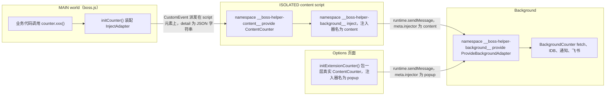
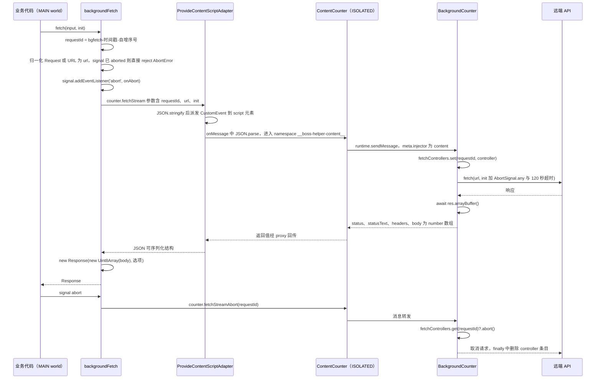

# 消息与存储桥（counter）

`src/message/` 是扩展的"系统调用层"：MAIN world（`boss.js` 注入脚本）、ISOLATED content script、options 页面里所有 `counter.*` 调用，最终都被 comctx 翻译成一次跨世界消息，落到 background 的 `BackgroundCounter` 实例上。业务代码（`useConf`、`useModel`、`useAccounts`、`useStatistics`、`HelperCache`、`notification()`）不直接触碰 `browser.*` 或 `storage`，只认识 `counter`。

本页覆盖三段链路：**门面与初始化**（`src/message/index.ts`）、**两端实现**（`BackgroundCounter` / `ContentCounter`）、**传输适配器**（`ProvideContentScriptAdapter` / `ProvideContentAdapter` / `InjectBackgroundAdapter` / `ProvideBackgroundAdapter`），以及由此产生的存储语义、心跳与超时行为、图片 IDB 存储和修改检查清单。四个运行时世界的边界见 [扩展运行时与构建目标](extension-runtimes.md)；持久化策略见 [持久化与缓存](../concepts/persistence-and-caching.md)。

## 分层结构



图中每个 subgraph 都是独立的 JS 堆，箭头都是跨世界通信，因此参数与返回值都必须可 JSON 序列化。

## 门面：`counter`、`initCounter()` 与 `initExtensionCounter()`

`src/message/index.ts` 只持有一个模块级变量 `_counter: ContentCounter | null`，所有对导出对象 `counter` 的访问都通过一个 `Proxy` 转发：

- `initCounter(script = document.currentScript)`：给 MAIN world 使用。用 `defineProxy(() => ({}) as ContentCounter, { namespace: '__boss-helper-content__' })` 得到注入端，再用 `InjectAdapter`（即 `ProvideContentScriptAdapter`，绑定到当前 `<script>` 元素）挂上传输。MAIN world 里没有真正的实现对象，工厂 `() => ({})` 只是占位。
- `initExtensionCounter()`：给 options 页面使用。先以 `namespace: '__boss-helper-background__'` 注入 background 代理（`injectBackground(new InjectBackgroundAdapter('popup'))`），再把它包进一个**真实的** `ContentCounter`——于是 options 页拿到完整业务接口：存储走本地 `storage`，网络/通知等走消息。

两者的调用位置是硬编码的两处：`src/entrypoints/boss/index.ts` 的 unlisted script 回调开头 `initCounter()`（在 `BossHelperCtx.new()` 和 `run()` 之前），以及 `src/entrypoints/options/main.ts` 的 `main()` 中、动态 `import('./App.vue')` 之前的 `initExtensionCounter()`。因为 `useConf`/`JobTable.vue` 在模块顶层就构造 `useStorageAsync(..., ExtStorage)`，顺序不能颠倒；options 入口还把 `main()` 的失败兜底成页面上的一段错误文案，而不是静默白屏。

**未初始化就调用**的语义是立即抛错。`counter` 的 `get` 与 `set` 陷阱在 `_counter === null` 时都抛出：

```text
Counter has not been initialized. Call initCounter() before using counter.xxx
```

这是有意为之的硬失败：把"忘记初始化"变成可见错误，而不是静默 `undefined` 导致的谜之空值。两点细节：`get` 陷阱对函数值返回 `value.bind(_counter)`，因此 `const { storageGet } = counter` 这类解构调用仍能工作；`set` 陷阱在未初始化时同样抛错，只有 `_counter` 存在时才真正写到实例上。读取属性（例如 `counter.storageGet`）就会抛错，`.then` 之类的链式访问无法绕过——所以必须先 init。

## 存储语义：`genKey()` 前缀规则

存储**不在 background 实现**，而在 `ContentCounter` 上：它直接用 WXT 的 `storage`（`#imports`）。因此 MAIN world 的存储请求只需一跳（到 ISOLATED），options 页则是本地直连。三个方法都先过 `genKey()`：

```ts
function genKey(key: string): StorageItemKey {
  const prefixes = ['local:', 'session:', 'sync:', 'managed:'] as const
  return prefixes.some((prefix) => key.startsWith(prefix)) ? (key as StorageItemKey) : `sync:${key}`
}
```

| 传入 key | 实际存储区 |
| --- | --- |
| `local:xxx` | `storage.local` |
| `session:xxx` | `storage.session` |
| `sync:xxx` | `storage.sync` |
| `managed:xxx` | `storage.managed`（只读区，写入会失败） |
| `xxx`（无前缀） | **默认 `sync:xxx`** |

这解释了仓库里为什么大量 key 显式写 `local:`：配置 `formDataKey()` 返回 `local:web-geek-job-FormData` / `local:web-geek-job-FormData-${preset}`；账号 `local:HelperAccounts`、`local:HelperAccount`（后者也以 `userKey` 常量从 `background.ts` 导出）；统计 `local:web-geek-job-Today`、`local:web-geek-job-Statistics`（非 default 账号再追加 `-${account}` 后缀）；预设列表 `local:FormDataPreses`；飞书配置 `local:feishu-config`；告警关闭状态 `local:alert:${id}`；限流时间戳 `local:netConf-${key}`。而 `useModel` 的 `confModelKey = 'conf-model'` 是**无前缀**的，因此落在 `sync` 区。

由此产生的失效模式值得单独记住：

- 新增一个漏写前缀的 key，数据会静默进入 `sync` 区——配额小得多，且随用户账号漫游到其他设备。
- 给既有 key 补前缀等于**迁移**存储区，旧值不会自动搬运，用户看到的是配置"丢失"。
- `storageRm` 同样过 `genKey`，删错区不会报错，只会"什么也没删掉"。
- `sync:` 与 `local:` 的写失败（配额/频率）表现不同，排查前先确认 key 落在哪个区。

方法契约：`storageGet<T>(key, defaultValue)` 转成 `storage.getItem(genKey(key), { fallback: defaultValue })`（有重载：带默认值返回 `T`，不带返回 `T | null`）；`storageSet` / `storageRm` 成功后返回 `true`，便于调用方判断。

`ExtStorage`（`StorageLikeAsync`）是同一套接口对 VueUse 的适配：`getItem` 用 `setInterval(..., 200)` **轮询等待 `_counter` 就绪**后才调用 `counter.storageGet` 并解析；`setItem` / `removeItem` 直接转给 `storageSet` / `storageRm`。它被 `useStorageAsync(..., ExtStorage, { mergeDefaults: true })` 使用（`appearanceConf` 的 `appearance-conf`、`JobTable.vue` 的 `job-table-layout-v1`）。后果是双向的：这些响应式偏好在 `initCounter()` 之前读取不会失败，而是每 200ms 重试一次；但若 `_counter` 永远不出现（注入脚本未执行、`keepInDom` 关掉），`getItem` 会**永久 pending**，对应的 `isLoading` 状态也就永不结束。注意 `ExtStorage` 的 key 同样经过 `genKey`，所以这两个偏好实际存放在 `sync:` 区。

## 接口面：`BackgroundCounter` 与 `ContentCounter`

`BackgroundCounter` 是"只能在 background 里跑"的能力集合；`ContentCounter implements BackgroundCounter`，逐方法用 `Parameters<...>` 转发到内部的 `this.background`，两边方法表必须一致（TypeScript 强制）。

| 能力 | 实际执行位置 | 说明 |
| --- | --- | --- |
| `storageGet/storageSet/storageRm` | ContentCounter 本地 | 唯一不走 background 的一类 |
| `fetch(...args)` | background | 直通 `fetch`，返回值需经消息序列化 |
| `fetchStream` / `fetchStreamAbort` | background | 处理 `backgroundFetch` 的请求/取消句柄 |
| `request({url, data, timeout, responseType})` | background | `AbortSignal.timeout(timeout*1000)` + `mode: 'cors'` + `credentials: 'include'`（带宿主 cookie）；非 2xx 抛 `状态码: <status>: <body>` |
| `getImage` / `setImage` | background | IndexedDB `ExtensionGlobalDB` 的 `images` store |
| `notify` | background | `browser.notifications.create`，被 `src/utils/index.ts` 的 `notification()` 包装 |
| `openOptionsPage` | background | `browser.runtime.openOptionsPage()` |
| `feishuFetch` / `createTableBoss` / `feishuUpsert` | background | 直接以 `@/utils/feishuBackground` 的实现作为类字段挂载 |
| `backgroundTest` / `contentScriptTest` | 两端各一 | 诊断用：传 `'error'` 抛错，否则返回 `Date.now()`，用来验证消息往返与错误能否跨世界传回 |

`ContentCounter` 额外持有 `routerHooks` 数组与 `_addRouterHook` / `callRouterHooks`，这些**不属于** `BackgroundCounter` 的接口约定，是本地状态、不参与 RPC（当前无调用方）。为与 `BackgroundCounter` 对齐而保留的 `backgroundTest` 在 `ContentCounter` 上缺失、`contentScriptTest` 在 background 上缺失，属于刻意的"各留一个探针"。

manifest 只申请 `permissions: ['storage', 'notifications']`，没有 `unlimitedStorage`；`host_permissions: ['http://*/*', 'https://*/*']` 是 background 侧跨域请求（含飞书）成立的前提。

## 传输层：适配器与序列化约束

comctx 的 `Adapter` 只有 `sendMessage` / `onMessage` 两个职责。项目提供四种实现，对应三条物理通道：

1. **`ProvideContentScriptAdapter(script)` —— MAIN ↔ ISOLATED（当前唯一在用）**。`sendMessage` 在 `<script>` 元素上派发 `CustomEvent('_boss-helper-message_', { detail: JSON.stringify(message) })`，`onMessage` 用 `JSON.parse(event.detail)` 还原。**detail 是字符串**，所以任何不可 JSON 表达的值都会丢字段或抛错：`File`、`ArrayBuffer`、函数，以及 `fetch` 返回的 `Response`。这正是图片与网络响应一律转成 `number[]` 的原因。
2. **`ProvideContentAdapter` —— 同一事件的 document 版本**。挂在 `document` 上、`detail` 直接传对象，并带 Firefox 兼容分支：检测到全局 `cloneInto` 时用 `cloneInto(message, document.defaultView)` 克隆进页面上下文。`contentScript.ts` 重新导出了它，但只有 `contentScriptShare.ts` 里被注释掉的历史实现（"挂在 script 元素 + cloneInto"）说明了两者关系——它是 `ProvideContentScriptAdapter` 的前身，当前未接入链路。它的存在提示：若要恢复 Firefox 支持，需要回到非 `JSON.stringify` 的 detail。
3. **`InjectBackgroundAdapter(name: 'content' | 'popup' = 'content')` —— 页面/options → background**。`sendMessage` 调 `browser.runtime.sendMessage(browser.runtime.id, { ...message, meta: { url: document.location.href, injector: this.name } })` 且不等待回执；`onMessage` 只把收到的消息转发给 callback。
4. **`ProvideBackgroundAdapter` —— background 服务端**。`onMessage` 用 `message.sender?.name` **覆盖** `meta.injector`，把"这条消息来自哪种扩展上下文"变成路由依据；`sendMessage` 按 `injector` 分流：`content` 用 `browser.tabs.query({ url: meta.url })` 找到同 URL 的标签页并逐个 `tabs.sendMessage`（结果被 `void` 丢弃），`popup` 用 `browser.runtime.sendMessage` 并**吞掉** `Receiving end does not exist`（options 页已关闭）错误，其他错误照抛。

一个必须知道的坑：`ContentCounter` 内部注入 background 时用的是 `new InjectBackgroundAdapter()`，即默认 `injector: 'content'`，返回消息因此在 background 侧走 `tabs.query({ url })` 精确匹配。实例所在上下文的 URL 若没有对应标签页（或页面 URL 变了、query 不再命中），回包会投递到空集合，调用方表现为**永不 settle**——这是 `fetchStream` 在 background 侧加 120 秒兜底超时的动机。options 页之所以显式传 `'popup'`，正是为了避开这条 `tabs.query` 路径。

## 一次 counter 调用的完整路径与超时

以 MAIN world 发起的 `counter.fetchStream(...)`、并由调用方 `AbortSignal` 中途取消为例（`src/utils/backgroundFetch.ts` → `ContentCounter` → `BackgroundCounter`）：



上图展示一次后台请求的跨世界往返，以及调用方取消时请求如何在 background 侧被中止。

超时行为分三层理解：

- **代理级心跳**：只有 ISOLATED 侧 provide `ContentCounter` 时显式设置了 `heartbeatTimeout: 3000`（`src/entrypoints/content.ts`），另外两个 namespace 的 `defineProxy` 未设该选项，走 comctx 默认值。心跳用于判定"对端世界还在不在"，超时后代理会认为对端失联，而不是无限等待。
- **请求级兜底**：`fetchStream` 在 background 用 `AbortSignal.any([controller.signal, AbortSignal.timeout(120_000)])`，保证即使回包因 `tabs.query` 未命中或消息丢失而永远不到达，远端请求也不会永久挂起（但调用方 Promise 仍依赖心跳或自身逻辑收敛）。
- **轮询替代**：`ExtStorage.getItem` 用 200ms 轮询代替等待心跳，`getRootVue` 等工具用 100–300ms 轮询 DOM，说明"等待对端就绪"在本项目里普遍通过显式轮询表达，而非依赖消息层。

`fetchStream` 虽然叫 "stream"，但**不是流式**：background 里 `await res.arrayBuffer()` 读完全部响应后一次性返回 `body: number[]`，`backgroundFetch` 再用它构造普通 `Response`。对 LLM 的 SSE 而言，调用方拿到的是完整响应而非逐 token 增量（模型层如何据此调整请求见 [AI 模型层](../integrations/ai-model-layer.md)）。请求体过桥时也被裁剪：只有 `method`、`headers`（`Headers`/数组/对象统一为普通对象）、**字符串** `body`、`credentials`（默认 `include`）与 `mode`（默认 `cors`）能通过；`FormData`、`Blob`、`ReadableStream` 请求体在桥上是不可用的。传 `Request` 实例时 `backgroundFetch` 只保留 `method/headers/credentials/mode` 并让 `init` 覆盖，**不读取 `Request` 的 body**——`createAdvancedFetch` 因此需要改请求体时显式 `await input.clone().text()` 再合并。

## 图片存储：IDB `ExtensionGlobalDB` / `images`

`getImage` / `setImage` 在 background 操作一个独立的 IndexedDB 库，与 `storage` 是两套完全不同的持久化：

- `initDB()` 以 `openDB('ExtensionGlobalDB', 1, { upgrade })` 打开，`upgrade` 里按需 `createObjectStore('images')`（无 keyPath，使用外部 key）。
- `setImage({name, type, buffer})` 用 `new File([new Uint8Array(opt.buffer).buffer], name, { type })` 重建 `File`，key 由内容决定：`` `img-${await calculateFileMD5(file)}` ``（`src/utils/file.ts` 用 SparkMD5 对 `FileReader` 读出的 ArrayBuffer 求哈希）。同一张图重复上传得到同一个 key，天然去重；返回 `{ success: true, key }`。
- `getImage(key)` 命中时返回 `{ success: true, name, type, buffer: number[] }`，未命中返回 `{ success: false }`（**不抛错**）。

调用契约是"配置里只存 key，字节留在 IDB"：

- `CustomGreeting.vue` 保存时若 `item.model instanceof File` 就 `counter.setImage(...)` 并把返回的 `key` 写进 `item.image`；打开面板时对已有 key 调 `counter.getImage` 重建预览 `File`。
- `GreetingImages.vue` 同样通过 `getImage` / `setImage` 在图片库中读取和登记图片。
- `boss/index.ts` 的 `sendMessage` 在 `msg.type === 'image'` 时先 `counter.getImage(msg.image)`；`success: false` 直接抛 `图片未上传或已过期`，否则用 `name`/`type`/`buffer` 重建 `File`，交给 `uploadImage` 上传后再通过 geek 客户端发送。

由此带来的运维事实：清理扩展站点数据/IDB 会让所有已保存的图片 key 失效，而 `storage` 里的配置仍指向这些死 key；卸载重装同理。由于没有 `unlimitedStorage`，大量图片会触及源默认配额，`db.put` 失败会作为消息错误抛回 `setImage` 调用方。

## 从组合式函数到存储：典型调用链

- **配置**：`useConf.init()` → `counter.storageGet(formDataKey(), {})` → `deepmerge(defaultFormData, from)`；保存时 `jsonClone` 后 `counter.storageSet(formDataKey(), ...)`；`formDataPreset` 变化会改 `formDataKey()` 第二段，从而读写另一份 key（见 [配置与预设](../concepts/configuration-and-presets.md)）。
- **账号/统计/模型**：`useAccounts`（`local:HelperAccounts` / `local:HelperAccount`）、`useStatistics`（`local:web-geek-job-Today` / `-Statistics`，按账号追加后缀，写侧以 `pending` Promise 串行化避免乱序）、`useModel`（无前缀 `conf-model` → `sync`）都直接调 `counter.storageGet/storageSet`。
- **界面偏好**：`appearanceConf` 与 `JobTable.vue` 的表格布局经 `ExtStorage` 走 `useStorageAsync`，因此无前缀 key 落 `sync`。
- **缓存/判重**：`HelperCache` 与 `JobResultCache` 把 `counter` 作为构造参数默认值（类型分别是 `CacheStorage` / `JobCacheStorage`，只要求 `storageGet`/`storageSet`），因此测试可用内存适配器替换；内存内的加载去重、写串行化、过期清理都由它们自己负责，`counter` 只负责持久化（`scripts/helper-cache.test.ts`、`scripts/job-cache.test.ts` 以 `mock.module('@/message', () => ({ counter: {} }))` 注入假边界）。
- **网络**：`request({ isBackground: true })` 走 `counter.request`，否则走页面内 `fetch`；模型请求走 `backgroundFetch` → `counter.fetchStream`。
- **通知**：`notification()` → `counter.notify`。
- **打开设置页**：界面里的"配置"按钮直接 `counter.openOptionsPage()`。
- **飞书**：`createFeishuSync().flush()` 以 `counter.storageGet('local:feishu-config')` 读配置、`counter.feishuUpsert(rows)` 批量写入；`FeishuPage.vue` 用同一 key 读写配置并调 `counter.createTableBoss()`。`scripts/feishu-workflow.test.ts` 与 `scripts/feishu-sync.test.ts` 都以 `mock.module('@/message', () => ({ counter: { storageGet, feishuUpsert } }))` 替换门面，断言同步批处理而不触网。

## 扩展点与修改检查清单

新增一项需要扩展 API 的能力时，正确位置是 `BackgroundCounter`（`src/message/background.ts`），并在 `ContentCounter`（`src/message/contentScript.ts`）补一个同签名转发；不要在 `boss/` 或 `options/` 里直接用 `browser.*`。

**新增一个 RPC 方法需要同步改动的文件**：

1. `src/message/background.ts` —— 在 `BackgroundCounter` 上加实现（访问浏览器能力/IDB/网络）。注意这里**不是**存业务的合适位置，业务状态仍留在调用方。
2. `src/message/contentScript.ts` —— 加一层 `async method(...args: Parameters<BackgroundCounter['method']>) { return this.background.method(...args) }`，否则 `implements BackgroundCounter` 会编译失败（这也是接口一致性的守卫）。
3. 调用点 —— 统一通过 `counter.method(...)`；若新增的是纯本地存储语义则跳过第 1、2 步，直接在 `ContentCounter` 上实现。
4. 若新方法引入了新 namespace 或新事件名，或改变了 `meta.injector` 的取值集合，需要同时检查 `src/entrypoints/background.ts`、`src/entrypoints/content.ts`、`src/message/index.ts`（以及 `MessageMeta` 类型）——三处 namespace 字符串必须成对。
5. 如涉及新的浏览器权限，改 `wxt.config.ts` 的 `permissions` / `host_permissions`。

其他约束：

- 参数与返回值必须可 JSON 序列化（MAIN ↔ ISOLATED 走 `JSON.stringify`）；二进制请沿用 `number[]` 约定，不要把 `ArrayBuffer`/`File`/`Response` 直接返回。
- 长耗时或可能被"路由丢失"的调用要自带超时：仿照 `fetchStream` 的 `AbortSignal.timeout`，或接受心跳/调用方超时兜底。
- 存储 key 一律显式带 `local:`（或明确想要的区），否则落到 `sync:`。
- 需要持久化的大对象先考虑 IDB（沿用 `images` store 的模式），`storage.sync` 的配额尤其小。
- 诊断手段：在两端分别调用 `backgroundTest('success' | 'error')` 与 `contentScriptTest(...)`，可确认消息能否往返以及异常能否跨世界传回（错误语义见 [错误与重试](../concepts/errors-and-retries.md)）。

## 相关页面

- [扩展运行时与构建目标](extension-runtimes.md)
- [持久化与缓存](../concepts/persistence-and-caching.md)
- [错误与重试](../concepts/errors-and-retries.md)
- [AI 模型层](../integrations/ai-model-layer.md)
- [飞书同步](../integrations/feishu-sync.md)
- [Boss 平台接口](../integrations/boss-platform-apis.md)
- [配置与预设](../concepts/configuration-and-presets.md)
