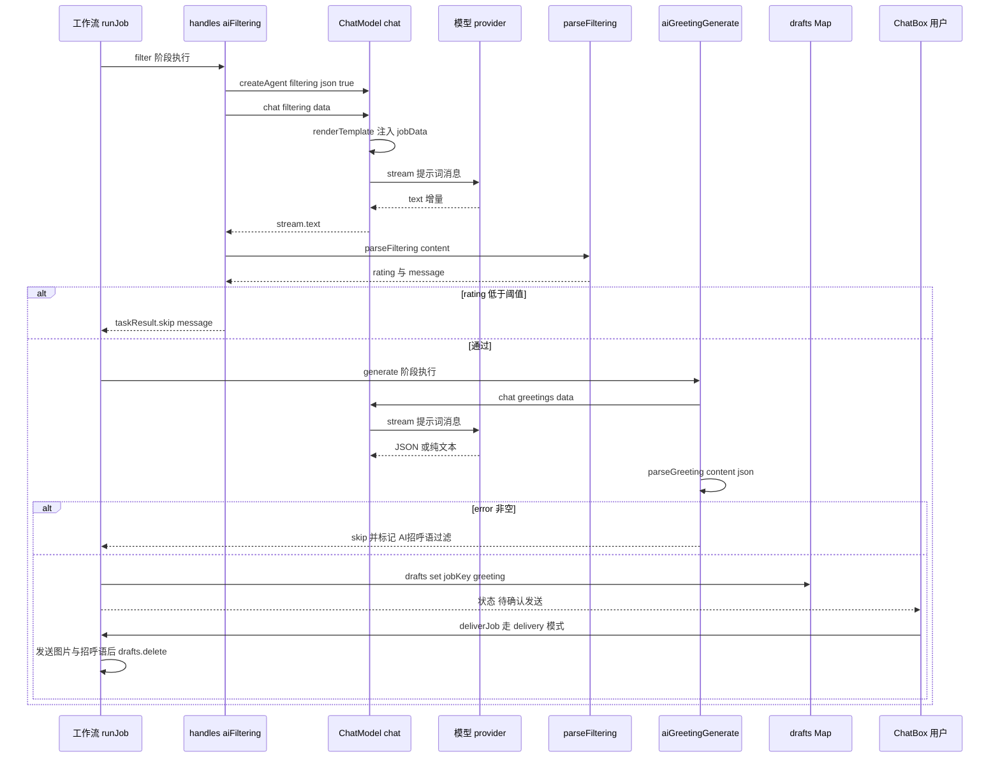

# AI 筛选、招呼语与提示词模板

Boss Helper 把大模型用在两处业务决策上：**AI 筛选**（给岗位打分，低于阈值就跳过）和 **AI 招呼语**（生成给 HR 的第一句话，并且可以借 `error` 字段反过来拒投岗位）。两者共享同一套底层实现：`ChatModel` 负责按 agent 名管理模型与消息流，`renderTemplate` 负责把岗位数据注入提示词，`parseFiltering` / `parseGreeting` 负责把模型的自由文本收敛成可判定的结构。理解这三个层次，基本就理解了整条 AI 链路。

## 分层结构

| 层次 | 位置 | 职责 |
| --- | --- | --- |
| 模型注册 | `src/composables/useModel/index.ts` | `modelData` 存续于存储键 `conf-model`，`initModel` 读取时经 `migrateModelConfig` 迁移协议字段 |
| Provider 适配 | `src/composables/useModel/providers.ts` | `createModel` 按 `protocol` 分派到 `openai-compatible`（`provider.chat`）/ `openai-responses`（`provider.responses`）/ `anthropic-messages`（`createAnthropic`） |
| 请求改写 | `src/utils/modelRequest.ts` | `createAdvancedFetch` 在 provider 序列化请求之后覆写 headers / body |
| Agent 与会话 | `src/composables/useModel/chatModel.ts` | `createAgent`、`chat`、每个岗位一份 `VueChatState` 消息流 |
| 模板与应用 | `src/utils/ai.ts`、`src/composables/useApplying/utils.ts` | `renderTemplate`、`parseGptJson`、`parseFiltering`、`parseGreeting` |
| 业务流程 | `src/composables/useApplying/handles.ts` | `aiFiltering`、`aiGreetingGenerate`、`aiGreeting`（以及 `customGreeting`）任务处理器 |

## 消息角色与 ChatModel Agent

`ChatModel` 用一份固定的角色清单约束"谁来生成什么"：

```ts
const role = ['system', 'user', 'assistant', 'boss', 'jd', 'filtering', 'greetings'] as const
```

其中 `system` / `user` / `assistant` 是标准的模型消息角色，`boss` / `jd` / `filtering` / `greetings` 是 UI 侧的 `uiRole`，用于在聊天面板里区分"这是 HR 的消息""这是职位卡片""这是筛选理由""这是招呼语"。每个角色在构造时都会得到独立的 `createIdGenerator`（前缀即角色名），因此消息 id 天然可回溯来源。`MessageRole` 同时是 `agents` Map 的键，所以一个角色只能挂一个 agent——重新 `createAgent` 会覆盖前一个。

`createAgent(model, name, { json })` 做三件事：用 `model.model` 在 `modelData` 中查配置（`key` 匹配不到或 `data` 为空就直接返回 `false`，调用方据此抛 `HelperConfigError`）、用 `createModel(conf.data)` 建 provider 实例、再用 `ToolLoopAgent` 包一层并把 `output` 设为 `Output.json()` 或 `Output.text()`。**`json` 选项就是这里生效的**：JSON 模式下 agent 被要求输出结构化对象，纯文本模式下则是普通文本。`allowSystemInMessages: true` 是必要的——提示词的首条消息通常就是 `role: 'system'`。

调用方从不自己拼消息，而是走 `chat(agentName, data, { disableMessages? })`：

1. 若该岗位尚未在 `jobs` 列表中且未禁用消息，把 `data.jobData.key` 插到队首（供 UI 选择岗位）。
2. 取出该岗位的 `VueChatState`；若不存在则新建，并**先塞一条 `uiRole: 'jd'` 的 system 消息**——岗位名、薪资、公司、地址、学历与完整 JD 被拼成 Markdown 首条上下文，让模型在提示词没有引用变量时也"看得见"岗位。`disableMessages: true` 时这条状态不会被登记进 `states`，测试消息也就不会污染真实会话。
3. 按 `modelConf.data.other.timeout ?? 60000` 取超时，把 `model.prompt`（字符串则包成单条 user 消息，数组则 `jsonClone` 后逐条渲染）交给 `agent.stream()`。
4. 消费 `toUIMessageStream()`，把 `reasoning-delta` / `text-delta` 增量写进消息 parts；`error` 分片会把 `state.error` 置为 `new Error(chunk.errorText)`，流结束后只要 `state.error` 存在就 `throw` 给调用方。

`chat` 返回的是 stream 对象，业务侧统一用 `.text` 取最终文本，用 `.finalStep` 取 `reasoningText`（设置页的提示词测试面板同时展示两者）。

## renderTemplate：`{{path}}` 的语义

提示词模板只支持一种语法——双花括号包裹的点分隔属性路径：

```ts
template.replace(/\{\{\s*([\w.]+)\s*\}\}/g, (match, path) => { ... })
```

关键语义，改动时必须守住：

- **路径两侧允许空白**：`{{ jobData.brand.name }}` 与 `{{jobData.brand.name}}` 等价；路径字符集是 `[\w.]`，因此 `jobData.showSkills.0`、`jobData.showSkills.length` 这类下标/长度写法可用，而 `[...]`、函数调用、`||`、算术表达式一律不匹配，会原样留在文本里。
- **ref 解包**：归约过程中只要当前对象带 `__v_isRef`，就先取 `.value` 再读属性。这是模板能直接读 Vue `ref` 包裹字段的原因。
- **缺失值替换为空字符串**：值为 `undefined` 或 `null` 时返回 `''`，**不保留占位符、不报错**。因此"变量拼错了"和"数据缺失了"在输出上无法区分，只能靠人工检查提示词。数字与布尔值经 `String()` 原样输出；普通对象会变成 `[object Object]`。
- **只做一次替换**：字段值内部即使含 `{{...}}` 也不会递归渲染。
- **不做转义**：拼接 JSON 时，JD 描述中的引号与换行可能直接破坏 JSON。这也是 JSON 模式必须配合宽松解析器的原因（见下文）。

渲染发生在两处，职责不同：

- `ChatModel.chat` 内：**只渲染字符串形式**的 `msg.content`；`content` 为复杂消息数组的分支不做逐项渲染。
- `customGreeting`（自定义招呼语）：仅当 `greetingVariable.value` 开启时才渲染——纯文本整体渲染，数组消息只渲染 `type: 'text'` 项，图片项原样保留。

模板变量全集与各字段含义以仓库根目录的 `TEMPLATE_VARIABLES.md` 为准，本页不重复枚举；该文档强调了几条容易被代码误读的约定，需要特别注意：

- 变量直接从 `WorkflowData` 根节点（`jobData` / `rawData` / `state`）读取，**不加 `data.` 或 `ctx.` 前缀**；`ctx.now`、`ctx.index`、`ctx.helper` 不是模板变量。
- `LogData`（`src/composables/useHelper/type.ts`）中的 `aiFilteringQ` / `aiFilteringR` / `aiGreetingQ` 等日志字段**不是**可用的模板变量。
- `state.aiGreeting` 只在 AI 招呼语生成后才可用，且生成前任务会 `delete data.state.aiGreeting`，所以本次提示词不能引用本次生成结果；非 JSON 模式只写入 `greeting`。
- AI 生成的正文会直接发送，不会再做一次模板替换，因此提示词应要求模型输出最终文本。
- 当前 AI 筛选任务只解析评分并决定是否跳过，不把分数或理由写回 `state`，因此没有可引用的筛选结果变量。
- `rawData.detail` / `rawData.boss` 有获取时机约束，投递前的 AI 任务不应读取投递后才产生的 `rawData.boss`。

默认提示词本身就在 `src/composables/conf/info.ts` 里以 `{{ jobData.jobName }}`、`{{ jobData.jobDescription }}` 等形式写好，用户可在设置页编辑。

## AI 筛选：打分即判定

`aiFiltering` 任务的装配期调用 `createAgent(..., 'filtering', { json: true })`（固定 JSON 模式，用户不能切换），未配置模型时抛 `HelperConfigError('aiFiltering.model', 'AI筛选模型未配置')`，把错误前移到工作流构建阶段而不是运行阶段。运行时它只做两件事：取 `chat('filtering', data).text`，交给 `parseFiltering`，然后与阈值比较。

`parseFiltering` 先用 `parseGptJson`（`partial-json` 的 `parse(json, ALL)`，并会先剥掉整体 ```` ```json ```` 围栏）解析，因此模型输出被截断时仍可能拿到部分字段。默认提示词要求的形状是：

```ts
interface aiFiltering {
  negative: { reason: string; score: number }[]  // 扣分项
  positive: { reason: string; score: number }[]  // 加分项
}
```

打分方式是**同向累加、异向相减**：

```ts
rating = (positive.score 之和) - (negative.score 之和)
```

每一项贡献 `Math.abs(curr.score)`——提示词要求"正整数，不需要正负号"，`Math.abs` 是对模型误加符号的容错。同时 `message` 会拼出可读理由（`分数{rating}` + 消极/积极分段，每段带 `理由/(N分)`），该字符串既用作 `taskResult.skip` 的原因，也被 `ChatBox.vue` 里 `parseFiltering(part.text).message` 在面板中二次渲染为 `uiRole: 'filtering'` 气泡展示。

判定规则在 `handles.ts`：`rating < (aiFiltering.score ?? 10)` 就 `taskResult.skip(message)`。默认阈值 10 分意味着"抵消后净加分为 0 或负"的岗位会被跳过；阈值可配置为负值（设置页 `UInputNumber` 范围 -100–100）。

**注意**：`parseGptJson` 解析失败返回 `null` 而不是抛错，此时 `rating` 退化为 `0 - 0 = 0`，于是只要阈值大于 0 就会被当作"低分"跳过。这是有意的失败关闭（fail-closed）行为——宁可漏投，不可错投——但排查"AI 筛选全部跳过"时，先怀疑模型没吐合法 JSON。`feishuSync.feishuJobRow` 也复用 `parseFiltering` 写 `AI筛选分数` / `AI筛选-加分项` / `AI筛选-扣分项` 三列，其中分数与理由取自聊天面板里最后一条 `uiRole: 'filtering'` 消息（而非 `state`），并用 try/catch 兜住，避免不完整的响应被当作有效评分。

## AI 招呼语：JSON 模式与纯文本模式

`aiGreetingGenerate` 的 `json` 选项来自配置 `aiGreeting.json === true`，它同时决定两件事：agent 的 `Output.json()` / `Output.text()`，以及 `parseGreeting(content, json)` 走哪个分支。非 JSON 模式下模型自由输出文本；JSON 模式下设置页会在 `LLMPromptEdit.vue` 里以 `greetingJsonTemplate` 展示约定的 `GreetingResult` 字段说明，并在切换开关时弹确认，提醒必须同步改写提示词。

`parseGreeting` 的两条路径：

**纯文本模式（`json = false`）**：只做一件事——`content.trim()` 为空就抛 `AI招呼语为空`，否则原样作为 `greeting`。模型说什么就发什么。

**JSON 模式（`json = true`）**：校验链按顺序执行，任一不满足直接抛错（错误会在任务里冒泡成岗位失败，而不是静默发送坏内容）：

| 检查 | 失败信息 |
| --- | --- |
| 允许被 ```` ```json ```` / ```` ``` ```` 围栏包裹（`^```(?:json)?\s*\n…\n```$`），剥离后必须 `JSON.parse` 成功 | `AI招呼语不是有效的JSON` |
| 顶层必须是对象，不能是数组或标量 | `AI招呼语JSON必须为对象` |
| `greeting` / `reason` / `error` 若存在必须是 `string` | `AI招呼语字段 {key} 必须为字符串` |
| `abilities` 若存在必须全部是 `string` | `AI招呼语字段 abilities 必须为字符串数组` |
| 只要 `error` 非空白，`greeting` 可缺失或为空；否则 `greeting` 必须是非空字符串 | `AI招呼语字段 greeting 必须为非空字符串` |

返回值固定包含 `greeting`（缺省补 `''`），`reason` / `abilities` / `error` 只在存在时用条件展开写入，避免把 `undefined` 带进工作流状态。

### `error`：AI 拒绝投递的唯一通道

最后一条校验是本设计的核心：**`error` 是"拒绝投递"的信号通道**。当模型判断岗位不匹配时返回 `{"error": "岗位要求与求职者经历不符", ...}`，`parseGreeting` 接受这个对象（`greeting` 兜底为 `''`），`aiGreetingGenerate` 随即检查 `data.state.aiGreeting.error?.trim()` 并返回 `{ ...taskResult.skip(error), msg: 'AI招呼语过滤' }`——岗位在"generate"阶段就被拦下，后续 delivery 任务不会执行，图片也不会发出。

同一守卫在投递链上出现三次，语义一致（`error` 非空 → skip；`greeting` 缺失或为空 → 抛错）：

| 位置 | 行为 |
| --- | --- |
| `handles.aiGreetingGenerate` | `error` 非空 → skip（`msg: 'AI招呼语过滤'`） |
| `delivery.ts`「岗位投递」 | `aiGreeting.enable` 时先查 `state.aiGreeting`：未生成就抛 `AI招呼语尚未生成`，`error` 非空就 skip，`greeting` 为空就抛错，通过后才 `sendPublishReq` |
| `handles.aiGreeting`（发送） | 同样的三段检查，然后按图片配置发送 |

也就是说 AI 招呼语承担了第二道语义筛选的职责，且**拒绝与失败都不发任何消息**。`GreetingImages.vue` 的面板文案明确写着"生成失败或拒绝发送时，不发送任何图片"。

注意失败语义的差别：`error` 走 skip（岗位被标记过滤、结果写入 `jobResultMaps`），而 JSON 解析/字段校验失败是 throw，会被 `runJob` 的 catch 记为 `{ status: 'error', msg: '执行失败', reason }`，不会留下 skip 结果也不会缓存。两者都不会发送招呼语，但用户在结果表里看到的类别不同。

## 图片附件：beforeImages / afterImages

只有 JSON 模式的招呼语才支持附图（设置页在 JSON 开关打开时才显示 `GreetingImages` 编辑器；`config.json` 为真而 `beforeImages` / `afterImages` 缺省时按空数组处理，等效于纯文本发送）。`aiGreeting` 任务发送时按 **beforeImages → 文本 → afterImages** 的顺序组装消息数组：

```ts
await ctx.helper.sendMessage?.(data, [
  ...(config.beforeImages ?? []).map((image) => ({ type: 'image' as const, image })),
  { type: 'text', content: result.greeting },
  ...(config.afterImages ?? []).map((image) => ({ type: 'image' as const, image })),
])
```

纯文本模式则直接 `sendMessage(data, result.greeting)`。图片在设置页由 `GreetingImages.vue` 经 `counter.setImage({ name, type, buffer })` 存入浏览器扩展 IndexedDB 并保存返回的 key（`local:` 域），支持上下移动排序，但不会自动读取已有 key 的原文件。

真正把 key 变成图片的是各入口的 `sendMessage` 实现（如 `src/entrypoints/boss/index.ts`）：字符串会被包成单条 `text` 消息；对 `type: 'image'` 的消息调用 `counter.getImage(key)` 取回 File 数据，失败就抛 `图片未上传或已过期`（对应 `GreetingImages.vue` 里"图片未上传或已过期，请重新配置"的提示）；再 `uploadImage(securityId, file)` 上传到平台，最后用 `createImageMessage` 发出；其他 `type` 抛 `不支持的消息类型`。每条消息都重新设置 `clientMid = Date.now()`，因为复用同一个 client id 会让后续消息被平台视为重复。

## 草稿与 `generate` 模式

投递编排里，`aiGreetingGenerate` 被注册为 `phase: 'generate'`（`src/entrypoints/boss/delivery.ts`），而发送招呼语的 `aiGreeting` 是 `phase: 'delivery'`。工作流按模式（`WorkflowMode = 'auto' | 'filter' | 'generate' | 'delivery'`）裁剪执行哪些阶段：

| 模式 | 执行的阶段 |
| --- | --- |
| `filter` | 仅 `filter` |
| `auto` | `filter` → `generate` → `delivery` |
| `generate` | `filter` → `generate`，然后**停下** |
| `delivery` | 仅 `delivery`（复用已就绪岗位） |

`generate` 模式的意义是"先算、后发"。`runJob` 在 `generate` 模式下的收尾逻辑是：

1. 从 `data.state.aiGreeting.greeting` 取值，为空则抛 `仅生成需要启用并配置 AI 招呼语`。
2. 写入 `drafts.set(key, greeting)`——`drafts` 是 `useApplying` 内的 `reactive(new Map<string, string>())`，以岗位 key 索引。
3. 把结果状态置为 `{ status: 'ready', msg: '待确认发送' }` 并返回，**不执行任何 delivery 任务**。

确认有两条路：

- **用户确认**：`ChatBox.vue` 读取 `workflow.drafts`，在最后一条 `uiRole: 'greetings'` 消息下显示"待确认草稿"面板，允许就地编辑（`saveDraft` 回写 Map；`draftBusy` 为真——工作流运行中或 `jobActionBusy`——时禁用输入与按钮，文案提示"暂停后才可操作"）；点击"发送并投递"调 `helper.deliverJob(key)` → `workflow.executeOne(data, 'delivery')`，即单岗位执行一次 delivery 模式。`deliverJob` 会先检查 `workflowRunning` / `jobActionBusy`、拒绝时抛错，并清除该岗位的手动过滤标记。
- **批量投递**：`executeAll(data, 'delivery')` 的队列是 `status === 'ready'` **且 `!drafts.has(job.key)`** 的岗位；草稿未确认的岗位会被跳过，直到用户手动发送。`auto` / `generate` 模式下逐岗位循环时同样以 `drafts.has(jobData.key)` 作为跳过条件。

草稿的生命周期与三个状态点绑定，改动这些点时最容易引入"重复发送"或"丢草稿"：

- `runJob` 开头：若 `drafts.get(key)` 存在且当前不是 `filter` 模式，草稿内容会被写回 `data.state.aiGreeting.greeting`，并把 `AI招呼语生成` 标记为已完成（`completed` 集合）——**已生成的招呼语不会在重跑时被重新生成**，保证用户看到并确认的就是最终发出的那句。
- 投递成功：`drafts.delete(key)`。
- 切换账号：`useHelper/ctx.ts` 监听 `activeAccount`，`flush: 'sync'` 地清空 `drafts`（连同 `jobResultMaps`、`stateMaps`、`manuallyFiltered`，并把每个 `jobData.state` 重置为空），因为草稿与岗位数据都属于账号上下文。

注意 `generate` 模式的前置校验在 `executeAll`：`mode === 'generate' && !formData.aiGreeting.enable` 时直接抛 `仅生成需要先启用并配置 AI 招呼语`，避免用户跑完一整轮筛选才发现没配模型。

## 端到端时序



上图是"筛选通过 → 生成草稿 → 人工确认 → 发送"的主路径；`auto` 模式会跳过等待环节，连续跑完三个阶段。

## 失败与边界语义

- **AI 任务超时更宽**：`resolveTimeout` 对 `state === 'ai'` 的任务给 120s（模型默认 60s + 缓冲），对 `state === 'request'` 给 70s，delivery 阶段 90s，其余 30s。AI 任务同时受 `agent.stream` 的 `timeout` 与工作流看门狗两层约束。
- **流式错误被包装**：`toUIMessageStream` 的 `onError` 把 `APICallError` 转成 `请求错误 {statusCode}: {message}`，其他错误用 `err.message`；这些文本会显示在聊天面板，`state.error` 最终通过 `throw state.error` 让任务失败。
- **JSON 严格度差异是有意的**：AI 筛选用宽松解析（`partial-json`，失败退化为 0 分后再被阈值裁掉），AI 招呼语用严格 `JSON.parse` 加字段校验（失败抛错）。前者错判只会少投一个岗位，后者错判会把 JSON 原文发给 HR。
- **面板展示也是宽松解析**：`GreetingMessage.vue` 独立做一次围栏剥离与 `JSON.parse`，只用于把 `greeting` / `reason` / `abilities` / `error` 渲染成结构化卡片（有未确认草稿时以草稿文本替代 `greeting`）；解析失败就退回纯文本，流式期间以 `{` 或 ```` ``` ```` 开头则显示"正在生成，请稍候…"。它不参与任何业务判定。
- **设置页的调试面板与运行路径一致**：`LLMPromptEdit.vue` 用同样的 `createAgent` + `chat(..., { disableMessages: true })` 对勾选岗位分批（每批 4 个）测试，`disableMessages` 让测试消息不进 `states` 和 `jobs`；筛选测试展示 `parseFiltering().message`，招呼语同时展示 `reasoningText` 与 `content`，JSON 模式则展示 `parseGreeting` 结果（解析抛错会作为错误展示）。测试结果保存在 `sessionStorage`，且不会写回 `state`。
- **JSON 开关是一份契约**：设置页在切换 `JSON 模式` 时会弹确认，提示必须同步修改提示词，否则要么得到解析失败的 JSON、要么把 JSON 文本直接发给 HR。该开关同时也决定图片编辑器的可见性。

## 扩展点

- 新增一种 AI 用途时，需要在 `chatModel.ts` 的 `role` 数组中加 `uiRole`、在 `conf/info.ts` 给默认提示词（`aiReply` 就是现成的占位配置）、在 `handles.ts` 用 `defineTaskHandler` + `createAgent` 注册任务，并在 `delivery.ts` 里挂到合适的 `phase`。
- 要让模板支持新变量，只需保证该字段出现在 `WorkflowData`（`jobData` / `rawData` / `state`）上——`renderTemplate` 直接从数据根节点归约，不需要注册表；新增后必须同步更新 `TEMPLATE_VARIABLES.md` 的表格与"维护依据"清单。
- 要改变打分数学，改 `parseFiltering` 的 `rating` 表达式即可；`rating` 与 `message` 会同时被投递判定、聊天面板和飞书同步三处消费，因此改语义前要一并检查 `handles.aiFiltering`、`feishuJobRow` 与 `ChatBox.vue`。
- 要改变招呼语的拒投语义，`parseGreeting`、`aiGreetingGenerate`、`岗位投递`、`aiGreeting` 四处必须一起改，否则会出现"生成了但没拦下"或"拦下了却仍发送图片"的偏差。
- Provider 级定制（自定义 header、覆写请求体）通过 `ModelAdvanced` 的 `headers` / `body` 走 `createAdvancedFetch`，在 provider 序列化之后再合并，因此可以覆盖协议特有的字段而不必 fork 适配器。

相关页面：[配置、预设与账号](configuration-and-presets.md)、[任务处理器与过滤器](task-handlers-and-filters.md)、[AI 模型层](../integrations/ai-model-layer.md)、[投递工作流](../workflows/delivery-workflow.md)。
