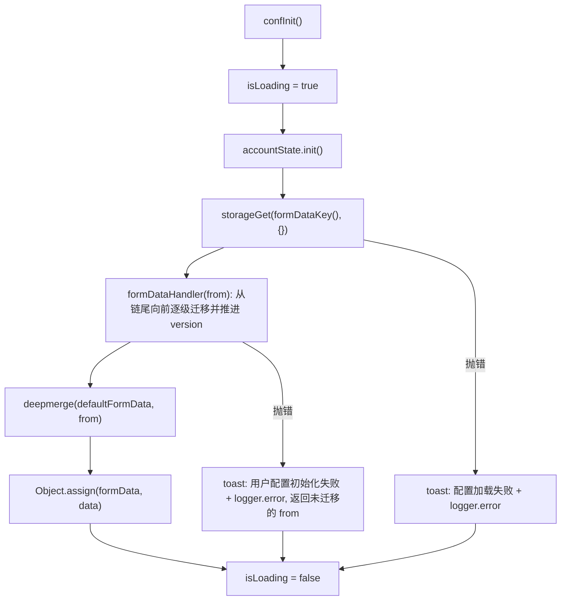
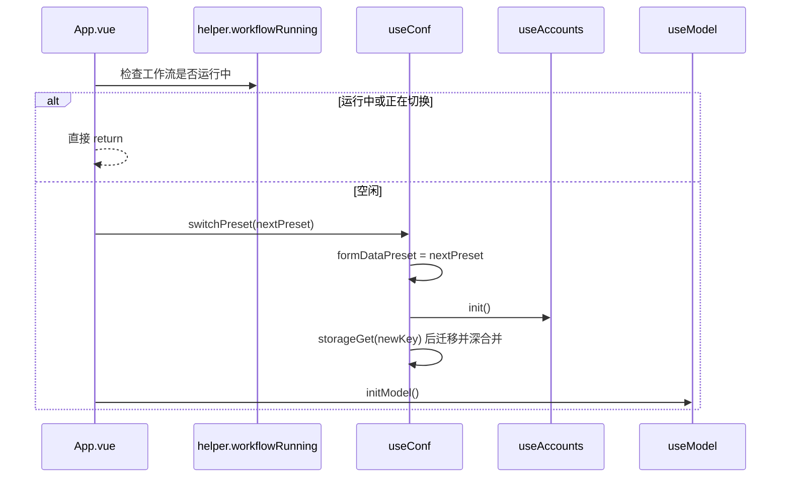

# 配置、预设与账号

插件所有"用户可调"的东西最终都收敛成三种状态：**`FormData`**（投递与筛选配置）、**`appearanceConf`**（纯外观偏好）、**账号/预设槽位**（配置与历史数据的分区维度）。前两者由一个模块级单例 `src/composables/conf/index.ts` 统一持有并通过 `useConf()` 暴露，账号则由 `useAccounts()` 单独持有。理解这一层的关键不是字段列表，而是：**配置在哪个键落盘、什么时候真正落盘、旧版本配置怎么被补齐、当前预设/账号如何改变键名与可见项**。

## 单例状态：`useConf()` 持有什么

`conf/index.ts` 在模块作用域创建了一次状态，`useConf()` 只是把同一份状态的操作包成闭包返回：

| 状态 | 形态 | 说明 |
| --- | --- | --- |
| `formData` | `reactive(jsonClone(defaultFormData))` | 全插件唯一的响应式配置对象；UI 直接 `v-model` 到它的深层字段 |
| `defaultFormData` | 常量对象（`conf/info.ts`） | 合并、"恢复默认"、"推荐配置"的唯一真源 |
| `isLoading` | `ref(true)` | `init()` / `switchPreset()` 的忙碌标志；**当前没有组件消费**，只在模块内部翻转 |
| `selectedPresets` | `useSessionStorage('HelperPresets', {})` | 会话级的 `账号 → 预设` 覆盖表 |
| `formDataPreset` | 可写 computed | 当前生效的预设 id；写入落到 `selectedPresets[activeAccount]` |
| `configLevel` | `reactiveComputed` | 由 `formData.configLevel` 派生的三个布尔门控 |

`selectedPresets` 用 `useSessionStorage` 是刻意的：它表示"这个标签页里临时切到了哪个预设"，刷新/关标签页即失效，而每个账号的**默认**预设保存在账号对象上（`Account.preset`）。`formDataPreset` 的 getter 因此是三级回退：

```
selectedPresets[activeAccount]  →  currentAccount.preset  →  'default'
```

显式切到 `default` 会写入 `selectedPresets[account] = 'default'`，从而**覆盖**账号默认预设（值为 `'default'` 而非 `undefined`，不会被 `??` 回退）。`App.vue` 的 `presetName` 用 `formDataPreset === currentAccount.preset` 判断"是否正处在账号默认预设上"，不一致时才显示预设名徽标。预设 id 还会被写进飞书同步行（`使用预设` 列，见 `src/utils/feishuSync.ts`），所以预设切换对投递溯源是可观察的。

`appearanceConf` 是完全独立的 `useStorageAsync('appearance-conf', {...}, ExtStorage, { mergeDefaults: true })`：它**不分预设、不分账号**，全局共享，随写入自动持久化（VueUse 的 storage ref 语义）。字段包括 `jobView`（cards/table）、`tableHeight`（单位 10px）、`hideHeader`、`changeIcon`、`dynamicTitle`、`changeBackground`、`blurCard`、`listSink`、`contentWidth`、`contentOffset`、`leftChat`、`chatBoxWidth`、`defaultShowChatBox`；由 `components/Tabs/ConfigItem/Appearance.vue` 逐项用 `watch(..., { immediate: true })` 施加到宿主页面 DOM。`mergeDefaults: true` 保证后续新增外观字段对老用户有值。

## 存储键：预设如何改变落盘位置

`formDataKey()` 是唯一的键派生点，也是"预设"这个概念的全部技术含量：

```ts
const formDataKey = () => {
  if (formDataPreset.value !== 'default') {
    return `local:web-geek-job-FormData-${formDataPreset.value}`
  }
  return 'local:web-geek-job-FormData'
}
```

- `default` 预设用**无后缀**的历史键 `local:web-geek-job-FormData`，保证老用户升级后无需迁移即可继续读到自己的配置。
- 其他预设用 `local:web-geek-job-FormData-<presetId>` 独立成键。
- 前缀 `local:` 交给 `counter.storageGet/storageSet` 的 `genKey()` 解析到浏览器存储（详见 [消息与存储桥](../architecture/messaging-and-storage-bridge.md)）；漏写 `local:`/`session:`/`sync:`/`managed:` 前缀会静默落到 `sync:` 区。
- 该函数只被 `conf/index.ts` 内部的读（`init`/`confReload`/`confExport`）与写（`confSaving`）使用，因此**配置的一切持久化都只经过这几个入口**。

预设列表本身是另一条数据：`local:FormDataPreses`（注意源码里的拼写 `Preses` 是既定事实），存 `{ label, value }[]`，默认 `[{ label: '默认配置', value: 'default' }]`。它被两处读取：内容脚本 `App.vue` 在下拉打开时刷新，options 的 `App.vue` 在初始化时读入并 `v-model` 传给 `ManagementPage`。

`presetId` 由 `Date.now().toString()` 生成（非 UUID），新预设**不会**复制当前配置；`createPreset` 只写预设列表条目，切到新预设时键不存在，`init()` 读到 `{}`，于是得到一份纯默认配置。

## 加载：init → 迁移 → 深合并

`confInit()` 是唯一把磁盘内容灌进 `formData` 的路径，顺序固定：



三个要点：

1. **先 `accountState.init()`**。`formDataPreset` 依赖 `activeAccount` 与账号的 `preset`，所以账号必须先于配置读取；否则会用错误的键加载。
2. **迁移在合并之前**。见下一节。
3. **`Object.assign(formData, data)` 而不是替换引用**。`formData` 是被 `HelperContext`、`App.vue`、各配置组件和 `conf/sections.ts` 同时持有的同一个 reactive 对象，替换引用会让所有 `v-model` 断链。`init()` 因此天然是"就地覆盖"，这也是 `switchPreset()` 能在不重建上下文的前提下换配置的机制。

`confInit` 的调用点只有两处：内容脚本 `App.vue` 的 `refreshConfiguration()`（挂载时 + `window` 的 `focus` 事件，且工作流运行中或账号切换中直接跳过），以及 options 的 `initialize()`（与 `initPresets()`、`model.initModel()` 并行）。

## 版本迁移链：`FROM_VERSION`

`FROM_VERSION` 是一个 `[version, (from) => from][]` 数组，`formDataHandler` **从数组尾部向前**遍历：若 `from.version`（缺省按 `'20240401'`）已经 `>=` 该项 version，说明该级迁移已做过，直接 `break` 结束整条链——因为链是按时间升序排列的，越靠前说明越旧。否则执行该级迁移函数，并**无条件把 `from.version` 置为该级 version**，然后继续看前一级。因此 `version` 是单调推进的"水位线"，而不是最终版本号。

当前链上三级（`defaultFormData.version` 为 `'20260718'`，即链尾）：

| version | 迁移内容 |
| --- | --- |
| `20250826` | `salaryRange.value` / `companySizeRange.value` 从 `"8-13"` 字符串拆成 `[min, max, false]` 三元组 |
| `20260521` | `aiFiltering.prompt` / `aiGreeting.prompt` 由单个字符串包装成 `[{ role: 'user', content }]`；prompt 缺失时用 `defaultFormData` 补齐；`jobAddress` 补 `include: true` |
| `20260718` | 扁平的 `delay: { starts, interval, pageNext }` 展开为 `delayDeliveryStarts` / `delayDeliveryInterval` / `delayDeliveryPageNext` 并删除 `delay` |

`20260718` 的实现是"键名变形"的通用写法（`delay` + 首字母大写后缀），但它只处理 `from.delay` 为对象的情形，`!('delay' in from) || typeof from.delay !== 'object'` 时直接原样返回——所以历史上若出现过非对象的 `delay`，字段只会被后续 `deepmerge` 用默认值兜住。

**新增字段的硬约束**：迁移链不负责补新字段，补新字段靠 `deepmerge(defaultFormData, stored)`。任何加入 `FormData` 的字段都必须在 `conf/info.ts` 的 `defaultFormData` 里给出默认值，否则老用户读到 `undefined`（`FormData` 带 `[key: string]: any` 索引签名，TypeScript 不会替你发现残留引用）；若新字段的语义需要从旧字段改写，才需要追加一级 `FROM_VERSION` 并同步抬高 `defaultFormData.version`。

迁移函数抛错会被 `try/catch` 整体捕获：弹一条 `用户配置初始化失败` 的 error toast 并记录日志，然后**返回当前的 `from`**（此时 `from` 可能已被前面的某一级就地改写过，但抛错的那一级没有推进 `version`）。`init()` 随后继续 `deepmerge`，所以坏迁移的后果是"旧结构 + 默认值兜底"而不是启动失败。`confImport` 走同一个 `formDataHandler`。

`from` 缺失或为 `null` 时（`storageGet(key, {})` 的默认值只在键不存在时生效），`formDataHandler` 内部访问 `from.version` 会抛错并被同一 `try/catch` 吃掉；`init()` 用 `(await formDataHandler(from)) ?? from` 兜底，`Object.assign` 仍会拿到一份可用对象——但 `null` 本身会让 `Object.assign(formData, null)` 静默不赋值，即保留内存中已有的值。

## 六个动作的持久化语义

这是最容易被误用的部分：**只有 `confSaving` 会写盘**。

| 动作 | 读/写磁盘 | 立即持久化 | 备注 |
| --- | --- | --- | --- |
| `confInit` | 读 | — | 唯一加载入口 |
| `confSaving` | 写 | **是** | `storageSet(formDataKey(), jsonClone(formData))`；写失败 toast 后 **rethrow** 给调用方 |
| `confReload` | 读 | 否 | 从磁盘重读并 `deepmerge(formData, v, { clone: false })` 就地合并；只合并**磁盘上存在的键**，因此磁盘上被删掉的字段不会从内存中回滚 |
| `confExport` | 读 | 否 | 导出的是 `deepmerge(defaultFormData, <磁盘值>)`，并**不包含**未保存的内存编辑 |
| `confImport` | 否 | **否** | 选 `.json` → 迁移 → `deepmerge(formData, jsonData, { clone: false })` 就地合并到内存；toast 明说"切记要手动保存哦" |
| `confDelete` | 否 | **否** | 把 `defaultFormData` 就地合并进 `formData`；toast 明说"不会自动保存, 请手动保存或重载恢复" |
| `confRecommend` | 否 | **否** | 只对一份白名单键重置为默认值；toast 同上 |

各动作的细节差异值得单独记住：

- **当前 UI 只用到其中一部分**。options 页脚提供「保存配置与模型」（`confSaving`，silent）、「重载」（先 `allowDiscard()`，再 `initialize()` + 重建模型）、「推荐配置」（`confRecommend`）与侧栏「导入配置」；`LLMPromptEdit.vue` 保存提示词时也直接 `confSaving(options)`。`confExport`、`confReload`、`confDelete` 目前**没有任何 UI 入口**，只有代码内可调用。因此"恢复默认"在页面上只能通过导入一份默认 JSON 或手工删键实现。
- **`confImport` 与 `confExport` 不对称**。导入是"深合并到当前内存配置"：嵌套对象逐键合并，数组整体替换；不会先清空，所以导入文件里缺失的键保留当前内存值。导出则基于磁盘值而非内存值，用来导出"当前已保存的完整配置"。options 侧栏的"导出当前配置"按钮**不**调用 `confExport`，而是直接 `exportJson(JSON.parse(snapshot()), 'BossHelper配置')`——导出的正是含未保存编辑的内存快照，文件名也不同（`confExport` 的文件名是 `打招呼配置`）。
- **`confRecommend` 的白名单**：`deliveryLimit`、`activityFilter`、`friendStatus`、`sameCompanyFilter`、`sameHrFilter`、`goldHunterFilter`、`notification`、`useCache`、`delayDeliveryStarts`、`delayDeliveryInterval`、`delayDeliveryPageNext`。它刻意不碰筛选集合（公司/岗位/HR/薪资）、AI 提示词与外观偏好。
- **`confDelete` 不是"删除存储"**：它只把内存配置重置为默认。真正清空磁盘要再点一次保存，或者用「重载」恢复。
- **`silent` 选项**：`confSaving({ silent: true })` 抑制"保存成功"toast。options 页的 `save()` 用它配合一次性的"配置与模型已保存"提示；`LLMPromptEdit.vue` 则把 Vue 事件对象作为 `options` 传进来（`'silent' in options` 对 `Event` 为假，因此仍会提示）。两处调用都把整个 `formData`（含与当前预设无关的内存值）写回当前预设的键。
- **`confSaving` 的 throw 语义**是 options `run()` 捕获错误、显示"操作失败"的依据；不要在 `useConf` 外部吞掉它。

`importJson`（`utils/jsonImportExport.ts`）只做形态校验——必须是 `.json`、`JSON.parse` 后 `toString` 标签为 `Array` 或 `Object`——失败弹 `alert` 并**让 Promise 永不 resolve**。也就是说用户取消/选错文件时，`confImport` 与模型导入的调用会挂起（`model.initModel()` 等不受影响的并行调用照旧完成）。

## `deepmerge`：配置合并的全部机制

`utils/deepmerge.ts` 是配置体系的承重墙，四个行为决定了配置正确性：

- **只对 plain object 递归**：`isPlainObject` 排除数组、`null`、带 `Symbol.toStringTag` / `Symbol.iterator` 的对象。`FormDataSelect.value`（数组）、`customGreeting.value`（可能是 `CustomGreetingItem[]`）、`aiGreeting.prompt`（数组）都因此是**整体替换**而非元素级合并。
- **`clone: true`（默认）返回新对象**，用于"从默认值 + 磁盘值构造一份配置"（`confInit`、`confReload`、`confExport`）；`clone: false` 就地修改 `target`，用于所有"应用到现有 `formData`"的动作（`confReload` 的第二次合并、`confImport`、`confRecommend`、`confDelete`）。就地修改是让 Vue reactivity 生效的前提。
- **`__proto__` 键被跳过**（原型污染防护）。导入任意第三方 JSON 是这条防线的实际威胁面。
- **`jsonClone`（`JSON.parse(JSON.stringify(x))`）** 用于 `formData` 的初始副本与 `storageSet` 前的序列化。因此 `FormData` 中任何不可 JSON 表达的值（`File`、`undefined`）在落盘时会静默丢失；`customGreeting` 的图片项就带着可选的 `model?: File` 字段，落盘后只剩可序列化部分。

## `configLevel`：分级门控

`formData.configLevel` 是 `'beginner' | 'intermediate' | 'advanced' | 'expert'` 四级枚举，默认 `'beginner'`。`configLevel` computed 把它折算成三个布尔量：

```ts
const order = { beginner: 1, intermediate: 2, advanced: 3, expert: 4 }
intermediate: order.intermediate <= order[formData.configLevel]
advanced:     order.advanced     <= order[formData.configLevel]
expert:       order.expert       <= order[formData.configLevel]
```

即 `beginner` 三项全 false，`intermediate` 只开 `intermediate`，`advanced` 开前两项，`expert` 全开。**没有** `beginner` 字段——基础项永远显示。

门控的实现在 `conf/sections.ts` 的 `useConfigSections()`：它返回 `computed<[AlertItem[], (ConfigAccordionItem | false)[]]>`，每个被门控的条目写成 `conf.configLevel.xxx && {...}`，因此关闭时值是 `false`。消费方必须显式过滤：

- `GeneralPage.vue` 与 options `App.vue` 都做 `schema.value[1].filter((item) => item !== false)`——前者过滤正文 section，后者过滤侧边栏目录项。
- `GeneralPage.vue` 的 section 内 item 用 `v-if="item"` 渲染。**漏掉过滤会让 `false` 流进渲染层并报错**，这是新增 section 时最常见的失误。

当前门控分布：

| 级别 | 门控项 |
| --- | --- |
| `intermediate` | 筛选区的 `jobAddress`、`salaryRange`、`companySizeRange`、`activityFilter`、`sameCompanyFilter`、`sameHrFilter`；整个「招呼语配置」section；整个「延迟配置」section；基础设置里的「投递数量」`deliveryLimit`；`Statistics.vue` 的额外统计网格 |
| `advanced` | 筛选区的 `bossGoldMedalHr`；整个「地址配置」section；`SalaryRange.vue` 的「高级」按钮（宽松/严格 + H/D/M 三档） |
| `expert` | `CustomGreeting.vue` 的专家相关 UI |
| 无门控（始终显示） | `company`、`jobTitle`、`jobContent`、`hrPosition`、`goldHunterFilter`、`friendStatus`、`useCache`、`notification`、`configLevel` 本身 |

`configLevel` 与预设是**独立**的：它保存在 `formData` 里，所以每个预设可以有不同的分级；同时它是"显示门控"而不是"功能门控"——降低级别只是隐藏 UI，被隐藏字段的值仍然存在并继续参与筛选和投递（例如 `deliveryLimit` 在 `beginner` 下仍被头部计数与统计进度条读取）。这一点在写迁移或排查"配置不生效"时必须记得。

## 预设与账号

账号是 `useAccounts()` 在模块作用域持有的另一份单例状态：

```ts
interface Account { value: string; label: string; preset: string }
```

- `accounts`：账号数组，默认 `[{ value: 'default', label: '默认账号', preset: 'default' }]`，落盘于 `local:HelperAccounts`。
- `activeAccount`：当前账号 id，落盘于 `local:HelperAccount`。
- `accountsKey` / `activeKey` 由内部的 `persist()` 一起写；`init()` 读取时若 `HelperAccount` 指向已不存在的账号，会回落到 `'default'`。

操作语义：`createAccount(label, preset)` 用 `crypto.randomUUID()` 生成 `value`；`deleteAccount('default')` 是空操作（默认账号不可删），删除当前账号会把 `activeAccount` 拉回 `'default'`；`setDefaultPreset(value, preset)` 只改账号对象上的 `preset` 并持久化，**不改变当前生效预设**；`selectAccount(value)` 校验存在性（不存在则抛 `账号不存在`）后写 `local:HelperAccount` 并更新 `activeAccount`，不负责重载配置（重载由 `App.vue` 的 `switchAccount` 顺序完成）。

预设与账号的耦合点只有一个：`formDataPreset` 的 getter 会回退到 `currentAccount.preset`。`ManagementPage.createAccount()` 因此把**当前生效预设**（`conf.formDataPreset.value`，含会话覆盖）写进新账号的 `preset`，让新账号继承当前现场。

### 切换顺序是硬约束

`switchPreset(value)` 做三件事：写 `formDataPreset` → `await init()` → 翻 `isLoading`。切换过程中 `formData` 是被**就地覆盖**的，因此没有"两个预设同时存在"的中间态，但**存在一个旧值仍可读的窗口**：`init()` 内的 `storageGet` 是异步的。两处调用方都因此把切换包在守卫里：



账号切换（`switchAccount`）的顺序更严格：`accounts.init()` → 取下一个账号 → `accounts.selectAccount(next.value)` → `statistics.updateStatistics()` → `conf.switchPreset(next.preset)` → `model.initModel()`。统计必须与配置同步切换到新账号的分区，否则会拿旧账号的当日计数继续投递。`HelperContext` 在 `activeAccount` 变化时用 `flush: 'sync'` 的 watch 清空 `jobResultMaps`、工作流中间态与缓存分区（见 [HelperContext 与站点适配器](../architecture/helper-context.md)），所以**切换后必须重建模型/工作流相关状态，而 `formData` 是就地覆盖复用的**。

`switchPreset` 自身的失败处理只是 toast + 日志；它**不会**回滚 `formDataPreset`，因此切换失败后 UI 显示的预设名与实际加载的配置可能不一致——重试或重载页面才恢复一致。

内容脚本 `App.vue` 的 `switchPreset` / `switchAccount` 都以 `helper.workflowRunning.value || switchingAccount.value` 为前置守卫；对应按钮在 `helper.workflowRunning` 时禁用。options 侧 `switchPreset` 还会先 `allowDiscard()` 检查未保存修改。`ManagementPage.vue` 顶部的提示"不可多账号同时运行!!"正是这个约束的用户侧表达：同一份 `local:` 配置键被多个标签页/账号共享，插件没有跨标签页协调。

### 预设删除：写空槽而不是删键

`ManagementPage.deletePreset` 的步骤顺序是有意为之：

1. `default` 不可删（按钮禁用 + 函数内判断），且需 `window.confirm` 二次确认。
2. 先 `await init()`——因为接下来的 `switchPreset('default')` 需要准确的账号基线状态。
3. 逐个把引用该预设的账号 `setDefaultPreset(account.value, 'default')`，避免账号指向不存在的预设。
4. 从 `local:FormDataPreses` 中移除该项并同步 `v-model`。
5. **`storageSet('local:web-geek-job-FormData-' + value, {})`** ——把被删预设的配置槽写成空对象，而不是 `storageRm`。源码注释说明了原因：*"An empty slot prevents deleted configuration from being reused."* 预设 id 是 `Date.now()` 生成的字符串，万一被复用（例如恢复旧备份的 `FormDataPreses`、或时间戳碰撞），空槽保证不会捡回已删除的配置，并让"预设被删"在存储中可观测。
6. 若当前正处在该预设上，`conf.switchPreset('default')` 换回默认槽。

整个函数包在 `props.manage(action)` 里，默认 `reload = true`：`ManagementPage` 的删除/创建账号等管理操作因此是"前后各 `initialize()` 一次"，即时生效；`createPreset` 传 `false`，因为它自己写预设列表，只需重建模型。这是它与配置表单的区别——表单改动要靠底部「保存配置与模型」，管理页按钮则直接落盘（options 页脚据此显示"管理操作即时保存"）。

### 键派生对照

账号与预设在存储键上的参与方式**不同**，容易混淆：

| 维度 | 键 | 影响范围 |
| --- | --- | --- |
| 预设（preset） | `local:web-geek-job-FormData[-<preset>]` | **只影响 `formData`** |
| 账号（account） | `local:web-geek-job-Today[-<account>]`、`local:web-geek-job-Statistics[-<account>]`（`useStatistics` 的 `key(base, account)`，`default` 账号用无后缀键）；`HelperCache` 的 `"<key>:<urlencoded account>"`；`JobResultCache` 的 `local:job-result-cache:<urlencoded account>` | 统计、判重缓存、岗位结果缓存 |
| 两者都不参与 | `appearance-conf`、`local:HelperAccounts`、`local:HelperAccount`、`local:FormDataPreses`、`conf-model`（AI 模型） | 全局共享 |

因此"换预设"换的是**筛选/投递参数**，"换账号"换的是**历史数据与去重分区**；两者可以正交组合，也意味着同一个账号下切换预设不会重置当日投递统计。

## 用户数据存储键：迁移时不可覆盖

这一层是用户数据的主要载体。改动迁移、预设管理或任何"清理/重置"逻辑时，下列键必须被保留（可以读、可以合并，但不能整键删除或写入无关内容）：

| 存储键 | 内容 | 为什么不能动 |
| --- | --- | --- |
| `local:web-geek-job-FormData` | 默认预设的完整 `FormData` | 老用户的全部筛选/投递配置；历史键名，改键即等于全量丢配置 |
| `local:web-geek-job-FormData-<presetId>` | 其他预设的配置槽 | 每个预设的唯一真源；删除预设时要写空对象而非 `rm` |
| `local:FormDataPreses` | 预设列表 `{ label, value }[]` | 丢失后所有非默认预设变成不可达孤儿配置 |
| `local:HelperAccounts` | 账号数组（含各自默认预设） | 丢失后账号与预设关联全部复位 |
| `local:HelperAccount` | 当前账号 id | 丢失后回落 `default`，界面与数据分区会"换人" |
| `local:web-geek-job-Today` / `-<account>` | 当日投递计数 | 丢失即清零当日额度统计，可能导致超投 |
| `local:web-geek-job-Statistics` / `-<account>` | 历史统计 | 用户的投递历史 |
| `local:job-result-cache:<account>`、`HelperCache` 的槽位键 | 岗位结果缓存、已投递公司/HR 去重集合 | 丢失会造成重复投递 |
| `conf-model` | AI 模型配置（含 API Key） | 丢失需用户重填密钥 |
| `appearance-conf` | 外观偏好 | 纯偏好，但丢失也是用户可见的回退 |
| `boss-protocol` | 已同意的协议版本 | 丢失会重新弹协议 |

相反，`FROM_VERSION` 迁移函数只应**改写已存在字段的形状**并推进 `version`，不应删除用户数据（`20260718` 删除的只是被拆解后的中间键 `delay`，其值已完整搬到三个新键上）。`confDelete`/`confRecommend` 这类"重置"动作只作用于内存中的 `formData`，且 UI 文案明确告知不会自动保存——这是有意的安全边界。

## 修改这一层时的检查清单

- 新增 `FormData` 字段：在 `conf/info.ts` 给出默认值；只有需要从旧结构改写时才加 `FROM_VERSION` 条目并同步抬高 `defaultFormData.version`（`version` 是单调水位线，不要回头改历史条目的 version 字符串）。
- 新增需要分级隐藏的配置项：在 `sections.ts` 用 `conf.configLevel.xxx && {...}`，并确认消费方 `filter(item => item !== false)` 仍然有效；不要试图在字段层做门控。
- 需要落盘的新操作：必须显式调用 `confSaving`，并想清楚应写当前预设键还是别的键；`confSaving` 会 rethrow，调用方需处理。
- 改动预设/账号相关行为：`formDataPreset` 的写侧只应通过 `switchPreset`（它会重载配置），否则内存与磁盘会不一致；`selectedPresets` 是 session 级，不要指望跨标签页保留。
- 该层目前**没有单元测试**（`scripts/` 下只有 feishu、helper-cache、job-cache 的测试），验证手段是在 options 页手工做"导出 → 改旧 version → 导入 → 保存 → 重载"的迁移回归。

## 相关页面

- [消息与存储桥](../architecture/messaging-and-storage-bridge.md)：`counter.storageGet/Set`、`genKey()` 前缀规则与 `ExtStorage` 适配器。
- [HelperContext 与站点适配器](../architecture/helper-context.md)：`conf` / `accounts` 如何被上下文与工作流共享，账号切换时的状态清理。
- [Options 设置页](../operations/options-page.md)：配置 UI 的保存/重载/导入/推荐入口与未保存修改语义。
- [持久化与缓存](persistence-and-caching.md)：统计数据、去重缓存与岗位结果缓存的分区与过期策略。
- [AI 筛选与招呼语](ai-filtering-and-greeting.md)：`aiFiltering` / `aiGreeting` 提示词结构（`20260521` 迁移的目标）如何被消费。
