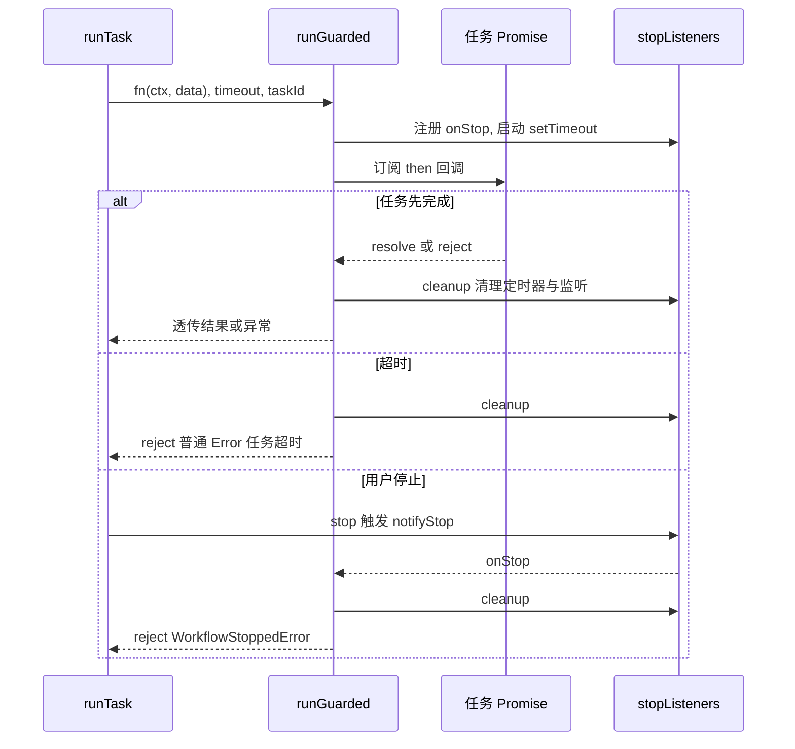

# 错误分类、受控执行与失败上报

一次"投递"失败的原因差别极大：可能是 BOSS 平台提示"您今天已与150位BOSS沟通"，可能是网络抖动，可能是用户自己点了停止，也可能是某个筛选任务主动跳过了这个岗位。这四件事在 UI 上的表现必须不同，但它们在 JavaScript 里都是"一个 Promise 被 reject 或者一个对象被 throw"。Boss Helper 因此把失败处理拆成四层：**错误类型体系**、**平台请求层的重试边界**、**工作流层的受控执行（超时 / 停止 / 依赖补跑）**、**结果层的 `JobStatus` 状态映射**。改动任何一个环节，都会直接反映在岗位卡片、toast 和右侧日志面板上。

## 分层结构

| 层次 | 位置 | 职责 |
| --- | --- | --- |
| 错误类型 | `src/composables/useApplying/deliverError.ts` | `BossHelperError` 及 5 个子类，携带 `state`（`warning`/`danger`）与 `error_type`；`src/utils/request.ts` 另有 `RequestError` |
| 平台请求 | `src/entrypoints/boss/requests.ts` | 把 BOSS 接口的弹窗文案翻译成具体子类，并按「业务错误不重试、传输错误衰减重试」递归 |
| 受控执行 | `src/composables/useApplying/index.ts` | `runGuarded`（超时 + 停止）、`WorkflowStoppedError`、`DependencyMissingError` 补跑 |
| 结果归属 | `src/composables/useApplying/index.ts`、`type.ts` | 把 `TaskResult` 写进 `jobResultMaps`、统计、缓存，最终决定 `JobStatus` |

## BossHelperError 体系

`BossHelperError` 继承 `Error`，额外带两个字段：

- `state: 'warning' | 'danger'` —— 声明只有"警告 / 危险"两档，**没有 success**。成功态由调用方用 `logs.add()` 不传 `err` 来表达。注意基类构造函数默认值是 `'warning'`，而所有内置子类都显式传 `'danger'`。
- `error_type: 'boss-helper'` —— 跨 context（content script ↔ background）传递标记，用于识别"这是本扩展自己抛的业务错误"。

构造函数里执行 `Object.setPrototypeOf(this, new.target.prototype)`，这是转译到 ES5 目标时保持 `instanceof` 可用的标准做法；`requests.ts` 里的 `if (e instanceof BossHelperError) throw e` 依赖这一行为，否则错误会被误判为网络异常而进入重试分支。

各子类的 `name` 同时也是 `logs.add()` 里 `state_name` 的取值，全部为 `danger`：

| 子类 | `name`（UI 标签） | 触发场景 |
| --- | --- | --- |
| `PublishError` | 投递出错 | 缺 token（`sendPublishReq`、`getJobDetail`）、重试耗尽、投递接口返回非 0、限额确认请求失败 |
| `GreetError` | 打招呼出错 | `getBossData` 缺 token、状态错误、重试耗尽 |
| `LimitError` | 达到限制 | 平台弹窗"您今天已与150位BOSS沟通" |
| `RateLimitError` | 操作频繁 | 平台弹窗"操作过于频繁" |
| `UnknownError` | 未知错误 | 兜底（当前源码中除导出外无调用点） |

`PublishError` / `GreetError` 的 `message` 直接来自平台文案或网络异常消息，**会把业务细节带到 UI**，所以它们不是"内部错误"，而是可读的用户提示。

### 平台错误的识别与重试

`sendPublishReq(data, errorMsg?, retries = 3, _params?)` 是这条链路的典型样本：

1. `retries === 0` 时直接 `throw new PublishError(errorMsg ?? '重试多次失败')`，把上一次的失败原因透传出去。重试预算因此是**总共 3 次尝试**（初始 3 次调用、每次异常后减一）。
2. 缺 `bst` cookie 时先 `toast` 提示"没有获取到token,请刷新重试"，再抛 `PublishError` —— **toast 只负责即时提醒，不负责终止流程**，真正的终止靠异常。这一步在 `try` 之外，所以不会进入重试。
3. `res.code === 1` 时按 `chatRemindDialog.content`（缺省回退 `res.message`，再回退 `'未知错误'`）的文案分流：
   - 含"您今天已与120位BOSS沟通"：先补一个 `chatremind.json` 确认请求，成功则**递归调用自身**并带上 `{ cid: 1 }`（复用同一份 `retries` 预算），失败则 `PublishError('投递限制确认失败]...')`。
   - 含"您今天已与150位BOSS沟通"：`LimitError`。
   - 含"操作过于频繁"：`RateLimitError`。
   - 其余一律 `PublishError(content)`。
4. `code !== 0` 且不为 `1` 时抛 `PublishError('未知错误状态:...')`。
5. `catch` 分支：`BossHelperError` 原样上抛（**业务错误不参与重试**），其它异常（超时 `AbortError`、网络错误、JSON 解析失败）递归 `sendPublishReq(data, e?.message, retries - 1)`。单次请求本身有 `AbortSignal.timeout(10_000)`。

这条"业务错误不重试、传输错误才重试"的分界是重要的不变量：如果放开它，`LimitError` 会被重试三次，徒增对平台的请求并延迟用户拿到"已达上限"的时间。

`getBossData` 结构对称，但有一处特殊分支：`res.code !== 0` 且 `res.message === '非好友关系'` 时直接带错误信息递归一次 `getBossData(job, '非好友关系', retries - 1)`（因为平台偶发返回该状态而稍后即可正常），其它 `code !== 0` 一律 `GreetError(\`状态错误:${message}\`)`；`catch` 分支只放过 `GreetError`，其余衰减重试。

`getJobDetail` 是个例外：它**不重试**，用 `AbortSignal.timeout(5000)` 兜住单个请求，失败直接向上抛（由工作流的通用失败分支处理）。但它同样在缺 `bst` cookie 时 `toast` + 抛 `PublishError`——也就是说 `PublishError` 并不只属于投递路径。所以它没有专属的错误子类，却在 token 缺失时借用投递错误类，这是阅读日志时容易误判的一点。

### 其它请求路径的错误形态

- **`src/utils/request.ts` 的 `RequestError`**（`name: '请求错误'`）是通用 fetch 封装：无响应体、HTTP `>= 400`（消息里拼入状态码与响应文本）、`AbortError`（统一转成"用户中止"）、其它异常都包成 `RequestError`。它**与 `BossHelperError` 体系无关，`instanceof BossHelperError` 不成立**，所以任何经过它的重试逻辑都会把它当传输错误。`isBackground` 时改走 `counter.request()`，错误原样 `reject`。
- **后台流式请求**（`BackgroundCounter.fetchStream`）用 `AbortSignal.any([controller.signal, AbortSignal.timeout(120_000)])` 做兜底超时，防止请求挂起让调用方 Promise 永不 settle；`src/utils/backgroundFetch.ts` 在调用方 `signal` 已 aborted 时直接 reject `DOMException('This operation was aborted', 'AbortError')`，并在 abort 时向后台发 `fetchStreamAbort`。这些是"跨扩展消息边界"的超时与取消，与 `runGuarded` 是两个独立层面。
- **`counter` 未初始化**时，`src/message/index.ts` 的 Proxy 会抛 `Counter has not been initialized...` 的普通 `Error`，属于配置/启动顺序问题，不走任何分类。

> 本页不涉及 `serialize-error` 之类的结构化错误序列化工具：仓库内没有该依赖的使用点，跨 context 传递时依赖的是 `error_type` 标记与 `Error.message` 文本。

## 受控执行：runGuarded、超时与停止

任务处理器返回的是普通 Promise，而工作流在 `for (const fn of [...t.before, handler, ...t.after])` 里逐个 `await`。如果不加保护，有两种典型卡死：

- 平台接口挂起（未覆盖超时的路径、或注入的页面方法永不 resolve），Promise 永不 settle，整个 `executeAll` 循环停住。
- 用户点"停止"后，`status` 变成 `'stop'`，但正在 `await` 的那一步依然不会返回，`busy` 永远为 `true`，重新启动被 `if (busy.value) return false` 挡住。

`runGuarded(promise, timeout, taskId)` 就是针对这两点的看门狗：



图：`runGuarded` 的三条出口——任务自身 settle、超时、停止信号。

关键语义，改动时必须守住：

- **两条失败出口抛出不同异常**。超时抛的是**普通 `Error`**（文案 `任务「xxx」执行超时(30s)`），停止抛的是 `WorkflowStoppedError`。上游靠类型区分：`if (e instanceof WorkflowStoppedError) throw e` 立刻中止整条链，而超时会落到 `runJob` 的 `catch`，把该岗位记为 `status: 'error'`、`msg: '执行失败'`。
- **`cleanup` 必须同时做两件事**：`clearTimeout(timer)` 与 `stopListeners.delete(onStop)`。漏掉后者会让已结束任务残留监听器（泄漏）；漏掉前者则会在任务已完成后触发一次虚假超时。
- **`stopListeners` 是 `Set`，`notifyStop` 遍历拷贝 `[...stopListeners]`**。因为 `onStop` 内部会 `delete` 自己，直接遍历原集合会在迭代中修改集合。
- **`.then` 显式给了两个回调**，也各自 `cleanup`；这让"任务成功"同样会解除监听，而不是只在失败时清理。
- **原 Promise 的拒绝不会被吞掉**：`promise.then(..., e => reject(e))` 保证业务错误原样上抛。

超时预算由 `resolveTimeout(t)` 决定，优先级是 `t.timeout`（任务自定义）→ `state === 'ai'` 120s（模型默认 60s + 缓冲）→ `state === 'request'` 70s → `phase === 'delivery'` 90s → 其余 30s。**新增耗时任务时应优先给 `state` / `phase`，只有在同一相位里个别任务明显更慢时才用 `timeout` 覆写。**

> 注意：`runGuarded` 只是让**调用方**提前返回，并不会中断底层请求（Promise 仍在后台跑）。真正的取消依赖各请求自身的 `AbortSignal.timeout`（以及后台 `fetchStream` 的 `fetchStreamAbort`）。

## 控制流哨兵：`throw { workflowResult }`

当某个任务返回"跳过"或"失败"的 `TaskResult` 时，当前岗位已经没有继续跑下去的意义（例如"相同公司已投递"之后不该再请求详情）。工作流用一行代码完成早退：

```ts
if (res.isSkip || res.status === 'error') {
  // 筛选阶段命中 warn 时顺手写结果缓存
  if ((!t.phase || t.phase === 'filter') && res.isSkip && res.status === 'warn') {
    await saveJobResult(key, res)
  }
  throw { workflowResult: res }
}
```

被 throw 的不是 `Error` 而是**普通对象**，这是刻意的：

- 它在 `runJob` 的 `catch` 里被优先识别：`if (e && typeof e === 'object' && 'workflowResult' in e) return`，**直接返回、不覆盖岗位状态**。岗位上已经写入的 `TaskResult`（含 `isSkip`、`reason`、`msg`）就是最终结论；如果走通用失败分支，一个"相同HR已投递"的过滤结果会被写成 `status: 'error'`，语义完全颠倒。
- 它天然**绕过 `runGuarded` 的语义**：从 `fn` 里抛出会先被 `runGuarded` 的 `.then` 捕获并 `cleanup`，随后仍在 `try` 块内被 `catch` 判定为哨兵，所以 `instanceof WorkflowStoppedError` / `instanceof DependencyMissingError` 的判断都不会命中，直接 `throw e` 向上传播。
- 因为它不是 `Error`，不会被 `logger.error` 当异常序列化，也就不会污染日志面板。

`catch` 里还有一条前置判断 `if (isBlocked(key)) return`（用户已停止或该岗位已被手动过滤），早于哨兵判断——停止优先级最高。

新增任务处理器时请注意：**返回 `taskResult.skip()` / `taskResult.error()` 是"正常业务结论"，`throw new Error()` 是"真的出错了"**。混淆这两者会让岗位在 UI 上显示成"投递错误"而不是对应的过滤原因。

`taskResult` 只有两个构造器：`skip(reason, status = 'warn')` 与 `error(reason)`（等价于 `skip(reason, 'error')`，同样 `isSkip: true`），另外 `res.status ??= res.isSkip ? 'warn' : undefined`、`res.msg ??= t.label ?? t.id` 保证忘了写 `status` / `msg` 的 skip 也能落到可读结果。

## DependencyMissingError：延迟初始化的按需补跑

筛选任务之间存在隐式前置条件——"活跃度过滤""Hr职位""工作地址""好友状态""工作内容"都 `deps: ['岗位详情获取']`，但 `rawData.detail` / `rawData.boss` 本身是 `createLazyObject('岗位详情获取')` / `createLazyObject('Boss信息获取')` 生成的 Proxy：

```ts
get(target, prop, receiver) {
  if (!_initialized) throw new DependencyMissingError(taskId)
  return Reflect.get(_data!, prop, receiver)
}
```

未初始化时读任何字段都会抛 `DependencyMissingError`。于是"读详情"这个动作既可能发生在 `岗位详情获取` 任务里，也可能发生在任何后置任务里，**不需要显式声明也能跑通**。`runTask` 的处理是一个精确的补跑：

```ts
catch (e) {
  if (e instanceof WorkflowStoppedError) throw e
  if (!(e instanceof DependencyMissingError)) throw e
  const dep = pipeline.value.find((task) => task.id === e.taskId)
  if (!dep || !canRun(dep)) throw e
  await runTask(dep)
  if (isBlocked(key)) return
  res = meginResults(await runGuarded(fn(ctx, data), taskTimeout, t.id))
}
```

要点：

- 只有 `DependencyMissingError` 会触发补跑，且**只重试一次**（`fn` 只被重新执行一次，再次缺失就上抛）。
- `!canRun(dep)` 时不允许补跑：例如在 `filter` 模式下依赖的却是 delivery 相位任务，此时继续重试只会无限循环，所以直接抛错。
- 补跑复用同一个 `ctx`（同一个 `now`、同一个 `index`、同一个 `task_id` 上下文），使前后两次调用的日志可以对应。
- 停止信号永远优先：`WorkflowStoppedError` 在最前面被重新抛出，避免在用户已经点停止后还去请求详情。
- Proxy 对 `__isProxy` / `__initialized` 与 symbol、`__v_` 前缀属性做了豁免，避免 Vue 响应式探测触发补跑；`isInitialized()` 是给调用方做"是否需要补跑"预判的配套工具。

## 结果状态映射

`JobStatus` 是一个**有序**枚举，`jobStatusList` 的顺序参与比较（`meginResults` 用它决定多个返回值合并时谁是"更严重"的那个）：

```
pending → wait → running → request → ai → ready → success → warn → error
```

任务结果写入 `jobResultMaps` 有三步：先写"运行中"占位（`t.state ?? 'running'` + `t.stateMsg ?? '运行中'`，让 AI 任务显示 `ai` / `生成招呼语中`），再写实际结果，最后决定是否早退。

| 情形 | 写入的 `status` / `msg` | 触发位置 |
| --- | --- | --- |
| 任务开始 | `t.state ?? 'running'` / `t.stateMsg ?? '运行中'` | `runTask` 进入 handler 前 |
| `status: 'success'` 且非 `isSkip` | 临时改写为 `running` + `投递处理中`，等待 `onDelivered` 系列任务跑完 | `runTask` 写回阶段 |
| 筛选命中 / 主动跳过 | `warn`（`taskResult.skip` 默认） | 哨兵抛出前 |
| `taskResult.error(...)` / AI 招呼语拒绝（`skip` + `msg: 'AI招呼语过滤'`） | `error` / `warn` | 哨兵抛出前 |
| filter 模式跑完 | `ready` + `待投递` | `runJob` |
| generate 模式跑完且有草稿 | `ready` + `待确认发送`；无草稿则抛 `Error('仅生成需要启用并配置 AI 招呼语')` | `runJob` |
| delivery 跑完但未真正投递 | `ready` + `待投递` | `runJob` |
| 真正投递成功 | `success` + `投递成功`（并写结果缓存、`success++`） | `runJob` |
| 真实异常（含超时、`PublishError`、`GreetError` 等） | `error` + `执行失败`，`reason` 取 `e.message` | `runJob` 的 catch |
| 用户停止 | `wait` + `已停止` | `runJob` 的 finally |
| 手动过滤 | `warn` + `手动过滤`，`id: 'manualFilter'` | `markFiltered` |
| `reset()` | `wait` + `等待中`（跳过 `success` / `ready` / 手动过滤项） | `reset` |

几个容易踩的坑：

- **成功是"延迟到投递阶段结束"才确立的**。投递任务自己返回 `status: 'success'`，但 `runTask` 会先把它写成 `running`，把"真正成功"的话语权留给 `runJob` 里的 `delivered` 标志（`if (t.phase === 'delivery') delivered = true`）。这样即使投递接口成功、随后的 `Boss信息获取` 或打招呼失败，岗位状态也能被后面的失败覆盖，而不是先显示成功再变成错误。
- **`onDelivered` 的异常被吞掉**：`try { await t.onDelivered(...) } catch (e) { log.error('onDelivered error', t.id, e) }`。它写的是去重缓存（相同公司 / 相同 HR），失败只影响下次去重，不该让一次已成功的投递变成失败。
- **`finally` 会无条件跑三件事**：处理手动过滤、停止状态下写 `wait`、`queueFeishu(data)` 排入飞书同步。用户停止时还会 `void feishuSync.flush()` 立刻冲刷，避免队列里的"已停止"记录滞留到下次运行。
- **缓存只接受两种结果**：`JobResultCache.set` 对 `status === 'success' && !isSkip` 与 `status === 'warn' && isSkip` 才落盘，其余静默丢弃；`get` 命中后返回 `{ ...result, isCache: true }`。读写失败只记 `logger.error`，不影响岗位结论。
- **统计按任务维度累加**：`statistics.todayData.value.tasks[t.id][res.status]++`，因此 `res.status` 为 `undefined`（无 skip 无 status）时不计数。`success++` 与 `activityFilter++`、`repeat++` 是另外几个独立计数器。

### 多个返回值的合并

任务可以返回 `TaskResult[]`（例如 `amap` 任务一次返回直线 / 驾车 / 步行三条判定）。`meginResults` 按 `jobStatusList` 的索引取**更严重**（索引更大）的状态，`reason` / `msg` 用换行拼接，`isSkip` / `isCache` 取逻辑或，`id` 取第一个非空。这保证了"三条里只要有一条超标就跳过"，且用户能看到全部原因。

## 构建期失败：不同于运行时失败

`rebuild()` 在解析每个任务定义时会 `try/catch`：抛错的任务被记录到 `errors`（键为 `${task.id}::${task.label}`），并把它注册成一个"永远抛出原错误"的 handler，`nodes` 状态标为 `failed`。依赖解析（`sort`）另有 `Cycle: ${id}` 与 `Missing dependency: ${id}` 两种硬失败，会直接抛出到 `withRun`。聚合后的文案会：

1. `logger.error('工作流构建错误, 请检查配置:', errMsg)`；
2. **`alert(...)`** 阻塞式提示用户（这是唯一使用 `alert` 的失败路径）；
3. 写入 `errorMessage`，随后在 `withRun` 里 `if (errorMessage.value) throw new Error(errorMessage.value)` 让本次运行根本不开始。

典型来源是 `HelperConfigError`（`aiFiltering.model` / `aiGreeting.model` 未配置时在任务工厂函数里抛出）——它是**普通 class、不继承 `Error`**，只在 `rebuild` 的格式化分支里被 `instanceof Error` 判为假、走 `JSON.stringify`。也就是说配置错误是"运行前失败"，运行时错误是"单个岗位失败"，两者不会互相掩盖。

`executeOne` 的调用方 `HelperContext.deliverJob` 还会在 `!accepted || result?.status === 'error'` 时抛 `Error(result?.reason ?? workflow.errorMessage.value ?? '投递未执行')`，把失败继续上抛给按钮交互层。

## 上报渠道：toast、alert、日志面板

三者的分工是明确的：

- **toast**：即时、可丢失的提醒。出现在：平台请求缺 token（`没有获取到token,请刷新重试`，`sendPublishReq` / `getBossData` / `getJobDetail` / `uploadImage`）；飞书同步失败（`飞书同步失败，待同步记录已保留`，id 固定为 `feishu-sync-error` 以免刷屏，失败时保留待同步快照以便下次重试）；`HelperContext.notification()`（可附带系统级 notification，仅在 `document.visibilityState !== 'visible'` 时发，经 `counter.notify` 落到后台 `browser.notifications`）；以及 `useJobActions.run()` 把抛出的异常统一转成 `「<label>失败」` + `error.message` 的错误 toast——这也是 `deliverJob` 错误最终变成用户可见提示的地方。
- **alert**：只用于工作流构建失败，因为这是用户必须立刻处理的配置问题。
- **日志面板**：真实诊断信息。`logger` 来自 `devlog-ui`，集中配置在 `src/utils/logger.ts`；`src/components/Tabs/Logs.vue` 用 `DevLoggerUI.init()` 把面板挂到标签页里。

## logger 的配置与限制

`src/utils/logger.ts` 在做任何导出之前先做两件事：

```ts
LogPersistence.enable({
  storage: 'session',   // sessionStorage
  maxPersisted: 500,    // 最多持久化 500 条
  debounceMs: 100,
})

let level: string = 'warn'
// 仅在 window 上存在可用的 localStorage 时才读取
level = localStorage.getItem('__BH_LOG_LEVEL__') ?? level

logger.configure({
  maxLogs: 1000,        // 内存中最多 1000 条，FIFO 轮转
  minLevel: level as LogLevel,
  enabled: true,
  shortcutAction: 'toggle',
  showToggleButton: true,
  spanCollapsed: false,
})
```

- **默认级别 `warn`**。这意味着大量 `logger.info` / `logger.debug`（如 `命中岗位结果缓存，复用结果`、`Pipeline rebuilt`）默认不可见，排查问题前要先把 `__BH_LOG_LEVEL__` 调成 `debug`。
- **`__BH_LOG_LEVEL__` 存在 `localStorage`**，由 devlog-ui 悬浮面板的 `log-level` 动作写入。**刷新页面后由 `src/utils/logger.ts` 重新读取生效**，所以手动改 localStorage 需要重新加载扩展页面。
- **日志持久化到 `sessionStorage`**，因此只在当前标签页会话内保留；标签页关闭即丢失，跨会话诊断要靠 devlog-ui 的导出功能。
- **零抛异常策略**：devlog-ui 的日志写入整体包在 `try/catch` 中（`Zero-Throw Policy`），所以日志本身不会成为新的失败源——但反过来，日志写失败也不会告诉你。

工作流各阶段都通过 `logger.withContext()` 附加结构性上下文：`workflow-rebuild`、`workflow-execute`（含 `job_key`）、`task_id`、`workflow-end`。查找某个岗位为什么失败时，按 `job_key` 过滤比按文本搜索可靠。

`HelperContext._logs` / `logs.add(job, err?, logdata?, msg?)` 是另一条**面向用户的投递记录**通道：`state` 取 `err.state`（无 `err` 时即 `success`），`state_name` 取 `err.name`（无 `err` 时 `投递成功`），`message` 取 `msg ?? err?.message`。`Log['state']` 的类型是 `'info' | 'success' | 'warning' | 'danger'`，解释了 `BossHelperError.state` 为何只有两档。它是唯一会消费 `BossHelperError.name` 的地方——把某个新错误类别的 `name` 写清楚，直接决定用户在记录里看到什么标签。当前 `src/` 中尚无 `logs.add` 的调用点（`Logs.vue` 标签页挂载的是 devlog-ui 面板），这一路径属于预留接口。

## 改动清单

- 新增平台错误类型时，继承 `BossHelperError` 并给出中文 `name`；若它代表"不该重试"的业务拒绝，确保 `requests.ts` 的 `instanceof BossHelperError` 分支能识别到它（继承链上任意一层都行，不要另起一个平级的 `Error` 子类）。
- 新增任务处理器时，区分"跳过"（返回 `taskResult.skip`）与"失败"（`taskResult.error` 或抛 `Error`）；只有真正中断流程才 `throw`。
- 新增耗时任务时评估 `resolveTimeout` 的默认值是否够用，不要靠调大全局超时来解决；需要真正取消的请求要自带 `AbortSignal`。
- 不要移除 `runGuarded` 的 `cleanup` 或两个 `then` 回调——任何一处遗漏都会把"任务卡住"变成"工作流卡住"。
- 任何在 `catch` 里设置岗位状态的新代码，都必须保留对 `isBlocked(key)`、`'workflowResult' in e` 哨兵和 `WorkflowStoppedError` 的放行判断。
