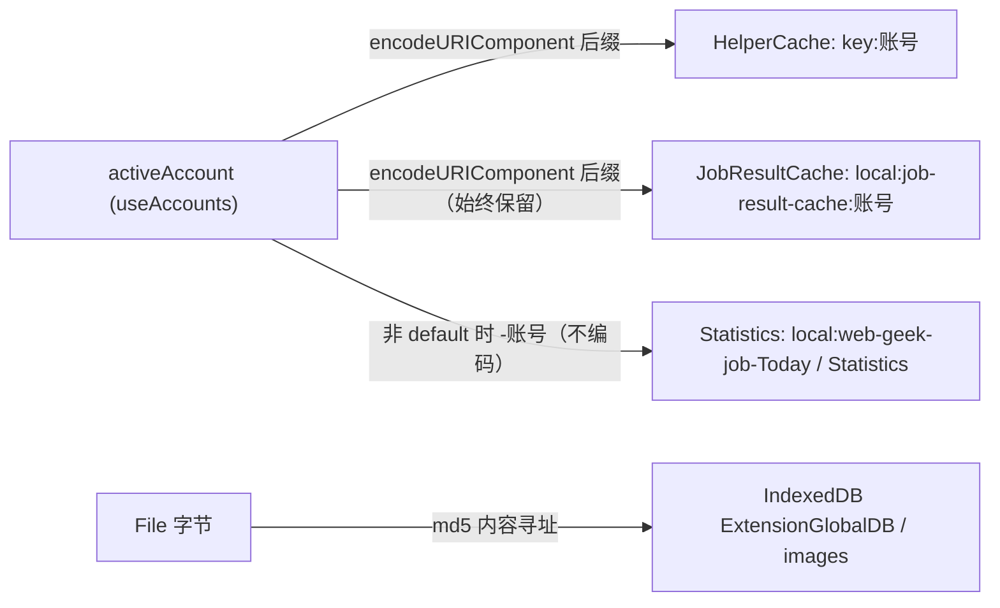
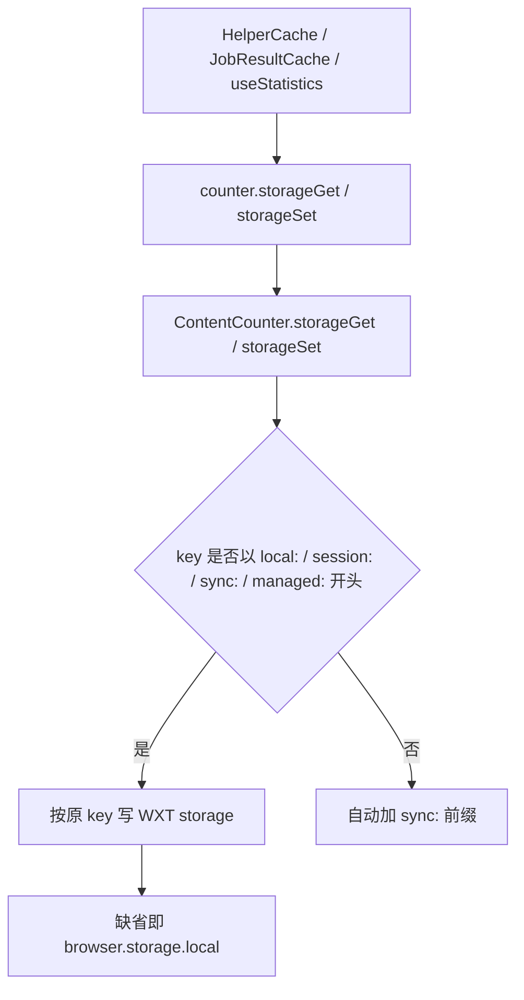
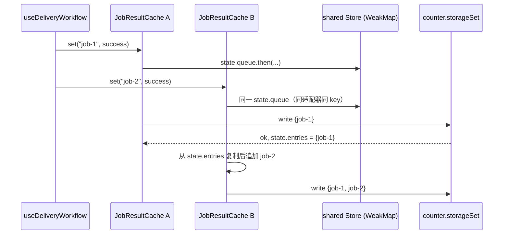
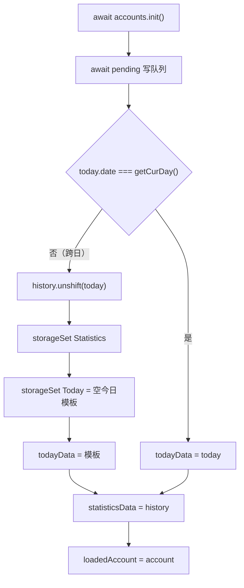

# 持久化：岗位结果缓存、判重集合与统计

Boss Helper 需要跨页面刷新、跨工作流运行保留四类状态：**岗位的筛选/投递结果**（避免重复消耗 AI 与网络）、**已沟通的公司与 HR**（判重）、**当日与历史投递统计**（面板展示）、以及**图片字节**（招呼语配图）。它们分别由 `JobResultCache`、`HelperCache`、`useStatistics` 和 background 的 IDB `images` store 承载。

本页只讲"什么在两次运行之间活着、用什么 key 活下来、写入如何排序"。这些缓存经由 `counter.storageGet/storageSet` 落地的通道细节（`local:`/`sync:` 前缀规则、跨世界序列化）见 [消息与存储桥](../architecture/messaging-and-storage-bridge.md)；缓存触发的业务决策（何时命中、何时跳过）见 [投递工作流](../workflows/delivery-workflow.md)；`useCache.expire`、`sameCompanyFilter.expire` 等配置项的来源见 [配置与预设](configuration-and-presets.md)。

## 存储 key 总览

四个消费者共用同一套 `counter` 存储适配器，但 key 的构造方式各不相同：两个缓存类自己做**账号槽位编码**，统计用**裸账号拼接**，图片走独立的 IndexedDB 库。



图中三组 `storage.local` key 通过活动账号区分槽位，图片 key 与账号无关、由内容哈希决定。

| 持有者 | 存储 key | 值形状 | 账号隔离方式 |
| --- | --- | --- | --- |
| `HelperCache` | 调用方给的 `key` + `:` + `encodeURIComponent(account)`；当前消费者传入 `local:sameCompany` / `local:sameHr` | `Record<string, number>`（成员 id → 时间戳） | 冒号后追加编码后的账号，`default` 也会编码成 `default` 后缀 |
| `JobResultCache` | `local:job-result-cache:${encodeURIComponent(account)}` | `Record<string, { result: TaskResult; savedAt: number }>` | 同上，账号段不可省略 |
| `useStatistics` | `local:web-geek-job-Today` / `local:web-geek-job-Statistics` | `Statistics` / `Statistics[]` | 仅当账号不是 `default` 时追加 `-${account}`（**不编码**） |
| `BackgroundCounter.setImage/getImage` | IndexedDB `ExtensionGlobalDB` / store `images`，key = `img-${md5(file)}` | `File` | 无（内容寻址，跨账号共享） |

三个编码/命名差异是必须记住的运维事实：

- **缓存槽位编码是 `encodeURIComponent`**。账号值是 `crypto.randomUUID()`（`useAccounts.createAccount`），但 `default` 以及外部植入的槽位字符串里可能出现 `/`、`:`，编码后键值不会撞车。`scripts/helper-cache.test.ts` 用 `slot/a:b` → `slot%2Fa%3Ab` 直接断言了这一点，`scripts/job-cache.test.ts` 用 `a/b` → `a%2Fb` 验证了同一规则。
- **统计 key 不编码**，只靠 `account === 'default'` 分支区分"无后缀"与"带后缀"两种形态。UUID 里不含 `-` 以外的特殊字符，所以实际不会冲突，但这条规则与缓存类不共享。
- **图片 key 与账号完全无关**，同一张图在任何账号下都是同一个 IDB 键。

改动账号命名策略时要同时评估这三套规则。

## 写入路径与存储区选择

所有缓存读写在业务代码里都通过 `counter` 门面（`src/message/index.ts` 的 Proxy）发起，落到 `ContentCounter`，再由 `genKey` 决定实际存储区：



- 因为本页所有持久化 key 都以 `local:` 开头，它们**显式落在 `browser.storage.local`**，不会被 `genKey` 改投到 `sync:`。新增 key 时若省略前缀，数据会进同步存储区，语义与容量上限都不同。
- 图片走的是另一条链路：`ContentCounter.setImage/getImage` 只是转发到 background 的 `BackgroundCounter`，字节永远不进 `storage.local`，只进 IDB。
- `ExtStorage`（`StorageLikeAsync` 适配器）同样经由 `counter`，供依赖 vueuse `storage` 语义的代码（如 `appearanceConf`）复用同一套通道。
- 删除能力存在但没人用：`counter.storageRm` 只被 `ExtStorage.removeItem` 调用，四个缓存都不主动删 key——失效只能靠覆盖写或用户在浏览器里清数据。

存储桥的完整语义（comctx 代理、跨世界调用、`browser.runtime.sendMessage` 细节）见 [消息与存储桥](../architecture/messaging-and-storage-bridge.md)。

## JobResultCache：岗位结果缓存

`src/composables/useHelper/jobCache.ts` 的职责很窄：**把单个岗位的 `TaskResult` 按 job key 存下来，读的时候带上过期判断**。

### 可缓存性规则

`set()` 在写入前做白名单判断，不满足则**静默返回、完全不碰存储**：

| `TaskResult` 组合 | 是否缓存 | 说明 |
| --- | --- | --- |
| `status: 'success'` 且 `!isSkip` | ✅ | 投递成功的岗位 |
| `status: 'warn'` 且 `isSkip` | ✅ | 筛选阶段的跳过结论（如关键词不匹配、HR 已沟通过） |
| `status: 'error'` | ❌ | 失败可能是瞬时的，缓存会永久吞掉岗位 |
| `status: 'success'` 但 `isSkip: true` | ❌ | 矛盾组合，语义不明 |
| `status: 'warn'` 但 `isSkip: false` | ❌ | 同上 |
| `status: 'ready'` / `running` 等中间态 | ❌ | 不是终态 |

这条规则与工作流侧的调用点互补：`useDeliveryWorkflow` 的 `saveJobResult` 只在 `useCache?.value` 打开时调用，抛错只记日志、不影响投递结果；真正的落盘时机只有两处——「筛选阶段 (`!t.phase || t.phase === 'filter'`) 的 `warn + isSkip`」和「整个岗位投递成功」。换句话说，缓存类负责形状校验，工作流负责时机。手动过滤（`markFiltered`）写进 `jobResultMaps` 的 `warn` 结果**不走缓存**，`workflow.reset()` 也不清除已落盘的缓存条目。

### `useCache` 开关与过期语义

`useCache` 是 `FormDataCheckbox & { expire }`，默认 `value: false`（缓存默认关闭）、`expire: 7 天`，配置面板把它渲染成 `checkbox-expire`：勾选开关 + 一个固定档位的过期下拉（不限 / 7 / 30 / 90 / 180 / 360 天，其中"不限"写入 `0`）。它对工作流的影响可以按"三处守卫 + 一条读时判定"来记：

| 位置 | 行为 |
| --- | --- |
| `saveJobResult` | `useCache.value` 为假时**根本不写**，历史缓存条目留在存储里但不再新增 |
| `runJob` | `useCache.value && mode !== 'delivery'` 才查缓存；`mode === 'delivery'`（仅投递现有 ready 队列）永远重新执行 |
| `restoreJobCache`（账号切换） | `useCache.value` 为假时直接返回；`await` 之后还会二次校验 |
| `get()` | 只有 `expire > 0 && Date.now() - entry.savedAt >= expire` 才算未命中 |

由此产生的操作语义：

- **关闭缓存 = 重新处理所有岗位**，但不清数据；重新打开后旧结论（若未过期）立刻复活。这正是配置提示"修改筛选条件后，如需重新处理岗位，可禁用缓存"的机制基础——它并不删除任何东西。
- **`expire <= 0` 即永不过期**（"不限"档位），过期条目会一直有效，容量也会随岗位数线性增长。
- **过期只在读取时判定**，过期条目留在存储里，直到被同一 key 的 `set` 覆盖。没有 TTL 清扫任务。
- 缓存维度是**单岗位 key**（`WorkflowData.jobData.key`），没有容量上限、也没有"某一轮运行"的分组。

### `isCache` 的语义

缓存层**从不改写存储里的对象**：`set()` 只做 `{ ...result }` 浅拷贝并附 `savedAt`，`get()` 命中后返回 `{ ...entry.result, isCache: true }`。`isCache` 因此是一个**只在读取路径注入的标记**，用于告诉 UI "这条结果不是本次运行算出来的"。判重任务也会自己返回 `isCache: true`（`SameCompanyFilter` / `SameHrFilter` 命中时），而 `meginResults` 用 `acc.isCache || r.isCache` 合并多条任务结果，所以同一个字段同时表达"结果来自持久化缓存"与"结果来自已沟通过的去重集合"。测试里明确断言传入的 `success` 对象在 `set` 之后 `isCache` 仍为 `undefined`。

### 写入串行化（为什么必须排队）

`JobResultCache` 的写入是 read-modify-write：读出整个 `Entries`、加一个 key、整块写回。两次并发 `set` 若各自读到同一份快照，后写者会覆盖前者的 key——丢缓存条目。实现用三层机制避免：

1. **`state.queue` 链**：每个 `set` 把自己挂到 `state.queue.then(...)` 之后，完成后更新 `state.queue = pending.catch(() => {})`。这样队列本身永远不会因为一次失败而变成 rejected 链（否则后续 `set` 全部短路）。
2. **`state.entries` 内存快照**：写成功后更新内存，后续 `set`/`load` 直接用它拼下一次写入，不再重复读存储；`storageGet` 对同一槽位因此只发生一次。
3. **`WeakMap<JobCacheStorage, Map<string, Store>>` 全局共享**：`stores` 以存储适配器为键，在模块级共享，**所以同一个适配器（默认就是 `counter`）上、不同 `JobResultCache` 实例、同一个账号 key 会共用同一个队列与同一份初始化 Promise**。`HelperContext` 每个实例都 `new JobResultCache(() => accounts.activeAccount.value)`，若不共享就会退化成并发写。

`get` 同样先 `await state.queue`——它必须等所有排队中的写入落地，否则会读到"尚未发布"的旧快照。



该图说明不同实例的写入被同一个共享队列串成一条链，第二次写入基于第一次的内存结果，因此不会互相覆盖。

正确性边界（`scripts/job-cache.test.ts` 逐一覆盖）：多个实例并发 `get`/`set` 时 `storageGet` 只被调用一次且最终 key 顺序为 `existing, one, two, three`；`load()` 失败会 reject 且 `ready` 被清空以便重试；`set()` 写失败会 reject，且**不会把未持久化的结果发布到 `state.entries`**，队列也不会被毒化。

### 读路径与账号切换

`HelperContext.restoreJobCache(key)` 在账号切换的 `watch` 中（对每个岗位）调用，把命中结果写进 `jobResultMaps`；`useDeliveryWorkflow.runJob` 在 `mode !== 'delivery'` 时先查缓存并直接 `queueFeishu(data)` 返回，`mode === 'delivery'` 则重新执行而不复用旧结果。两处都遵循同一套**防御式提交**模式：

- 读之前确认 `useCache.value` 打开且 `jobResultMaps` 里没有已有结果；
- `await` 之后**再次**核对"当前活动账号仍是发起时的账号"、"`useCache` 仍开着"、"期间没有别处写入结果"，任一不满足就丢弃这次读到的值。

原因是账号可以在 `get` 进行中被切换（`switchAccount` 会重新 `updateStatistics`、换预设、重建模型），而槽位是在调用开始时捕获的；不二次校验就会把 A 账号的缓存结果贴到 B 账号的岗位上。注意槽位捕获发生在 `store()` 被调用时（即 `get`/`set` 的同步前缀处），而不在 `JobResultCache` 构造时——所以缓存实例天然跟着活动账号走，账号切换时只需清内存 Map。`scripts/job-cache.test.ts` 用「`set` 未完成就换账号」验证了槽位捕获时机，用「website uid 变化不影响插件账号槽位」验证了缓存按**插件账号**而非站点 uid 隔离。

## HelperCache：同公司/同 HR 判重集合

`src/composables/useHelper/cache.ts` 是一个更通用的"命名集合（id → 时间戳）"，当前只有两个消费者：`SameCompanyFilter` 与 `SameHrFilter`（`src/composables/useApplying/handles.ts`），key 常量来自 `src/entrypoints/boss/requests.ts` 的 `sameCompanyKey = 'local:sameCompany'` 与 `sameHrKey = 'local:sameHr'`。

### 生命周期与 API 约定

- `has(key, id)`：触发 `load(slotKey)`，命中返回 `true`。
- `add(key, id, time = Date.now())`：**只改内存**，不落盘。
- `save(key, expire = 0)`：先按 `expire` 清理过期条目（`expire > 0` 时删除 `time < Date.now() - expire` 的项；`expire <= 0` 完全不清理），再整块写回。

因为 `add` 不落盘、`save` 才落盘，任何"写集合"的新调用点都必须成对出现。判重任务的两个钩子正是这么配合的：

| 阶段 | 行为 |
| --- | --- |
| `task(...)` 初始化 | 先 `await cache.has(key, '')` 预热 —— 把存储读提前到筛选开始前，避免投递成功后在 `onDelivered` 里同步做 IO |
| `fn` 筛选 | `cache.has(key, \`${helper.key}:${id}\`)` 命中则 `statistics.todayData.value.repeat++` 并返回 `{ ...taskResult.skip(...), isCache: true }` |
| `onDelivered` | 投递成功后 `cache.add(...)` 再 `cache.save(key, conf.formData.<x>.expire)` |

集合成员是 `` `${helper.key}:${id}` ``——`helper.key` 是站点标识（如 boss），因此同一存储槽位可以同时容纳多个站点的判重数据而不冲突；id 优先用 `companyId`/`hrId`，缺失时回退到 `brand.name`/`boss.name`。

`sameCompanyFilter` 与 `sameHrFilter` 都是 `{ value, expire }` 组合：默认分别是 `value: false, expire: 0` 与 `value: true, expire: 0`，即**判重集合默认只增不减**，只有用户在 `checkbox-expire` 里把过期档选成 7/30/… 天后，`save` 才会在每次投递成功时顺带裁剪。`expire <= 0`（"不限"）时 `save` 跳过清理分支，集合单调增长。

### 加载去重与槽位捕获

`load()` 维护两个实例字段（`Map`）：

- `stores`：已加载的 `Map<id, time>`，命中即返回，不再读存储——切走再切回同一账号时，不会重新 `storageGet`（测试断言全程只读两次，即 company 与 hr 各一次）；
- `loading`：进行中的读 Promise，并发读同一 key 时共享一次 `storageGet`。

与 `JobResultCache` 的关键差异是 `HelperCache` **没有写入队列**：`save` 直接 `storageSet` 整块覆盖。它之所以现阶段不会互相覆盖，是因为 `onDelivered` 由工作流在单个岗位循环里**串行** `await`（`for (const t of pipeline.value) await t.onDelivered(...)`，且单个岗位的错误被捕获记日志），并且每个 `save` 都基于同一份内存 `Map`。若将来把 `onDelivered` 并行化、或出现第二个写入同一 key 的消费者，`HelperCache` 就会退化成"后写覆盖先写"——这是新增判重维度时必须先处理的约束。

`slotKey()` 在 `has`/`add`/`save` 的**入口处同步求值**，`scripts/helper-cache.test.ts` 的 "captures the slot before asynchronous loads" 用例专门锁定这一点：`storageGet` 被人为挂起、期间切换账号，在途的 `has`/`add`/`save` 仍写入原槽位，之后的 `has` 也不会串到新槽位。同理，测试还断言只读平铺的 `company`/`hr` 两类 key，不再回读任何历史 key 形态（迁移责任外部化）。

## 统计：今日数据与历史滚存

`src/composables/useStatistics.ts` 维护两份 reactive 数据：`todayData: Statistics` 与 `statisticsData: Statistics[]`（历史，新的在前，默认 `[]`，无上限裁剪）。

`Statistics`（`src/types/formData.ts`）的结构是 `{ date, success, total, repeat, activityFilter, tasks: { taskId: { status: count } } }`：

| 字段 | 写入点 |
| --- | --- |
| `total` | `runJob` 在真正开始执行任务前 `++`（命中缓存直接 return 时不计） |
| `success` | 岗位投递成功分支 `++` |
| `repeat` | 判重任务命中 `++` |
| `activityFilter` | `activityFilter` 任务判定无活跃信息或不活跃时 `++` |
| `tasks[taskId][status]` | 每个任务返回带 `status` 的结果时累加 |
| `date` | `getCurDay()`，仅由 `empty()` 生成 |

### 跨日滚存

`updateStatistics()` 是唯一的重载入口，三个调用点：

| 调用点 | 时机 |
| --- | --- |
| `App.vue` 的 `refreshConfiguration()` | 内容脚本挂载时，以及 `window` 的 `focus` 事件（工作流运行中或账号切换中直接跳过） |
| `App.vue` 的 `switchAccount()` | 切账号后，先于 `conf.switchPreset` 与 `model.initModel` |
| `components/Tabs/Statistics.vue` 的 `onMounted` | 打开统计 Tab 时 |

它是一个"读 — 比较 — 迁移 — 赋值"的过程：



要点：

- 迁移是**懒执行**的：只有下一次 `updateStatistics` 才会把上一次的 `today` 推到历史数组头并重置今日。整天不开面板或不应答 focus，数据就一直停在旧的 `Today` key 里。
- 重置写回的是 `empty()` 模板，因此 `tasks` 也为空——**逐任务计数不跨日累积**。
- 统计面板的区间下拉（近三日/本周/本月/历史）对 `statisticsData` 前 N 项（或全部）的 `success` 求和，再与 `todayData.success` 相加展示；因此区间口径依赖历史里已经滚存了多少天，且历史数组无上限。
- `todayData` 上挂了一个 `{ deep: true, flush: 'sync' }` 的 `watch`，把每次变更经 `jsonClone`（`JSON.parse(JSON.stringify(...))`）后排队写入。

### 写侧串行与"载入中"守卫

这三道守卫是统计写入正确性的全部保障：

- `pending` 链保证 `storageSet` 依次执行（`pending = pending.catch(() => {}).then(...)`，一次写失败不会让后续写入短路），且 `updateStatistics` 开始时会先 `await pending`，避免"刚读出的旧值被在途写覆盖"。
- `loading` 标志在 `updateStatistics` 期间挡住 `watch`——否则把刚从存储读出的值赋回 `todayData` 会立刻触发一次无意义的回写。
- `loadedAccount` 在赋值**完成之后**才设置，保证 `watch` 回调用的 `key(todayKey, loadedAccount)` 永远不是 `undefined`（未载入前的任何变更都不会写盘）。
- `key(base, account)` 只在 `account !== 'default'` 时追加 `-${account}`，所以默认账号的历史数据永远不会因为新增账号槽位而"消失"。

它们对应一类真实事故：统计写入是整对象覆盖，任何在 `updateStatistics` 中途触发的写入都会把一个半初始化的 `empty()` 或者别的账号的 key 写进去。

## 图片：IndexedDB `images`

图片的持久化与上面三组 `storage.local` 完全独立，但同样属于"跨运行状态"：

- `setImage({ name, type, buffer })` 在 background 里用 `new File(...)` 重建文件，key 由**内容**决定：`img-${await calculateFileMD5(file)}`（`src/utils/file.ts` 用 SparkMD5 对 ArrayBuffer 求散列）。同一张图重复上传得到同一个 key，天然幂等。
- 配置项里只存 key 字符串（`customGreeting` 高级招呼语里 `type: 'image'` 项的 `image`、`aiGreeting.beforeImages/afterImages` 的 `string[]`），字节留在 IDB。`CustomGreeting.vue` 保存时对每个 `File` 调 `setImage` 并写回 `item.image = uploadedImage.key`。
- 读取侧是 `getImage`：未命中返回 `{ success: false }` 而**不抛错**，调用方统一翻译为"图片未上传或已过期"（`CustomGreeting.vue`、`GreetingImages.vue` 的加载校验，`boss/index.ts` 发图消息前）。

因此存在一个不可拆分的双存储一致性契约：清理扩展站点数据/IDB 会让所有 `img-*` key 变成悬空引用，而 `storage` 里的配置仍然指向它们；反向也一样（`storage` 被重置后 IDB 里的图片成为孤儿）。key 生成逻辑改变（例如换成 sha256 前缀）会让历史图片全部读不到，必须视为迁移。

## 飞书写入的串行化

缓存之外，`src/utils/feishuBackground.ts` 用同一种"链式队列"模式保护另一处 read-modify-write：`createTableBoss` 会读取 `local:feishu-config`、建表、再把 `tableIdBoss` 写回。

```ts
let writeQueue: Promise<unknown> = Promise.resolve()
function serialize<T>(run: () => Promise<T>): Promise<T> {
  const result = writeQueue.then(run)
  writeQueue = result.catch(() => undefined)
  return result
}
```

`createTableBoss` 与 `feishuUpsert` 全部包在 `serialize` 内，同一时刻只有一个飞书写操作在跑。除串行化本身外，`createTableBoss` 在写回前还会**重新读取**最新配置并校验 `appToken`/`appId`/`appSecret` 未变，否则抛错并拒绝覆盖——这是"用户在建表期间改了配置"这类并发场景的兜底，与 `JobResultCache` 里"await 之后二次校验 `jobResultMaps` 与账号"是同一类竞态防范思路。

注意飞书这里串行的是**模块级**变量，作用域是整个 background；而 `JobResultCache` 的队列是**按存储适配器 + 账号 key** 划分的。两者不能互相替代：前者排的是"远端一次一个请求"，后者排的是"同一 key 的一份完整快照"。飞书同步的领域逻辑见 [飞书同步](../integrations/feishu-sync.md)。

## 失效模式与修改检查清单

- **新增一个缓存维度**：先决定 key 是否要带账号槽位、是否需要 `encodeURIComponent`、是否需要写队列，以及 key 是否显式带 `local:` 前缀。如果新维度与 `local:sameCompany` 共用一个存储 key，必须改为串行写入或换成独立的 key。
- **改可缓存判定**：`JobResultCache.set` 的白名单与工作流 `saveJobResult` 的调用时机是两层过滤，只改一处会产生"看起来缓存了但读不到"或"缓存了不该缓存的错误"。改动需同步 `scripts/job-cache.test.ts` 中「不缓存 error/ready/矛盾组合」与 `scripts/helper-cache.test.ts` 中「过期只在 save 时清理」的用例。
- **以为关掉 `useCache` 就清了缓存**：开关只影响读写时机，条目还在存储里。要真正"从零开始"，必须让 `expire` 或数据本身失效（清扩展数据）；同理，调小 `expire` 不会立即删除任何条目，只是让它们在下次读取时算作未命中。
- **改 key 字符串**：等价于丢弃用户数据。`local:job-result-cache:`、`local:sameCompany`、`local:sameHr`、`local:web-geek-job-Today`、`local:web-geek-job-Statistics`、`local:feishu-config` 都是持久化契约；统计 key 还兼作历史数组的容器，改名后旧历史会静默消失。
- **`HelperCache.add` 之后忘记 `save`**：内存里看起来生效（本轮判重正常），重启后全部丢失——这类 bug 只在下一次运行时才暴露；反之 `save` 的 `expire` 传错会一次性裁掉用户的判重历史。
- **并发写失败后的恢复**：`JobResultCache` 保证失败的 `set` 不发布内存结果也不毒化队列；新增队列时请沿用 `queue = pending.catch(() => {})` 的模式，否则一次写失败会让后续所有写入短路。
- **统计写入被绕过**：直接改 `local:web-geek-job-Today`（而不是改 `todayData`）不会被 `watch` 感知，也不会走 `pending` 链，可能与在途写入互相覆盖；跨日滚存只发生在 `updateStatistics`，绕过它就无法推进历史。
- **误以为"重置筛选"会重算缓存**：`workflow.reset()` 只把 `jobResultMaps` 里非 success/ready/手动过滤的条目改回 `wait`，既不删缓存 key 也不清判重集合；要重跑一个已成功或已被缓存跳过的岗位，得关 `useCache` 或清扩展数据。

## 相关页面

- [消息与存储桥（counter）](../architecture/messaging-and-storage-bridge.md) —— `counter` 门面、`genKey` 前缀规则、IDB 图片 store 的跨世界序列化
- [HelperContext 与 Boss 适配器](../architecture/helper-context.md) —— 缓存的实例化位置与账号切换时的清理
- [配置与预设](configuration-and-presets.md) —— `useCache.expire`、`sameCompanyFilter.expire`、`sameHrFilter.expire` 的来源与 `checkbox-expire` 控件语义
- [投递工作流](../workflows/delivery-workflow.md) —— 缓存命中的时机、`onDelivered` 钩子与任务状态机
- [飞书同步](../integrations/feishu-sync.md) —— 飞书写队列与配置校验
- [测试套件](../testing/test-suite.md) —— `scripts/helper-cache.test.ts` 与 `scripts/job-cache.test.ts` 的覆盖点
