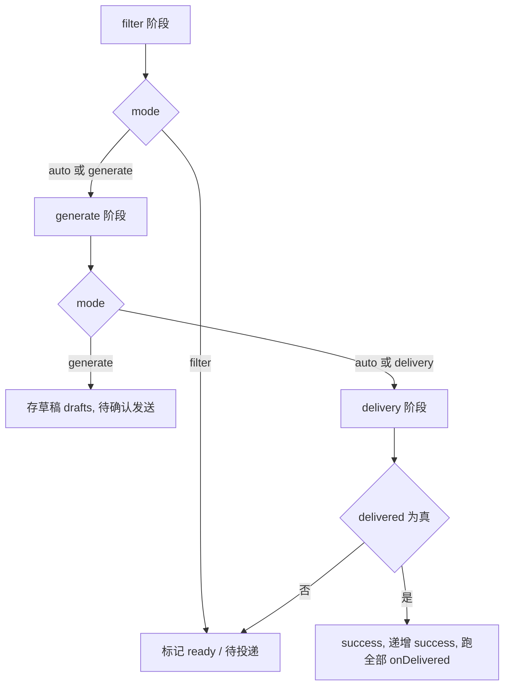

# 任务注册表：过滤器、生成器与发送器

投递工作流的每个"能力"都是一个任务（Task）。`src/composables/useApplying/handles.ts` 里的 `TaskRegistry` 类把**可复用**的任务（去重、关键词/区间过滤、AI、高德、打招呼）集中定义并导出为成员；`src/entrypoints/boss/delivery.ts` 的 `bossWorkflow` 则按业务顺序把它们与 Boss 站点专属任务（已沟通、岗位详情获取、金牌面试官、岗位投递、Boss 信息获取）拼成一条声明式流水线。任务 id 是**中文业务串**（`岗位名`、`Hr职位`、`重复沟通-相同HR`…），代码里通过 `tasks.<成员>()` 引用，所以搜中文 id 与搜成员名都能定位。

理解这一层的三个要点：**任务是否入列由装配期的工厂返回值决定**；**任务返回的 `TaskResult` 决定岗位是否被跳过**；**`onDelivered` / `onEnd` 是任务写入持久状态的唯一时机**（前者用于去重缓存，后者在工作流结束收尾）。工作流如何按 `phase` 分段执行、如何排序和超时，见 [投递工作流](../workflows/delivery-workflow.md)；AI 侧的提示词与解析细节见 [AI 筛选、招呼语与提示词模板](ai-filtering-and-greeting.md)。

## 启用模式：`undefined` 即禁用

每个任务都用 `defineTaskHandler(id, factory, opt?)` 声明。`factory(ctx)` 是一个**装配期（rebuild）只调用一次**的函数，它返回：

- `undefined`（或 `void`）→ 任务被禁止入列；
- 一个 `Handler` 函数 → 直接作为运行时处理器；
- 一个对象 `{ fn, before?, after?, onEnd?, onDelivered? }` → `fn` 为运行时处理器，其余为可选的挂载钩子。

工作流构建时对每条定义调用一次 `task.task(_ctx)`，只有返回了非空值才把该任务 id（以及它声明的全部 `deps` id）加入 `requiredIds`：

```ts
const result = await task.task(_ctx)
if (!result) continue
requiredIds.add(task.id)
task.deps.forEach((d) => requiredIds.add(d))
```

`requiredIds` 进一步决定 `pipeline` 的最终内容——`sort()` 只从 `requiredIds` 出发递归展开依赖。因此**"工厂返回 undefined"同时产生两个效果：该任务自身不入列、且不会被任何依赖它的任务的 `deps` 拉回来**。这正是配置开关的工作方式：`ctx.helper.conf.formData.<flag>.enable`（或 `.value`）为假就直接 `return`。

`nodes` 的五态判定（`rebuild` 末尾逐个 `rawTasks` 计算，标签页里的任务列表消费它）把上述机制显式化：

| 节点状态 | 判定条件 | 含义 |
| --- | --- | --- |
| `shadowed` | 该条定义不是同 id 的最后一条 | 被后定义覆盖，不会执行 |
| `failed` | 装配期抛出异常 | 配置错误，见下文 |
| `active` | 解析出了运行时 handler | 会执行 |
| `dependency_only` | 无 handler 但在 `requiredIds` 里 | 只作为 `deps` 占位 |
| `disabled` | 其余（工厂返回 `undefined`/`void`） | 配置关闭 |

一个附带后果：`deps` 不会自动拉起被禁用的依赖。例如 `AI招呼语生成` 未启用时，`岗位投递` 虽然声明了 `deps: ['岗位详情获取', 'AI招呼语生成']`，但后者不在 `requiredIds` 中，`sort()` 只处理 `requiredIds`，所以流水线里只剩前者。若某个被保留的 `deps` id 在 `taskMap` 里**根本不存在**（拼写错误、或忘记把它加进 `bossWorkflow`），`sort()` 会抛 `Missing dependency: <id>`；存在循环则抛 `Cycle: <id>`——两者都发生在 `rebuild` 内，会让 `withRun` 直接失败、本次运行不开始。反过来，若 `deps` 写的是**已声明但被禁用**的同名任务，它恰好被工厂返回值 `undefined` 跳过而不报错，这类"忘了开开关"的问题只能靠 `nodes` 里的 `dependency_only` 状态发现。

装配期抛出的异常也被妥善处理：`HelperConfigError`（例如 `aiFiltering.model` / `aiGreeting.model` "模型未配置"）会进入 `errors` 表，该任务被强制加入 `requiredIds` 并替换成"一调用就抛同一个错误"的处理器，节点状态为 `failed`，同时日志与 `alert` 提示"工作流构建错误, 请检查配置"（聚合文案的格式详见 [错误、重试与限流](errors-and-retries.md)）。即**配置错误在执行前就暴露，而不是等跑到该任务时才炸**：任何节点 `failed` 都会让 `errorMessage` 非空，`withRun` 随即抛错，整轮执行根本不开始。

## `defineTaskHandler` 与默认值

`defineTaskHandler` 是偏函数：返回一个"再传 options 得到 `Task`"的构造器。options 可覆盖 `task`（运行时处理器）、`phase`、`deps`、`before`/`after`、`label`、`desc`、`state`/`stateMsg`、`timeout`、`onEnd`、`onDelivered`；未覆盖项回落到定义时的 `opt`。

需要注意两个易错点：

- **`phase` 默认是 `'filter'`**。生成器/发送器必须在调用点显式传 `phase: 'generate'` 或 `phase: 'delivery'`，否则会被当成过滤器在筛选阶段执行。
- **`before` / `after` 是"options 在前、定义在后"拼接**（`[...(b ?? []), ...(opt?.before ?? [])]`），且与工厂返回对象里的 `before`/`after` 再拼一层。运行时对 `[...t.before, handler, ...t.after]` 顺序逐一执行，任一环节返回 `isSkip` 就中断整个任务。

`state` 同时充当"执行中的占位状态"（运行时先把 `jobResultMaps` 设为 `{ status: t.state ?? 'running', msg: t.stateMsg ?? '运行中' }`）和超时档位的选择依据：`state === 'ai'` → 120s，`state === 'request'` → 70s，`phase === 'delivery'` → 90s，其余 30s。任务级的 `timeout` 可覆盖。

## 任务清单

下表按 `bossWorkflow` 的声明顺序列出全部任务。"启用条件"即工厂返回 `undefined` 的判据（来自 `defaultFormData` 的默认值一并标注，便于判断开箱即用的行为）。

| 任务 id | phase | 启用条件（配置项） | deps | 典型跳过文案 |
| --- | --- | --- | --- | --- |
| `已沟通` | filter | 恒启用（`rawData.jobitem.contact` 为真时跳过） | — | `已沟通` |
| `重复沟通-相同公司` | filter | `sameCompanyFilter.value`（默认 `false`，`expire: 0`） | — | `相同公司已投递` |
| `重复沟通-相同HR` | filter | `sameHrFilter.value`（默认 `true`，`expire: 0`） | — | `相同hr已投递` |
| `岗位名` | filter | `jobTitle.enable`（默认 `false`） | — | `岗位名为空` / `岗位名含有排除关键词 [x]` / `岗位名不包含关键词` |
| `公司名` | filter | `company.enable`（默认 `false`） | — | `公司名为空` / `公司名含有排除关键词 [x]` / `公司名不包含关键词` |
| `薪资范围` | filter | `salaryRange.enable`（默认 `false`） | — | `不匹配的薪资范围 <text>, 预期: <范围>` |
| `公司规模` | filter | `companySizeRange.enable`（默认 `false`） | — | `不匹配的公司规模 <text>, 预期: <范围>` |
| `猎头过滤` | filter | `goldHunterFilter.value`（默认 `false`） | — | `猎头过滤` |
| `岗位详情获取` | filter | 恒启用（调用 `helper.onJobCardClick`） | — | 无（失败即报错） |
| `活跃度过滤` | filter | `activityFilter.value`（默认 `true`） | `岗位详情获取` | `无活跃信息,如果全失败请反馈` / `不活跃 [时间]` |
| `Hr职位` | filter | `hrPosition.enable`（默认 `false`） | `岗位详情获取` | `Hr职位在黑名单中: x` / `Hr职位不在白名单中: x` |
| `工作地址` | filter | `jobAddress.enable`（默认 `false`） | `岗位详情获取` | `工作地址含有排除关键词 [x]` / `工作地址不包含关键词: x` |
| `好友状态` | filter | `friendStatus.value`（默认 `true`） | `岗位详情获取` | `已经是好友了` |
| `工作内容` | filter | `jobContent.enable`（默认 `false`） | `岗位详情获取` | `工作内容含有排除关键词 [x]` / `工作内容中不包含关键词` |
| `金牌面试官` | filter | `bossGoldMedalHr.value`（默认 `false`） | `岗位详情获取` | `金牌HR` |
| `高德地图` | filter | `amap.enable`（默认 `false`） | `岗位详情获取` | `地址信息为空` / `未获取到地址经纬度` / `api数据异常` / `直线距离超标…` 等 |
| `AI筛选` | filter | `aiFiltering.enable`（默认 `false`，`score: 10`） | `岗位详情获取` | AI 返回的 `message`（含分数明细） |
| `AI招呼语生成` | generate | `aiGreeting.enable`（默认 `false`） | `岗位详情获取` | AI 返回的 `error` 文本（`msg: 'AI招呼语过滤'`） |
| `岗位投递` | delivery | 恒启用 | `岗位详情获取`、`AI招呼语生成` | 抛错 `AI招呼语尚未生成` / `AI招呼语为空`，或透传 `state.aiGreeting.error` |
| `Boss信息获取` | delivery | 恒启用 | `岗位投递` | 无（请求失败即报错） |
| `打招呼`（自定义招呼语） | delivery | `customGreeting.enable`（默认 `false`） | `岗位详情获取`、`岗位投递`、`Boss信息获取` | 无（发送失败即抛错） |
| `打招呼`（AI 招呼语） | delivery | `aiGreeting.enable`（默认 `false`） | `AI招呼语生成`、`岗位投递`、`Boss信息获取` | 透传 `state.aiGreeting.error`，抛错 `AI招呼语尚未生成` / `AI招呼语为空` |

关于 `label`：内置任务里只有部分定义带 label（`SameCompanyFilter` → `相同公司`、`SameHrFilter` → `相同HR`、`customGreeting` → `自定义招呼语`、`aiGreetingGenerate` → `AI招呼语生成`、`aiGreeting` → `AI招呼语`），其余 `label` 为空，展示与 `TaskResult.msg` 会回落到 `id`。`已沟通` 的 `desc` 是"已沟通过滤"，`岗位详情获取` 用 `state: 'request'` + `stateMsg: '获取岗位详情'`（因此超时档位是 70s）。

注意最后两行的 **id 都是 `打招呼`**：`tasks.customGreeting({...})` 与 `tasks.aiGreeting({...})` 各自被调用一次，于是同一个 id 在 `bossWorkflow` 里出现两条定义。`rebuild` 里 `taskMap.set(task.id, task)` 是后写覆盖，`nodes` 用 `taskMap.get(t.id)?.task === t.task` 判定"是否为最后一条定义"，先出现的 `自定义招呼语` 会被标为 `shadowed`。两者同时启用时**不能**期望"后者覆盖前者"：`sort()` 按 `requiredIds` 逐个展开依赖，两条同 id 定义都会进 `pipeline`；而 `resolvedHandlers` 只保留后者的 handler，`runTask` 的 `completed` 集合又按 id 去重——结果是第二条定义借用第一条的 handler（或反之）执行，行为取决于集合迭代顺序，属于应当避免的歧义。配置层必须保证二者互斥，见 [配置、预设与账号](configuration-and-presets.md)。

由此得到的通用规则：**同一 `id` 在 `bossWorkflow` 里重复声明是危险模式**。新任务应使用唯一 id；需要"二选一"的分支时，在同一个工厂里判断配置项，而不是声明两条同 id 定义。

## `TaskResult`：跳过的唯一出口

处理器统一返回 `void | TaskResult | Array<TaskResult | void>`。`taskResult` 提供两个构造器：

```ts
taskResult.skip(reason, status = 'warn') // { isSkip: true, reason, status }
taskResult.error(reason)                 // { isSkip: true, reason, status: 'error' }
```

运行时把数组结果用 `meginResults` 归并：`isSkip` 取或、`reason`/`msg` 换行拼接、`status` 取 `jobStatusList` 中**更靠后**的那一个（`success < warn < error`）。一旦归并结果带 `isSkip` 或 `status === 'error'`，就抛出 `{ workflowResult: res }` 中断当前岗位的后续任务。此外只有"filter 阶段 + `isSkip` + `warn`"的跳过会被写入岗位结果缓存（`jobCache`），所以纯 warn 的过滤结论可以跨运行复用，而 error 类结果不会。

`TaskResult.msg` 缺省时被填成 `t.label ?? t.id`；同一结果也按任务 id 累计进 `helper.statistics.todayData.value.tasks`，这就是统计面板里"各任务淘汰了多少岗位"的数据来源。

## 文本归一化：`normalizeFilterText`

关键词类过滤器（`岗位名`、`公司名`、`工作内容`、`Hr职位`、`工作地址`）全部经过同一个私有函数把两侧都归一化后再比较：

```ts
function normalizeFilterText(text: string) {
  return text.toLowerCase().replace(/\s/g, '')
}
```

即**转小写 + 删除所有空白字符**。语义后果：

- 大小写不敏感；`"Vue 开发"` 与 `"vue开发"` 等价。
- 关键词中间的空白会被吃掉，所以用户输入 `"Java 开发"` 实际等价于 `"java开发"`，无法用空格做"精确分隔"。
- 归一化后为空的关键词被 `continue` 跳过（不会命中任何东西），归一化后为空的岗位字段则直接按"空"跳过岗位（`岗位名为空` / `公司名为空`）。
- 只有包含关系（`includes` / 全等）判断，没有分词，因此关键词与中文文本的子串误伤是设计内的代价。

各过滤器的比较方式并不一致，改动时需要分别对待：

| 过滤器 | 比较方式 |
| --- | --- |
| `岗位名` / `公司名` / `工作地址` | `text.includes(keyword)` |
| `Hr职位` | `normalizedContent === keyword`（**全等**，不是包含） |
| `工作内容` | 正则 `(?<!(不\|无).{0,5})<keyword>(?!系统\|软件\|工具\|服务)` |

`工作内容` 的正则是最特别的一条：前置负向后行断言排除"不/无 + 至多 5 个字符 + 关键词"的否定语境（避免要求里写"不需要 xx"反而命中"xx"），后置负向先行断言排除"关键词 + 系统/软件/工具/服务"的工具名语境。关键词本身被直接拼进正则，因此**含正则元字符的关键词会改变匹配语义甚至抛错**——这是用户输入侧应当注意的边界。

`工作地址` 还有一处不对称：命中任意关键词且 `include === false` 时跳过含有关键词的岗位；**所有关键词都不命中时无条件跳过**（`return taskResult.skip('工作地址不包含关键词: ...')`），并不会因为 `include === true` 而放行。换句话说它实际是"白名单优先、黑名单兜底"的联合判定。另外它的进入条件里还有一条提前返回：`value.length === 0` 或 `jobData.address` 为空时**直接放行**（不判空、不跳过）。

`include` 的通用含义是"这组关键词是白名单还是黑名单"：`include === true` 时命中即**通过**（直接 `return`），全部不命中才跳过；`include === false` 时命中即跳过。默认值上 `jobTitle`/`hrPosition`/`jobAddress` 为 `true`，`company`/`jobContent` 为 `false`。`company` 与 `jobContent` 在循环开始时还有 `if (!x) continue`，即**空字符串关键词被直接跳过**（不参与任何判定）。

## 区间匹配：`rangeMatch` 的严格与宽松

`salaryRange` 与 `companySizeRange` 共用 `rangeMatch(rangeStr, form: [start, end, mode])`，`mode` 为真表示"严格"，假表示"宽松"：

1. 先对 `form` 的 `start/end` 排序，保证配置写反也能用。
2. 用 `/(\d+(?:\.\d+)?)(?:\s*-\s*(\d+(?:\.\d+)?))?/` 从岗位文本里抽出第一个数字区间；只有一个数字时 `inputEnd = inputStart`。
3. 单调化 `inputStart/inputEnd`；任一端非有限数则返回 `false`。

判定条件：

```ts
if (mode) {
  // 严格：岗位范围(input) 完全覆盖 目标范围(form)
  return start <= inputStart && inputEnd <= end
} else {
  // 宽松：任意重叠（闭区间）
  return Math.max(inputStart, start) <= Math.min(inputEnd, end)
}
```

方向感很重要：**严格模式要求"岗位给的区间完全落在期望区间之内"**，不是"期望区间被岗位覆盖"。所以 `salaryRange.value = [8, 13, true]`（严格）时，`10-12K` 通过、`6-15K` 与 `12-20K` 都被拒；而 `[8, 13, false]`（宽松，默认）时只要与 `8~13` 有交集就算通过。`rangeMatchFormat` 把期望值渲染成 `"8 - 13 K 宽松"` 这样的文案，随跳过原因一起显示，方便用户反推配置。

`salaryRange` 的特殊之处在于它按**单位分档**匹配：依次尝试 `元/时` → `advancedValue.H`、`元/天` → `advancedValue.D`、`元/月` → `advancedValue.M`、`K` → `value`（这里的 `K` 是月薪千元档）。只有 `text.includes(单位)` 成立时才用对应档位做 `rangeMatch`；若岗位的 `salary` 不含任何已知单位，则**一条都不校验**，过滤器放行。默认 `advancedValue` 的三档写成 `[0, 1, false]` 且注释说明"默认全部关闭，避免用户未配置而投递错误岗位"——但它只作用于含对应单位的文本，配合 `enable: false` 的默认值共同兜底。

`companySizeRange` 直接拿 `data.brand.scale`（如 `50-150人`）与 `companySizeRange.value`（默认 `[500, 2000, true]`，严格）比对，没有单位分档。

## 去重过滤器与 `onDelivered`

`重复沟通-相同公司` 与 `重复沟通-相同HR` 是唯二使用 `onDelivered` 的任务，机制值得单独说明：

- 判定 id：公司优先级 `jobData.companyId ?? jobData.brand.name`，HR 优先级 `jobData.hrId ?? jobData.boss.name`（Boss 侧 `hrId` 来自 `encryptBossId`）。
- 缓存键值：`${ctx.helper.key}:${id}`，即用账号/平台 key 做前缀——Boss 站点是 `boss:<id>`，因此**多账号共用同一份存储也不会互相误伤**。
- 存储：`helper.cache`（`HelperCache`）按命名集合管理 `id → 时间戳`，在 `sameCompanyKey = 'local:sameCompany'` / `sameHrKey = 'local:sameHr'` 下再按账号槽位隔离（`<key>:<encodeURIComponent(account)>`）。
- 命中即跳过，并把 `statistics.todayData.value.repeat++`，返回带 `isCache: true` 的 `TaskResult`。

关键设计点在于**装配期预加载**：工厂里先 `await ctx.helper.cache.has(sameCompanyKey, '')`，目的是把集合读进内存，避免投递成功后才在 `onDelivered` 里触发 IO。

`onDelivered` 的调用时机由工作流控制：只有当本次运行出现过任一 `phase === 'delivery'` 的任务（`delivered = true`），岗位状态才被置为 `success`，随后**遍历整条 pipeline**，逐个 `await t.onDelivered?.(ctx, data)`。因此 `onDelivered` 写缓存的代码位于：

```ts
onDelivered: async (ctx, { jobData: data }) => {
  const id = data.hrId ?? data.boss.name
  if (!id) return
  await ctx.helper.cache.add(sameHrKey, `${ctx.helper.key}:${id}`)
  await ctx.helper.cache.save(sameHrKey, ctx.helper.conf.formData.sameHrFilter.expire)
}
```

注意 `save()` 才真正持久化，并按 `expire`（毫秒，`<= 0` 表示永不过期）清理过期项；默认 `expire: 0` 意味着去重记录永久保留，用户开启该过滤后若不手动清理，"同一 HR 只投一次"会一直生效。`onDelivered` 内的异常被 `try/catch` 吞掉并记录日志，不会把成功的投递翻成失败。`helper-cache.test.ts` 覆盖了槽位隔离、调用前捕获槽位、扁平 id 集合只读写自身 key、以及"仅正数 expire 才清理"这几条不变量。

## `onEnd` 钩子

`onEnd` 是"整个工作流结束时调用"的收尾钩子，签名 `(ctx: TaskContext) => void | Promise<void>`。它在 `withRun` 的 `finally` 里执行，条件与 `onDelivered` 不同：**只有本次运行中真正执行过（进入 `usedTasks`）的任务才会被调用**，且调用时 `index` 固定为 `0`、日志上下文为 `workflow-end`。任何 `onEnd` 抛错都只记日志、不改变运行结果。

`defineTaskHandler` 允许定义期与调用期各带一个 `onEnd`，`rebuild` 会把它们组合成"先原定义、后工厂返回"的串行链：

```ts
task.onEnd = async (ctx) => {
  await onEnd?.(ctx)
  await result.onEnd?.(ctx)
}
```

目前 `TaskRegistry` 内置任务都没有使用 `onEnd`，它是留给自定义任务（如批量清理、汇总上报）的扩展点；`onDelivered` 的组合方式完全相同。

## 高德地图距离过滤

`高德地图`（`amap`）任务先用 `amapGeocode(jobData.address)` 把地址转成经纬度，再 `amapDistance(location)` 并发取三种出行方式（`type=0` 直线、`1` 驾车、`3` 步行）的距离与耗时，结果缓存在 `data.state.amap` 上（`WorkflowState.amap`，含 `geocode` 与 `distance`）。`src/utils/amap.ts` 里 `amapGeocode` 在 `status !== '1'` 时 **throw `new Error(res.info)`**（Key 缺失、无配额或地址无法解析），而 `amapDistance` 把每个 `type` 归一成 `{ ok, distance, duration }`、失败时给 `ok: false`。因此**地址解析失败会让岗位变成 `执行失败`，距离接口失败只是软跳过**。

随后对三档各调一次 `amapHandler(ctx, id, distance, duration, amapResult)`，返回三个 `TaskResult | void`，由 `meginResults` 归并：

1. `amap` 缺失或 `ok === false`（高德返回非 `status === '1'`）→ `skip('高德地图未初始化')`；
2. `distance > 0 && amap.distance > distance * 1000` → 距离超标（配置单位为公里，比较时换算成米）；
3. `duration > 0 && amap.duration > duration * 60` → 时间超标（配置单位为分钟，比较时换算成秒）。

阈值 `0` 表示不启用该档位限制，`0` 也是 `straightDistance` / `drivingDistance` / `drivingDuration` / `walkingDistance` / `walkingDuration` 的默认值，所以只填其中若干项是受支持的用法。`walkingDistance` 与 `walkingDuration` 是两个独立开关；直线档只传距离、`duration` 恒为 `0`，因此永远不会触发时间判定。注意跳过文案里的"设定"值取的是 `amap.straightDistance` / `amap.drivingDuration`，无论命中的是哪一档，读日志时需要留意这一点。

## AI 过滤器与招呼语任务

这两个任务的装配期会调用 `chatModel.createAgent(...)`，失败即抛 `HelperConfigError`（见上文"配置错误前置"），运行时只负责取文本、解析、判定：

- `AI筛选`：`chatModel.chat('filtering', data).then(r => r.text)` → `parseFiltering` 得到 `{ rating, message }`；`rating < aiFiltering.score` 即 `skip(message)`。`score` 默认 `10`，`parseFiltering` 的 `rating` 为 `positive 总分 − |negative 总分|`。
- `AI招呼语生成`：先 `delete data.state.aiGreeting` 清空旧值，`chat('greetings', data)` 后 `parseGreeting(content, aiGreeting.json === true)` 写入 `data.state.aiGreeting`；若结果带非空 `error` 则跳过（`msg: 'AI招呼语过滤'`）。
- `AI招呼语`（发送）：读取 `state.aiGreeting`，**缺失/为空/带 error 都抛错或跳过**；`json` 模式下按 `beforeImages` + 文本 + `afterImages` 组装成消息数组交给 `helper.sendMessage`，否则直接发字符串。

这形成一条硬依赖：生成任务的输出是发送任务的输入，而 `岗位投递` 同时在 `deps` 中依赖 `AI招呼语生成`、在运行时再次检查 `state.aiGreeting`，因此"没生成就不投递"被两处独立守住。

`打招呼`（`customGreeting`）则是纯本地模板：`greetingVariable.value` 为真时用 `renderTemplate(item.content, data)` 渲染文本项（`type: 'text'`），图片项原样保留；渲染是**单次替换、未命中即空串**，不做转义。它不需要任何 AI 配置，是 AI 招呼语之外的零成本替代路径。

## 发送器与投递任务

真正改变外部状态的任务有三个，其中两个在 `delivery.ts` 内联定义、发送器来自 `TaskRegistry`：

- `岗位投递`（内联）：先复检 `state.aiGreeting`（仅当 `aiGreeting.enable`），再调 `sendPublishReq({ securityId, encryptJobId })`；成功返回 `{ status: 'success', msg: '投递成功' }`，该 `success` 会被运行时临时改写成 `running / 投递处理中`，等后续任务跑完才落定。
- `Boss信息获取`（内联）：`getBossData({ securityId, encryptUserId: helper.uid })` 并**就地写回 `rawData.boss`**，因为发送消息需要 `bossId`、`bossSource`、`encryptUid` 等字段。
- `打招呼`（两个变体，均来自 `TaskRegistry`）：最终都落到 `helper.sendMessage?.(data, msg)`。Boss 侧实现在 `src/entrypoints/boss/index.ts`：把字符串包成单条 `{ type: 'text' }`，为**每条**消息重新生成 `clientMid = Date.now()`（复用同一 id 会让后续消息被判重），图片走 `counter.getImage` + `uploadImage` 后 `createImageMessage`，文本走 `createTextMessage`，最后经 `geek.client.publish('chat', ...)` 以 `qos: 1, retain: true` 发出，消息间隔 `delay(2)`。它读取的是 `rawData.boss.data` / `rawData.detail.bossInfo`，这正是 `Boss信息获取` 必须先跑的原因；`sendMessage` 只是可选链调用，`helper` 未实现时发送会被静默跳过。

投递失败的错误分级（`LimitError`、`RateLimitError`、`PublishError` 等）与重试语义见 [错误、重试与限流](errors-and-retries.md)；`sendPublishReq` 自带 `retries = 3` 与"120 位限额弹窗自动确认后重试"的分支。

## 执行顺序与阶段

`bossWorkflow` 声明顺序即意图顺序，但**真正执行由 `phase` 分段驱动**，同一 `phase` 内按 `pipeline`（`requiredIds` 深度优先展开）顺序串行：



`runTask` 是**依赖优先**的递归：先按 `t.deps` 递归执行依赖，再执行自身。这带来两个语义细节：

- `deps` 中的任务若 `canRun` 为假（`filter` 模式遇到 delivery 阶段任务、或 `generate` 模式依赖 delivery 阶段任务），直接抛 `Filter depends on delivery: <id>`。
- `before`/`after` 中访问 `data.state` 里由依赖产出的字段时，会撞上 `createLazyObject` 的 `DependencyMissingError`；运行时捕获后**按需补跑该依赖**再重试当前处理器一次。这是"详情数据尚未获取"类问题的兜底路径。

阶段化的直接后果是：过滤类任务只要在 `filter` 阶段跑完，`岗位投递` 之前的一切都已确定；`phase` 写错会让任务在错误的模式下被跳过（`filter` 模式只跑 `!t.phase || t.phase === 'filter'`，`generate` 模式不跑 `delivery`）。另外，若岗位结果已是 `ready`（`wasReady`），filter 阶段会被整段跳过（`if (mode !== 'delivery' && !wasReady)`），这是"筛选后单独投递"不会重复筛选的原因。

`rebuild` 在每次 `withRun` 开始时重跑，因此**配置修改无需重启工作流**，下一次执行即生效；但装配期工厂里的副作用（预加载缓存、`createAgent`）每次运行都会重新发生一次。

## 扩展一个新任务的检查清单

内置任务都在 `TaskRegistry` 里，站点专属任务则在 `bossWorkflow` 内联；两条路径的登记点不同，**扩展时最容易漏掉的就是"改了一处、忘了另一处"**。

### 加一个筛选类（filter）任务

1. **在 `TaskRegistry` 上加一个成员**：`defineTaskHandler('<中文任务 id>', factory, opt?)`。工厂内先读 `ctx.helper.conf.formData.<flag>` 判断开关，返回 `undefined` 表示禁用。
2. **配置项要同时改三处**：
   - `src/types/formData.ts` 的 `FormData` 接口加字段（关键词类通常是 `{ enable, value, include?, options? }`，区间类用 `FormDataRange = [start, end, strict]`）；
   - `src/composables/conf/info.ts` 的 `defaultFormData` 给默认值（关键词类默认 `enable: false`、区间类给出合理默认区间）；
   - 需要 UI 的话还要在配置面板注册一项：`src/composables/conf/sections.ts` 的 `useConfigSections()` 用 `key: '<formData 字段名>'` 声明控件（`select` / `salaryRange` / `companySizeRange` 等），再由 `HelperContext.getConfigItems()` 提供出去（Boss 侧直接 `return useConfigSections()`）。注意部分项按 `conf.configLevel` 分级门控（如 `jobAddress`、`salaryRange` 只在 `intermediate` 及以上出现）。
3. **在 `bossWorkflow` 里调用它**：`tasks.<member>({ deps: ['岗位详情获取'] })`。除非任务只依赖列表项数据（如 `已沟通`、`岗位名`），否则**必须声明 `deps: ['岗位详情获取']`**——`jobData.jobDescription` / `boss.title` / `address` / `activeTime` 等字段由 `onJobCardClick` 回填，运行时对 `data.state` 的懒代理会抛 `DependencyMissingError` 并按需补跑依赖，但显式声明更可靠、也让 `nodes` 显示正确的依赖。
4. **不要传 `phase`**：默认 `'filter'` 就是筛选任务想要的；显式传错会让它在 `generate`/`delivery` 模式下被跳过。
5. **跳过一律走 `taskResult.skip` / `taskResult.error`** 并给出可读 `reason`（会展示在岗位卡片与统计里），不要 `throw`——抛错会变成 `执行失败` 而非"被过滤"。

### 加一个动作类（generate / delivery）任务

1. 同样在 `TaskRegistry` 上定义，但调用点**必须显式传 `phase: 'generate'` 或 `phase: 'delivery'`**。
2. 若该任务要消费筛选阶段的结论，`deps` 指向相应任务 id；`delivery` 阶段任务通常会 `deps: ['岗位详情获取', '岗位投递']`（发送类还要 `'Boss信息获取'` 来补齐 `rawData.boss`）。
3. 选 `state` / `stateMsg`：`state: 'ai'` → 120s 超时，`state: 'request'` → 70s，`phase: 'delivery'` → 90s，其余 30s；需要更长时显式传 `timeout`。
4. 幂等性靠 `runTask` 的 `completed` 集合（按 id）保证——同一 id 在一次岗位执行里只跑一次，所以不要把"需要重复执行"的逻辑塞进同一个 id。
5. 需要在成功后写持久状态时用 `onDelivered`，并保证 `HelperCache.save` 之前已经有 `add`。`onDelivered` 只在本次运行出现过 `phase === 'delivery'` 任务时才触发，且异常被吞掉只记日志。

### 去重类任务

复用 `helper.cache` 的命名集合 + `${helper.key}:${id}` 前缀（`src/entrypoints/boss/requests.ts` 里的 `sameCompanyKey = 'local:sameCompany'`、`sameHrKey = 'local:sameHr'` 是既有两条），保持账号隔离；工厂里先 `await helper.cache.has(key, '')` 预加载，避免 `onDelivered` 时才触发 IO。`scripts/helper-cache.test.ts` 钉住了槽位隔离、异步加载前捕获账号槽位、扁平 id 集合只读写自身 key、以及"仅正数 `expire` 才清理"这几条不变量——但**没有**覆盖过滤任务层的逻辑。

### 测试与验证

`scripts/feishu-workflow.test.ts` 用真实 `useDeliveryWorkflow` + 三个假任务（id 恰为 `filter` / `generate` / `delivery`）验证了阶段编排、结果缓存与停止语义，可作为"任务配置写对没写对"的参照：它证明只有 filter 阶段 `warn + isSkip` 会落 `jobCache`、`error`/抛错不落盘、`useCache` 关闭时不读写缓存、以及命中缓存后所有阶段都不执行。新增任务后值得手工确认的三件事：`nodes` 里它是 `active` 而不是 `disabled`/`shadowed`、`pipeline` 顺序符合预期、跳过文案在岗位卡片上可读。
