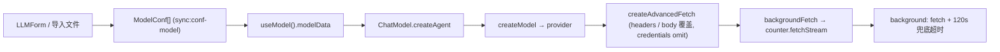
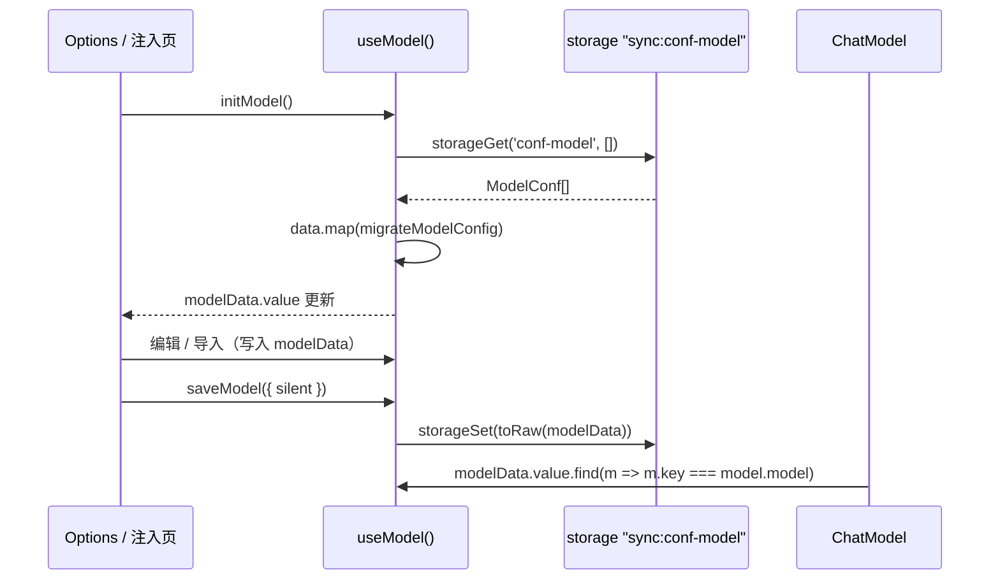
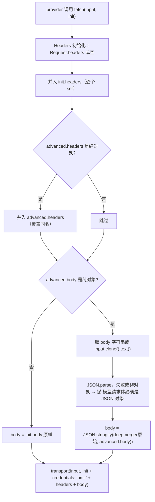

# AI 提供商配置与传输层

本页说明"一个 AI 模型"从配置表单到真正发出 HTTPS 请求之间的完整链路：配置如何存储与迁移、如何被构造成 `ai` SDK 的 language model、`advanced` 覆盖如何在序列化之后注入、以及请求为什么不是由页面而是由 background 发出。

页面本身是薄壳：`src/entrypoints/options/pages/ProvidersPage.vue` 只渲染 `LLMModelManage`，真正的状态位于 `useModel()` 的组合式函数中，而消费方是 `ChatModel`。相关的调用方语义见 [AI 筛选与招呼语](../concepts/ai-filtering-and-greeting.md)，消息桥与 `fetchStream` 的协议细节见 [消息与存储桥](../architecture/messaging-and-storage-bridge.md)。

整个链路可以概括为若干段，本页按此顺序展开：



## 配置模型与存储

配置的存储单元是 `ModelConf` 数组，整体写在单个存储键下：

```ts
export interface ModelConf {
  key: string                       // 列表内唯一 id
  name: string
  color?: string
  data?: ModelConfData              // 缺失 = 未完成的占位条目
}

export interface ModelConfData {
  base_url: string
  api_key: string
  model: string
  protocol: ModelProtocol
  advanced: ModelAdvanced           // { headers?, body? }
  other?: { timeout?: number }
}

export type ModelProtocol = 'openai-compatible' | 'openai-responses' | 'anthropic-messages'
```

- **存储键**是 `confModelKey = 'conf-model'`，由 `useModel().initModel()` 经 `counter.storageGet(confModelKey, [])` 读取，缺省为空数组；`saveModel()` 用 `counter.storageSet(confModelKey, toRaw(modelData.value))` 写回（`toRaw` 去掉 Vue 响应式代理，避免结构化克隆失败）。
- **`key` 的生成方式**是 `new Date().getTime().toString()`，新建（无 key 时现场生成）、复制（name 追加" 副本"）都这么做。因此同一毫秒内连续两次新建会撞 key——这是实践上唯一的冲突来源。
- **存储域是 `sync:`**：`conf-model` 不带前缀，`ContentCounter.genKey` 会把它归一化为 `sync:conf-model`；而账号（`local:conf-user`）、`local:FormDataPreses`、飞书配置等使用 `local:` 前缀。迁移/改写模型配置时不要把键名改成带 `local:` 的形式，否则用户会"丢配置"。这也是 `chrome.storage.sync` 配额（单项约 100KB、总量约 100KB）实际约束模型列表规模的原因。
- **`data` 可选**是刻意的：`key` 存在但 `data` 缺失的条目只能存在于列表中，不能参与推理（见下文 `createAgent`）。
- **`api_key` 是明文**存储、明文出现在 `storage.sync` 里（会随浏览器账号同步到其他设备）、也会被导出到 JSON 文件；`LLMModelManage.vue` 的提示文案明确警告导出文件包含密钥、不要分享。表单里 `api_key` 输入框初始为 `type="password"`，可点眼睛按钮切换为明文。

### 明文密钥与请求发起地：两个运行时世界

这是本页最容易被误改的安全边界：

| 事项 | 发生位置 |
| --- | --- |
| 读写 `sync:conf-model`（含明文 `api_key`） | 注入页 / options 页 —— 都是扩展页面，经 `ContentCounter.storageGet/storageSet` 直接访问 `browser.storage`，**不经过 background** |
| 组装请求（`createModel` → provider 序列化 → `createAdvancedFetch`） | 仍在**发起方的扩展页面**，不是 background；因此 provider 的 `api_key` 头、`advanced.headers` 都在页面侧 JS 内存里 |
| 真正调用 `fetch()` 发 HTTPS | `src/message/background.ts` 的 `BackgroundCounter.fetchStream`，在 **background service worker** 里执行 |

由此可推出三条实践含义：一是模型请求**不受页面 CORS 限制**（跨域由 background 的 host permissions 兜底），这是 `backgroundFetch` 存在的首要理由；二是 **background 从来看不到 API key**——它只收到已序列化好的 `url` 与 `headers`/`body`，因此不能也不会自行补鉴权，任何"在 background 里补鉴权头"的改动都会变成对这些 header 的重复注入；三是依赖浏览器 Cookie 会话的 provider 不会自动带上凭据，因为 `createAdvancedFetch` 已把 `credentials` 固定为 `'omit'`。

### 生命周期：谁读写、什么时候迁移



`initModel()` 被两处运行时调用：注入页 `src/App.vue`（挂载、`window` 获得 `focus`、切换账号/预设）与配置页 `src/entrypoints/options/App.vue`（初始化、保存/重载、切换预设）。因此"另一侧改了模型配置"的同步方式是**重新 `initModel`**，`modelData` 本身只是模块级 `ref`，没有跨上下文订阅。`modelData` 也没有按账号/预设分区——切账号只会重新读取同一份 `sync:conf-model`。配置页还有一层"脏检查"：列表编辑/复制/删除/导入**不会自动落盘**，必须点页面底部的保存按钮才会 `saveModel({ silent: true })`。

## 协议迁移：`migrateModelConfig`

早期配置用一个布尔标志 `responses` 表示是否走 Responses 协议。`migrateModelConfig` 是**读取时的纯函数迁移**（不写回存储）：

1. `data` 缺失时原样返回；
2. 若 `data.protocol` 为空，则按 `data.responses === true` 映射为 `'openai-responses'`，否则为 `'openai-compatible'`；
3. 删除已退休的 `responses` 字段；
4. 返回 `{ ...config, data: 新 data }`，其余字段（含 `key`/`name`/`color`）保持不变。

关键约束：**它只迁移协议标志，`advanced` 被有意原样保留**。函数注释写明"Only migrate the retired protocol flag; advanced is deliberately left untouched"。原因是 `advanced.headers` / `advanced.body` 是用户手写的任意 JSON，任何"顺手归一化"都可能改动用户注入的请求内容。

迁移在两个入口执行：`useModel().initModel()` 读取存储后 `map`；`LLMModelManage.importllm()` 导入 JSON 后也 `map`（导入提示"导入成功, 请手动保存"，所以导入的值在用户点击保存前仍是内存态）。`saveModel()` **不做**迁移——写入的是当前内存值，因此迁移结果只有在用户保存后才会回写存储。

新增协议或再退休一个字段时，正确做法是在 `migrateModelConfig` 的 `if (!data.protocol)` 分支里扩展映射，并保证对已有 `protocol` 的配置是恒等变换，避免覆盖用户在界面里选定的协议。

## Provider 构造：`createModel`

`createModel(conf: ModelConfData)` 是唯一把配置翻译成 `ai` SDK language model 的地方，三种协议共享同一份 `settings`：

```ts
const settings = {
  baseURL: conf.base_url || undefined,
  apiKey: conf.api_key,
  fetch: createAdvancedFetch(conf.advanced),
}
if (conf.protocol === 'anthropic-messages') {
  return createAnthropic(settings)(conf.model)
}
const provider = createOpenAI(settings)
return conf.protocol === 'openai-responses'
  ? provider.responses(conf.model)
  : provider.chat(conf.model)
```

要点：

- **协议归属靠 provider 工厂而非 URL**：`@ai-sdk/openai` 的 `createOpenAI` 提供 `.chat()` 与 `.responses()` 两个模型入口；`@ai-sdk/anthropic` 的 `createAnthropic` 只有默认入口。未知协议值会落到 `provider.chat()` 分支。
- **`base_url` 是基础地址**，不能带 `/chat/completions`、`/responses` 或 `/messages`；表单提示与 `protocolPlaceholder` 都按协议给出示例基础地址。`base_url` 为空时传 `undefined`，交给 SDK 默认值。
- **空 `api_key` 是合法的**：本地兼容服务可留空，表单里 `api_key` 不是必填项。
- **`fetch` 注入点**是高级覆盖与后台传输的唯一挂载处，所有协议都经过它。
- `createModel` 的调用点有两类：`ChatModel.createAgent` 构造 `ToolLoopAgent`；`LLMModelEdit.vue` 的"测试"按钮用 `streamText({ model: createModel(data.data), prompt })` 直接跑一次流式请求，与生产链路共用同一构造函数（因此"测试通过"意味着同一条 `advanced`/传输链路可用）。
- `createModel` **不缓存** provider 实例：每次 `createAgent` 都新建一个，provider 级配置（`baseURL`/`apiKey`/`fetch`）因此总是取自当前 `ModelConfData`。

表单侧（`LLMForm.vue`）对 `advanced` 做 JSON 文本编辑与校验：必须是对象；`headers`/`body` 若存在也必须是对象；`headers` 的每个值必须是字符串。校验通过后 `formData.advanced = JSON.parse(advancedJson)`。校验失败时"测试"与"应用到列表"都会被拦下。`LLMModelEdit.validate()` 另外要求 `base_url` 与 `model` 非空，且 `base_url` 必须是合法的 `http:`/`https:` URL；`api_key` 不校验非空。

## 高级覆盖：`createAdvancedFetch`

`createAdvancedFetch(advanced, transport = backgroundFetch)` 返回一个 `fetch` 兼容函数，包在 provider 外面。它的核心不变量写在注释里：**在 provider 已经序列化出协议相关请求之后再应用覆盖**。



- **header 合并顺序**是 `Request.headers` → `init.headers` → `advanced.headers`，后者同名覆盖；全部用 `new Headers(...).forEach((v, k) => set(k, v))` 归一化，因此大小写不敏感地覆盖，且不会产生重复头。
- **body 合并**用 `deepmerge`：嵌套对象递归合并、**数组整体替换**（`deepmerge` 对数组直接深拷贝替换）、`__proto__` 键被忽略以防原型污染。若原始体不是 JSON 对象则抛 `模型请求体必须是 JSON 对象`——例如给某个协议配了非 JSON 请求体时，`advanced.body` 会导致整次请求失败而不是被静默丢弃。
- **读取原始 body 的兜底**：`init.body` 存在就用它；否则若 `input` 是 `Request`，`await input.clone().text()` 取序列化结果。这一步是必需的，因为下游 `backgroundFetch` **不读取 `Request` 的 body**。
- **`credentials: 'omit'` 强制生效**：`transport(input, { ...init, credentials: 'omit', headers, body })` 把 `credentials` 放在 `init` 之后，覆盖 provider 可能带上的 `include`。模型请求因此不会携带宿主站点的 cookie 跨站外发，同时也不受 `backgroundFetch` 里 `credentials ?? 'include'` 默认值影响。
- **`transport` 是构造参数**，默认 `backgroundFetch`。这是测试/替换传输的扩展点（当前仓库没有直接替换它的调用方）。
- **`advanced` 在构造时就固化**：`createModel` 里 `createAdvancedFetch(conf.advanced)` 捕获的是当时对象的引用，之后再改表单不会影响已创建的 provider。`advanced.headers`/`advanced.body` 不是纯对象时被**静默跳过**（不报错），因此字段写错类型的表现是"覆盖没生效"而不是报错——校验靠 `LLMForm`，运行时不兜底。

## 后台传输：`backgroundFetch`

`backgroundFetch(input, init)` 把"在 background 脚本里发请求"包装成 `fetch` 兼容函数，使模型请求既绕开页面 CORS，又保留 `Response` 语义：

1. 生成取消句柄 `requestId = bgfetch-${Date.now()}-${seq++}`（模块级 `seq` 防同毫秒重复）。
2. 归一化入参：入参是 `Request` 时取 `url` 并把 `method/headers/credentials/mode` 摊平进 `mergedInit`，随后被 `init` 覆盖；否则直接用字符串/`URL` 的 href。
3. **已 abort 的 signal 立即拒绝**：`Promise.reject(new DOMException('This operation was aborted', 'AbortError'))`，不发消息。
4. 注册 `signal` 的 `abort` 监听，回调里 `void counter.fetchStreamAbort(requestId).catch(() => {})`——**取消是射后不理的**，不等待、也不把后台取消错误抛给调用方。
5. 调 `counter.fetchStream({ requestId, url, init })`，`init` 被裁剪为 `method`、`headers`（`Headers`/数组/对象归一为普通对象）、`body`（**仅字符串**）、`credentials`（默认 `include`）、`mode`（默认 `cors`）。
6. 回包是 `{ status, statusText, headers, body: number[] }`；重新组装为 `new Response(new Uint8Array(body), { status, statusText, headers })` 返回给 provider。
7. `finally` 里 `signal.removeEventListener('abort', onAbort)`，避免长生命周期 signal 泄漏监听。

跨桥的序列化约束决定了第 5 步的裁剪：`number[]` 是为了让字节数组能过扩展消息边界（详见 [消息与存储桥](../architecture/messaging-and-storage-bridge.md)）。副作用是 `FormData`/`Blob`/`ReadableStream` 作为请求体在模型链路上不可用——`createAdvancedFetch` 用字符串化后的 JSON 正好落在可传输的类型里。

**AI SDK 的增量流因此不是"网络流"**：provider 把 `backgroundFetch` 当成普通 `fetch` 消费，而它返回的是一个**内容已经完整**的 `Response`（从 `Uint8Array` 重建）。SDK 仍会在本地逐块解析该 `Response` 的 SSE body，所以 `ChatModel.chat` 的 `toUIMessageStream` 回调照样逐片触发，但**第一片 UI 增量要等整个响应收完才出现**；首 token 延迟等于完整响应时间。这也是"AI 筛选/招呼语看起来卡住很久然后一口气刷出文字"的根因，排查时不要先去怀疑 provider 的流式能力。

### 120 秒兜底超时与取消传播

background 侧 `BackgroundCounter.fetchStream` 把每个 `requestId` 映射到一个 `AbortController` 并存进 `fetchControllers`，真正发请求时用：

```ts
signal: AbortSignal.any([controller.signal, AbortSignal.timeout(120_000)])
```

- **为什么需要兜底**：正常情况下取消已经由 `fetchStreamAbort` 覆盖；但回包要经消息桥投递回调用方，若投递不到（标签页 URL 变化、options 页关闭等），调用方的 Promise 会**永不 settle**。`AbortSignal.any` 让"调用方取消"与"120 秒硬超时"任一触发都中止底层 fetch，把悬挂收敛为一个可观察的错误。
- **超时是后台 fetch 的绝对上限**，与模型自身的时间预算无关：`ChatModel.chat` 用的是 `modelConf.data?.other?.timeout ?? 60000`，作为 `agent.stream({ timeout })` 传给 SDK。这在语义上构成了"SDK 层 60 秒默认 / 传输层 120 秒上限"两层结构，且 `other.timeout` 没有在 `LLMForm.vue` 中暴露编辑控件（只能通过导入 JSON 设置）。由于第一片 UI 增量要等完整响应到达，长文本或长推理模型在 60 秒默认值下比在真正的流式链路上更容易先触发 SDK 超时。
- **两者都由同一个 `AbortController` 家族驱动**：调用方 `backgroundFetch` 记录 `signal`，abort 时发 `fetchStreamAbort`；background 把该 controller 与超时信号用 `AbortSignal.any` 合并，因此取消与超时对底层 `fetch` 是等价的中止。
- **`requestId` 是取消的唯一句柄**：`fetchStream` 在 `finally` 中删除 `fetchControllers` 条目，所以请求结束后再 abort 是安全的空操作；`fetchStreamAbort` 对未知 id 返回 `true`。
- **不是真正的流式**：`fetchStream` 内部 `await res.arrayBuffer()` 读完响应体再一次性返回，UI 看到的是完整结果而非逐 token 增量。
- **`fetchStream` 不会检查 `res.ok`**：HTTP 4xx/5xx 也按原样包装成 `Response` 返回给 provider，由 AI SDK 解析错误体并抛 `APICallError`。这与同一个 background 里的 `counter.request`（非 2xx 直接 `throw new Error('状态码: ...')`）语义不同——不要把两者混用于模型调用。

## 使用者：`createAgent` 与模型缺失的降级

`ChatModel.createAgent(model: FormDataAi, name, { json })` 是配置到运行时 agent 的绑定点：

```ts
const conf = this.ctx.models.modelData.value.find((m) => m.key === model.model)
if (!conf?.data || !model.model) {
  return false
}
```

- 查找键是 `FormDataAi.model`（功能配置里选中的模型 `key`）对 `modelData` 的 `key`。
- **任一条件不满足即返回 `false`**：功能未选模型，或选中的条目没有 `data`。返回 `false` 时**不覆盖**已存在的 agent，`agents` Map 保持原样。
- 调用方必须自行处理 `false`：`aiFiltering` 抛 `HelperConfigError('aiFiltering.model', 'AI筛选模型未配置')`，`aiGreetingGenerate` 抛 `HelperConfigError('aiGreeting.model', 'AI招呼模型未配置')`。任务因此在**第一阶段的配置检查中就被阻止**，不会走到逐岗位请求。注意 `HelperConfigError` 是普通 class（不是 `Error` 子类），也不在 `BossHelperError` 体系内。
- 成功时注册 `ToolLoopAgent({ model: createModel(conf.data), output: json ? Output.json() : Output.text(), allowSystemInMessages: true })`，同时把 `[agent, conf, model]` 存进 `agents`，后续 `chat()` 用其中 `conf.data?.other?.timeout` 与 prompt。
- **`createAgent` 总是覆盖**：成功路径无条件 `this.agents.set(name, ...)`。因此它在任务处理器里被调用是安全的（`aiFiltering` 每次进入处理器都会重建 agent），但这也意味着 `agents` 里缓存的是**创建时刻**的 `conf` 与 `model`（prompt）快照，不是响应式引用。

`ChatModel.chat(agentName, data, { disableMessages })` 是实际的调用面：

1. 取不到 agent 就抛 `Agent ${agentName} not found`。
2. prompt 是字符串时包成单条 `user` 消息，否则 `jsonClone` 后逐条 `renderTemplate(msg.content, data)` 注入岗位数据（`{{jobData.xxx}}` 语法，见 `src/utils/ai.ts`）。
3. 每个岗位 `key` 对应一个 `VueChatState`；首条是 `uiRole: 'jd'` 的 system 消息，包含岗位名、薪资、公司、地址、学历与 JD 正文。
4. `agent.stream({ timeout, messages, ... })` 后用 `stream.toUIMessageStream({ sendReasoning: true })` 逐片写入状态；`APICallError` 被格式化为 `请求错误 <status>: <message>`。
5. 结束时若 `state.error` 存在则抛出，调用方（任务处理器）据此判定任务失败。

由于 `agent` 只按角色名（`'filtering'` / `'greetings'`）存一份，**修改模型配置后需要重新 `createAgent` 才能生效**；而 `modelData` 变化（`initModel`）不会自动重建已有 agent。`HelperContext` 构造时 `new ChatModel(this)`，所以注入页与 options 页各有一个独立的 `ChatModel` 实例和独立的 `agents`/`states`——options 页的"测试任务"因此不会污染注入页的状态。

## 变更与排障指引

| 症状 | 检查点 |
| --- | --- |
| "AI筛选模型未配置" / "AI招呼模型未配置" | 功能配置里的 `model` 是否指向存在的 `ModelConf`，该条目是否有 `data` |
| 401/404 且路径怪异 | `base_url` 是否误带 `/chat/completions`、`/responses`、`/messages` |
| 协议能力缺失（无 reasoning、无 Responses 特性） | `protocol` 是否被 `migrateModelConfig` 回填成预期值；旧配置可能仍依赖已删除的 `responses` 布尔 |
| 自定义头/参数没生效 | `advanced` JSON 是否通过 `LLMForm` 校验；`body` 是否为对象（数组/标量无法在非 JSON 原始体上合并） |
| `模型请求体必须是 JSON 对象` | `advanced.body` 用在了非 JSON 请求体上；不要为这类协议配 `body` 覆盖 |
| 长响应在 120 秒左右中断 | background 兜底超时；同时核对 `other.timeout` 与供应商侧限制 |
| 文字"卡很久再一次性出现" | 预期行为：`fetchStream` 收完整响应才回包（见上文），不是 provider 未流式 |
| 改了模型配置但任务仍用旧配置 | `agents` 里的 agent 是创建时快照；重新执行任务会重建，但 `disableMessages` 的测试路径也走同一 `createAgent` |
| 请求本应带 cookie 却失败 | 模型链路固定 `credentials: 'omit'`；需要 cookie 的场景应走 `counter.request` 而非模型传输 |

## 测试与扩展点

仓库中没有针对 `migrateModelConfig`、`createAdvancedFetch`、`backgroundFetch` 的单元测试（`scripts/*.test.ts` 覆盖的是飞书同步与缓存，`packages/devlog-ui` 覆盖日志 UI）。实际可用的验证面有两层：

- **单模型连通性**：`LLMModelEdit.vue` 的"测试"抽屉对当前表单值跑一次 `streamText`，能看到 `reasoning` 与 `text` 增量，是验证 `base_url`/`protocol`/`advanced` 最快的方式。
- **端到端行为**：`LLMPromptEdit.vue` 的"测试任务"用 `helper.chatModel.createAgent(...)` + `chat(..., { disableMessages: true })` 对勾选的岗位批量跑真实提示词（每批 4 个并发），结果按 `prompt-test-results:<feature>` 存在 sessionStorage；它同时走 `parseFiltering`/`parseGreeting`，是验证"配置 → agent → 传输 → 解析"整链的入口。该路径会把 `chatModel.agents` 中对应角色替换成测试用 agent。

可安全依赖的扩展点：

- 在 `createModel` 里为已有协议更换模型入口，或在 `migrateModelConfig` 中做**向下兼容**的字段迁移。
- 把 `createAdvancedFetch` 的第二个参数替换成别的 `fetch` 实现（例如录制型 transport）以供测试。
- `ModelConfData.other` 目前只承载 `timeout`，是放置模型级附加参数的自然位置；但任何新增字段都必须在 `LLMForm`/导入导出路径上被保留，否则 `saveModel` 之后会丢失。
- 新增 `ModelProtocol` 需要在**至少三处**同步：`type.ts` 的联合类型、`providers.ts` 的工厂分支、`LLMForm.vue` 的 `protocols` 与 `protocolHelp`/`protocolPlaceholder`（否则下拉框选不到、提示为空）。若新协议不是 OpenAI/Anthropic 兼容，还要引入新的 `@ai-sdk/*` 包并在 `createModel` 里早返回。
- 让传输层真正流式，需要同时改 `BackgroundCounter.fetchStream`（改为长连接 + 增量消息）与 `backgroundFetch` 的 `Response` 构造，并新增配套的桥接消息类型；`createAdvancedFetch` 与 provider 层不需要改。
