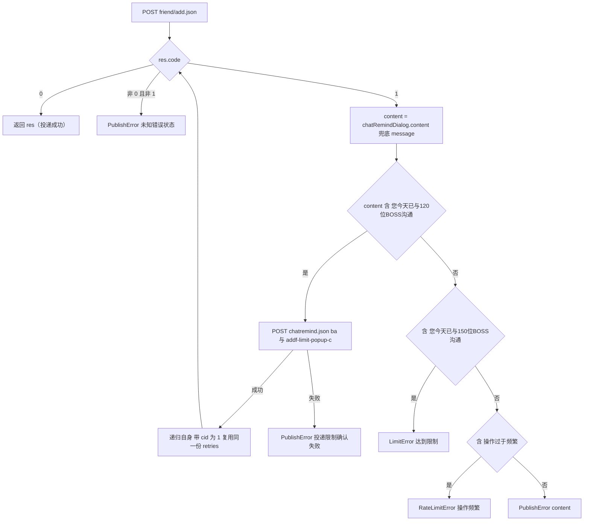
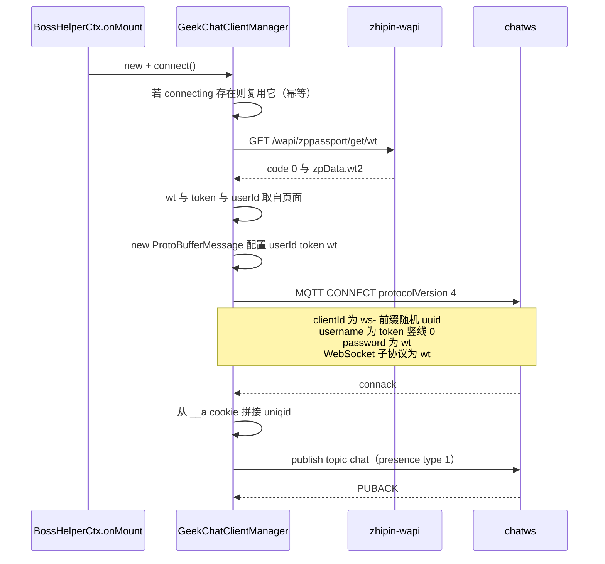
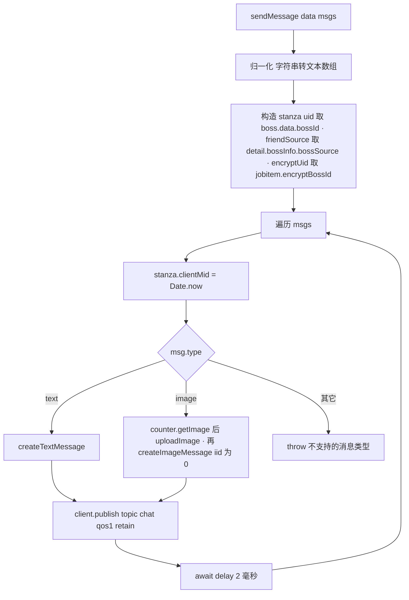

# Boss 直聘 HTTP 与 MQTT 接口接入

Boss Helper 不带任何自己的后端：所有业务能力都建立在 `www.zhipin.com` 的私有 `wapi/*` 接口和 `ws.zhipin.com` 的聊天长连接上。这意味着本扩展是一个**纯前端的上游协议客户端**，鉴权凭据、错误码语义、protobuf schema 全部由对方掌握，对上游协议变化的抵抗力就是这套集成的全部生命力。

本页按"鉴权 → HTTP 端点 → 错误分类 → MQTT 聊天发送"的顺序描述这些边界，并给出改动时的风险点。投递失败如何在 UI 上呈现、如何被工作流消费，见 [错误分类、受控执行与失败上报](../concepts/errors-and-retries.md)；请求在工作流中的位置见 [投递工作流](../workflows/delivery-workflow.md)；图片二进制如何跨世界搬运见 [消息与存储桥](../architecture/messaging-and-storage-bridge.md)。

## 未公开接口：本页的前提

`wapi/zpgeek/friend/add.json`、`wapi/zpchat/geek/getBossData`、`wapi/zppassport/get/wt`、`wapi/zpupload/*` 以及 `wss://ws.zhipin.com/chatws` 上的 protobuf 帧**都不是 Boss 直聘公开 API**。它们是从官方 Web 客户端的流量与打包产物里逆出来的：

- 字段名、`code` 语义、URL 路径没有任何契约承诺，平台可以在不发版的情况下改变它们；
- `geek-chat-core.ts` 里的 `.proto` 文本、`chat/index.ts` 里的 MQTT 参数（`appid: 9019`、`version: '4.92'`、`channel: '-1'`）是**照着官方客户端抄的伪装值**；
- `check_claims` 意义上的"兼容性"完全依赖本仓库跟进速度。

因此本页所有描述都应读作"当前观测到的行为"，而不是"保证的行为"。改动这一层的唯一可靠验证手段是**装包后的 `logger` 协议日志**（见下文 `logProtocol`）与实际发送结果对照。

## 两个凭据来源，两套用法

上游给的凭据形式并不统一，页面脚本里因此并存两条取凭据的路径，二者的来源、请求头、失败语义都不同：

| 凭据 | 读取方式 | 用于 | 缺失时的表现 |
| --- | --- | --- | --- |
| `bst`（HTTP token） | `window.Cookie.get('bst')` | 全部 `wapi/*` HTTP 请求的 `Zp_token` 头 | `toast` 提示"没有获取到token,请刷新重试"，随后抛 `PublishError` / `GreetError`（`uploadImage` 例外，抛普通 `Error`） |
| `_PAGE.token` + `wt2`（聊天凭据） | `window._PAGE.token`，配合 `GET /wapi/zppassport/get/wt` 返回的 `wt2` | MQTT 的 `username` / `password` / WebSocket 子协议 | 抛普通 `Error`（`未获取到当前用户 token` / `未获取到有效的 wt`） |

几个容易踩的点：

- `bst` 取自**页面注入的 `window.Cookie` 辅助对象**（类型见 `src/env.d.ts`），不是 `document.cookie`——httpOnly 的 cookie 只有宿主页面的封装能读到。
- `_PAGE.token` 与 `bst` **不是同一个值**。`getBossData` 里有一行注释"`userInfo.value?.token` 不相等！"明确记下了这个坑：用账号配置里的 token 调 `getBossData` 会失败。`env.d.ts` 里被注释掉的 `// zp_token: string; 7.18 寄！` 记录了同一个事实的另一面——页面曾经暴露过 `zp_token` 字段，现在只能从 cookie 拿。
- 聊天侧的用户 id 是**数值 uid**：`GeekChatClientManager` 用 `window._PAGE.uid ?? window._PAGE.userId` 并要求它是正的 `Number.isSafeInteger`。而 `BossHelperCtx.uid` 返回的是 `window._PAGE.encryptUserId`（加密字符串），它既作为 `getBossData` 的 `bossId`，也作为 `sendMessage` 里 `stanza.encryptUid` 的来源。`BossHelperCtx.uid` 里那段被注释掉的 `return window?.Cookie.get('bst') // token ?` 说明这条取值曾反复摇摆过，改动前务必确认调用方要的是"数值 uid"还是"加密 uid"。
- `getJobDetail` / `sendPublishReq` / `getBossData` / `uploadImage` 各自在函数体内**重复读取**一次 `bst`（没有集中的请求拦截器或 token 缓存）。好处是刷新页面后立刻生效；代价是新增端点时容易漏掉 `Zp_token` 头，表现为 401 或空 `zpData`，而不是一条清晰的错误。

## HTTP 端点清单

全部 BOSS 端点都在 `src/entrypoints/boss/requests.ts`，除 `getJobDetail` 外都遵循同一种重试骨架：**传输层失败递归 `retries - 1`，业务错误原样上抛不重试**。

| 函数 | 方法 / URL | 必需参数 | 超时 | 重试 |
| --- | --- | --- | --- | --- |
| `getJobDetail` | `GET https://www.zhipin.com/wapi/zpgeek/job/detail.json` | query `securityId`、`lid`，附加 `_=Date.now()` 防缓存 | `AbortSignal.timeout(5000)` | **无**，失败直接向上抛 |
| `sendPublishReq` | `POST https://www.zhipin.com/wapi/zpgeek/friend/add.json` | query `securityId`、`jobId`（= `encryptJobId`），限额确认后追加 `cid` | `AbortSignal.timeout(10_000)` | 默认 3 次，仅传输错误消耗预算 |
| `chatremind`（内联） | `POST https://www.zhipin.com/wapi/zpCommon/actionLog/geek/chatremind.json` | query `ba`（来自弹窗 `chatRemindDialog.ba`）、`action=addf-limit-popup-c` | `AbortSignal.timeout(10_000)` | 无独立重试；失败即 `PublishError` |
| `getBossData` | `POST https://www.zhipin.com/wapi/zpchat/geek/getBossData` | `FormData`：`bossId`（= `encryptUserId`）、`securityId`、`bossSrc=0` | `AbortSignal.timeout(10_000)` | 默认 3 次 |
| `uploadImage`（秒传） | `POST https://www.zhipin.com/wapi/zpupload/quicklyUpload` | `URLSearchParams`：`fileMd5`、`fileSize`、`source=chat_file`、`securityId`；`referrer` 固定为聊天页 | 无 | **无重试**，`code !== 0` 或没有 `zpData.url` 时静默落到完整上传 |
| `uploadImage`（完整上传） | `POST https://www.zhipin.com/wapi/zpupload/image/uploadSingle` | `FormData`：`securityId`、`source=chat_file`、`file` | 无 | **无重试**，失败抛 `Error('上传图片失败: ...')` |
| wt（聊天） | `GET https://www.zhipin.com/wapi/zppassport/get/wt` | 无（依赖页面 cookie） | 无 | **无重试**，`code !== 0` 抛 `Error` |

约定与陷阱：

- **参数全部走 query 或 `FormData`，没有 JSON body**。`sendPublishReq` 的 `_params` 会被 `URLSearchParams.append` 逐个追加，这也是 `cid: 1` 能透传进第二次调用的唯一通道。
- **`uploadImage` 的请求头是 `zp_token`（小写）**，其它函数是 `Zp_token`。两者都指向同一个值，但大小写不一致说明这部分是照着抓包抄下来的，不能想当然"统一一下"。
- **图片上传是"秒传优先"的两段式**：先按 `fileMd5 + fileSize`（`fileMd5` 由 `src/utils/file.ts` 的 `calculateFileMD5` 用 SparkMD5 在渲染层现算）问服务端是否已有该文件，命中（`code === 0 && zpData.url`）就直接复用远端 URL，从而**完全跳过上传字节**；未命中才走 `uploadSingle`。返回结构被裁剪成 `{ tinyImage, originImage }`，其中 `tinyImage` 的宽高在两条分支里都被**硬编码为 `200 × 118`**，而不是取 `metadata`——这是聊天卡片缩略图的既定比例；`originImage` 的宽高则来自 `metadata`。
- **`getJobDetail` 在当前代码中是死路径**。仓库内没有任何调用点；`BossHelperCtx.onJobCardClick` 里对应的调用被注释掉了，改由"点击宿主岗位卡片 → 轮询宿主 Vue 的 `jobDetail` ref（100ms 一次，上限 60s）"获取详情。它仍然是这一层唯一无重试的端点样本，也解释了为什么详情获取失败会以 `bossZpDetailData获取超时` 而不是 `PublishError` 的形式暴露。
- **`getBossData` 有一条专属重试分支**：平台返回 `message === '非好友关系'` 时不抛 `GreetError`，而是带着这条消息递归一次并消耗一次预算。此时好友关系尚不存在，正式投递之后就会成立，属于已知的时序抖动。
- **工作流里的调用顺序**（`delivery.ts`）保证了上述时序：`岗位投递`（`sendPublishReq`）在 `delivery` 阶段先跑，`Boss信息获取`（`getBossData`）依赖它，随后 `customGreeting` / `aiGreeting` 才发消息。

## `sendPublishReq` 的错误分类：一条必须守住的分界线

`friend/add.json` 用 `code` 表达三种完全不同的语义，其中 `code === 1` 是"业务弹窗"，真正的含义藏在 `zpData.bizData.chatRemindDialog.content` 的自然语言文案里。于是错误分类退化为**中文字符串匹配**：



四种结果的语义差别很大，改动时不能合并：

| 命中 | 抛出的异常 | `name`（UI 标签） | 语义 |
| --- | --- | --- | --- |
| 120 位 → 确认后重发 | 不抛（递归） | — | **平台的可关闭提醒**，补一次 `chatremind.json` 确认即可继续投递，第二次请求带 `cid: 1` |
| 150 位 | `LimitError` | 达到限制 | **今日额度真的用尽**，重试无意义 |
| 操作过于频繁 | `RateLimitError` | 操作频繁 | **速率限制**，稍后可恢复 |
| 其它文案 | `PublishError` | 投递出错 | 兜底 |

**递归重发复用同一份 `retries` 预算**（`sendPublishReq(data, undefined, retries, { cid: 1 })`），120 分支不递减，于是确认动作本身不"额外"消耗尝试额度；代价是如果确认后平台仍返回 120 文案，会**无限递归**——安全的做法是把"已带 `cid` 就不要再确认"作为显式守卫，当前代码依赖的是"带 `cid` 后平台不再返回同一弹窗"这一外部假设。另外 `retries === 0` 的守卫在函数最开头，且 120 分支是 `return` 而非 `await`，错误语义都在 Promise 链上传递。

另一条分界线在 `catch` 里：`if (e instanceof BossHelperError) throw e`，其余异常才递归重试。这条判断依赖 `BossHelperError` 构造函数里的 `Object.setPrototypeOf(this, new.target.prototype)` 保持 `instanceof` 可用；一旦转译目标或错误跨世界传递丢掉了原型，`LimitError` 会被当成网络错误重试三次，用户拿不到"已达上限"的即时反馈。同理 `getBossData` 侧只 `instanceof GreetError` 才算业务错误，其余（含超时）一律消耗预算重试。

## MQTT 聊天发送

发送招呼语要绕开官方页面，直接向聊天长连接写 protobuf 帧。这条链路由两个文件承担：`chat/geek-chat-core.ts` 负责 **protobuf 编解码**，`chat/index.ts` 的 `GeekChatClientManager` 负责 **连接与发布**。

### 连接：wt 换取与 clientId 构造



要点：

- **`connect()` 自身可重入**：`connecting` Promise 与 `client && !client.disconnected` 两个短路条件保证同一时刻只有一条连接，`onMount` 每次路由切换都会调一次。
- **`wt` 一物两用**：既是 MQTT `password`，也是 WebSocket 子协议名（`new WebSocket(url, wt ? [wt] : ['mqtt'])`）。少了子协议，握手层就会被拒，比 CONNECT 层的鉴权失败更难定位。
- **`clientId` 每次连接随机**（`ws-${getUuid(16, 16)}`），配合 `clean: true` 是干净的会话；服务端**不会**补投离线消息。`keepalive: 25`、`reconnectPeriod: 1000`、`connectTimeout: 10000`、`protocolVersion: 4` 这组参数共同定义了"断线多久后自动恢复"。
- **presence 是连接成功后的第一件事**，`type: 1`、`lastMessageId: 0`、`retain: true`、`qos: 1`。`clientInfo` 里塞了一批伪装成客户端的常量（`version: '4.92'`、`appid: 9019`、`channel: '-1'`、`platform: 'web'`），其中 `uniqid` 由 `__a` cookie 解出的两段拼接（`parts[1] + parts[0]`），`network` 取 `_PAGE.clientIP`。presence 构造/发布整段包在 `try/catch` 里**只记日志、不中断**——在线状态同步失败不应该阻塞后续发消息。
- **日志层区分"协议已送达"与"业务已成功"**：`packetreceive` 收到 `puback` 时打印的是"PUBACK 不代表业务发送成功"。`logProtocol` 用 `{ longs: String, bytes: String }` 解码载荷，把 int64 保留成字符串，正是为了能用 `clientMid/cmid` 把发出的包和服务器回执对应起来；解码结果还会对 JSON 字符串字段做一层二次 `JSON.parse` 展开。解码失败时退化为 hex + 文本预览，并标出 `truncated`（预览上限 2048 字节）。

### 发布：每条消息一个 `clientMid`

`BossHelperCtx.sendMessage` 是唯一的发送入口，被 `customGreeting` 与 `aiGreeting` 两个任务通过 `ctx.helper.sendMessage?.(data, msg)` 调用；`aiGreeting` 在"前后图片"配置下会一次传入 `[image..., text, image...]` 混合数组。



这里有三条不变量：

1. **`clientMid` 必须逐条重算**。源码注释写得很直白："Each chat message needs its own client id; reusing one makes later messages look duplicated." 所以 `stanza.clientMid = Date.now()` 被放在循环体内而不是构造 stanza 时；`getMessageStanza` 再把它同时写成 `tempID` 与消息体的 `mid/cmid`。同一毫秒内连发两条仍可能撞号，`await delay(2)` 就是为这个服务的；调小或去掉延时会让批量图片+文本的招呼语出现重复气泡。
2. **`publish` 是 fire-and-forget**。它不 `await` 回调，也不检查 `PUBACK`。MQTT 层的 QoS 1 只保证"送达 broker"，业务是否入库、是否被平台判为重复，全都不在本扩展的视野内。
3. **图片走的是"IDB 取回 → 重新上传 → 组 protobuf"三段**：`counter.getImage(key)` 从 background 的 IndexedDB 拿回 `number[]`，重建 `File`，再用 `uploadImage`（`securityId` 取自 `boss.data.securityId`）换成平台 URL，最后 `iid: 0` 占位，`tinyImage`/`originImage` 填入上传结果。因此**发图强依赖 `uploadImage` 成功**，而它没有任何重试；图片过期时抛的是普通 `Error('图片未上传或已过期')`。

### protobuf 层：自维护的 schema

`geek-chat-core.ts` 的 `ProtoFile` 是一整段内联的 `.proto` 文本（`option java_package = "cn.techwolf.boss.chat"`），由 `protobufjs.parse(..., { keepCase: false })` 在构造时解析，`lookupType('TechwolfChatProtocol')` 拿到根类型。`ProtoBufferMessage` 暴露 `decode` / `encode` / `isValidMessage`，并在其上封装 `createTextMessage` / `createImageMessage` / `createStickerMessage` / `createActionMessage` / `createReadMessage` / `createIqMessage`。

- **外层是单一信封 `TechwolfChatProtocol`**，用 `type` 区分业务：`1` 文本、`2` presence、`3` iq、`5` messageSync、`6` messageRead。内层 `TechwolfMessageBody.type` 再区分 `1` 文本、`3` 图片、`4` action、`20` 表情。
- **`toObjectOptions` 固定为 `{ enums: String, bytes: String, defaults: true, arrays: true, objects: true, oneofs: true }`**。`defaults: true` 让「字段缺失」在编码时被显式写成默认值，这是与官方客户端对齐的必要条件之一。
- **`encode` 对"已经是 Message 实例"的对象有分支**：若 `typeof e.encode === 'function'` 就调它（并把结果规整成 `Buffer`），否则先 `verify` 再 `ChatProtocol.encode(...).finish()`。`decode` 同时接受 base64 字符串与 `Uint8Array`，并对错误统一包成 `Failed to decode protobuf message: ...`。
- `getMessageStanza` 里还有一批不在 proto 里、只影响构造的键：`isSelf: true`、`mSource: 'server'`、`typeSource: 'newSubmit'`，以及 `type: e.groupId ? 2 : 1`（群聊 vs 单聊）。单聊路径下 `groupId`/`encryptGid` 为空。
- 整个文件顶部是 `// @ts-nocheck`，字段名全是压缩后的单字母变量。**这是刻意保持"与上游 SDK 同构"的代码**，不要做重命名清理、也不要"补类型"。

## 上游 SDK 的镜像文件

`src/entrypoints/boss/chat/geek-chat-core.2.0.4.umd.min.js` 是从上游软链的原样产物，首行就是来源：

```text
// https://static.zhipin.com/assets/sdk/geek-chat/js/geek-chat-core.2.0.4.umd.min.js
```

文件头还标着 `geek-chat-sdk v2.0.4 / (c) 2026 KanZhun`。它不参与运行时（`chat/index.ts` 只 `import { ProtoBufferMessage } from './geek-chat-core'`，即手抄的 `.ts` 版本），作用是**留档**：当 `.ts` 里的 `ProtoFile` 与线上不一致时，用同版本号的 UMD 文件对照，就能判断是"我们抄漏了字段"还是"上游真的改了协议"。里面还包含 `pako`（用于 `send-read-chat` / `update-friend-info` / `boss-delete` 这几类外部广播消息的 base64+inflate 解码）与 `axios`，这些依赖当前并未被 `.ts` 版本使用。

## 通用请求封装与 `net-conf.json`

这一层还有两个"看起来属于本集成、其实不属于"的东西，容易混淆：

- **`src/utils/request.ts` 的 `request` 不在 BOSS 链路上**。它提供 `RequestError`、默认 18s 超时、`isBackground` 时改走 `counter.request`（background 里 `credentials: 'include'` 的 fetch），以及把 HTTP 4xx/5xx 与 AbortError 统一成 `RequestError` 的语义。仓库里 BOSS 的六个端点**没有**经过它，而是各自裸调 `fetch`。改动 `/openwiki/architecture/messaging-and-storage-bridge.md` 所述桥接时不要假设 BOSS 请求已经走了统一封装。
- **`net-conf.json`（仓库根，由 `https://testingcf.jsdelivr.net/gh/Ocyss/boss-helper@main/net-conf.json` 提供）是远端版本公告与商店链接清单**，不是 zhipin 的接口配置：`version` / `version_description` 用来判断"有更新"并展示更新日志，`store` 给 Chrome/Crx/Edge/Firefox/GitHub 四个渠道的展示文案、下载地址与徽章 URL，`notification` 渲染 `alert`/`notification` 两类提示（每项按 key 记 `local:netConf-<key>`，在 `duration` 秒内不重复弹），`feedback` 是反馈表单入口。`HelperContext.initNetConf()` 在挂载时拉一次，之后每 5 分钟刷新一次。注意它与具体平台无关，因此不承担任何鉴权或参数作用。

## 风险与改动指引

- **上游协议变更是本页所有内容的主要风险**。三处最脆弱：`protobuf` 的 `ProtoFile` 文本、`chatRemindDialog.content` 的中文文案匹配、`wss://ws.zhipin.com/chatws` 的凭据形式（`wt` 作子协议 + 作密码）。任何一处漂移都会同时影响所有投递与打招呼路径，且通常表现为"静默不发送"而非报错。升级上游 SDK 时的正确顺序是：先比对新的 UMD 版本号与 `ProtoFile`，再改动 `geek-chat-core.ts`，最后用 `logProtocol` 的十六进制回退日志确认帧结构。
- **新增 HTTP 端点**时照抄 `requests.ts` 的骨架：先取 `bst`、加 `Zp_token` 头、加 `AbortSignal.timeout`，业务错误用具体的 `BossHelperError` 子类、传输错误才递归 `retries - 1`，并在 `catch` 里保留 `instanceof BossHelperError` 的透传。
- **不要把 `publish` 包成 `await` 加超时重试**。QoS 1 的重传由 mqtt.js 负责，应用层的重试只会造成重复消息；如果需要确认送达，正确位置是比对服务器回执里的 `cmid`，而不是重发。
- **限流相关文案是唯一判据**。若平台改文案（例如换成"已达今日沟通上限"），`LimitError` / `RateLimitError` 都会退化成 `PublishError`，岗位被标成"投递出错"而不是"达到限制"，用户会误以为是 bug。
- **权限面很宽**：`wxt.config.ts` 的 `host_permissions` 是 `http://*/*` 与 `https://*/*`，content script 的 `matches` 才是 `*://zhipin.com/*` / `*://*.zhipin.com/*`。因此 `fetch` 的 CORS/凭据行为不靠 host 白名单保障，新增端点时 `credentials` 与 `referrer` 仍需按上表显式处理。
