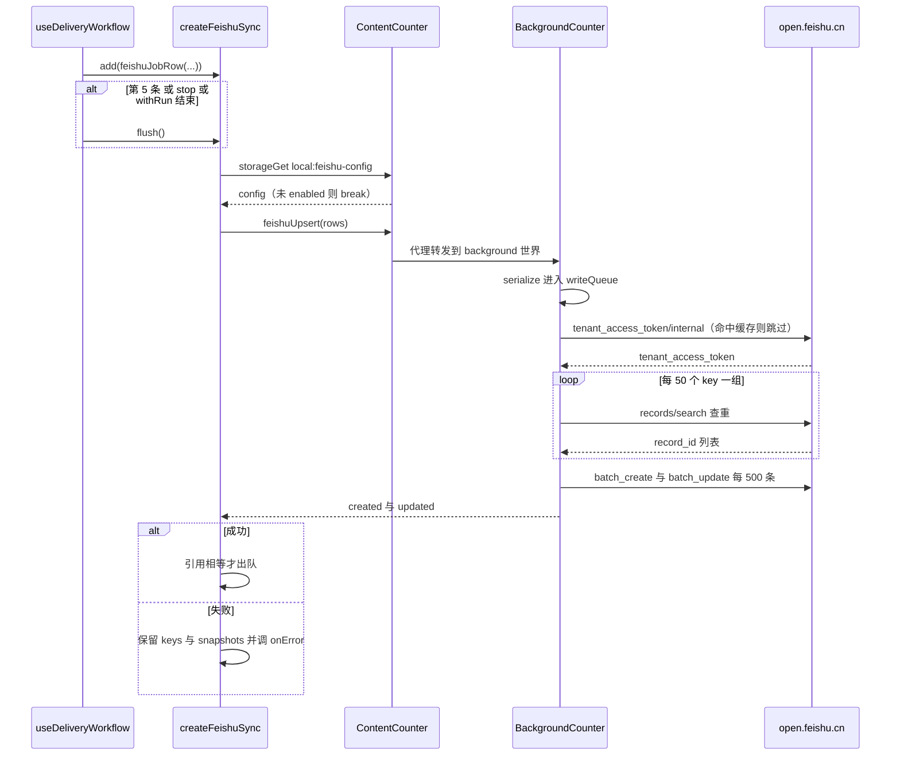
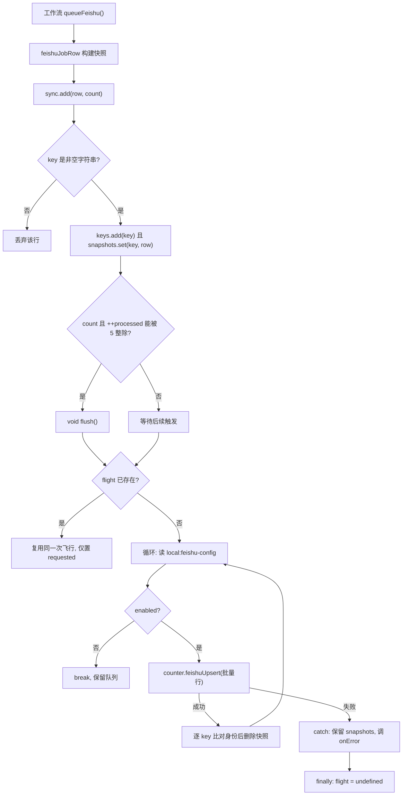

# 飞书（Lark）多维表格同步

飞书同步是一条**单向、可选、尽力而为**的旁路：工作流每处理完一个岗位，就把该岗位的"最终快照"投进一个内存队列，凑批后经 background 写入用户自己的飞书多维表格（Bitable）。它既不参与"筛选 → 打招呼 → 投递"的决策，也不允许自己的失败传染给工作流——所有异常都被 `try/catch` 收口成一条 toast。

本页讲清四段链路：**快照构建**（`feishuJobRow`）→ **排队与批量**（`createFeishuSync`）→ **跨世界调用**（`counter.feishuUpsert`）→ **Bitable 写入**（`feishuBackground.ts`），以及它们之间的失败与生命周期语义。存储 key 前缀、comctx 代理与 `storage.local` 的语义见 [消息与存储桥](../architecture/messaging-and-storage-bridge.md)；本站状态与缓存的整体图景见 [持久化与缓存](../concepts/persistence-and-caching.md)；工作流在何处触发排队见 [投递工作流](../workflows/delivery-workflow.md)；Options 页的整体编排见 [Options 设置页](../operations/options-page.md)。

## 端到端时序

下面这张图是这条旁路的全貌：工作流的 `finally` 排队、每 5 条或停止/结束时的 flush、background 侧串行化队列中的 token 获取与查重写入。



## 配置：`local:feishu-config`

只有一个配置项，即 `storage.local` 下的 `local:feishu-config`（必须带 `local:` 前缀，否则 `genKey()` 会把它落到 `sync:` 区并随账号漫游）。

```ts
interface FeishuConfig {
  enabled: boolean
  appId: string
  appSecret: string
  appToken: string
  tableIdBoss: string
}
```

[`FeishuPage.vue`](../../src/entrypoints/options/pages/FeishuPage.vue) 是与它交互的唯一 UI：四个输入框（App ID / App Secret / App Token / Table ID - Boss直聘）、一个"启用飞书同步"开关（`USwitch`）、一个"自动创建"按钮和"保存飞书配置"。`onMounted` 用 `counter.storageGet('local:feishu-config', { ...config })` 把落盘值合并进本地 `reactive` 表单。页面上写明三条运维约定：

- **必须使用自动创建的模板表**。其他 Table ID 因字段结构不一致会报错，"请勿修改模板字段名称和类型"。
- 访问 Token 由扩展后台自动获取与刷新，**不需要用户填写**；应用需开通多维表格读写权限，并拥有目标文档的编辑权限（右上角"更多 - 添加文档应用"）。页面还提供"复制批量开通权限"，弹出 `base:record:create` / `base:record:retrieve` / `base:record:update` / `base:table:create` 四个 `tenant` scope 的 JSON。
- 页面文案同时声明了同步节奏："启用后每处理 5 个岗位、暂停或停止时同步岗位及 AI 处理结果"。
- 密钥仅保存在本地扩展存储中，请勿分享。

### 校验分四层，宽松程度不同

| 位置 | 校验内容 | 失败表现 |
| --- | --- | --- |
| `FeishuPage.vue` | "自动创建"按钮在 `!enabled \|\| !appId \|\| !appSecret \|\| !appToken` 时禁用；`tableIdBoss` 非空时先 `window.confirm` 告知"原表不会删除" | 按钮不可点 / 用户取消 |
| `feishuSync.flush()` | `appId`、`appSecret`、`appToken`、`tableIdBoss` 四者都必须是 `trim()` 后非空的字符串，否则 `throw new Error('飞书同步配置不完整')` | 进入失败路径，行保留待重试 |
| `readConfig()`（background） | `enabled` 必须为真（否则 `飞书同步未启用`）；`appId`/`appSecret`/`appToken` 非空（缺席时报 `飞书配置缺少 <key>`）；`appToken` 必须匹配 `/^[A-Za-z0-9_-]+$/`（否则 `飞书 appToken 格式无效`） | 抛错回传，行保留待重试 |
| `feishuUpsert()` | 额外要求 `tableIdBoss` 非空（`飞书尚未配置 Boss 数据表，请先创建数据表`），并要求入参是数组、每个元素是非数组对象 | 同上 |

`FeishuPage.vue` 用 `v-model.trim` 绑定四个输入框，所以表单侧不会把首尾空格带进配置，与两处 `trim()` 校验一致。

### 关闭时是彻底的空操作

`flush()` 的业务顺序是：`requested = false` → 若 `keys.size` 为 0 则 `continue`（连一次 `storageGet` 都不发）→ 读配置 → `!config?.enabled` 时 `break`。因此禁用飞书时工作流侧不会产生任何网络请求，队列却仍会累积（`add()` 不读配置），直到用户下次开启并触发一次 flush。

UI 上还有一条：保存与自动创建都会先把当前表单 `storageSet` 到 `local:feishu-config` 再动作，所以"改了 token 但没点保存就点自动创建"不会用旧凭据建表。

## 快照行：`feishuJobRow()`

`feishuJobRow(helper, data, result?)` 把一次岗位处理的全部可写产物压成一个扁平的 `Record<string, unknown>`，键名是**中文列名**（`公司唯一标识`、`岗位名`、`AI筛选分数`、`处理状态-原因` …）。

数据来源：

1. **岗位本身** `data.jobData`：`key`、`companyId`、`hrId`、`jobName`、`positionName`、`jobDescription`、`brand.*`、`boss.*`、`salary`、`city`、`address`、`experienceName`、`degreeName`、`showSkills`、`skills`、`welfareList`、`jobLabels`、`activeTime`、`activeTimeStr` 等。
2. **账号与预设**：`使用账号` 取 `helper.accounts.currentAccount.value?.label ?? helper.accounts.activeAccount.value`（账号对象的 `label`，回退到槽位字符串）；`使用预设` 取 `helper.conf.formDataPreset.value`（未选过时是 `'default'`）。测试专门断言 `使用账号` 是**单选字符串而不是账号对象**。
3. **AI 结果**：从 `helper.chatModel.states.get(job.key)?.messages` 里 `reverse()` 找最后一条 `uiRole === 'filtering'` 的文本消息，`parseFiltering()` 得到 `rating` 与正/负分项的累加原因（`reason` + `(N分)` 逐条拼接）；`data.state.aiGreeting` 提供 `AI招呼语`、`-原因`、`-拒绝原因`、`-能力`。`parseFiltering` 抛错时被吞掉——注释写得很直白：「不完整或失败的 AI 响应不能冒充有效评分」，此时这些列落到 `undefined`。
4. **处理状态** `result?.msg / status / reason`，即 `helper.jobResultMaps.get(job.key)` 的最终结果（由 `queueFeishu` 调用时取）。

最后一行 `JSON.parse(JSON.stringify(row))` 做**深拷贝**：

- `undefined` 值在序列化时被丢弃，因此"没有的字段"根本不出现，而不是以 `null` 出现；
- 拷贝同时也剥掉 Vue 响应式代理，让快照与后续 `reactive` 更新彻底隔离（函数上方的注释：「只保存可写模板字段，避免持有随翻页清理的工作流对象」）；
- 顺带把 `公司标签` 过滤成纯字符串数组、把 `工作地址坐标` 压成 `"lng,lat"` 字符串（对应 `type: 22` 位置列）。

### 改中文列名 = 破坏用户的表结构

`feishuBackground.ts` 的 `bossFields` 是这个行形状的**唯一权威定义**：列名、类型（`1` 文本、`2` 数字、`3` 单选、`4` 多选、`5` 日期、`7` 复选框、`17` 附件、`22` 位置、`1001` 创建时间、`1002` 最后更新时间）、`is_hidden`、`property`（`options`、`date_formatter: 'yyyy/MM/dd HH:mm'`、`formatter: '0'`、位置的 `input_type: 'not_limit'`）全部在其中。`fieldsFor()` 按 `bossFields` 逐列做类型分派，遇到不匹配就 `throw new Error('飞书字段 <name> 类型无效')`。

这带来几条硬约束：

- 想加一列，必须同时改 `bossFields`（类型/属性）与 `feishuJobRow`（取值），并且**只对新建表生效**——已存在的表不会自动迁移。
- 改任何一个 `field_name` 都会让老用户的表整列失联，而不是报错：`fieldsFor` 用 `Object.hasOwn(row, field.field_name)` 跳过行里不存在的列，多余的行字段则被直接忽略。用户看到的是"数据没同步上来"。
- `创建时间`/`最后更新时间`（`1001`/`1002`）由飞书自动维护，`fieldsFor` 显式跳过；`HR头像`/`公司Logo`（`17` 附件）虽然列在模板里（`is_hidden: true`），但快照从不写它们，理由是「附件必须先上传取得 file_token，外部 URL 不能直接作为附件写入」。若某天真传入字符串 URL，`fieldsFor` 会**静默跳过**该列；只有传了合法的 `{ file_token }` 对象数组才会写入。
- `null` 是唯一会被显式提交的"空值"（写回 `null` 以清空单元格），`undefined` 直接跳过。

## 排队与批量：`createFeishuSync()`

`createFeishuSync(onError?)` 返回 `{ add, flush }`，内部只有五个状态：`keys: Set<string>`、`snapshots: Map<string, Record>`、`processed` 计数、`requested` 布尔、`flight: Promise | undefined`。



上图是队列的全部控制流：攒批、单飞、循环重读配置，以及"成功才出队"的核心规则。注意每轮循环都会重新读一次 `local:feishu-config`，所以用户在长跑期间关掉开关会立刻在下一轮 `break`。

### 触发点：每 5 个 + 停止/结束

`add(row, count = true)` 中 `count` 为真时，`++processed % 5 === 0` 立即 `void flush()`（不 await）。`count = false` 用于**手动过滤**（`markFiltered`）：被手动过滤的岗位要入队，但不计入"每 5 个"的节奏，然后由调用方在空闲时自行 `flush()`。

`useDeliveryWorkflow` 在此之外还调用了多次 `flush()`，作用都是"把不足 5 条的尾批尽量早地送出"：

| 时机 | 出处语义 |
| --- | --- |
| `withRun` 开始 | 开跑前先冲掉上一轮遗留的待同步行 |
| `withRun` 的 `finally` | **本轮结束（成功、失败或停止）必定 flush** |
| `runJob` 的 `finally`，仅 `status === 'stop'` | 用户停止后立即冲尾批（同一 `finally` 里先 `queueFeishu` 排队） |
| `executeAll` 每翻页一次 | 一页处理完就冲一次，避免长跑期间数据长时间滞留 |
| `executeAll` 投递模式的循环 | 每个岗位之间按 `delayDeliveryInterval` 间隔，循环结束由 `withRun` 统一 flush |
| `stop()` | 用户点停止即冲（无论当时是否 `busy`） |
| `markFiltered()` 且 `!busy` | 空闲状态下的手动过滤立刻落库 |

`flush()` 自身是幂等的：多个调用者共享同一次 `flight`，重复调用只是把 `requested` 置真，让循环多转一圈再去读一次队列。

### 快照身份语义：最新者胜，旧请求不删新快照

`keys` + `snapshots` 的组合刻意分开维护：`keys` 只负责"还有谁要发"，`snapshots` 只负责"发什么"。同一个 `key` 再次 `add` 时会覆盖 `snapshots` 里的值，但 `keys` 里仍然只有一份。

发送成功后的出队动作不是 `keys.delete(key)`，而是先做身份比较：

```ts
for (const [key, row] of batch) {
  // 同一 key 在请求期间可能产生新结果，旧请求成功不能删除新快照。
  if (snapshots.get(key) !== row) continue
  keys.delete(key)
  snapshots.delete(key)
}
```

也就是说**引用相等**才算"这条快照已被写出去"。如果请求飞行期间该岗位产生了新结果（`add` 换掉了 `Map` 里的引用），旧批次成功后新快照仍留在队列里，下一轮循环（`requested` 已被 `add` 侧或后续 `flush` 置真）会把它作为新批次发出。`scripts/feishu-sync.test.ts` 用 `version: 1` / `version: 2` 显式覆盖了这一条。

### 失败语义：保留 + 提示 + 去重 toast

`catch` 分支只做两件事：`logger.warn('飞书同步失败，保留待同步岗位以便重试', error)` 与调用 `onError?.(error)`。**`keys` 与 `snapshots` 一行都不删**，所以下一次 `flush()`（下一次攒满 5 条、下一次翻页、下一次停止，或下一次 `withRun`）会把它们原样重发。

`onError` 由 `useDeliveryWorkflow` 内的 `reportFeishuError` 提供，固定 id 为 `feishu-sync-error`：

```ts
toast.add({
  id: 'feishu-sync-error',
  title: '飞书同步失败，待同步记录已保留',
  description: error instanceof Error ? error.message : String(error),
  color: 'error',
})
```

固定 id 让同一 toast 被反复 `add` 时只占一条，避免批量同步连续失败刷屏。`scripts/feishu-workflow.test.ts` 断言了这个形状，并进一步验证：失败后调用 `stop()` 会**重发同一批行**（`toEqual(failedRows)`）。

还有两条防呆细节：

- `add()` 对非字符串/空字符串 `key` 静默丢弃——快照以 `key` 为身份，没有身份的行不可能正确 upsert。
- `feishuJobRow()` 里 `parseFiltering` 的兜底与 `queueFeishu` 外层的 `try/catch`（`飞书岗位快照生成失败，不影响工作流`）：**快照构建的失败也有可能走同一条 toast**，但绝不会中断岗位处理。

### 生命周期边界

队列是**纯内存**的：background 侧无持久化，页面刷新、标签页关闭或扩展重载都会丢掉未发出的快照。这是有意的取舍——岗位结果本身已由 `jobCache` 持久化（见 [持久化与缓存](../concepts/persistence-and-caching.md)），重跑时能重新生成快照。因此失效范围只是"这段时间的 Bitable 行"，不会污染状态机。

## background 侧：`feishuBackground.ts`

`BackgroundCounter` 把三个函数直接挂成字段：`feishuFetch`、`createTableBoss`、`feishuUpsert`；`ContentCounter` 再逐一声明同名方法转发给 `this.background`，页面侧因此以 `counter.feishuUpsert(...)` 的形式调用。因为 background 拥有 `host_permissions: ['http://*/*', 'https://*/*']`，跨域的 `open.feishu.cn` 请求才能成立。

### 租户 token 缓存与单飞

`tenantToken(config)` 用 `appId + appSecret` 的 JSON 串作为缓存键：

- 命中 `tokenCache` 且 `expiresAt > Date.now()` 直接返回；
- 否则若已有相同凭据的 `tokenFlight`，复用同一个 `Promise`（并发批次不会各自去鉴权）；
- 否则请求 `/open-apis/auth/v3/tenant_access_token/internal`，成功后缓存 `expire - 60` 秒（提前一分钟过期，留出时钟与网络抖动余量），并对响应做形状校验（`tenant_access_token` 非空、`expire` 为正数，否则抛 `飞书鉴权响应缺少有效凭证或有效期`）；`finally` 里只在 `tokenFlight` 仍是自己时清空，避免误清别人的飞行。

换了凭据（改 App ID/Secret）就自然 miss，不需要显式失效。

**并发注意点**：`tokenCache` 与 `tokenFlight` 都是**模块级单例**，只在单个 background 上下文内有效。多标签页共用同一个 background，因此共享同一份 token 与同一条 `writeQueue`；若将来把同步逻辑搬进 content script 或页面世界，缓存与串行化会各自独立实例化，`99991663` 这类错误的重取节奏与"查重 → 建/改"的互斥保证都需要重新评估。

`fetchData` 的**一次性 token 重取**：若响应是 HTTP 401 或错误码落在 `99991663/99991664/99991668/99991671/99991672`（访问凭证无效/过期），且这是第一次尝试，则清掉 `tokenCache` 再重试一次；第二次仍失败则抛 `飞书凭证刷新后请求仍然失败`。这覆盖了"token 在服务器侧被提前吊销"的场景。

### 写入串行化与路径白名单

模块级的 `writeQueue` 把 `feishuUpsert` / `createTableBoss` 串成一条链：

```ts
function serialize<T>(run: () => Promise<T>): Promise<T> {
  const result = writeQueue.then(run)
  writeQueue = result.catch(() => undefined)
  return result
}
```

`writeQueue` 存的是"吞掉异常后的版本"，因此**一次失败不会毒化后续写入**；调用方拿到的 `result` 仍保留原始的 reject。这把"查重 → 建/改"这类 read-modify-write 保护在单个 background 上下文内，避免两个批次同时读到"该 key 尚不存在"而各建一条记录。

`feishuFetch`（暴露给页面的通用出口）走 `resolvePath()` 白名单：先替换 `:app_token` / `:table_id`，再要求结果以 `/open-apis/bitable/v1/apps/<appToken>/tables` 开头，后缀只允许为空、`/<id>`、`/<id>/fields`、`/<id>/records`、`/<id>/records/<id>` 这几种形态；query 键里出现 `token` / `secret` / `authorization` 关键字直接抛错，query 值必须是字符串。这条白名单防止页面侧把 token 或任意飞书 API 借 background 的权限打出去。注意 `feishuUpsert` / `createTableBoss` **不走** `resolvePath`，它们用内部常量 `tablesPath` 拼接，因而无法被页面指定路径。

### upsert 算法：按 key 查重，再批量建/改

`feishuUpsert(rows)` 是同步链路的终点，整段跑在 `serialize()` 里，分三段：

1. **归并与字段过滤**：逐行要求是对象、`key` 为非空字符串；`unique.set(key, { ...fieldsFor(row), key })`——同批同 key 后者覆盖前者，且 `key` 永远被强制写回（`key` 同时是用户可见的业务列，`is_hidden: false`）。
2. **查重**：每 50 个 key 一组，调 `records/search`，`filter` 用 `conjunction: 'or'` 逐个 key 下 `{field_name:'key', operator:'is', value:[key]}`（注释说明「飞书文本 is 对多个值的解释不作为 OR 依赖，每个 key 使用单独条件」），`field_names: ['key']`、`automatic_fields: false`、`page_size: 500` 并沿 `page_token` 翻页；`seen` 集合检测"分页凭证缺失或重复"以抛错跳出死循环。返回项的 `fields.key` 经 `text()` 归一化（数组拼接、`{text}` 解包、对象 JSON 化）后再比对。
3. **写入**：命中 `record_id` 的进 `updates`，其余进 `creates`，分别以 `batch_create` / `batch_update` 每 500 条一片提交，返回 `{ created, updated }`。这两个数字被 `feishuSync` 记进 `logger.info('飞书批量同步完成', result)`。

查重只在**当前批次内**去重，跨批次靠飞书里已有的 `key` 列；这也解释了为什么 `key` 必须是稳定且唯一的岗位标识（取自 `jobData.key`）。

### 建表：`createTableBoss()`

`createTableBoss()` 在 `serialize()` 内 `POST /open-apis/bitable/v1/apps/:app_token/tables`，body 里带 `table: { name: 'Boss - <ISO 时间>', default_view_name: '全部岗位', fields: bossFields }`。响应缺少 `table_id` 时抛 `飞书建表响应缺少 table_id`。拿到 `table_id` 后，它会**重新读一次配置**来检测竞态：如果期间 `appToken`/`appId`/`appSecret` 变了（或配置被清空），就抛错且**不覆盖配置**，把已建成的表留给用户在原多维表格中确认。否则把 `tableIdBoss` 合并写回并返回 `{ tableIdBoss }`，页面据此回填输入框。

## 错误信息：不回传远端原文

`requestJson` 统一收口网络与解析：网络异常/超时压成 `飞书请求失败：网络异常或请求超时`；响应不是 JSON 时抛 `飞书响应不是 JSON（HTTP <status>）`；缺少数值 `code` 时抛 `飞书响应格式无效（HTTP <status>）`。请求本身固定 `credentials: 'omit'`、`redirect: 'error'`、`AbortSignal.timeout(30_000)`。

`apiError()` 把飞书错误码映射成固定的中文提示（`99991661` 应用凭据无效、`99991663`/`99991664`/`99991668`/`99991672` 访问凭证无效、`99991671` 访问凭证已过期、`99991679` 缺少应用权限、`91403` 无多维表格访问权限、`1254043` 数据表不存在、`1254045` 字段不存在请检查 Boss 表结构、`1254060` 字段值类型不匹配），未知码落到通用文案。注释明确说明意图：「不回传远端 msg/响应体，避免其中回显凭据或请求数据」。

这条约束会传导到 UI：`feishu-sync-error` toast 的 `description` 就是这些固定文案，用户据此判断是"权限"还是"字段类型"问题，而不是去看飞书原始响应。

## 测试覆盖

两个脚本测试把边界都钉死了（运行方式见 [测试套件](../testing/test-suite.md)）：

- [`scripts/feishu-sync.test.ts`](../../scripts/feishu-sync.test.ts)（`mock.module` 掉 `@/message`、`@/utils/logger`、`parseFiltering`，只保留队列与行构建的真实实现）：
  - `使用账号` 映射为账号 `label` 字符串而非对象；
  - 前 4 条不发、第 5 条发一次（长度 5），之后 5 条再发一次，第 11 条单独成批；
  - 失败调用 `onError` 一次，再次 `add` 新快照后下一轮 `flush` 发出的是**新快照**（`处理状态` 从"筛选完成"变成"生成完成"），且不会重复发送已成功的批次；
  - 请求飞行期间 `add` 的新快照在旧请求成功后被保留并作为第二批发出。
- [`scripts/feishu-workflow.test.ts`](../../scripts/feishu-workflow.test.ts)（只 mock 工作流外部边界——`../src/message`、logger、`ai`、`handles` 与几个全局——"workflow execution、row snapshots and batching 保持真实"，另用 `settleSync()` 手动排空 fire-and-forget 的微任务）：
  - `filter` / `generate` / `auto` 三种模式各自的 `处理状态`（`待投递` / `待确认发送` / `投递成功`）与 `处理状态-类别`（`ready` / `success`）、账号 label 与预设；
  - 停止中断时 `finally` 仍同步 `{ 处理状态: '已停止', 处理状态-类别: 'wait' }`，且不处理下一个岗位、不加载更多；
  - `skip` 与抛错两种提前退出路径仍从 `finally` 同步（`warn/不匹配` 与 `error/执行失败`）；
  - 6 个岗位时第 5 个完成即发送（`job-0`…`job-4`）、尾批（`job-5`）在结束时发送；
  - 失败触发 `feishu-sync-error` toast，`stop()` 后原样重发失败的批次。

## 改动时要注意什么

1. **改 `bossFields` 的列名或类型 = 破坏已建成表的兼容性**，且没有任何迁移机制。新增列只能作用于新建的表。
2. **`feishuJobRow` 与 `bossFields` 必须同步演进**，否则 `fieldsFor` 会抛 `飞书字段 X 类型无效`（类型错）或静默丢列（名字错）。
3. **别把 `flush()` 改成 await**：`add()` 里的 `void flush()` 与 `runJob`/`withRun` 的 `finally` 都不能被一个可能失败的同步动作阻塞工作流；错误已经由 `onError` 走 toast。
4. **别在成功分支无条件 `keys.delete`**：那会吃掉请求期间产生的新快照，测试 `keeps a newer snapshot added while a request is in flight` 会挂。
5. **`count = false` 才是不计入 5 条节奏的入口**；在新增的工作流出口里传错这个参数，会导致手动过滤的岗位把其他岗位的批次提前催发。
6. **token 与写队列是模块级单例**：多标签页共用同一 background；如果将来把同步逻辑搬进 content script，缓存与串行化就各自独立，需要重新评估（见上文"并发注意点"）。
