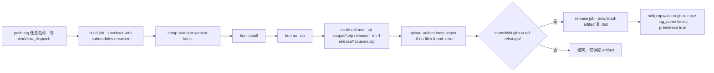

# 构建、质量门禁与发布

本页说明"从 clone 到商店/Release"的完整路径：如何把仓库装起来（含子模块）、每个 npm script 对应哪个浏览器目标、哪些命令是提交前的门禁、`.output/` 里产出什么、GitHub Actions 实际执行了哪些步骤（以及**没有**执行哪些），还有 `net-conf.json` 这个**运行时数据源**为何不应被当成构建配置。

构建产物本身的目录结构、四个运行时世界与 `wxt.config.ts` 的 manifest 差异见 [扩展运行时与构建目标](../architecture/extension-runtimes.md)；风格与 lint 规则背后的贡献约定见 [贡献与改动约定](../contributing.md)。

## 首次安装：子模块必须先于依赖

`packages/devlog-ui` 是一个 **git submodule**（[.gitmodules](../../.gitmodules) 指向 `https://github.com/Ocyss/devlog-ui`），同时又是 workspace 包 `devlog-ui`（[package.json](../../package.json) 声明 `"devlog-ui": "workspace:*"`，`wxt.config.ts` 与 [tsconfig.json](../../tsconfig.json) 都把别名指到 `packages/devlog-ui/src`）。因此**在 `bun install` 之前必须先初始化子模块**，否则 workspace 解析不到该包，dev 与 build 都会在解析 `devlog-ui` 时失败。

[mise.toml](../../mise.toml) 把这个顺序编码成任务依赖：

```toml
[tasks."init.git"]
run = "git submodule update --init --recursive"

[tasks.init]
depends = ["init.git"]
run = "bun install"

[tasks.dev]
alias = "default"
run = "bun run dev"

[tasks.pre-commit]
run = "bun run lint-staged"
```

- `mise run init` → 先 `init.git`，再 `bun install`；
- `mise run dev`（`mise` 不带任务名时也是它，因为标了 `alias = "default"`）→ `bun run dev`；
- `mise run pre-commit` 的定义是 `bun run lint-staged`，但 [package.json](../../package.json) 的 `scripts` 里**没有** `lint-staged` 这个条目——它只是顶层的 `lint-staged` 配置字段。直接执行会报 "Script not found"；可用的等价手段是 `bunx lint-staged`，或让 git hook（`husky` 之类）在提交时调用 `bunx lint-staged`。仓库当前没有任何钩子安装步骤，所以**提交门禁默认不会自动运行**。
- `[tools]` 固定 `bun = "1.2"`、`node = "latest"`。CI 不经过 mise，而是单独用 `oven-sh/setup-bun@v2` 且 `bun-version: latest`——**本地与 CI 的 Bun 版本并不一致**，这是一个隐性差异。

CI 里对应的初始化是 checkout action 上的 `submodules: recursive`；没有这一步，`bun run zip` 会因为缺少 `packages/devlog-ui` 而失败。

## 脚本矩阵：每个命令对应哪个目标

[package.json](../../package.json) 的 `scripts` 可以按"目标 × 动作"来读。三个浏览器目标是 `chrome`、`firefox`、`edge`，其中 **firefox 一律追加 `--mv3`**：

| 脚本 | 实际命令 | 说明 |
| --- | --- | --- |
| `dev` | `wxt` | 默认目标（chrome）开发模式 |
| `dev:edge` | `wxt -b edge` | Edge 开发模式 |
| `dev:firefox` | `wxt -b firefox --mv3` | Firefox 开发模式，强制 MV3 |
| `build` | `run-p build:chrome build:firefox build:edge` | 三目标并行构建 |
| `build:chrome` | `wxt build -b chrome` | |
| `build:firefox` | `wxt build -b firefox --mv3` | |
| `build:edge` | `wxt build -b edge` | |
| `zip` | `run-p zip:chrome zip:firefox zip:edge` | 三目标并行打包 |
| `zip:chrome` | `wxt zip -b chrome` | |
| `zip:firefox` | `wxt zip -b firefox --mv3` | 同时产出 `*-sources.zip` |
| `zip:edge` | `wxt zip -b edge` | |
| `check` | `vue-tsc --noEmit` | 仅类型检查，不产出文件 |
| `fmt` / `fmt:check` | `oxfmt` / `oxfmt --check` | 格式化 / 只检查 |
| `lint` / `lint:fix` | `oxlint --type-aware` / `oxlint --type-aware --fix` | 类型感知静态检查 |

要点：

- `run-p` 来自 `npm-run-all`，三个目标共享同一个 `.output/` 父目录但写入各自的子目录，因此并行是安全的。
- **`--mv3` 不能省**：Firefox 目标必须是 MV3，漏掉 flag 会产出 MV2 变体，与 CI 产物不一致。
- **`check` 是唯一的全量类型门禁**。`oxlint --type-aware` 也会做一定类型层面的分析，但它不能替代 `vue-tsc`（SFC 模板类型、路径别名、`#imports` 虚拟模块的类型都靠后者）。`tsconfig.json` 以 `extends: "./.wxt/tsconfig.json"` 开头——这个文件由 WXT 生成，所以**首次运行 `bun run check` 之前至少跑过一次 `wxt` 类命令（例如 `bun run dev` 或 `bun run build`）**，否则类型解析会因缺失生成文件而失败。
- 仓库**没有 `test` script**：测试是放在 `scripts/*.test.ts` 的 `bun:test` 用例，用 `bun test` 从仓库根运行。覆盖范围见 [测试套件与可测性边界](../testing/test-suite.md)。
- 三个浏览器目标的 manifest 差异（`extKey()` 给出的 `key` 或 `browser_specific_settings.gecko.id`）是构建期行为，改动它会改变扩展 ID、影响已安装用户的升级路径，详见 [扩展运行时与构建目标](../architecture/extension-runtimes.md)。

## 产物布局：`.output/` 是按浏览器 × manifest 版本切分的

[wxt.config.ts](../../wxt.config.ts) 设置 `srcDir: 'src'` 与 `outDirTemplate: '{{browser}}-mv{{manifestVersion}}'`，所以每个目标产出到 `.output/<browser>-mv<version>`，例如 `.output/chrome-mv3`、`.output/firefox-mv3`、`.output/edge-mv3`。由此产生一条使用规则：

- **本地"安装未打包扩展"要指向具体的 `<browser>-mv3` 子目录**，不是 `.output/` 根目录。`wxt.config.ts` 里 `webExt.disabled: true` 关闭了 WXT 的自动拉起浏览器，所以开发流程就是 `bun run dev` 之后在浏览器里手动加载该目录。
- `.output` 与 `.wxt` 都在 [.gitignore](../../.gitignore) 中（`.openwikiignore` 同样排除它们），不参与版本控制，也不被 wiki 读取。

**分发用的 zip 与解包后的 build 产物不在同一层**：`wxt zip` 把 `*-chrome.zip`、`*-edge.zip`、`*-firefox.zip` 写到 `.output/` 根下，Firefox 目标还会额外生成 `*-sources.zip`（Mozilla 审核要求的源码包）。这正是 [scripts/submit.sh](../../scripts/submit.sh) 与 CI 都用通配符引用它们的原因：

```bash
proxychains -q pnpx wxt submit $1 \
--chrome-zip .output/*-chrome.zip \
--edge-zip .output/*-edge.zip \
--firefox-zip .output/*-firefox.zip \
--firefox-sources-zip .output/*-sources.zip
```

这是**手工商店提交**入口（`$1` 通常是一次性的商店提交密钥），需在仓库根执行，依赖 `.output/` 下的扁平 zip 通配符，并通过 `proxychains` 走代理访问各商店 API。改动 `outDirTemplate` 或 zip 命名会同时打断 CI 的 `cp .output/*.zip`、`rm -f release/*sources.zip` 与本脚本，三处都要跟着改。

## 提交门禁：lint-staged → oxfmt → oxlint，CI 不跑任何检查

[package.json](../../package.json) 的 `lint-staged` 字段对所有暂存文件执行两步：

```json
"lint-staged": {
  "*": "oxfmt --no-error-on-unmatched-pattern",
  "*.{js,jsx,ts,tsx,mjs,cjs,vue}": "oxlint --fix"
}
```

即：所有暂存文件先被 `oxfmt` 重写格式，脚本/TS/Vue 再被 `oxlint --fix` 自动修复。注意这里**没有 `--type-aware`**，与 `bun run lint` 的类型感知检查并不等价。

- `oxfmt` 的配置见 [oxfmt.config.ts](../../oxfmt.config.ts)：`semi: false`、`singleQuote: true`、`sortImports.partitionByComment: true`。
- `oxlint` 的配置见 [oxlint.config.ts](../../oxlint.config.ts)：`plugins: ['import', 'vue', 'jsx-a11y', 'oxc', 'typescript']`，`options.typeAware: true`，另外把 `typescript/consistent-type-imports` 与 `import/consistent-type-specifier-style` 设为 error。
- 两者共享同一组 `ignorePatterns: ['*.min.js', '/packages', '/.claude']`——**`packages/devlog-ui` 子模块不参与格式化与 lint**，不要试图给它"顺手修格式"。

**CI 侧一条检查都不跑**：[.github/workflows/main.yml](../../.github/workflows/main.yml) 的 `build` job 只有 checkout → setup-bun → `bun install` → `bun run zip` → 整理 zip → 上传 artifact，既没有 `fmt:check`、`lint`、`check`，也没有 `bun test`。也就是说类型检查、lint、测试**完全是本地责任**：PR 与 tag 推送都没有自动化门禁兜底，`bun run fmt:check && bun run lint && bun run check && bun test` 是提交前必须的自查补偿。规则层面的说明见 [贡献与改动约定](../contributing.md)。

## 发布流水线：tag 触发 → build → Release

[.github/workflows/main.yml](../../.github/workflows/main.yml) 有两个 job。



上图是 tag 推送与手工 dispatch 两条触发路径在 `main.yml` 中的实际执行序列。

关键语义：

- **`build` 在两类触发条件下都会跑**（任意 tag 的 push，或手工 `workflow_dispatch`），产物以 `boss-helper` 为名上传为 artifact，`if-no-files-found: error` 保证"没产出 zip"会直接失败，而不是产出一个空 Release。
- **`release` 加了 `needs: build` 与 `if: startsWith(github.ref, 'refs/tags/')`**，所以手工 dispatch 只做构建与 artifact 上传，不发布；只有 tag 推送才会走到 Release。
- **`rm -f release/*sources.zip` 是必须的**：`wxt zip` 为 Firefox 生成的源码包只用于 Mozilla 商店审核，体积大且对普通用户无意义，因此在进入 artifact 之前就被剔除。这条命令依赖 WXT 的 `*sources.zip` 命名，不要改成精确文件名，否则新增版本号后会静默失效。
- Release 固定写到 `tag_name: latest`、`name: Latest Build` 并带 `prerelease: true`。这是一个"浮动最新构建"的发布模型：**每次 tag 推送都会覆盖 `latest` Release 的资产**，`net-conf.json` 里 GitHub 商店卡片指向的 `releases/latest` 因此永远拿到最近一次构建。副作用是历史构建不会被保留为该 Release 的资产。
- `permissions: contents: write` 只授予 `release` job，`build` job 用默认权限。
- 版本号来源是 `package.json` 的 `version`（经 `wxt.config.ts` 的 `define.__APP_VERSION__` 注入为 `VITE_VERSION`）——**workflow 不读取也不校验 tag 名与版本号是否一致**，发版前对齐版本属于人工职责。`net-conf.json` 的 `version` 才是运行时"是否有新版本"的判断依据（下一节）。

## `net-conf.json`：运行时数据源，不是构建配置

仓库根的 [net-conf.json](../../net-conf.json) 长得像构建元数据，但它**不参与任何构建步骤**——CI 与 WXT 都不读取它。它是一份被**运行时从 CDN 拉取**的公告/版本源：

- 内容脚本侧 [src/composables/useHelper/netConf.ts](../../src/composables/useHelper/netConf.ts) 的 `initNetConf()` 通过 `fetch('https://testingcf.jsdelivr.net/gh/Ocyss/boss-helper@main/net-conf.json')` 拉取，解析成 `NetConf`（`version`、`version_description`、`notification[]`、`store`、`price_info?`、`feedback`），并对 `notification` 逐条调用内部的 `netNotification()`：
  - `type: 'notification'` 会弹一条持久 toast（`duration: 0`，带可选 `url`，点击 `window.open`），关闭时把 `now + (item.data.duration ?? 86400) * 1000` 写入 `local:netConf-<key>` 作为"下次可再弹"的时间点；`local:netConf-<key>` 未到期或本次会话内已弹过（模块级内存 `netNotificationMap`）则跳过。
  - `type: 'alert'` 不弹 toast，而是由 [App.vue](../../src/App.vue) 用 `notification.filter(item => item.type === 'alert')` 渲染成内嵌 `<Alert>`。
- 拉取与轮询在 `HelperContext.initNetConf()`（[src/composables/useHelper/ctx.ts](../../src/composables/useHelper/ctx.ts)）中完成：立即拉一次写入 `this.netConf`，然后 `setInterval(..., 1000 * 60 * 5)` 每 5 分钟刷新一次；`netConfTimer` 判空保证同一个上下文不会叠加多个定时器。`Version.vue` 弹窗 `@open` 时也会再触发一次 `helper.initNetConf`。首次调用点是 Boss 页面 `onMount` 末尾的 `this.initNetConf()`。
- 消费方式：`App.vue` 的 `isDot` 用 `(helper.netConf.value?.version ?? '0') > VITE_VERSION` 做**字符串比较**，决定版本按钮上的红点与"有更新"文案；[Version.vue](../../src/components/Version.vue) 用 `store[key]` 三元组（描述、URL、徽章图）覆盖 `@/components/StoreIcons` 里内置的商店链接与徽章，缺失时回落到内置值。

由此得出运维要点：

1. **改公告不需要发版**：只要往 `main` 分支的 `net-conf.json` 推送，jsdelivr 缓存过期后所有在线用户会在一个轮询周期内看到。这正是它作为"急救开关"的价值，也是风险——`initNetConf()` 没有 `try/catch`，格式错误的 JSON 会让 `response.json()` 抛错，调用方的 `.then()` 不会执行，`netConf` 保持 `null`，`Version.vue` 回落到"暂未获取到版本信息"。
2. **`version` 与 `package.json` 的 `version` 必须协同更新**：前者决定用户看到"有更新"，后者决定实际产物版本。`package.json` 当前是 `0.5.3`，而 `net-conf.json` 的 `version` 仍是 `0.5.2` 并附带 `0.5.2` 的更新说明——在 `net-conf.json` 更新之前，新装的 0.5.3 不会提示更新，旧用户也不会被提示升级。
3. **`store` 的键必须与 `StoreIcons` 导出的浏览器键一致**（当前 `chrome`/`crx`/`edge`/`firefox`/`github`）。键拼错不会报错，只会静默回落到代码里硬编码的默认链接与徽章。
4. [PRIVACY.md](../../PRIVACY.md) 已把"版本检查"列为唯一的自家服务器请求（仅记录 IP 做日活统计）。这是内容脚本直接 `fetch`、不经 background 的外部端点，新增同类端点属于需要单独评审的隐私改动，参见 [贡献与改动约定](../contributing.md)。

## 另一条流水线：OpenWiki 自动更新

[.github/workflows/openwiki-update.yml](../../.github/workflows/openwiki-update.yml) 与本页的发布流水线无关，但它会改写仓库文档并提交 PR，因此运维上需要知道：

- 触发方式是每日 `cron: "0 8 * * *"` 加手工 dispatch；`fetch-depth: 0` 是硬要求——`openwiki code --update` 需要完整历史才能 diff 出"上次文档化的提交"，浅克隆会让更新跑在空变更集上。
- 运行环境是 Node 22 + 全局安装 `openwiki@0.7.3`（外加可选的 `mermaid`/`jsdom` 用于 Mermaid 校验），模型走 `OPENWIKI_PROVIDER=openai-compatible` + `OPENWIKI_MODEL_ID=deepseek-chat`，密钥来自 repo secrets/vars。
- `openwiki code --update --print` 标了 `continue-on-error: true`，随后**无论成败都会**删除瞬态文件 `openwiki/.run.json`、并用 `peter-evans/create-pull-request` 往 `openwiki/update` 分支开一个 `docs: update OpenWiki` PR（`add-paths` 为 `openwiki`、`AGENTS.md`、本 workflow 文件，以及存在时的 `CLAUDE.md`）。失败时那个 PR 只保留已完成的页面，合并它即是把进度变成下次运行的基线；最后一步 `if: steps.openwiki.outcome == 'failure'` 才 `exit 1` 把 workflow 标红。
- 因此按 [AGENTS.md](../../AGENTS.md) 的约定**不要手工编辑 `openwiki/` 下的生成页面**：改动会在下次运行被覆盖，正确做法是改源码/文档后重跑。本页就属于这条流水线的产物。

## 发版检查清单

1. 子模块已初始化（`mise run init` 或 `git submodule update --init --recursive`）。
2. `bun run fmt:check`、`bun run lint`、`bun run check`、`bun test` 全部通过——CI 不做这些检查，这是唯一门禁。
3. `bun run zip` 本地能出三个 zip，且 `.output/` 根下 Firefox 对应的 `*-sources.zip` 存在。
4. `package.json` 的 `version` 已递增；如需让在线用户看到更新提示，同步更新 `net-conf.json` 的 `version` 与 `version_description`。
5. 打 tag 并推送 → 确认 `build` job 的 artifact 含三个 zip 且**不含** `*sources.zip` → 确认 `latest` Release 资产被替换。
6. 需要上架更新时，在仓库根执行 `scripts/submit.sh <提交密钥>`（走 `proxychains`），它复用上一步的 `.output/*.zip`。

相关页面：[扩展运行时与构建目标](../architecture/extension-runtimes.md)、[贡献与改动约定](../contributing.md)、[测试套件与可测性边界](../testing/test-suite.md)。
