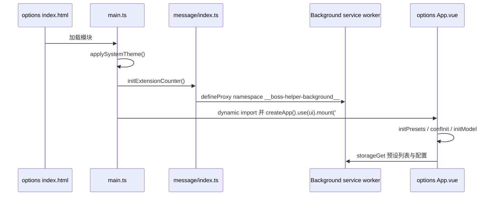

# Options 设置页与页面内面板

BossHelper 的界面分成两个互不共享 DOM 的世界，但它们读写**同一批 composable**（`useConf`、`useAccounts`、`useModel`），因此配置在哪一边改，另一边下次读取时都能看到：

- **Options 设置页**：`entrypoints/options/` 这个 HTML entrypoint（`index.html` + `main.ts` + `App.vue`），在独立的扩展页标签里运行，通过 `initExtensionCounter()` 拿到完整的后台 RPC 客户端（injector 名为 `popup`）。
- **页面内面板**：`src/App.vue`，作为 `<boss-helper-job>` 自定义元素挂进 BOSS 页面的 shadow DOM，通过 `initCounter()` 走"MAIN world → ISOLATED → background"的两跳代理（见 [扩展运行时与构建目标](../architecture/extension-runtimes.md) 与 [消息与存储桥](../architecture/messaging-and-storage-bridge.md)）。

两者的运行时差异只影响**引导方式和可用能力**，不影响配置数据的真源：`formData` 始终是 `conf/index.ts` 里的模块级 reactive 单例。本页讲清 UI 侧的责任划分、配置项渲染契约、保存/脏状态语义与几条必须遵守的运行守卫。配置字段的默认值、迁移链与落盘键属于 [配置、预设与账号](../concepts/configuration-and-presets.md)。

## 两个世界如何被引导

Options 页的引导刻意保持"薄"：`main.ts` 先按系统主题切 `dark`/`light` class，然后在 `main()` 里**先** `initExtensionCounter()`、再动态 `import('./App.vue')` 并挂载。顺序不可交换，因为 `counter` 是个 Proxy，在任何一次存储访问前必须已经绑定实现，否则直接抛 `Counter has not been initialized`。整个引导包在 `main().catch()` 里，失败时把错误文本写进 `#app`，避免白屏。

`options/index.html` 里的 `manifest.open_in_tab=true` 让设置页在独立标签打开（而不是狭窄的 popup）。这也是设置页敢于使用三栏布局（侧边导航 / 主区 / 右侧帮助栏，`>=1440px` 时才出现第三栏）的前提。

注入面板走的是 `/src/index.ts` 的 `run(ctx)`：注册 `boss-helper-job` 自定义元素，在 `connectedCallback` 里 `attachShadow`、注入内联样式、`app.provide(HelperKey, ctx)` 后挂载，`disconnectedCallback` 里 `app.unmount()`。因此面板的每次路由切换都是**新的 Vue 实例**（`boss/index.ts` 把 `ctx.onMount(to.path)` 挂进宿主 `$router.afterHooks`），而配置单例跨实例存活。

## Options 页的业务分层

`entrypoints/options/App.vue` 是**唯一的编排者**：它持有页签状态、脏状态、保存流程，并把 5 个 page 组件全部挂载、仅用 `v-show` 切换（`ManagementPage` / `GeneralPage` / `AIPage` / `ProvidersPage` / `FeishuPage`）。`v-show` 而非 `v-if` 是有意的——`AIPage` 通过 `ref` 暴露 `save()` 与 `isDirty` 给父组件，卸载会丢失提示词草稿与脏标记。

| 页面 | 组件 | 读写的数据 | 保存方式 |
| --- | --- | --- | --- |
| 基础设置 + 常规配置节 | `pages/GeneralPage.vue` + `components/ConfigItem/*` | `conf.formData` 深层字段 | 页脚「保存配置与模型」 |
| AI 配置 | `pages/AIPage.vue` → `components/AI.vue` → `AI/LLMPromptEdit.vue` | `formData.aiGreeting` / `formData.aiFiltering` | 父组件的 `save()` 转发给编辑器 |
| AI 模型配置 | `pages/ProvidersPage.vue` → `AI/LLMModelManage.vue` | `model.modelData`（`conf-model` 键） | 页脚保存（列表操作不自动落盘） |
| 飞书多维表格 | `pages/FeishuPage.vue` | `local:feishu-config` | **页面内独立「保存飞书配置」** |
| 预设/账号管理 | `pages/ManagementPage.vue` | `local:FormDataPreses`、`local:HelperAccounts` | **即时保存**（`manage()` 包裹） |

页脚右侧那行小字就是这个表格的摘要：管理页是"管理操作即时保存"，飞书页是"飞书配置请在页面内单独保存"，其余是"修改后请点击保存"。

### 侧边导航与滚动定位

侧栏的"常规配置"目录项来自 `sections`：`useConfigSections()` 返回 `[AlertItem[], (ConfigAccordionItem | false)[]]`，`App.vue` 与 `GeneralPage.vue` 都做 `schema.value[1].filter((item) => item !== false)`。点击目录项走 `navigate(value)`：把 `page` 切回 `'general'`、`await nextTick()`、再 `document.getElementById('section-' + value)?.scrollIntoView()`。锚点偏移由 CSS 变量 `--options-header-height` 吸收——`useResizeObserver` 观察 header 的真实高度，`scroll-margin-top: calc(var(--options-header-height) + 20px)` 保证吸顶 header 不会盖住标题。

「基础设置」不是 `sections` 的一员，它被硬编码在 `GeneralPage.vue` 顶部（`id="section-basic"`），因为配置级别选择器本身不能受配置级别门控。

### 配置项渲染契约

`conf/sections.ts` 的 `useConfigSections()` 是**声明式**的配置树：它不含任何模板，只描述"哪些 section、section 里哪些 item、item 的类型与帮助文本"。`ConfigItem.vue` 是唯一的解析器，`ConfigItem` 的联合类型定义在 `composables/useHelper/type.ts`。

渲染三层结构：

1. **section 层**（`ConfigAccordionItem`）：`value` 决定 `id="section-<value>"`，`label` 同时用于卡片标题和侧栏按钮。整节可以是 `false`（被 `configLevel` 门控），消费方必须 `filter(item => item !== false)`。
2. **item 层**：`ConfigItem.vue` 用一串 `v-if` / `v-else-if` 按 `item.type` 分发。`type: 'div'` 是布局容器，递归渲染 `items`（其中元素同样可能是 `false`，所以递归处也 `v-if="value"`）。
3. **字段层**：`type: 'select'` / `'checkbox'` / `'checkbox-expire'` / `'inputNumber'` / `'salaryRange'` / `'companySizeRange'` 直接按 `item.key` 绑定到 `conf.formData[key]`；`'customGreeting'` / `'address'` / `'appearance'` 是**无 key 的特化组件**（`CustomGreeting.vue`、`Address.vue`、`components/Tabs/ConfigItem/Appearance.vue`）；`'alert'` 直接透传成 `Alert` 组件 props。

帮助文本有两条通路，必须区分：结构化 item 用 `help` 字段（`select` 交给 `FormItem.vue` 作为 `data-help`；`checkbox` / `checkbox-expire` 绑在包裹 `span` 上；`inputNumber` 则要求调用方自己写在 `fieldProps` 的 `'data-help'` 里）；`alert` 之外的任意元素也可以直接写 `data-help` 属性。options `App.vue` 的 `readHelp()` 从事件目标向上遍历祖先，取**第一个**非空且不为 `no-help` 的 `data-help`，再分 `pointerover`/`pointerleave`/`focusin`/`focusout` 四条路径合成 `helpText`——所以帮助栏能覆盖悬浮与键盘聚焦两种交互。

`checkbox-expire` 是个复合类型：复选框控制 `formData[key].value`，右侧时钟按钮用 `UDropdownMenu` 写 `formData[key].expire`，选项为不限 / 7 / 30 / 90 / 180 / 360 天（毫秒）。因为 `expire` 只在勾选后才有意义，`ConfigItem.vue` 的 `exp` computed 在 `formData[key]` 为假时直接返回空数组。

另一个渲染层细节：options 页提供的是一个**假 HelperContext**（见下文），它的 `workflowRunning` 恒为 `ref(false)`。因此 `ConfigItem.vue` 里 `select` 类型的 `:disabled="helper.workflowRunning.value"` 在设置页永远是 false——这条守卫只对注入面板生效。

### 端到端新增一个配置字段

这套结构让"加一个配置项"变成一条固定流水线，漏掉任何一步都会得到静默失败：

1. **类型**：在 `types/formData.ts` 的 `FormData` 加字段（注意它带 `[key: string]: any` 索引签名，TypeScript 不会替你发现遗漏）。
2. **默认值**：在 `conf/info.ts` 的 `defaultFormData` 给出默认值。这是老用户拿到值的唯一来源——`confInit` 用 `deepmerge(defaultFormData, stored)` 补齐。
3. **迁移（仅当语义改写旧字段）**：追加一级 `FROM_VERSION` 并把 `defaultFormData.version` 抬到同一字符串。不要改写历史条目。
4. **声明 UI**：在 `conf/sections.ts` 的对应 section 的 `items` 里加 `{ type, key, label, help }`；需要分级隐藏就写成 `conf.configLevel.xxx && {...}`。
5. **（可选）渲染器**：只有在需要新的**交互形态**时才在 `ConfigItem.vue` 加分支和 `ConfigItem` 联合类型的新成员；纯 `select`/`checkbox`/`inputNumber` 不需要改渲染层。
6. **消费者**：在筛选/投递流程里读 `formData.<key>`（见 [任务处理器与筛选](../concepts/task-handlers-and-filters.md)）。

`appearance` 是个例外通道：外观偏好属于独立的 `appearanceConf`（全局、不分预设、自动落盘），它的 UI 在 `components/Tabs/ConfigItem/Appearance.vue`，通过 `ConfigItem` 的 `type: 'appearance'` 既出现在注入面板的外观页，也可被配置树复用。

## Options 页的保存、重载与脏状态

选项页把"是否已落盘"提升为一等状态，因为 `confSaving` 之外的动作（导入、推荐配置、清空）都**不写盘**：

- `baseline` / `modelBaseline` 是 `ready` 之后对 `conf.formData` 与 `model.modelData.value` 各做一次 `JSON.stringify` 的快照。
- `dirty` = `ready &&`（配置快照变了 ‖ 模型快照变了 ‖ `aiEditor.value?.isDirty`）。`isDirty` 是 `AIPage` → `AI.vue` → `LLMPromptEdit.vue` 逐层 `defineExpose` 上来的，后者用自己的 `draftSnapshot()` 对比。
- header 的徽标在"有未保存修改 / 草稿"与"已同步"之间切换；`beforeunload` 在 `dirty` 时 `preventDefault()`，提供浏览器级离开确认。
- `allowDiscard()` 在 `dirty` 时弹 `confirm`，`reload()`、`switchPreset()`、`manage()` 三个"会丢改动"的入口都先过它。

`save()` 的顺序是关键：**先**让 `aiEditor.save({ silent: true })` 落草稿（返回 `false` 就直接 return，不保存任何东西），**再**同步取两份快照、**然后** `confSaving({ silent: true })` + `model.saveModel({ silent: true })`、**最后**把刚取的快照记为 baseline。先取快照再写盘，是为了让用户在保存过程中继续输入的内容仍被判定为脏，而不是被"保存成功"掩盖。

所有副作用都走 `run(action)`：`busy` 互斥（同一时刻只允许一个操作）、`error` 清空后重新捕获并渲染成顶部 `Alert`、`finally` 复位。按钮的 `:disabled` 普遍是 `!ready || busy`，所以加载期间不会出现并发写。

`manage(action, reload = true)` 是管理页的专用包装：`allowDiscard()` → `initialize()` → 执行 `action` → 再 `initialize()` → `markClean()` → `revision.value++`。其中 `revision` 作为主区的 `:key`，递增即强制重建所有 page 组件，把被删除预设/账号残留的本地状态一并丢掉。`ManagementPage.createPreset` 传 `reload = false`，因为它只改预设列表而不改当前配置，重建会白费一次加载。

### 假 HelperContext：为什么设置页也要"有上下文的形态"

`ConfigItem`、`FormItem`、`Appearance`、`AI/LLMPromptEdit` 等组件内部都会 `useHelper()`，而 `useHelper()` 在拿不到 `HelperKey` 注入时**直接 throw**。options 页没有站点会话、没有岗位列表、没有工作流，于是 `App.vue` 手工构造一个 `HelperContext` 形状的对象并 `provide(HelperKey, context)`：

- `workflowRunning: ref(false)`——让所有基于它的禁用态在设置页恒为启用。
- `statistics: { todayData: ref({ success: 0 }) }`——`Statistics.vue` 与 `Appearance.vue` 会读它。
- `jobList: ref([])`、`jobMaps: new Map()`、`onJobCardClick: async () => {}`——供 `LLMPromptEdit` 提示词测试面板使用。
- `models: model` 与 `context.chatModel = new ChatModel(context)`——提示词测试需要真正跑一次模型。

这个对象被断言成 `HelperContext<any, unknown, unknown>`（`HelperContext` 是抽象类）。注意它是"结构性占位"，不是 `HelperContext` 实例：任何依赖基类构造函数副作用（缓存、watch、日志收集）的逻辑都不会执行。新增 UI 组件时，如果它依赖 `useHelper()` 的某些成员，必须同时补齐这个 stub，否则设置页会运行时报错——而 typescript 的 `as unknown as` 断言不会提醒你。

### 飞书页为何自成一套

`FeishuPage.vue` 完全不碰 `formData`：它在 `onMounted` 里 `counter.storageGet('local:feishu-config')` 读入一个本地 `reactive`，`save()` 写回同一键，与页脚的"保存配置与模型"无关。这是刻意的隔离——飞书密钥属于敏感信息，不进入可导出的 `FormData`（导出含密钥的文件是已知的分享风险，`ProvidersPage` 与 `LLMModelManage` 的文案都在提示这点）。

「自动创建」按钮先把当前表单写回存储，再调 `counter.createTableBoss()`（转给 background 的 `createTableBoss`），成功后把返回的 `tableIdBoss` 填回表单。按钮的 `:disabled` 硬性要求 `enabled && appId && appSecret && appToken` 全有值；若已有 `tableIdBoss`，会先 `confirm` 提示"原表不会删除"。整页也提供了三条外链动作（创建应用、AppToken 文档、批量权限 JSON 的 prompt 复制），把飞书侧的配置步骤搬到页面内。

## 注入面板：`src/App.vue`

`src/App.vue` 是注入面板的根，职责是把 helper 上下文、页签、任务按钮与几个全局守卫拼在一起。

### 页签与布局

`UTabs` 的 `items` 由数组 `satisfies (TabsItem | boolean | null | undefined | '')[]` 后过滤得出五个 slot：`statistics`（统计）、`filter`（筛选）、`appearance`（外观）、`logs`（日志）、`about`（关于&赞赏）。`unmount-on-hide={false}` 让切页不销毁组件（`JobTable` 的滚动位置、`Appearance` 的 watch 效果都依赖这一点）。

容器宽度、居右/居左偏移与聊天框宽度直接绑定 `appearanceConf`（`contentWidth`、`contentOffset`、`leftChat`），`Appearance.vue` 则把其余开关以 `watch(..., { immediate: true })` 的形式施加到宿主页面 DOM（隐藏 `#header`、改 favicon、动态 fallback 标题、模糊卡片、列表下沉、聊天框宽度）。这是"外观配置自动保存"的实现方式：`appearanceConf` 本身是 VueUse 的 `useStorageAsync`，写入即持久，无需保存按钮。

`size="xs"` 的 header 按钮组有两个出口：`counter.openOptionsPage()` 打开设置页（`BackgroundCounter.openOptionsPage` → `browser.runtime.openOptionsPage()`），以及切换账号/预设。

### 未保存修改的护栏

注入面板的脏状态**不在 `formData` 上**——每个配置控件都直接 `v-model` 到 `conf.formData` 的深层字段，改动立即写进内存单例。真正的持久化只发生在 `confSaving` 被调用时（设置页的保存按钮）。因此面板侧重的是"防止切换导致内存改动被覆盖"：

- **切换预设/账号被工作流阻塞**。`switchPreset()` 与 `switchAccount()` 都以 `helper.workflowRunning.value || switchingAccount.value` 为前置守卫，对应的「切换预设」下拉与「切换账号」按钮也 `:disabled="helper.workflowRunning.value"`。原因见 [配置、预设与账号](../concepts/configuration-and-presets.md)：`conf.switchPreset()` 在 `init()` 期间会**就地覆盖** `formData`，若工作流正在跑，它手里的筛选条件会中途换血。
- **`refreshConfiguration()` 同样守卫**。挂载时与 `window` 的 `focus` 事件都会触发"重新读配置 + 统计 + 预设列表 + 模型"，但运行中或切换中直接 return。这就是"在设置页改完配置，回到 BOSS 页标签需要手动刷新"这一提示的来源——`focus` 只覆盖一部分场景，页脚保存成功时因此明确提示"回到投递页面记得手动刷新"。
- **`Statistics.vue` 的任务按钮**在 `running || helper.jobActionBusy` 时禁用，并按 `workflow.lastMode` 把主按钮文案在"开始投递 / 继续投递"之间切换，另有两个"仅筛选 / 仅生成"入口与"重置筛选"、"暂停"。

### 协议同意门

面板挂载后会 `counter.storageGet('boss-protocol')` 与本地的 `protocolVal`（当前为 `'2026/10/21'`）比较，不相等就打开一个**不可关闭、不可 dismiss** 的 `UModal`（`:close="false" :dismissible="false"`），唯一出口是「了解并同意!」→ `onProtocol()` → `storageSet('boss-protocol', protocolVal)` 并关闭。源码注释写明语义：**修改这个日期字符串即可让全体用户重新阅读并同意协议**。存储的是日期字符串而非布尔量，所以"同意过"与"同意的是哪一版"是同一条记录。

### 岗位视图：`JobCards` / `JobTable`

`appearanceConf.jobView` 决定渲染 `JobTable.vue`（`'table'`）还是横向卡片流（其他值）。`JobCards` 负责数据侧过滤与跟随：`jobList` 按 `helper.jobResultMaps` 的状态与 `filterItems` 的勾选状态筛选，`following` 为真时在 `currentJob` 变化后把对应卡片 `scrollIntoView`。

`JobTable.vue` 是被 `JobCards` 引用的表格实现（自身只依赖 `appearanceConf`、`useHelper` 与 `useJobActions`）：

- 列定义固定为 `index / job / company / salary / hr / status / address / skills / welfare / actions`，`index` 与 `actions` 不可隐藏；`enableHiding: false` 的列同时被排除出可拖动集合 `movableIds`。
- 布局（`visibility` / `sizing` / `order`）存在 `useStorageAsync('job-table-layout-v1', ..., ExtStorage)`，即**表格布局是全局偏好**，与预设/账号无关；`resetLayout()` 把三份记录清空。
- `tableJobs` 在边界处按 `job.key` 去重，保证列表就地更新时行 id 唯一。
- 虚拟化用 `estimateSize: 140`、`overscan: 8`，因为当前 `UTable` 版本不暴露 virtualizer，代码从 `onChange(instance)` 里把它捕获进模块级 `virtualizer`，再用 `pendingLocation` 处理"实例还没就绪就要定位"的时序。
- 跟随逻辑在 `watch([following, currentJob, currentIndex])` 中走 `locateCurrent()`，而 `@wheel.passive` / `@touchmove.passive` 触发 `stopFollowing()`——用户一旦自己滚动就解除自动跟随。
- 行右键由 `UContextMenu` + `useJobActions().items(job)` 提供；`useJobActions` 内部用 `busy` 与 `workflow.status === 'running'` 做 `blocked` 门控，手动投递还会二次 `confirm`。
- 表格高度是 `appearanceConf.tableHeight * 10` 像素——外观面板里标注的"×10px"就是这个换算。

日志页（`Tabs/Logs.vue`）与关于页（`Tabs/About.vue`）几乎不含逻辑：前者把 `DevLoggerUI.init({ body })` 挂在模板 ref 上，日志数据来自 devlog-ui 自己的采集；后者是纯静态说明与链接。

## 修改 UI 层时的检查清单

- **新增需要 `useHelper()` 的 options 组件**：同步补齐 `options/App.vue` 里的 stub context，否则 `useHelper()` 抛错。`as unknown as` 不会在编译期保护你。
- **新增配置项**：走上面的六步流水线；尤其不要忘记 `defaultFormData` 默认值。
- **新增外观开关**：加进 `appearanceConf` 的默认值（`mergeDefaults: true` 会为老用户补值），在 `Appearance.vue` 用 `watch(..., { immediate: true })` 施加到 DOM；不要放到 `formData`，否则它会被预设绑定并需要保存。
- **新增页签**：在 `src/App.vue` 的 `items` 数组加 `{ slot, label }`，并在模板里补同名 slot；`unmount-on-hide={false}` 意味着组件会一直存活，注意 `onMounted` 里的副作用不要重复触发。
- **任何会替换 `formData` 内容的操作**：新增守卫前先检查 `helper.workflowRunning`；`formData` 是就地覆盖的被共享对象，中途换血不会报错，只会让工作流用错条件。
- **测试**：仓库的自动化测试集中在 `scripts/*.test.ts`（feishu、job-cache、helper-cache）与 `packages/devlog-ui`，**UI 层没有单元测试**。验证手段是手工回归：设置页做"改 → 脏徽标 → 保存 → 刷新面板"、注入面板做"运行中尝试切换预设/账号（应被禁用）"。
- **协议文本更新**：改 `protocolVal` 日期，而不是删除 `boss-protocol` 键；否则不会触发重新同意。

## 相关页面

- [配置、预设与账号](../concepts/configuration-and-presets.md)：`formData` 的默认值、迁移链、`configLevel` 门控表与 `confSaving` 语义。
- [扩展运行时与构建目标](../architecture/extension-runtimes.md)：options 入口与 MAIN/ISOLATED 注入脚本的引导顺序。
- [消息与存储桥](../architecture/messaging-and-storage-bridge.md)：`initExtensionCounter()`、`ExtStorage` 与 `popup` injector。
- [HelperContext 与站点适配器](../architecture/helper-context.md)：`useHelper()` 注入的上下文契约，以及设置页 stub 所模拟的成员。
- [持久化与缓存](../concepts/persistence-and-caching.md)：`job-table-layout-v1`、`local:feishu-config`、`conf-model` 等 UI 相关存储键。
