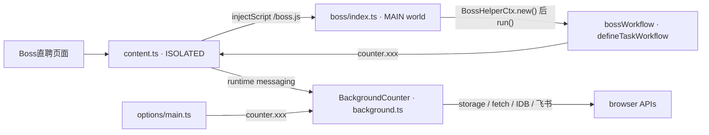

# OpenWiki 快速上手

**BossHelper（boss-helper）是一个浏览器扩展，用于自动化 Boss直聘（zhipin.com）上的岗位筛选与简历投递。** 它在招聘列表页注入一个 Vue 面板，读取宿主页面自带的 Vue 组件树拿到岗位数据，然后按用户配置执行一条"去重 / 关键词 / 区间 / 距离 / AI 评分 → 生成招呼语 → 真实投递 → 发消息"的任务流水线，并把结果、日志与统计写进本地存储。

技术栈：**WXT 0.21 + Vue 3 + Nuxt UI 4 + Tailwind CSS 4 + TypeScript**，包管理器是 **Bun**（`mise.toml` 固定 `bun = "1.2"`）。仓库是 Bun workspace monorepo，`packages/devlog-ui` 以 git submodule 形式提供日志 UI，并被 `wxt.config.ts` 用 alias 直接指向其 `src/`。构建目标为 **chrome / edge / firefox，全部 MV3**（firefox 必须显式带 `--mv3`）。

> **语言提示**：这是一个中文项目。UI 文案、注释、日志、错误消息、甚至工作流任务 id 都是中文字符串（如 `'岗位投递'`、`'已沟通'`、`'岗位名'`）。搜索代码时**务必同时用中文关键词**，用英文概念（如 "filter"、"delivery"）只能搜到标识符和变量名，搜不到业务语义所在的位置。

## 本地最短开发循环

```bash
git submodule update --init --recursive   # packages/devlog-ui 必须先就位（mise 任务 init.git）
bun install                               # 否则 workspace 解析 devlog-ui 会失败
bun run dev                               # = wxt，chrome 开发模式
bun run dev:firefox                       # = wxt -b firefox --mv3
```

- `wxt.config.ts` 设置了 `srcDir: 'src'`、`outDirTemplate: '{{browser}}-mv{{manifestVersion}}'` 和 `webExt.disabled: true`，所以 `bun run dev` **不会**自动拉起浏览器：产物在 `.output/chrome-mv3/`，需要手动"加载已解压的扩展程序"指向**这个子目录**，而不是 `.output/`。
- 首次跑 `bun run check`（`vue-tsc --noEmit`）之前，`tsconfig.json` 继承的 `./.wxt/tsconfig.json` 还不存在，必须先让 `wxt` 生成一次。
- **测试不在 `src/` 里，而在 `/scripts`**：在仓库根执行 `bun test` 运行 `scripts/*.test.ts`（`bun:test`）。`package.json` 里**没有 `test` script**，tag 触发的 `.github/workflows/main.yml` 只做 `bun run zip` 与发布，不跑测试或类型检查。

完整脚本矩阵、质量门禁与发布流程见 [构建、质量门禁与发布](operations/build-and-release.md)，测试的依赖注入模式与覆盖盲区见 [测试套件与可测性边界](testing/test-suite.md)。

## 四个运行时世界：动手前先认出自己在哪

同一个功能往往横跨两三个 JS 堆，**先确认你的代码运行在哪个世界**，否则会写出"在 MAIN world 里调 `browser.*`"这类根本无法运行的代码。

| 世界 | 入口 | 拥有的能力与代码 |
| --- | --- | --- |
| Background service worker | `src/entrypoints/background.ts` | 唯一能直接用 `browser.*` 的地方：`browser.storage`、`notifications`、`runtime.openOptionsPage`、跨域 `fetch`（含流式 `fetchStream`）、飞书 OpenAPI 调用、图片 IndexedDB（`ExtensionGlobalDB`） |
| ISOLATED content script | `src/entrypoints/content.ts`（`matches` 为 zhipin.com、`runAt: 'document_start'`、`world: 'ISOLATED'`） | `injectScript('/boss.js')`，并把 MAIN world 与 background 两侧的 comctx `defineProxy` 接起来：namespace `__boss-helper-content__` / `__boss-helper-background__` |
| MAIN world 注入脚本 | `src/entrypoints/boss/index.ts`（`defineUnlistedScript`，产物 `boss.js`） | 宿主 `window` / cookie / 宿主 Vue 根实例、`BossHelperCtx`、`bossWorkflow`、MQTT 聊天、自定义元素 `boss-helper-job` 面板 |
| Options 页面 | `src/entrypoints/options/main.ts` + `App.vue` | 完整 Vue UI，启动时调 `initExtensionCounter()`，之后只通过 `counter` 访问后台能力 |

业务代码（`useConf`、`useModel`、`useStatistics`、`request`、`feishuSync`……）**从不直接接触 `browser.*`**，一律经过 `src/message/` 导出的 `counter` 门面跨世界转发：`initCounter()` 让注入脚本接到 content script，`initExtensionCounter()` 让 options 页面直接接到 background；未初始化就访问 `counter.xxx` 会当场抛错而不是静默失败。运行时装配、manifest 差异与 `extKey()` 见 [扩展运行时与构建目标](architecture/extension-runtimes.md)；`counter` 的 RPC 协议、三个 namespace 与 `local:`/`sync:` 键前缀规则见 [消息与存储桥（counter）](architecture/messaging-and-storage-bridge.md)。



一次投递任务从注入脚本到存储的跨世界路径：每个箭头都是一次需要序列化的跨世界调用。

## Boss 专属装配线

两个类把通用引擎接上 Boss直聘：

- **`HelperContext`（抽象基类，`src/composables/useHelper/ctx.ts`）** 持有 `conf`、`accounts`、`models`、`statistics`、`chatModel`、`cache`（`HelperCache`）、`jobCache`（`JobResultCache`）、`workflow`、`logs`，并声明 `jobList` / `jobMaps` / `start` / `sendMessage` / `loadMoreJob` 等抽象成员。它同时通过 `HelperKey` 注入给 Vue 面板。
- **`BossHelperCtx`（`src/entrypoints/boss/index.ts`）** 实现这些抽象：hook 宿主 Vue 的 `jobList` / `pageVo` / `hasMore` / `jobDetail` / `pageChangeAction`，把 SPA 变成数据源；`onJobCardClick` 用模拟点击卡片取详情；`sendMessage` 走 MQTT/protobuf 聊天通道。注入脚本末尾调用 `run(bossHelpCtx)`，由 `src/index.ts` 注册 `boss-helper-job` 自定义元素并在 shadow DOM 里挂载面板。
- **`bossWorkflow`（`src/entrypoints/boss/delivery.ts`）** 用 `defineTaskWorkflow(...)` 把 `TaskRegistry` 的通用任务与 Boss 专属任务（`已沟通`、`岗位详情获取`、`岗位投递`、`Boss信息获取`）按业务顺序声明成一条流水线。

细节见 [HelperContext 与 Boss 适配器](architecture/helper-context.md)、[岗位数据获取与页面控制](workflows/job-data-acquisition.md)、[投递工作流引擎](workflows/delivery-workflow.md)。

## 任务路由表

按"我要做什么"查表；每行只指向唯一的主页面，不在这里复述内容。

| 我要做的事 | 读这一页 |
| --- | --- |
| 新增/调整一个筛选任务，或改变任务执行顺序与依赖 | [任务注册表：过滤器、生成器与发送器](concepts/task-handlers-and-filters.md) |
| 修改工作流的阶段、模式（auto/filter/generate/delivery）、超时、停止、翻页 | [投递工作流引擎](workflows/delivery-workflow.md) |
| 修改 AI 提示词、评分解析、招呼语生成与人工确认 | [AI 筛选、招呼语与提示词模板](concepts/ai-filtering-and-greeting.md) |
| 加一个配置项、改默认值、写版本迁移、处理预设/账号切换 | [配置、预设与账号](concepts/configuration-and-presets.md) |
| 新增存储键、调缓存过期、改统计滚存或判重集合 | [持久化：岗位结果缓存、判重集合与统计](concepts/persistence-and-caching.md) |
| 新增一个跨世界调用、改存储前缀、排查"消息没到" | [消息与存储桥（counter）](architecture/messaging-and-storage-bridge.md) |
| 改 background / content script / 注入脚本的加载与生命周期，或改 manifest 差异 | [扩展运行时与构建目标](architecture/extension-runtimes.md) |
| 让面板/工作流适配新的宿主页面结构或抽象成员 | [HelperContext 与 Boss 适配器](architecture/helper-context.md) |
| 接新的 AI provider 或改模型请求体 | [AI 提供商配置与传输层](integrations/ai-model-layer.md) |
| 改投递接口、错误码、MQTT 发消息、图片上传 | [Boss 直聘 HTTP 与 MQTT 接口接入](integrations/boss-platform-apis.md) |
| 调整失败分类、重试、超时后如何上报 | [错误分类、受控执行与失败上报](concepts/errors-and-retries.md) |
| 改飞书多维表格同步的列、批次、重试 | [飞书（Lark）多维表格同步](integrations/feishu-sync.md) |
| 改 options 页或页面内注入面板 | [Options 页面与注入面板 UI](operations/options-page.md) |
| 加/跑测试，或想知道哪里没有测试 | [测试套件与可测性边界](testing/test-suite.md) |
| 发版、打包、确认 lint/format 门禁 | [构建、质量门禁与发布](operations/build-and-release.md) |
| 提交 PR 前确认范围与风格约束 | [贡献与改动约定](contributing.md) |

## 三条容易踩的全局约束

1. **存储键默认落进 `sync:` 区**——`ContentCounter` 的 `genKey()` 只有在 key 已经以 `local:` / `session:` / `sync:` / `managed:` 开头时才原样使用，否则静默补上 `sync:` 前缀：配额更小，而且会随用户账号漫游到其他设备。新增键请显式写 `local:`（或你真正想要的区）；给既有键补前缀等于迁移存储区，旧值不会自动搬运。
2. **对上游 zhipin.com 的假设极其脆弱**——CSS 选择器、宿主 Vue 组件名（`pageVo`、`jobList`、`jobDetail`、`pageChangeAction`）、`wapi/*` 错误码、`window._PAGE` 里的用户字段、protobuf schema 都不由本项目掌控。相关页面都会标出风险点，改动这类代码前请先读 [贡献与改动约定](contributing.md) 里"先讨论再实现"的要求。
3. **`counter` 未初始化就抛错，不会静默降级**——`src/message/index.ts` 的 `counter` 是个 `Proxy`，`_counter === null` 时读取或写入任意属性都会抛 `Counter has not been initialized...`；因此 `initCounter()`（注入脚本）与 `initExtensionCounter()`（options）必须在业务模块求值之前调用。仓库里唯一绕过这条检查的是 `ExtStorage.getItem`，它用 200ms 轮询等待 `_counter` 就绪，代价是永远等不到时会**永久 pending**。

## 当前 wiki 状态核对

本页职责之一是对照 `/openwiki/.page-manifest.json`、`/openwiki/.run.json` 与 `/openwiki/.last-update.json` 判断有无页面因源码变化而失准。核对结果：

- `.last-update.json` 记录的 `gitHead` 为 `19f57bfabec9b12a5e88293814409713f4376f2b`；`.run.json` 的 `baseGitHead` / `targetGitHead` 同为该提交，`sourceFingerprint` 为 `sha256:a795ba2c8884fca82e4c119a0a653d06c06bc1339f5190cc1948d4d696b1ed99`。
- `.page-manifest.json` 中**全部 18 个页面**的 `gitHead` 与 `sourceFingerprint` 都与上述值一致，即当前 wiki 是对当前工作树源码的完整快照。
- 逐页复核源码中本页所依赖的事实（四个入口文件、`src/message/`、`src/index.ts`、`wxt.config.ts`、`package.json`、`mise.toml`、发布工作流）后未发现与页面内容冲突的证据。

**因此本次无需重生成任何页面。** 已核对的全套页面路径：

| 目录 | 页面 |
| --- | --- |
| 入口 | [quickstart.md](quickstart.md) |
| architecture | [extension-runtimes.md](architecture/extension-runtimes.md)、[helper-context.md](architecture/helper-context.md)、[messaging-and-storage-bridge.md](architecture/messaging-and-storage-bridge.md) |
| concepts | [ai-filtering-and-greeting.md](concepts/ai-filtering-and-greeting.md)、[configuration-and-presets.md](concepts/configuration-and-presets.md)、[errors-and-retries.md](concepts/errors-and-retries.md)、[persistence-and-caching.md](concepts/persistence-and-caching.md)、[task-handlers-and-filters.md](concepts/task-handlers-and-filters.md) |
| integrations | [ai-model-layer.md](integrations/ai-model-layer.md)、[boss-platform-apis.md](integrations/boss-platform-apis.md)、[feishu-sync.md](integrations/feishu-sync.md) |
| operations | [build-and-release.md](operations/build-and-release.md)、[options-page.md](operations/options-page.md) |
| testing | [test-suite.md](testing/test-suite.md) |
| workflows | [delivery-workflow.md](workflows/delivery-workflow.md)、[job-data-acquisition.md](workflows/job-data-acquisition.md) |
| 约定 | [contributing.md](contributing.md) |

改完源码后要让 wiki 重新与源码对齐，请走本仓库记录的 OpenWiki 更新流程（而不是手工编辑生成页）；该流程本身在 [贡献与改动约定](contributing.md) 与 [构建、质量门禁与发布](operations/build-and-release.md) 中有说明。
