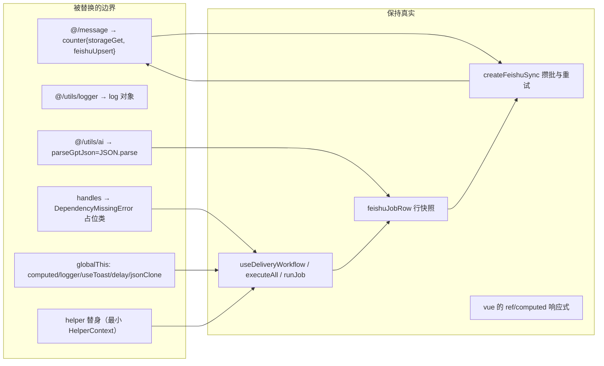
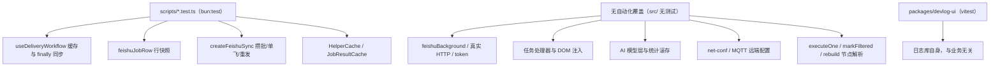

# 测试套件与可测性边界

Boss Helper 的自动化测试只有四个文件，全部位于 `scripts/`，都用 `bun:test` 编写，覆盖三块彼此独立、且都能在无浏览器环境下判定对错的逻辑：

| 文件 | 被测对象 | 方式 |
| --- | --- | --- |
| [`feishu-workflow.test.ts`](../../scripts/feishu-workflow.test.ts) | `src/composables/useApplying` 的 `useDeliveryWorkflow`、`feishuJobRow`、`createFeishuSync` | 只 mock 边界，工作流与批处理真实执行 |
| [`feishu-sync.test.ts`](../../scripts/feishu-sync.test.ts) | `src/utils/feishuSync` 的行构建与队列 | 只 mock 边界 |
| [`helper-cache.test.ts`](../../scripts/helper-cache.test.ts) | `HelperCache` | 构造函数注入内存存储 |
| [`job-cache.test.ts`](../../scripts/job-cache.test.ts) | `JobResultCache` | 构造函数注入内存存储 |

它们刻意不启动浏览器、不连 zhipin.com、不发真实 HTTP：所有 DOM、扩展 API、模型调用与远端接口都在 `mock.module()`、`globalThis` 注入或构造函数参数处被截断。`src/` 目录下没有任何 `*.test.ts`，测试与源码物理分离是这套体系的第一条事实。

本页说明四件事：测试怎么运行（以及为什么不能靠 `bun test` 一把梭）；`feishu-workflow.test.ts` 的注入模式为何成立、改动时要留神什么；这些用例锁定的不变量；以及**完全没有测试**的区域该用什么替代手段验证。被测对象的业务语义分别见 [投递工作流](../workflows/delivery-workflow.md)、[飞书同步](../integrations/feishu-sync.md) 与 [持久化与缓存](../concepts/persistence-and-caching.md)。

## 如何运行：没有 test script，也没有 CI 门禁

两条运维事实决定了测试只是本地确认手段：

- **根 `package.json` 没有 `test` 脚本**。`scripts` 里只有 `dev*`、`check`、`build*`、`zip*`、`fmt*`、`lint*`，因此测试无法通过 `bun run test` 触发，只能在仓库根手动执行 `bun test`。
- **CI 不跑测试**。发布工作流 [main.yml](../../.github/workflows/main.yml) 只有 `bun install` → `bun run zip` → 收集 `.output/*.zip` → 上传 artifacts / 建 Release，没有任何 `test`、`lint` 或 `typecheck` 步骤。测试变红不会阻断合并或发版。

`scripts/` 目录不在 WXT 的 `srcDir`（`wxt.config.ts` 中为 `'src'`）内，所以测试文件不参与扩展构建，也不会被打进产物。

运行根仓库测试时**显式给路径**更安全：`bun test` 不带参数会扫描整个仓库，而 `packages/devlog-ui` 是 git submodule（`mise` 的 `init` 任务用 `git submodule update --init --recursive` 拉取），它自带一套 **vitest** 用例（`environment: 'jsdom'`、`globals: true`、`include: ['src/**/*.test.ts']`，在子包内用 `npm test` 即 `vitest run` 运行）。那套用例依赖 `vi`、jsdom 与全局注入，在 Bun 运行器下不可用。两个生态互不感知：vitest 的 `include` 相对子包，永远捡不到 `scripts/*.test.ts`；而 `bun test` 从根扫全仓库时可能把子包的 vitest 用例一起算进来。结论：

```bash
# 只跑本项目自己的用例（推荐）
bun test scripts

# 或只跑某一个
bun test scripts/feishu-workflow.test.ts
```

devlog-ui 的用例覆盖的是日志库自身（`logger` 的级别与订阅、`ErrorCapture`、`LogPersistence`、`sessionStorage` 行为），与 Boss Helper 的业务逻辑无关，且随 submodule 单独演进——不要在本仓库里修改它们，也不要指望它们充当业务回归网。

不强制覆盖率、不要求给强依赖真实浏览器的逻辑补复杂 Mock，是 [贡献与改动约定](../contributing.md) 里明确的策略（`CONTRIBUTING.md` 的「浏览器扩展项目的测试与验证」与「不要为了测试而制造复杂 Mock」两节）。测试只是"如果写了就按本页约定写"的可选项。

## Bun 测试的注入模式：只有边界被替换

`scripts/feishu-workflow.test.ts` 是最讲究的一个文件。它要测的 `useDeliveryWorkflow` 是 ESM 顶层导出的函数，内部依赖三类东西：**编译器自动导入的全局**（`logger`、`useToast`、`jsonClone`、`delay`、`computed`）、**`@/` 别名模块**（`@/message`、`@/utils/logger`、`@/utils/ai`、`@/composables/useApplying/utils`、`@/utils/feishuSync`）以及**被替换成替身对象的 `HelperContext`**。文件用三种手段分别处理前两类，用 `fixture()` 处理第三类。

### 1. `mock.module()` 替换别名模块

`@/message` 背后是跨世界消息桥，`@/utils/logger` 来自 `devlog-ui` 子模块——两者在 Bun 环境里都会失败。所有用例都把它们的**最小可用表面**换掉：

```ts
const log = { info: mock(() => {}), warn: mock(() => {}), error: mock(() => {}), debug: mock(() => {}), withContext: () => log }
const storageGet = mock(async (_key: string) => config)
const feishuUpsert = mock(async (_rows: Record<string, unknown>[]) => ({ success: true }))

mock.module('../src/message', () => ({ counter: { storageGet, feishuUpsert } }))
mock.module('../src/utils/logger', () => ({ logger: log }))
mock.module('../src/utils/ai', () => ({ parseGptJson: JSON.parse }))
```

- `counter` 只提供真实代码调用到的两个字段（`storageGet`、`feishuUpsert`），它们正是"跨世界存储"与"飞书写入"两条边界。
- `parseGptJson` 换成 `JSON.parse`，避开 `partial-json` 的容错解析，让行快照里的 AI 评分路径仍能真实跑通（`parseFiltering` 本身保持真实）。
- 文件为**相对路径与别名各注册了一遍同样的工厂**（`../src/message` 与 `@/message` 等），因为同一模块可能通过不同 specifier 解析；`bun:test` 的 `mock.module` 是进程级"最后一次注册生效"，重复注册是刻意的保险，不是冗余。

`mock.module` 必须在**动态导入被测模块之前**执行，所以文件里所有被测模块都用 `await import(...)` 而非静态 `import`。

### 2. `globalThis` 注入自动导入的全局

`logger`、`jsonClone`、`useToast`、`delay`、`computed` 在生产代码里是 WXT / Nuxt UI 自动导入的**裸标识符**：源码中既没有 `import` 也没有声明（Nuxt UI 那一批在 [auto-imports.d.ts](../../auto-imports.d.ts) 里有全局声明，`delay` 则来自 `src/utils/index.ts` 的导出，靠构建期 auto-import 注入）。Bun 不认识这层编译期转换，于是文件把它们挂到 `globalThis`：

```ts
const globals = {
  computed,
  logger: log,
  useToast: () => toast,
  delay: async () => {},
  jsonClone: (value: unknown) => JSON.parse(JSON.stringify(value)),
}
const descriptors = new Map(Object.keys(globals).map((key) => [key, Object.getOwnPropertyDescriptor(globalThis, key)]))
Object.assign(globalThis, globals)
afterAll(() => { /* 逐 key 恢复原 descriptor，原本不存在才 deleteProperty */ })
```

三点细节决定可靠性：

- `delay` 被替换成 `async () => {}`，把 `conf.formData.delayDeliveryStarts / delayDeliveryInterval / delayDeliveryPageNext` 的秒级等待变成零；真实实现 `delay(s)` 会 `Promise` 化 `setTimeout(s * 1000)` 并顺带操作 `#loader` DOM 元素，在无 DOM 的 Bun 环境不可用。
- `afterAll` 不是简单删除，而是**按原 descriptor 逐个还原**（原本不存在才 `Reflect.deleteProperty`），避免污染同进程内后续测试文件。
- `computed` 用的是真实 `vue`，因为被测代码里 `total` 等状态需要真实响应式语义；文件还显式 `import { ref } from 'vue'` 供 fixture 使用。

### 3. 真实模块的显式"放行"与一个占位类

被 mock 清单之外，还有两个模块**必须保持真实**，但源码以 `@/...` 别名引用。做法是先按相对路径拿到真实实现，再把别名映射回它：

```ts
const realApplyingUtils = await import('../src/composables/useApplying/utils')
mock.module('@/composables/useApplying/utils', () => realApplyingUtils)
const realFeishuSync = await import('../src/utils/feishuSync')
mock.module('@/utils/feishuSync', () => realFeishuSync)
```

这样 `useDeliveryWorkflow` 通过 `@/utils/feishuSync` 拿到的 `feishuJobRow` / `createFeishuSync` 是真实实现（只有它内部 import 的 `counter` 被换掉），`parseFiltering` 也是真实实现。

唯一被"假装"的类是 `DependencyMissingError`：`mock.module('../src/composables/useApplying/handles', ...)` 只导出一个同名 `class extends Error`，因为真实 `handles.ts` 顶层引用了 `@/utils/activity`、`@/entrypoints/boss/requests` 等重依赖。`useDeliveryWorkflow` 只对它做 `instanceof` 判断（用于"任务依赖缺失时改跑依赖"的分支），占位类行为等价。

文件开头那句注释就是全部约定：**「Mock boundaries only: workflow execution, row snapshots and batching stay real.」** 换成中文：只有"出门"的动作（存储/飞书写入、日志、AI JSON 解析、toast）被替换，工作流控制流、行快照与批处理永远走真实代码。

### `fixture()` 与 `deferred()`：让真实 `executeAll` 可驱动

注入完成后，`fixture(count, overrides)` 造出一个**只实现被测代码实际读到的字段**的 `HelperContext` 替身，并把三个假任务（`filter` / `generate` / `delivery` 三个 phase）喂给真实的 `useDeliveryWorkflow`：

- `jobList` / `jobMaps` / `jobResultMaps` / `jobCache`（只有 `get`、`set` 两个 `mock`）/ `statistics.todayData` / `conf.formData` / `accounts` / `conf.formDataPreset` / `chatModel.states` / `loadMoreJob` 均为最小实现，`as any` 绕过完整类型；
- 任务定义为 `task: () => handlers[phase]`，使每个阶段的处理器能在用例里按需覆盖（`overrides.filter` 等）；
- `raw` 是 `Map<key, { key }>`，模拟页面注入侧抓到的原始岗位数据。

任务本身**没有 `phase` 之外的特殊配置**，所以 `rebuild()` 的 `active` 判定、`deps` 排序、`onEnd`/`onDelivered` 钩子都不在测试范围内——它们只在真实任务定义里才出现。

`deferred()` 是控制时序的关键：返回一个手工可 `resolve` 的 `Promise`，让用例"把任务卡在半路"，然后在卡住期间断言 `feishuUpsert` **尚未**被调用，或在这时调用 `workflow.stop()` 验证中断语义。配套的 `settleSync()` 连续 `await Promise.resolve()` 30 次，用来排干 `flush()` 的微任务——因为生产代码里 `add()` 内的 `void flush()`、`runJob` 的 `finally` 以及 `stop()` 都是**故意不 await** 的 fire-and-forget 调用（见 [飞书同步](../integrations/feishu-sync.md) 的"别把 flush 改成 await"）。测试必须自己把这些游离 Promise 转干净，否则断言会跑在微任务之前，得到假绿。



## 用例锁定的不变量

这些断言目前是**唯一**的自动化护栏。改动对应实现时若它们变红，先判断是实现回归还是行为被有意改变，不要直接改期望值。

### 缓存决策（`runJob` 前后）

| 不变量 | 断言位置 |
| --- | --- |
| `useCache` 开启时，`jobCache.get(key, useCache.expire)` 用配置里的过期毫秒数（示例 `60_000`）调用 | 「启用时缓存过滤阶段 warn isSkip，且不执行后续阶段」 |
| 筛选阶段 `warn + isSkip` 会落盘；后续 `generate` / `delivery` 阶段**一次都不执行** | 同上 |
| 投递成功写入 `{ status: 'success', msg: '投递成功' }` | 「启用时在投递成功后写入 success」 |
| `error` 状态与抛异常**都不缓存**（`set` 零调用），但 `jobResultMaps` 仍是 `error` 且不投递 | 「启用时不缓存 error/throw 失败结果」 |
| 命中缓存时保留 `isCache: true` 的结果、跳过**全部**阶段、不写缓存、`todayData.total` 不增加 | 「命中缓存后保留缓存结果并跳过所有执行阶段」 |
| `useCache` 关闭时完全不读写缓存，即使缓存里有 `success` 也照常执行 | 「禁用时 success/skip 正常执行且不读写缓存」 |

注意 `todayData.total === 0` 的含义：缓存命中路径在 `++total` 之前就 `return` 了。这解释了为什么统计口径里"总处理数"不含缓存命中。另一个隐含前提是 useCache 分支只在 `mode !== 'delivery'` 时进入——测试都跑 `auto`/`filter`，没有覆盖 `delivery` 模式跳过缓存的用例。

### 最终状态与飞书行形状

- `filter` / `generate` / `auto` 三种模式的 `处理状态` 分别是 `待投递` / `待确认发送` / `投递成功`，`处理状态-类别` 分别是 `ready` / `ready` / `success`；`使用账号` 取账号 `label`（`测试账号`）而非对象，`使用预设` 取 `formDataPreset`（`测试预设`）。
- `storageGet` 被以 `'local:feishu-config'` 调用——行发得出去的前提是读的是这个 key。
- `filter` 模式跑完后 `AI招呼语` 列为空，另两种模式为生成阶段的招呼语文本；`auto` 模式跑完 `workflow.busy.value` 为 `false`。
- 提前 `skip` 退出与抛异常都仍然从 `finally` 同步：异常行形状为 `{ '处理状态-类别': 'error', 处理状态: '执行失败', '处理状态-原因': <message> }`，跳过行为 `{ '处理状态-类别': 'warn', 处理状态: '不匹配', '处理状态-原因': <reason> }`。
- 用户停止时 `finally` 写入 `{ 处理状态: '已停止', '处理状态-类别': 'wait', 使用账号 }`，`status` 变 `stop`、`busy` 变 `false`、**下一个岗位（`job-1`）的 `jobResultMaps` 不存在**、`loadMoreJob` 不被调用、`success` 计数为 0。

### 批次节奏与失败重发

- **每 5 条一次**：6 个岗位跑到第 5 个（`job-5` 被 `deferred` 卡住）时，`feishuUpsert` 已经收到恰好 5 行，key 顺序是 `job-0..job-4`；解除阻塞、`executeAll` 结束后尾批 `job-5` 作为第二次调用发出（`count: false` 的手动过滤入口未覆盖）。
- **失败不丢行**：`feishuUpsert` reject 时 `toast.add` 收到 `{ id: 'feishu-sync-error', description: <message>, color: 'error' }`，`workflow.status` 仍是 `pending`（同步失败不算工作流失败），随后 `stop()` 会**原样重发**同一批行（`toEqual(failedRows)`）。

### `createFeishuSync` 队列本身（`feishu-sync.test.ts`）

这个文件不注入 `globalThis`，只 mock `@/message`、`@/utils/logger` 与 `parseFiltering`，然后直接调用真实的 `createFeishuSync` / `feishuJobRow`：

- `使用账号` 映射为账号 `label` 字符串而非账号对象；
- 前 4 条不发、第 5 条发 5 行；再 5 条发一次；第 11 条 `flush()` 单独成批；
- 失败调用 `onError` 一次，随后 `add` 新快照再 `flush`，发出的是**最新快照**（`处理状态` 从"筛选完成"变成"生成完成"），成功后不会重复发送；
- 请求飞行期间 `add` 同名 key 的新快照，旧请求成功后该新快照仍保留并成为下一批。

### 缓存类本身（`helper-cache.test.ts` / `job-cache.test.ts`）

这两个文件只需 `mock.module('@/message', () => ({ counter: {} }))` 让模块级 `import { counter } from '@/message'` 能解析；随后把 `storageGet`/`storageSet` 换成基于 `Map` 的内存适配器（带 `structuredClone`，模拟真实存储的值语义），并**通过构造函数**注入。这正是两个缓存类接受 `storage` 参数的原因：生产代码传默认值 `counter`（`ctx.ts` 中 `new HelperCache(() => this.accounts.activeAccount.value)` / `new JobResultCache(...)`），测试传自己的适配器。

- `HelperCache`：账号槽位经 `encodeURIComponent` 编码（`slot/a:b` → `slot%2Fa%3Ab`）；`has`/`add`/`save` 在**入口同步捕获槽位**（`storageGet` 被人为挂起期间切账号，在途操作仍写原槽位，之后的查询不会串槽）；只读平铺的 `company`/`hr` key、不回读历史 key；`save(0)` 与 `save(-1)` 不清理、`save(1000)` 才删除过期项；切换回原账号时复用内存（`storageGet` 只调 2 次）。
- `JobResultCache`：只缓存 `success && !isSkip` 与 `warn && isSkip`，`error`/`ready`/矛盾组合/空对象全部丢弃且**不调用 `storageSet`**；`set` 不修改传入对象（`success.isCache` 仍 `undefined`），`get` 才注入 `isCache: true`；`expire` 以毫秒计、`0` 表示永不过期；跨实例共享初始化与写入顺序（`storageGet` 只 1 次，最终 key 顺序 `existing, one, two, three`）；`load` 失败 reject 后可重试；`set` 写失败 reject 且**不发布未持久化结果**、不毒化队列（后续 `set` 仍成功）。槽位 key 形如 `local:job-result-cache:<encodeURIComponent(账号)>`。

## 完全没有测试覆盖的部分

被测范围之外的东西比被测的多得多，`src/` 里连一个测试文件都没有。改动下列路径前请默认"没有护栏"，按 [贡献与改动约定](../contributing.md) 的要求给出真机验证步骤：

- **DOM 注入与 Shadow DOM**：`App.vue`、`boss-helper-job` 自定义元素、宿主 Vue 的 hook 与翻页监听全部依赖真实 zhipin.com 页面，无法在 Bun 里构造。
- **MQTT / 远端配置**：`net-conf.json` 拉取与轮询、公告与版本红点没有任何用例。
- **真实 HTTP 与鉴权**：`counter.feishuUpsert` 背后的 `feishuBackground.ts`（租户 token 缓存与单飞、401 重取、写队列、`bossFields` 字段类型分派与 `fieldsFor`、`records/search` 分页防死循环、`createTableBoss`）**一个用例都没有**——测试只把 `feishuUpsert` 当成成功/失败的桩，配置校验（`enabled`、四个字段非空）也从未被执行到。同样，`backgroundFetch`、`requests.ts` 的重试与 `BossHelperError` 子类映射、高德地理编码也无测试。
- **AI 层**：`modelRequest`、`migrateModelConfig`、`renderTemplate` 没有用例；`parseFiltering` / `parseGreeting` 只在行快照与真实任务路径里被间接使用，边界输入（不完整 JSON、非对象、围栏格式）没有专门用例。
- **统计滚存**：`updateStatistics` 的跨日迁移、`pending` 写队列与 `loading` 守卫没有专门用例，只在工作流用例里被间接观察（`success` / `total` 计数）。
- **工作流的其余入口与钩子**：`executeOne`、`execute`、`markFiltered`（`count: false` 的飞书入口）、`reset`、`rebuild()` 的任务解析（`shadowed` / `failed` / `dependency_only` 节点状态、`deps` 拓扑排序、循环检测）、`onEnd` / `onDelivered` 钩子、`deliveryLimit` 截断、连续 50 个重复岗位的翻页保护，以及 `DependencyMissingError` 的"改跑依赖后重试"分支，都没有用例。
- **任务处理器**：`handles.ts` 里各个筛选/投递处理器只以 mock 形式出现在 fixture 中。

替代验证手段：这些路径的正确性靠**真机验证 + 已有的横向信号**——`bun run check`（`vue-tsc --noEmit`）、`bun run lint`（oxlint 类型感知）、以及原样保留失败输出的观察。真机验证的最小记录格式见 `CONTRIBUTING.md` 的「验证方式」小节。哪些命令属于门禁、哪些只是本地自检，见 [构建、质量门禁与发布](../operations/build-and-release.md)。



## 改动时要注意什么

1. **给真实代码加一个新的自动导入全局**（新的 `useXxx()`、新的工具函数裸调用），`scripts/feishu-workflow.test.ts` 会在运行时抛 `ReferenceError`。要么在 `globals` 对象里补一条，要么改成显式 `import`。这是"mock 边界靠 `globalThis` 白名单"的固有代价。
2. **不要在测试里替换 `@/utils/feishuSync` 的行为**。它的 `mock.module` 只是为了把相对路径映射成真实实现；改成假实现，批次与重试的不变量就全部落空。同理，`@/composables/useApplying/utils` 也应保持真实。
3. **`flush()` 仍然是 fire-and-forget**：新增"发完要断言"的用例，必须用 `settleSync()` 或 `await` 具体的 `deferred`，否则断言会在微任务之前跑掉。
4. **`beforeEach` 里只重置 `feishuUpsert` 的实现与 `toast.add` 的调用记录**，不重置 `jobCache` 的 mock——依赖默认实现的用例与依赖 `mockResolvedValue` 的用例共用同一个 fixture 工厂，新增用例时注意自己的 stub 不会泄漏给同一文件里的其他用例。
5. **`bun:test` 的 `mock.module` 是进程级"最后一次注册生效"**，vitest 的 `vi.mock` 是文件级提升；不要把 `scripts/` 的写法搬到 `packages/devlog-ui`，反之亦然。
6. **想加 CI 门禁**：`main.yml` 目前没有测试步骤，且裸 `bun test` 会连带扫描 devlog-ui 的 vitest 用例而失败。若要把测试接进 CI，需要先给 `bun test` 指定 `scripts` 路径，并另起一步在 `packages/devlog-ui` 里跑 `npm test`。
7. **改缓存类时保留构造函数注入**：`HelperCache` / `JobResultCache` 的第二个参数就是可测性接缝；把它改成直接引用 `counter` 会让两个缓存用例无处下手。

## 相关页面

- [投递工作流](../workflows/delivery-workflow.md) —— `executeAll` / `runJob` 的阶段划分与 `finally` 语义，即工作流用例的断言对象
- [飞书同步](../integrations/feishu-sync.md) —— 行快照的列名契约、`createFeishuSync` 的四段状态与控制流
- [持久化与缓存](../concepts/persistence-and-caching.md) —— `JobResultCache` 与 `HelperCache` 的槽位编码、写队列与可缓存白名单
- [构建、质量门禁与发布](../operations/build-and-release.md) —— 为什么 `test` 不是 npm script，CI 只跑 build/zip
- [贡献与改动约定](../contributing.md) —— 不强制覆盖率、真机验证优先的验证期望
