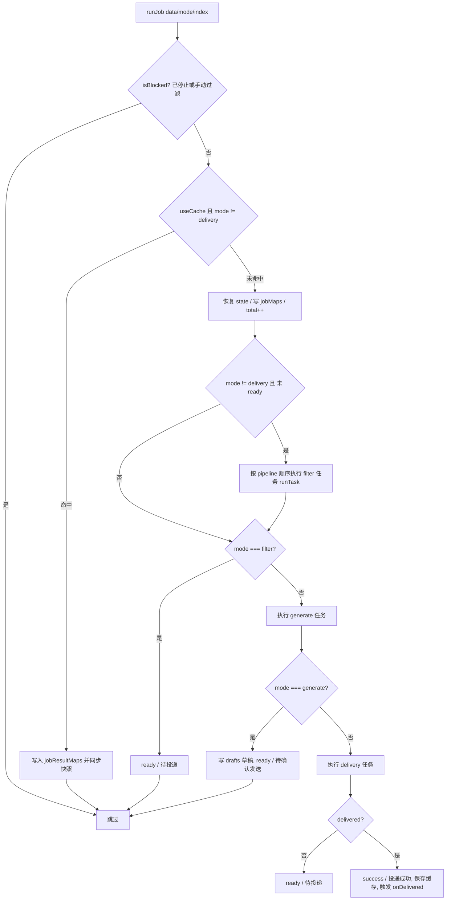
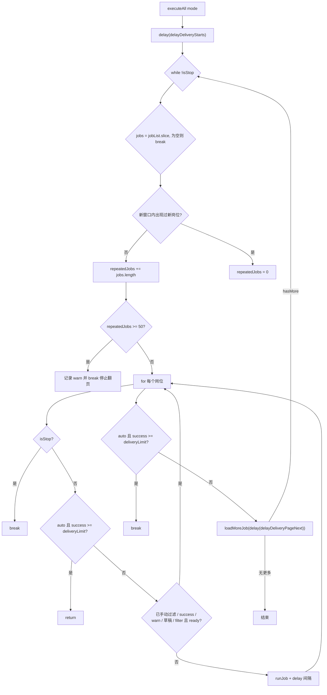
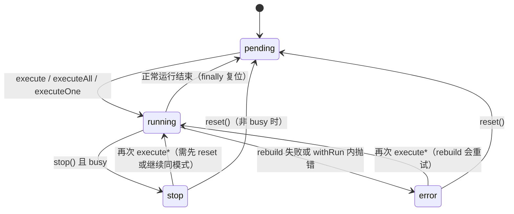
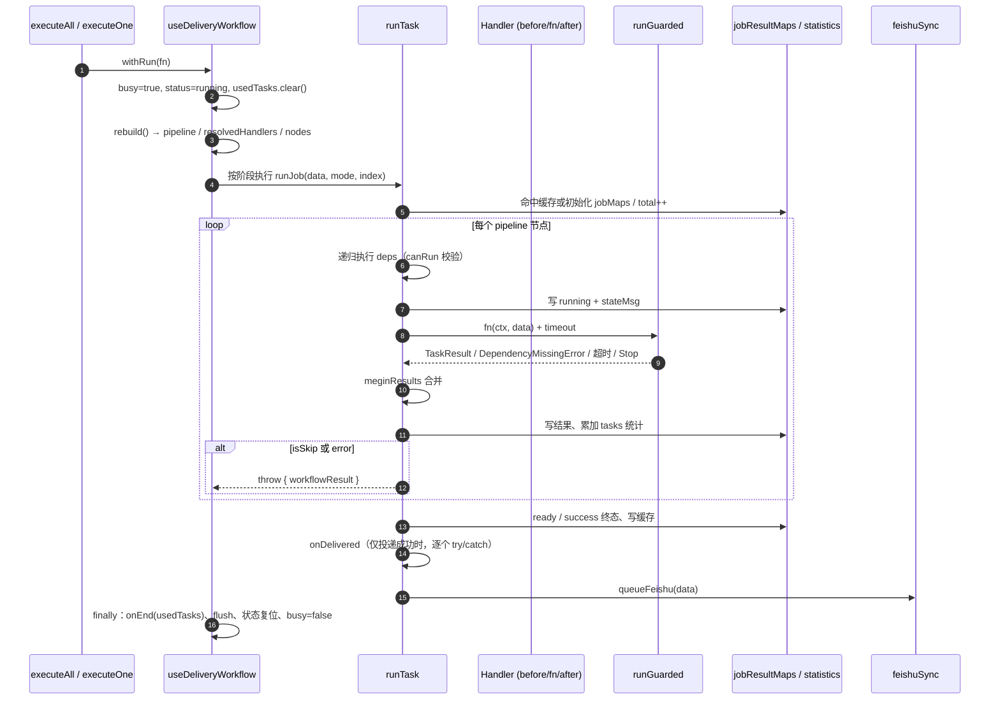

# 投递工作流引擎

投递工作流是插件的核心自动化层：它把"筛岗位 → 生成招呼语 → 真实投递 → 招呼语发送"拆成一组可声明、可依赖、可独立启停的任务，然后对页面上每一个岗位依序执行。

这一层的实现集中在三个职责不同的位置：

| 位置 | 职责 |
| --- | --- |
| `/src/composables/useApplying/type.ts` | 声明层：任务类型、`defineTaskHandler` / `defineTaskWorkflow`、状态枚举、状态共享 |
| `/src/composables/useApplying/handles.ts` | 任务库：`TaskRegistry` 中所有内置筛选/生成/投递任务，`taskResult` 结果构造器，`DependencyMissingError` |
| `/src/composables/useApplying/index.ts` | 运行时：`useDeliveryWorkflow`，负责 `rebuild()`、`runJob()`、`executeAll()` 等 |

> `useDeliveryWorkflow.ts` 与 `useDeliveryWorkflow.1.ts` 两个文件目前**都是空文件**，没有任何模块 import 它们（`useDeliveryWorkflow` 只在 `type.ts` 与 `index.ts` 之间互相引用，见 `type.ts#L6`）。它们只是遗留占位，真正实现在 `index.ts` 中。

## 声明层：从 handler 到 Task

一个任务用 `defineTaskHandler(id, task, opt?)` 声明，返回一个 `(options?) => Task` 的工厂。`Task` 记录 `id`、`phase`、`deps`、`before`、`after`、`label`、`state`/`stateMsg`、`timeout`，以及两个生命周期钩子 `onEnd`（工作流结束时调用）和 `onDelivered`（岗位投递成功后调用）。

`defineTaskHandler` 的合并规则（`type.ts#L121-L177`）：

- `phase` 缺省为 `'filter'`，`deps` 缺省为 `[]`；
- 调用点传入的 `options` 覆盖声明时的 `opt`；
- `before` / `after` 是**拼接**而不是覆盖：`before: [...options.before, ...opt.before]`。

`task` 本身是分层的：它可以是一个同步/异步的"工厂"，返回真正的 `Handler`，也可以返回 `{ fn, before, after, onEnd, onDelivered }` 形态，从而让任务在"决定是否启用"的同时附带钩子（`TaskHandler` 类型）。这正是所有内置任务的做法——先在工厂里检查 `ctx.helper.conf.formData.xxx.enable`，未启用就返回 `undefined`，任务即被视为不参与本次运行。

`defineTaskWorkflow(...items)` 把数组、嵌套数组或惰性 `() => Task` 展平，返回一个 `(ctx) => Promise<DeliveryWorkflow>` 的异步工厂。Boss 入口就是这样组装的：

```ts
// src/entrypoints/boss/delivery.ts
const tasks = new TaskRegistry<BossHelperCtx, BoosJobData>()

export const bossWorkflow = defineTaskWorkflow<BossHelperCtx, BoosJobData>(
  defineTaskHandler('已沟通', ...),
  tasks.SameCompanyFilter(),
  tasks.SameHrFilter(),
  tasks.jobTitle(),
  // ...
  tasks.aiGreetingGenerate({ phase: 'generate', deps: ['岗位详情获取'] }),
  defineTaskHandler('岗位投递', ..., { phase: 'delivery', deps: ['岗位详情获取', 'AI招呼语生成'] }),
)
```

注意声明顺序在这里只是"提交顺序"，真正的执行顺序由 `deps` 决定（见下节）。

### 三个阶段与状态枚举

`TaskPhase` 只有三种：`filter`、`generate`、`delivery`；`WorkflowMode` 多一个 `auto`。`JobStatus` 则由 `jobStatusList` 固定：

```ts
['pending', 'wait', 'running', 'request', 'ai', 'ready', 'success', 'warn', 'error']
```

这个数组的顺序是有语义的——`meginResults()` 用它做"严重程度"比较（下标越大越严重），而不是字母序或声明序。`running` 与 `request` / `ai` 的区分用于 UI 展示（"运行中" vs "AI 处理中"）。

## 解析：`rebuild()` 如何把声明变成 pipeline

`useDeliveryWorkflow(items, helper)` 接收声明数组和 `HelperContext`，返回一个响应式的 workflow 对象。每次真正开始运行前，`withRun()` 都会先调 `rebuild()`（`index.ts#L88-L216`）。`rebuild()` 做四件事：

1. **展平并拷贝**：把 `items`（数组/函数）展开，并为每个任务复制 `before` / `after` 数组，避免运行时修改污染声明。
2. **条件解析**：按顺序对每个任务调用 `task.task(_ctx)`（一个伪 ctx，`index: 0`）。返回值决定三件事：
   - `undefined`/空 → 任务被禁用，**不加入** `requiredIds`；
   - 返回 `Handler` 或 `{fn, ...}` → 任务激活，记录到 `resolvedHandlers`，并把 `{fn}` 里的 `before`/`after` 追加到任务上，把 `onEnd`/`onDelivered` 包成"先原钩子、后返回值钩子"的组合；
   - 抛错（典型是 `HelperConfigError`，例如 AI 模型未配置）→ 任务仍加入 `requiredIds`（以便暴露问题），错误记入 `errors`（键为 `${task.id}::${task.label}`），并注册一个"永远抛出原错误"的 handler。
3. **收集依赖闭包**：只有被解析出来的任务才把自己的 `id` 和它的 `deps` 加入 `requiredIds`。这就是一个被禁用任务不会把依赖链强行拉进 pipeline 的原因。
4. **拓扑排序**：对 `requiredIds` 逐个执行 DFS `sort(id)`：
   - 在 `stack` 中再次遇到同一 id → `throw new Error('Cycle: ' + id)`；
   - `taskMap` 中找不到 id → `throw new Error('Missing dependency: ' + id)`；
   - 先递归排 `deps`，再把自身 `push` 进 `_pipeline`。

排序完成后，`pipeline.value` 是"依赖在前、被依赖任务在后"的扁平数组，`resolvedHandlers` 被整体替换。

### 节点状态

`nodes.value` 按**原始声明顺序**（不是 pipeline 顺序）为每条声明生成一个节点，用于配置/调试视图。状态判定有严格优先级：

| 状态 | 条件 |
| --- | --- |
| `shadowed` | `taskMap.get(t.id)?.task !== t.task`，即同 id 出现了更靠后的定义，本条被覆盖 |
| `failed` | 解析期抛错 |
| `active` | 解析成功且登记为 handler |
| `dependency_only` | 未解析出 handler，但被别的任务的 `deps` 引用而进入 `requiredIds` |
| `disabled` | 其余情况，即未启用 |

`shadowed` 是一条真实存在的陷阱：`TaskRegistry` 里 `customGreeting` 与 `aiGreeting` 的 id 都是 `打招呼`，同时启用时只有后声明的那条生效（详见 [任务处理器与筛选器](../concepts/task-handlers-and-filters.md)）。

如果有任何节点处于 `failed`，`rebuild()` 会聚合 `label: message` 文本、打日志、**弹 `alert`** 并写入 `errorMessage.value`；`withRun()` 随即把 `status` 置为 `error` 并放弃本次运行。

手动调用 `workflow.rebuild()` 时不会写 `status`，但会临时设置 `busy`，因此运行中调用会被直接忽略。

## 执行：`runJob()` 与单个岗位的生命周期

`runJob(data, mode, index)` 是所有模式的公共内核（`index.ts#L276-L450`）。执行前与执行中的关键步骤：



### `runTask()` 的内部顺序

每个任务节点由 `runTask(t)` 执行，规则如下：

1. 跳过已 `completed` 的任务和已阻塞的岗位；若 `t.id` 正处在 `visiting` 集合中则说明 dep 图有环，抛 `Cycle:`。
2. **递归先执行 `deps`**：对每个 `dep` 在 `pipeline` 中查找，找不到就抛 `Missing dependency:`；若该依赖在当前模式下不可运行（`canRun(dep)` 为假），抛 `Filter depends on delivery:`。
3. 逐个调用 `[...t.before, handler, ...t.after]`，每次用新的 `TaskContext`（`now` 重新取、`index` 为岗位在页面中的序号、`log` 带 `task_id`）。
4. 每次调用包在 `runGuarded(fn(ctx, data), taskTimeout, t.id)` 里，返回值经 `meginResults()` 归一化。
5. 若抛出 `DependencyMissingError`（来自 `createLazyObject` 的惰性详情代理）：找到对应任务，若可运行则**先补跑该依赖**，再用同一个 `fn`/`ctx` 重跑一次；否则原样抛出。
6. 结果写回 `helper.jobResultMaps`：`res.status ??= res.isSkip ? 'warn' : undefined`，`res.msg ??= label`。若结果为"成功但未跳过"，写状态会被改写成 `running` + `投递处理中`，等后续任务再升级。
7. 累加 `statistics.todayData.tasks[t.id][status]`。
8. **短路**：`res.isSkip || res.status === 'error'` 时，如果是 filter 阶段的 `warn`+`isSkip` 就写入岗位缓存，然后 `throw { workflowResult: res }`——这不是错误，而是一个"提前结束本岗位"的信号，外层 `catch` 识别 `'workflowResult' in e` 后安静返回。

`t.phase === 'delivery'` 的节点执行完成后把 `delivered` 置真，这是后续写出 `投递成功` 的依据。

### 依赖缺失的重解析

`DependencyMissingError` 机制让"详情请求"可以推迟到真正需要时发生：Boss 入口把 `rawData.detail` / `rawData.boss` 建成 `createLazyObject('岗位详情获取')` / `createLazyObject('Boss信息获取')`（`src/entrypoints/boss/index.ts#L396-L397`），未初始化时读任何属性都会抛 `DependencyMissingError(taskId)`。工作流捕获它后按 id 找到 `岗位详情获取` / `Boss信息获取` 任务，先执行（真实发请求并写回 `rawData`），再重跑刚才失败的那一次调用。这样声明层不必手工在每个筛选任务的 `deps` 里重复写详情任务（虽然 Boss 入口仍然显式写了，见 [任务处理器与筛选器](../concepts/task-handlers-and-filters.md)）。

### 结果合并：`meginResults()`

当一个 handler 返回 `TaskResult[]`（如 `amap` 任务同时返回直线/驾车/步行三条判断）时，`meginResults()` 把它们合并为一个：

- `isSkip`、`isCache` 取逻辑或；
- `reason`、`msg` 用换行拼接（去空）；
- `status` 取 `jobStatusList` 中**下标更大**的那个，也就是更严重的一方；
- `id` 取先出现的非空值。

### 超时与停止：`runGuarded()`

`runGuarded` 用定时器 + 停止监听双向看门狗，确保任何一次 handler 调用都能 settle：

```ts
const timer = setTimeout(() => reject(new Error(`任务「${taskId}」执行超时(...s)`)), timeout)
const onStop = () => reject(new WorkflowStoppedError())
```

`resolveTimeout()` 的默认值按任务特征分层：

| 条件 | 默认超时 |
| --- | --- |
| 任务显式 `timeout` | 原值 |
| `state === 'ai'` | 120s（模型默认 60s + 缓冲） |
| `state === 'request'` | 70s |
| `phase === 'delivery'` | 90s |
| 其余 | 30s |

超时被当作普通异常抛出，最终由 `runJob` 的 `catch` 记为 `error` / `执行失败`。`WorkflowStoppedError` 则在 `runTask` 内被**原样重新抛出**，一路冒泡到 `runJob` 的 `catch`，那里因为 `isBlocked(key)` 为真直接返回，不写错误状态。

### `finally` 与钩子

`runJob` 的 `finally` 保证三件事：手动过滤的岗位重新落 `手动过滤` 结果；`status === 'stop'` 时把当前岗位标为 `wait` / `已停止`；无论如何都 `queueFeishu(data)` 入队一条飞书快照，并在停止时立即 `flush()`（详见 [飞书同步](../integrations/feishu-sync.md)）。

`onDelivered` 只在整个岗位确认 `delivered` 之后依次调用，且**逐个包 try/catch**——某个任务的 `onDelivered` 失败只记日志，不影响其它任务（相同公司/HR 去重缓存正是这样写入的）。

`onEnd` 则由 `withRun()` 的 `finally` 统一触发，且**只对本次运行中真正用到的任务**（`usedTasks` 集合）调用。

## 模式与分页：`executeAll()`

`withRun(fn)` 是所有入口的公共守卫：`busy` 为真时直接返回 `false`；否则置 `busy`、`status = 'running'`、清空 `errorMessage` 与 `usedTasks`，先 `rebuild()`，有构建错误就抛；成功后进入 `fn`，异常则 `status = 'error'` 并返回 `false`。`finally` 里跑 `onEnd`、flush 飞书、把 `running` 复位为 `pending`。

三个入口都在 `withRun` 之上：

- `execute(data, index)` → `runJob(data, 'auto', index)`；
- `executeOne(data, 'delivery')` → `runJob(data, 'delivery')`，供"手动投递"单岗位路径使用（`HelperContext.deliverJob` 会先 `manuallyFiltered.delete(key)` 再调用，并在未接受或结果为 `error` 时上抛原因，见 [Helper 上下文](../architecture/helper-context.md)）；
- `executeAll(rawDataMap, mode = 'auto')` → 分页主循环。

### 模式语义

`canRun()` 与阶段过滤一起定义了四种模式：

| 模式 | 执行阶段 | 结束状态 |
| --- | --- | --- |
| `filter` | 仅 `filter` | `ready` / `待投递`，不进入生成与投递 |
| `generate` | `filter` + `generate` | 把 `state.aiGreeting.greeting` 写入 `drafts`，`ready` / `待确认发送` |
| `delivery` | 直接 `delivery`（不重跑筛选；若岗位已有 `ready` 且非草稿） | 成功即 `success`，否则 `ready` |
| `auto` | `filter` → `generate` → `delivery` 全流程 | `success` / `投递成功`，否则 `ready` / `待投递` |

几个细节值得注意：

- **草稿短路生成**：`runJob` 开头若发现该岗位有 `drafts` 且模式不是 `filter`，就把草稿回填到 `state.aiGreeting` 并把 `AI招呼语生成` 标记为 `completed`，从而跳过模型调用——用户在 `ChatBox` 里编辑过的招呼语不会被覆盖。
- **`wasReady` 跳过筛选**：本岗位上一次结果已经是 `ready` 时，`mode !== 'delivery'` 也不再重跑 filter 阶段。
- **`generate` 模式的前置校验**：`executeAll` 先检查 `aiGreeting.enable`，`runJob` 在 `data.state.aiGreeting?.greeting` 为空时抛"仅生成需要启用并配置 AI 招呼语"。

### `delivery` 模式队列

`mode === 'delivery'` 时不翻页，只遍历当前 `jobList` 中状态为 `ready` 且**不在 `drafts` 中**的岗位（草稿需人工确认）。每个岗位执行 `runJob(data, 'delivery')` 后 `await delay(delayDeliveryInterval, isStop)`。循环顶部有两个出口：`status === 'stop'`，或 `todayData.success >= deliveryLimit`。

### `auto` / `filter` / `generate` 的翻页循环



要点：

- `deliveryLimit`（默认 120）是**当日累计成功投递数**的上限，判断依据是 `statistics.todayData.success`，而不是本次运行的计数；因此中途停止后再次"继续投递"会接着同一个预算往下走。`auto` 模式下它在岗位循环内、循环间以及分页后各检查一次。
- **重复岗位页停止**：循环维护 `seenJobs`，如果一整轮下来没有任何新 `key`，就把这一轮的岗位数累加到 `repeatedJobs`；`repeatedJobs >= 50` 时记 `warn` 并停止翻页。这是"页面滚不动 / Boss 反复返回同一批岗位"的兜底，与 `BossHelperCtx.loadMoreJob()` 内部基于 `encryptJobId` 的内容无变化检测互补。
- **跳过已处理岗位**：`manuallyFiltered`、`success`、`warn`、存在草稿，以及 `filter` 模式下已有 `ready` 的岗位都会被跳过。
- **缺 `rawData` 直接跳过**：`rawDataMap.get(job.key)` 为空时不做任何事。

### 时间间隔配置

| 配置项 | 默认值 | 作用 |
| --- | --- | --- |
| `delayDeliveryStarts` | 3 | 每次运行开始前的等待（秒） |
| `delayDeliveryInterval` | 5 | 每个岗位处理后的等待（秒），`delivery` 模式与自动模式共用 |
| `delayDeliveryPageNext` | 60 | 翻页前的等待（秒） |

三者都通过 `delay(seconds, isStopped)` 实现，且都传入 `isStopped`，所以点击暂停能立刻打断等待（`src/utils/index.ts#L59-L65`）。

## 缓存

`runJob` 在两处读写 `helper.jobCache`（`JobResultCache`）：

- 读取条件：`useCache.value` 为真且 `mode !== 'delivery'`。命中时直接写入 `jobResultMaps`、入队飞书快照并返回，`todayData.total` 都不增加。
- 写入条件：filter 阶段 `warn` + `isSkip` 的跳过，以及投递成功的 `success`；`error` 与抛出异常都不缓存。

`JobResultCache.set()` 自身还有一道过滤，只接受 `success && !isSkip` 或 `warn && isSkip`，并按账号分槽存储。

## 停止、重置与手动干预

`status` 的转移是这一层的顶层状态机：



- `stop()`：仅当 `busy` 为真才把 `status` 置 `'stop'` 并 `notifyStop()`，让所有挂起的 `runGuarded` 以 `WorkflowStoppedError` reject；同时 flush 飞书。UI 通过 `isBlocked()`（`status === 'stop'` 或岗位在 `manuallyFiltered`）阻断后续岗位。
- `reset()`：`busy` 时无效；把 `status` 复位为 `pending`，并把所有非 `success` / `ready` / 非手动过滤的岗位结果改回 `wait` / `等待中`，从而允许重跑。
- `markFiltered(key)`：写入 `warn` + `手动过滤`（`id: 'manualFilter'`）结果并入队飞书（不计入每 5 条节奏），空闲时立即 flush。
- `status === 'running'` 会通过 `HelperContext.workflowRunning` 反向禁用切换账号/预设、拉取详情、手动投递等入口，避免与运行中的工作流竞争。

## 单岗位执行的时序



## 扩展点与改动注意事项

- **新增任务**：优先在 `handles.ts` 的 `TaskRegistry` 里用 `defineTaskHandler(id, task, opt)` 声明，然后在入口的 `defineTaskWorkflow(...)` 中实例化并给出 `phase` 与 `deps`。工厂函数返回 `undefined` 即"按配置禁用"；返回 `{fn, onDelivered}` 可把投递后的副作用（缓存、去重）绑定到任务本身。
- **`id` 必须唯一**：重复 `id` 会让先声明的任务变成 `shadowed`，不报错但静默失效。
- **依赖必须能解析**：`deps` 指向的任务必须在同一份声明中出现，否则 `rebuild()` 抛 `Missing dependency:` 并让整次运行失败。
- **`delivery` 依赖 `generate` 是合法的**，但反向（filter 依赖 delivery）在运行时会抛 `Filter depends on delivery:`。
- **不要绕过 `runGuarded`**：任何新的 handler 调用路径都需要超时与停止信号，否则挂起的网络请求会让 `busy` 永远为真。

## 相关页面

- [Helper 上下文](../architecture/helper-context.md)：`jobList`、`jobResultMaps`、`deliverJob` 等运行时字段的拥有者。
- [任务处理器与筛选器](../concepts/task-handlers-and-filters.md)：`TaskRegistry` 中每个任务的具体筛选规则。
- [AI 筛选与招呼语](../concepts/ai-filtering-and-greeting.md)：`generate` 阶段与草稿确认流程。
- [错误与重试](../concepts/errors-and-retries.md)：`HelperConfigError`、`DependencyMissingError`、`WorkflowStoppedError` 的失败语义。
- [飞书同步](../integrations/feishu-sync.md)：`queueFeishu` / `flush` 与每 5 条节奏。
