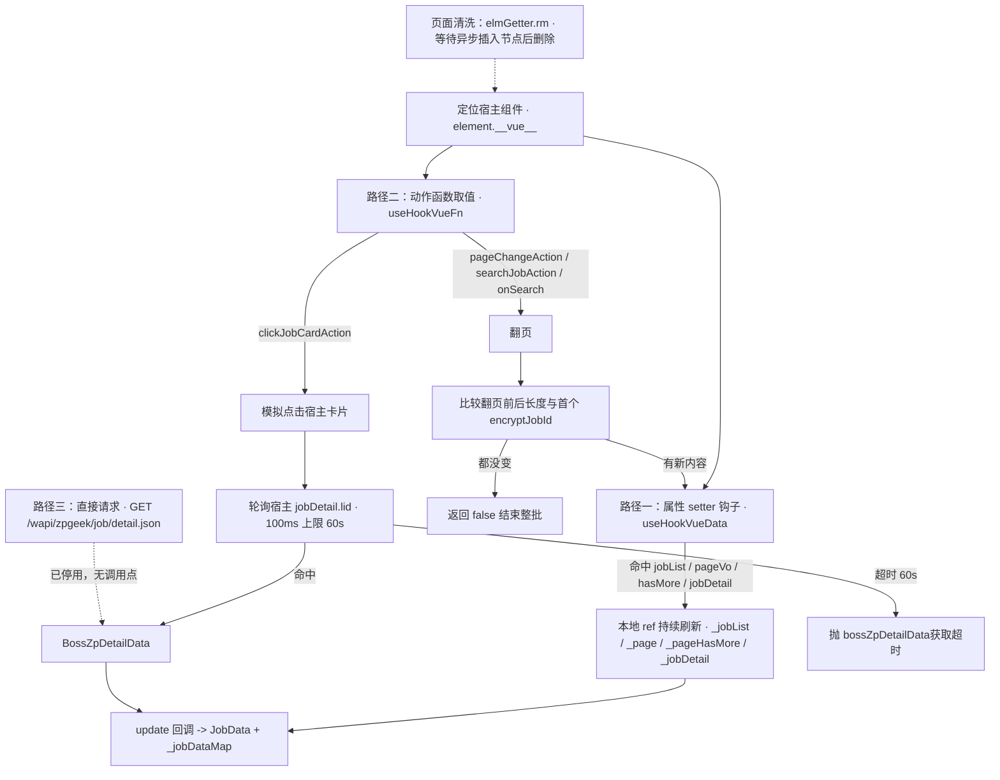
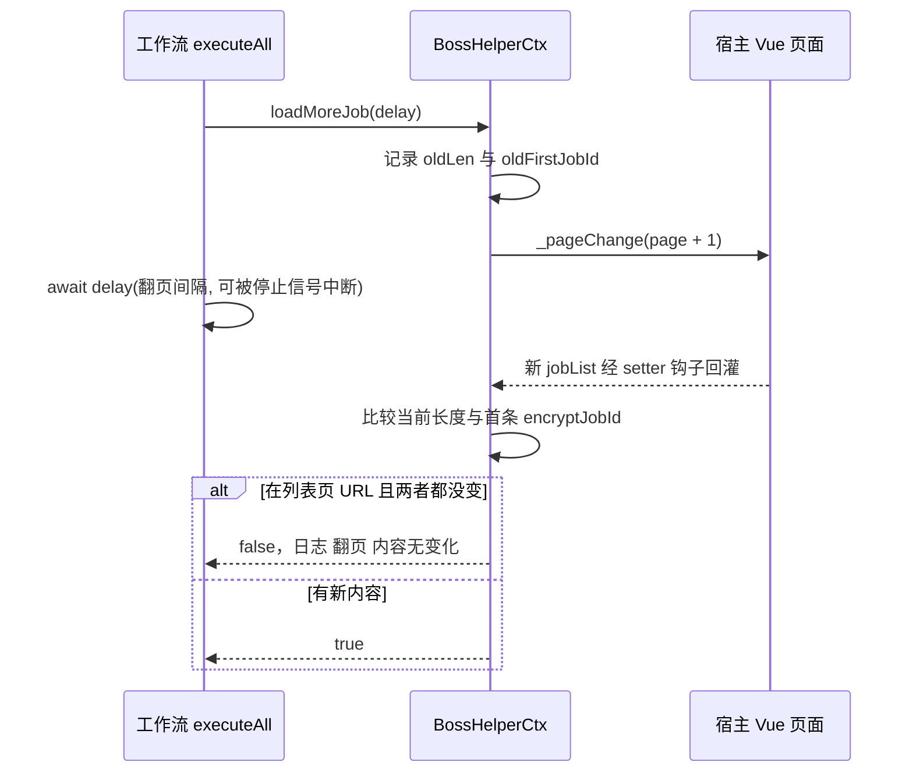

# 岗位数据获取与页面控制

Boss 直聘的搜索/推荐页是一个 Vue 单页应用：岗位列表、分页信息、岗位详情都是宿主组件里的响应式数据，没有可供扩展直接调用的公开接口。插件因此不做网络层的列表抓取，而是**住在宿主页面里读它的数据**——这也正是页面脚本必须运行在 MAIN world 的原因（见 [扩展运行时](../architecture/extension-runtimes.md)）。

本页只讲"数据从哪里来、怎么保持新鲜、拿不到时怎么办"。拿到数据之后如何被工作流消费，见 [投递工作流](delivery-workflow.md)；上下文对象如何暴露这些能力，见 [HelperContext 与站点适配器](../architecture/helper-context.md)。

## 三条获取路径与降级顺序

同一份岗位数据实际上有三条来源，按优先级依次退化：



*图：列表/分页来自属性钩子，详情来自"点击宿主卡片 + 轮询宿主状态"，直接请求详情接口只是保留但未启用的旁路。*

`useHookVueData` 在 20s 内找不到组件时 reject，异常从 `onMount` 向上冒到 `_initXxx` 的 `await` 链——这是第一处降级边界：**钩子失败不是静默的**；而后面的 `loadMoreJob` 失败则是静默的（吞掉异常并返回 `false`）。更细的失败语义见 [断裂面与改动注意](#断裂面与改动注意)。

## 根组件发现：getRootVue

`getRootVue()`（`src/composables/useVue.ts`）只做一件事：拿到宿主 Vue 的根实例，`defineUnlistedScript` 入口要靠它的 `$router.afterHooks` 注册路由钩子，后续每次路由变化都会调 `onMount(path)`。

- 每 300ms 查询一次 `document.querySelector('#wrap')`，命中且 `'__vue__' in wrap` 时把 `wrap.__vue__` 缓存进模块级 `ref`。
- 总超时 20s，超时后 `reject(new Error('未找到vue根组件'))`。
- 结果被模块级变量记住：`rootVue.value !== undefined` 时直接返回，不再轮询。

缓存策略是有意为之——`BossHelperCtx.new()` 每次都调用它，但宿主进程内的根实例不会变。

## 属性拦截：useHookVueData

`useHookVueData(selectors, key, data, update?)` 是整套取数机制的核心，返回一个异步函数，调用即执行三步：

1. **找组件实例**：每 100ms 查 `document.querySelector(selectors)?.__vue__`，找到即 `resolve`；20s 未找到则 `reject(new Error('未找到对应元素'))`。选择器是逗号分隔的多候选串（`'#wrap .page-job-wrapper,.job-recommend-main,.page-jobs-main'`），因此新版页面与旧版页面共用一份初始化代码。
2. **抓初值**：`data.value = jobVue[key]`，并立即调用 `update(toValue(jobVue[key]))`。`toValue` 保证拿到解包后的真实数据而非 `Ref` 容器。
3. **装 setter 钩子**：先用 `jobVue.__lookupSetter__(key)` 保存原 setter，再用 `Object.defineProperty(jobVue, key, { set(val){ data.value = val; update?.(val); originalSet.call(this, val) } })` 覆盖。宿主此后每次给它赋值（翻页追加、搜索换结果、选中新卡片）都会同步回插件侧，并**继续调用原 setter**，所以不会破坏宿主自身的响应性。

这一步的返回值是 `_jobList` 这类 `Ref` 被持续刷新的唯一途径；没有它，插件只能读到挂载那一刻的快照。它同时也是副作用边界：`defineProperty` 之后该属性在宿主组件上变成插件自定义的访问器，若宿主框架要重新定义同名属性，行为不可预期。注意 `Object.defineProperty` 未显式传 `configurable`/`enumerable`，默认为 `false`。

### 四个被钩住的状态

`onMount` 里按 `_initPage` → `_initPageChange` → `_initJobDetail` → `_initClickJobCardAction` → `_initJobList` 的顺序初始化，其中四次 `useHookVueData` 的落点如下：

| 宿主属性 | 落到的本地 ref | 用途 |
| --- | --- | --- |
| `pageVo` | `_page`（初值 `{ page: 1, pageSize: 15 }`） | 记录当前页码，`loadMoreJob` 以 `_page.value.page + 1` 作为翻页目标 |
| `hasMore` | `_pageHasMore`（初值 `true`） | 宿主"还有更多"标志，**仅作观测记录**，停止条件不依赖它 |
| `jobDetail` | `_jobDetail`（`BossZpDetailData`） | 详情抓取轮询的比对源 |
| `jobList` | `_jobList`（`BossZpJobItemData[]`） | 列表数据源，`update` 里完成去重与 `JobData` 映射 |

只有 `jobList` 带 `update` 回调；其余三个只做镜像。

## 列表快照如何变成岗位数据

`_initJobList` 传入的 `update` 回调是列表到 `JobData` 的唯一转换点，每次宿主刷新 `jobList` 都会跑一遍：

1. 用 `Set` 按 `encryptJobId` 去重（宿主翻页时可能保留上一页尾部条目）。
2. 每条映射为 `JobData`：`jobMaps` 里已有同 key 条目就复用其 `jobData`（保住已回填的详情），否则走 `convertBossZpJobItemToJobData`。`key` 固定为 `` `boss::${item.encryptJobId}` ``，是后续所有 Map 查找的联合主键。
3. 同步维护 `_jobDataMap`：已有条目只替换 `jobitem` 字段；新条目则一次性塞入 `{ jobitem, detail: createLazyObject('岗位详情获取'), boss: createLazyObject('Boss信息获取') }`。**详情与 Boss 数据在列表阶段就是不可读的惰性占位**。
4. 对新的 `jobList` 逐个 `restoreJobCache(job.key)`，并用 `workflow.stateMaps` 里已有的 `state`（退回旧 `jobMaps` 的 `state`）重新拼出 `jobMaps` 条目。

`convertBossZpJobItemToJobData` 只填列表接口已给的字段：`companyId` 取 `encryptBrandId`、`hrId` 取 `encryptBossId`（二者是"相同公司/相同 HR"去重缓存的键，见 [持久化与缓存](../concepts/persistence-and-caching.md)）、`experienceName`/`degreeName` 取 `jobExperience`/`jobDegree` 并带兜底默认值；`address` 此时只是 `cityName-areaDistrict-businessDistrict` 拼接；`jobDescription` 明确留空，等详情抓取补。

## 惰性 rawData：把提前读取变成依赖请求

`createLazyObject(taskId)`（`src/composables/useApplying/type.ts`）返回一个只持有"是否已初始化"状态的 `Proxy`：

- 未初始化时，任何命名属性读取都 `throw new DependencyMissingError(taskId)`；`set` 一次即视为初始化，之后 `get` / `ownKeys` / `getOwnPropertyDescriptor` 都转发到内部 `_data`。
- `__isProxy`、`__initialized` 以及任何 `__v_` 前缀键和 symbol 是被豁免的哑查询，直接返回状态值或 `undefined`。这层豁免不是美化，而是必需的：Vue 的响应式探测、`JSON.stringify`、以及 `isInitialized()` 都会读这些键，若它们也抛错，工作流会在到达依赖声明之前就崩掉。
- `isInitialized(val)` 对所有非代理值返回 `true`，只对带 `__isProxy` 的代理读取 `__initialized`。`BossHelperCtx.hasJobDetails(key)` 正是靠它判断"详情是否已抓"，`useJobActions` 据此决定是否显示"拉取信息"菜单项（`src/composables/useJobActions.ts`）。

真正的价值在异常到依赖的转换。工作流在 `runJob` 里对每个处理函数 `try/catch`（`src/composables/useApplying/index.ts`）：

```ts
if (!(e instanceof DependencyMissingError)) throw e
const dep = pipeline.value.find((task) => task.id === e.taskId)
if (!dep || !canRun(dep)) throw e
await runTask(dep)
// 依赖跑完后，同一个 handler 再执行一次
res = meginResults(await runGuarded(fn(ctx, data), taskTimeout, t.id))
```

因此"筛选任务里不小心读了 `rawData.detail`"不会变成一条无意义的报错，而是**自动把 `岗位详情获取` 任务拉到前面执行，然后重跑该 handler**。设计含义是：任务不必（也不能）显式声明"我要用详情"就能安全读取，只要 `detail` 是用 `createLazyObject('岗位详情获取')` 造的；反过来，`createLazyObject` 的 `taskId` 必须与 `delivery.ts` 里 `defineTaskHandler` 的任务 id **逐字一致**，否则 `pipeline.find` 找不到依赖，异常原样抛出，工作流以 `执行失败` 收尾。这是一个纯字符串耦合点。

三条约束值得记住：

- 一次 `runJob` 中嵌套触发依赖只会重跑一层；`canRun(dep)` 在模式不允许该依赖时（例如 `filter` 模式下依赖属于 `delivery` 阶段）会重新抛出，这是刻意的护栏。
- 代理的 `set` 语义是"整体赋值一个对象"。`onJobCardClick` 末尾的 `job.rawData.detail = detail` 因 `_data` 已存在而只写属性并刷新 `_initialized`；`_jobDataMap` 复用旧条目时不会把已抓到的详情丢掉。
- 工作流里显式依赖（`deps: ['岗位详情获取']`）与隐式依赖（读代理抛错触发）是两条并行机制，`delivery.ts` 中多数过滤任务用的是前者，后者只是安全网。

## 翻页：模拟页码变更 + 内容无变化检测

`_initPageChange` 沿 URL 分流拿到翻页函数：

```ts
let pc = location.href.includes('/web/geek/job-recommend') || location.href.includes('/web/geek/jobs')
  ? await initSearch()      // searchJobAction / onSearch
  : await initChange()      // pageChangeAction
if (!pc) throw new Error('pageChange is undefined')
```

`initChange` / `initSearch` 都是 `useHookVueFn`：同样轮询组件上的 `__vue__`（100ms / 20s），但只**取值不装钩子**；传数组时返回第一个真值属性，从而兼容新旧页面里翻页函数改名（`initSearch` 的候选是 `['searchJobAction', 'onSearch']`）。`initChange` 用的是较窄的选择器 `'#wrap .page-job-wrapper'`，而 `initSearch` 用的是三候选串——这意味着旧页面若落在后两个挂载点上，`pageChangeAction` 会取不到。

`loadMoreJob(delay)` 是 `HelperContext` 的抽象成员（`src/composables/useHelper/ctx.ts`），在 `executeAll` 的翻页循环里被消费。它的逻辑不是"判断 `hasMore` 再翻页"，而是**翻页后自我校验**：



*图：没有可用的"还有更多"信号时，用翻页前后快照差异判定是否到底。*

要点：

- **停止条件 = 列表长度与首元素 `encryptJobId` 都未变化**，而非 `hasMore === false`。这既覆盖"真的没有下一页"，也覆盖宿主吞掉非法页码、或接口失败但仍渲染旧数据的情况。
- 这个判定**只在列表页 URL**（`/web/geek/job-recommend` 或 `/web/geek/jobs`）下生效。其它 URL 走过翻页调用后一律返回 `true`，翻页循环在那里不会因"内容不变"而终止——`executeAll` 另有一道"连续 ≥ 50 个重复岗位且无新岗位"的兜底，见 [投递工作流](delivery-workflow.md)。
- 任何异常都被吞掉并 `logger.error('翻页: 下一页错误')`，返回 `false` 让工作流正常收尾而不是崩溃。`delay` 承诺在停止信号时 reject，因此 `_pageChange` 之后的 await 也是"停止"能打断翻页挂起的时机。
- 宿主是否真的响应 `_pageChange` 完全取决于它对页码变化的处理；插件没有任何确认机制，唯一证据就是前后快照差异。

## 详情抓取：模拟卡片点击 + 轮询 lid

`onJobCardClick(key)`（覆盖 `HelperContext` 的基类空实现，基类版本直接 `throw new Error('Method not implemented.')`）是详情数据的唯一入口，被两处共用：工作流的 `岗位详情获取` 任务（`ctx.helper.onJobCardClick(job.jobData.key)`）与手动"拉取信息"经 `helper.fetchJobDetails(key)`。

1. `jobMaps.get(key)` 拿不到就抛 `未找到job数据`。
2. `isInitialized(job.rawData.detail)` 为真则直接返回——详情只抓一次。
3. 调用 `_clickJobCardAction(job.rawData.jobitem)`，即宿主自己的 `clickJobCardAction`。插件不发详情请求，而是让宿主"以为用户点了卡片"，由宿主自己发请求并写入它的 `jobDetail`。
4. 以 100ms 轮询 `this._jobDetail`，**直到 `_jobDetail.value.lid === job.rawData.jobitem.lid`**（用列表项自带的 `lid` 做关联），超时 60s 抛 `bossZpDetailData获取超时`。除超时外没有其它失败分支——宿主若不响应点击，这里只能等到超时。
5. 成功后写回 `job.rawData.detail`（代理首次 `set`，即"已初始化"），并把详情**就地回填**到同一个 `jobData` 对象（UI 无需重建即可看到新字段）：

| `JobData` 字段 | 来源 (`BossZpDetailData`) |
| --- | --- |
| `jobDescription` | `jobInfo.postDescription` |
| `city` | `jobInfo.locationName` |
| `address` | `jobInfo.address`（无条件覆盖列表阶段拼出的省市-区-商圈） |
| `addressCoords` | `[jobInfo.longitude, jobInfo.latitude]` |
| `activeTime` | `brandComInfo.activeTime ??` 原值 |
| `activeTimeStr` | `bossInfo.activeTimeDesc ??` 原值 |
| `boss.isOnline` / `boss.isCertificated` | `bossInfo.bossOnline` / `bossInfo.certificated`（其余 `boss` 字段用展开保留） |
| `brand.labels` / `brand.introduce` / `brand.stageName` | `brandComInfo` 同名字段 |

最后 `jobMaps.set(key, job)`。回填顺序上的细节：`activeTime`/`activeTimeStr` 用 `??` 保留列表值作为兜底，而 `address` 是无条件覆盖——列表地址只是行政区拼接，详情里的才是完整门牌。

并发控制分布在两层：

- `fetchJobDetails`（基类）用 `detailRequests` Map 让同一个 key 的并发调用复用同一个 Promise，且在工作流运行或 `jobActionBusy` 为真时**直接拒绝**（`工作流或岗位操作正在运行，请稍后再试`）。
- 但工作流自身的 `岗位详情获取` 任务走的是 `onJobCardClick` 而非 `fetchJobDetails`，因此工作流内部并发点卡只靠 `isInitialized` 的早退与任务依赖串行化来约束。

`boss` 这一路是独立的：`rawData.boss` 由工作流的 `Boss信息获取` 任务经 `getBossData` 请求填充（`phase: 'delivery'`、`deps: ['岗位投递']`），与详情抓取无关。`requests.ts` 中的 `getJobDetail`（`GET /wapi/zpgeek/job/detail.json`，读 `bst` cookie）保留但**无任何调用点**，对应调用在 `onJobCardClick` 里被注释掉，见 [Boss 平台接口](../integrations/boss-platform-apis.md)。

## DOM 等待：elmGetter 为何必要

宿主页面是 SPA，节点在异步渲染与路由切换中才会插入，且 `onMount` 往往早于目标节点出现。`src/utils/elmGetter.ts`（基于 ElementGetter 2.0.0）因此提供了一套"先同步查、未命中就挂 `MutationObserver` 等后续插入"的工具：

- `get(selector, parent?, timeout)`：先 `querySelector` 一次，未命中则注册一个共享的 `MutationObserver` filter（`childList` + `subtree` + `attributes`），对每次 `addedNodes`/属性变化回调重新匹配；`timeout > 0` 才设超时并在超时后 `resolve(null)`；**默认 timeout 为 `0`，即永不超时、一直等待**。
- `each(selector, cb)`：对当前匹配节点与后续插入节点都回调，用 `WeakSet` 去重，回调返回 `false` 即注销 filter。
- `rm(selector, ...)`：对每个选择器 `get(...).then(e => e.remove())`。

因此有三处依赖它：`onMount` 开头用 `elmGetter.get('boss-helper-job', 3000)` 探测面板是否已存在；用 `elmGetter.get('.job-search-wrapper,.job-recommend-main,.page-jobs .page-jobs-main')`（无超时）等挂载点出现后再 `insertBefore` 插入 `<boss-helper-job>`；`removeAd()` 的各次 `rm` 也要能删掉渲染后才插入的浮层。

需要区分它和 `useHookVueData` 的等待：后者是自带的 100ms `setInterval` 轮询，**不经过 elmGetter**。两套等待机制并存，超时语义也不同（20s 硬超时 vs 默认无限等待）。

## 页面清洗：removeAd

`removeAd()` 在每次 `onMount` 插入面板后调用，`void` 掉一批 `elmGetter.rm`（订阅浮层 `.job-list-wrapper .subscribe-weixin-wrapper`、侧栏 `.job-side-wrapper`、悬浮条 `.side-bar-box`、登录按钮 `.go-login-btn`，以及新版页面的 `.c-subscribe-weixin` / `.c-job-tools.job-tools` / `.c-hot-link.hot-link` / `.c-breadcrumb` / `.job-detail-container .job-detail-guide-cont`）。

它依赖 `elmGetter` 的两个特性：`rm` 内部走 `get`，先同步查一次、未命中则挂 `MutationObserver` 等后续插入的节点，所以在 SPA 渲染完成前调用也能生效；但 **`get` 默认超时 0 且 `rm` 不 await 失败**，因此删不掉时完全静默（包括 `null.remove()` 会抛的 TypeError，落在无人 `catch` 的 promise 里）。这段代码同时假定了两类前提：选择器属于 zhipin.com 当前的 DOM 结构（改版即失效，且失效无声），以及"删掉侧栏不影响宿主布局逻辑"（它只删 DOM，不通知 Vue）。

## 断裂面与改动注意

这一层的鲁棒性完全建立在宿主实现的细节上，任何一条都可能随站点更新失效，且多数失效方式是**静默的**：

- **`__vue__`**：`getRootVue` 与所有钩子都读 `element.__vue__`，这是 Vue 2 的 DOM 挂载约定；宿主升级 Vue 3（改用 `__vueParentComponent`）会让全部钩子在 20s 后超时。
- **挂载点选择器**：`#wrap .page-job-wrapper` / `.job-recommend-main` / `.page-jobs-main` / `.page-jobs .page-jobs-main` / `.job-search-wrapper` 散落在 `useHookVueData`/`useHookVueFn` 调用、`onMount`、`initChange`、`initSearch` 中，改版时需逐处同步。
- **宿主属性名与签名**：`jobList`、`pageVo`、`hasMore`、`jobDetail`、`pageChangeAction`、`searchJobAction`、`onSearch`、`clickJobCardAction`。`useHookVueFn` 的数组形式只覆盖了翻页函数的同类改名，其余全是硬编码字符串。
- **`lid` 关联**：详情等待靠列表项的 `lid` 与详情的 `lid` 相等。若宿主更换关联字段（例如改用 `encryptId`），轮询永不命中，只会以 60s 超时报错。
- **任务 id 字符串**：`createLazyObject('岗位详情获取')` / `createLazyObject('Boss信息获取')` 必须与 `delivery.ts` 中 `defineTaskHandler` 的 id 一致。
- **URL 判定**：`location.href.includes('/web/geek/job-recommend' | '/web/geek/jobs')` 同时决定翻页函数来源与"内容无变化"检测是否启用，路由改版会让二者一起漂移。
- **数据形状假设**：`pageVo` 被当作 `{ page, pageSize }`、`jobList` 被当作 `BossZpJobItemData[]`，`_jobDetail` 被当作 `BossZpDetailData`，字段名全部取自 `types.ts` 中记录的当前接口形态。

排障时按这三步顺序确认：根组件是否找到（`未找到vue根组件`）→ 四个状态钩子是否装上（`未找到对应元素`）→ 详情是否超时（`bossZpDetailData获取超时`）。三者分别指向 `__vue__`、选择器、点卡动作三类不同的断裂面。若进程卡住而非报错，先怀疑 `elmGetter.get` 的无限等待。

## 相关页面

- [扩展运行时](../architecture/extension-runtimes.md)：MAIN world 注入、`#wrap` 与路由钩子、`onMount` 的幂等重建、样式注入。
- [HelperContext 与站点适配器](../architecture/helper-context.md)：这些钩子结果如何暴露为抽象成员（`jobList` / `jobMaps` / `loadMoreJob` / `hasJobDetails` / `onJobCardClick`）。
- [投递工作流](delivery-workflow.md)：`岗位详情获取` 任务、`loadMoreJob` 在 `executeAll` 中的调用位置与重复岗位兜底。
- [任务处理器与过滤器](../concepts/task-handlers-and-filters.md)：`DependencyMissingError` 之外的任务结果语义。
- [Boss 平台接口](../integrations/boss-platform-apis.md)：`getJobDetail` / `getBossData` / `sendPublishReq` 的请求形态。
- [持久化与缓存](../concepts/persistence-and-caching.md)：`companyId` / `hrId` 作为相同公司与相同 HR 缓存的键。
